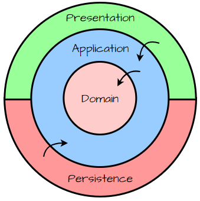

> AI 규칙(한국어 답변·빌드 미실행·체크리스트 질문), GIT 규칙(`NO_COMMIT_OR_ROLLBACK`·추천 커밋 메시지), 플랜 작성 규칙, 일반 네이밍 규칙 등 리포 전체 공통 규칙은 **리포지토리 루트의 `CLAUDE.md`** 를 참조합니다. 이 파일은 backend 고유 컨벤션만 다룹니다.

규칙을 바꿀 때는 본문을 현재 규칙으로 덮어쓰고, 결정 경위는 `docs/adr/`에 남긴다(루트 `CLAUDE.md`의 "규칙 문서 개정 규칙" 절).


## 모듈 지도 (모듈 재편 완료 + application 모듈 통합 + external 분리 + 앱 모듈 재분리)

**모듈은 39개이고(`settings.gradle` include 38줄 + 암묵 `infrastructure` 컨테이너), 경계는 "계층 × 앱" 2차원이다.** 어느 파일을 어디에 둘지 헷갈리면 여기서 시작한다(배치 기준의 근거는 아래 [모듈 경계 규칙](#모듈-경계-규칙-계층--앱-2차원--기술별-infrastructure)).

> **`infrastructure:jpa`와 `infrastructure:persistence`는 다르다.** JPA·QueryDSL 코드 전부(엔티티·쓰기 어댑터·조회 DAO·`LayerRulesTest` 등 가드 테스트)는 **`infrastructure:jpa`**(디렉터리 `infrastructure/jpa/`, 자바 패키지 `com.tastyhouse.infrastructure.jpa..`, 진입 설정 `JpaModuleConfig`)에 있다. `infrastructure:persistence`는 **자바 코드 없는 조립 모듈**로, `runtimeOnly project(':infrastructure:jpa')` + `runtimeOnly project(':infrastructure:mysql')`을 묶고 `application-persistence.yml`(`application-mysql.yml`·`application-jpa.yml` import만)을 갖는다. 4앱은 `runtimeOnly ':infrastructure:persistence'` 한 줄로 둘을 받는다. 상세는 `infrastructure/jpa/AGENTS.md`·`infrastructure/persistence/AGENTS.md` ([ADR-0047](../docs/adr/0047-jpa-module-split.md)).

```
실행 앱 4 (bootJar)      web-api      admin-api      ceo-api      batch-module
   │  컨트롤러/@Scheduled 트리거 + request/ + config·security 정책 + 부트스트랩
   ↓
application 5            application-core  ← 2개 앱 이상이 쓰는 것 + 리스너·@Configuration + 모든 port.out 계약
                         web-application  admin-application  ceo-application  batch-application
                                             ← 앱 하나만 쓰는 것(UseCase·Command·오케스트레이터·앱 전용 도메인 서비스·앱 전용 SPI 포트)
                         자바 패키지는 전부 com.tastyhouse.application 하나다(5모듈이 split package로 나눠 쓴다).
                         앱 소속은 마커 애노테이션이 아니라 "어느 Gradle 모듈에 있는가"가 표현한다
   │  앱 모듈: <ctx>/port/in/(UseCase + Command) + <ctx>/service/(CQRS·앱 전용 도메인 서비스) + 앱 전용 <ctx>/port/out/(SPI)
   │  코어:    <ctx>/port/out/(읽기 계약·write 포트·Command 반환 Result) + <ctx>/service/(공유 도메인 서비스) + <ctx>/listener/ + shared/**
   │  ※ <ctx>/response/ 는 application에 없다 — Response record는 3개 api 모듈이 소유한다
   │  ※ 앱 간 수평 의존은 컴파일러가 막는다 — 앱 모듈끼리는 서로를 의존하지 않고, 코어는 앱 모듈을 모른다
   ↓                                    ※ infrastructure를 컴파일 클래스패스에 두지 않는다
                                        ※ api-common-module 의존도 없다
도메인                   domain               모델·VO·이벤트 타입·포트 없는 순수 계산기/정책 (프레임워크-프리)
                         ※ write 포트·출력 포트·포트 주입 도메인 서비스는 application에 있다
   ※ 읽기 계약({Ctx}QueryPort · *Result · *SearchCondition)은 전부 위 application-core가 소유한다
     (패키지는 com.tastyhouse.application..port.out)
   ↑ 구현
아웃바운드 어댑터 18      infrastructure:jpa          JPA 어댑터(XxxPersistenceAdapter가 XxxLoadPort·XxxSavePort 구현) + QueryPort 구현 DAO
                                                     ※ notice 쓰기·조회는 JPA(@Primary) — web·admin에선 아래 :mybatis 구현도 함께 뜨지만 주입되지 않는다
                                                     ※ domain은 implementation으로만 의존(앱으로 새지 않음) — query DAO는 domain-free
(driven)                 infrastructure:mybatis      MyBatis 어댑터(notice 레거시 구현 — 쓰기+조회, web-api·admin-api 의존). 같은 포트를 JPA와 함께 구현하고 @Primary(JPA) 쪽만 주입
                         infrastructure:mysql        MySQL 드라이버·HikariCP·datasource 설정(application-mysql.yml) — 자바 코드 없음, persistence가 조립
                         infrastructure:redis        Redis 연결·템플릿 + rate limiting
                         infrastructure:restclient   외부 연동 HTTP 코어 — RestClient customizer만 (예외·에러코드 없음, 파일 저장 무관)
                                                     ※ 포트를 구현하지 않지만 벤더가 쓰는 기술 코어라 이 칸에 둔다
                           ├ :firebase   Firebase Storage 파일 저장      (앱이 아니라 :file-storage가 의존)
                           ├ :aws-s3     S3(파일 저장)                    (의존하는 앱 없음 — 컴파일만 검증)
                           ├ :aws-ses    SES(메일)                        (의존하는 앱 없음 — 컴파일만 검증)
                           ├ :aws-sns    SNS(SMS)                         (의존하는 앱 없음 — 컴파일만 검증)
                           ├ :kakao-oauth    카카오 로그인 벤더 구현    (앱이 아니라 :oauth가 의존)
                           ├ :naver-oauth    네이버 로그인 벤더 구현    (앱이 아니라 :oauth가 의존)
                           ├ :apple-oauth    애플 로그인 벤더 구현      (앱이 아니라 :oauth가 의존)
                           ├ :facebook-oauth 페이스북 로그인 벤더 구현  (앱이 아니라 :oauth가 의존)
                           ├ :tosspayments Toss 결제 벤더 구현            (앱이 아니라 :pg가 의존)
                           ├ :javamail   JavaMail(SMTP) 메일 발송        (앱이 아니라 :mail이 의존)
                           ├ :solapi     Solapi SMS 발송                 (앱이 아니라 :sms가 의존)
                           ├ :bbq        BBQ 메뉴 수집·원격 이미지        (batch)
                           └ :admdongkor 행정동 경계 GeoJSON 수집          (batch)
조립 6                   도메인 포트를 구현하지 않는 컴포지션 루트 조각. 앱이 DB·외부 연동을 쓸 때 직접 의존하는 좌표
(전부 코드 없는 스타터)    ├ :persistence  DB — jpa·mysql 조립                            (4개 앱 전부)
                           ├ :file-storage 파일 저장 — firebase 조립                      (4개 앱 전부)
                           ├ :oauth        소셜 로그인 — 벤더 4종 조립                    (web)
                           ├ :pg           결제 PG — tosspayments 조립                    (web·batch)
                           ├ :mail         메일 — javamail 조립                           (web)
                           └ :sms          SMS — solapi 조립                              (web)
공유                     security-core  security-module  api-common-module  logging-module
```

- **`infrastructure:jpa`는 `domain`을 `implementation`으로 의존한다 — 쓰기 어댑터는 도메인 모델을 직접 다루고, 조회 DAO는 domain-free다.** `infrastructure/jpa/build.gradle`의 프로젝트 의존은 `implementation project(':domain')` + `implementation project(':application-core')`이다. `api`가 아니라 `implementation`이므로 domain이 jpa를 거쳐 앱 컴파일 클래스패스로 새어 나가지 않는다(presentation이 domain을 모르게 하는 절단 유지). 쓰기 경로는 `application/<ctx>/port/out/write/XxxLoadPort`·`XxxSavePort`(도메인 타입 시그니처)를 jpa `XxxPersistenceAdapter`가 직접 구현하고, JpaEntity ↔ Domain 변환은 jpa `XxxMapper`가 맡는다. 도메인 ↔ 엔티티 사이에 State record·StatePort·Store 같은 중간 계층을 두지 않는다 — 애그리거트 하나를 저장하려고 파일 5개(State·StatePort·Store·StateMapper·StatePortImpl)를 거치는 비용이 얻는 격리보다 크기 때문이다([ADR-0031](../docs/adr/0031-persistence-domain-reallowed.md)). 조회 DAO(`..query..`)와 봉인 조회 어댑터 3개의 domain 의존은 `backend/infrastructure/jpa/src/test/java/com/tastyhouse/infrastructure/jpa/architecture/LayerRulesTest.java`의 `queryShouldNotDependOnDomain`이 막는다. 규칙 전문은 아래 [도메인 모델 / JPA 엔티티 분리 규칙](#도메인-모델--jpa-엔티티-분리-규칙-선별-적용-persistence는-infrastructure-module로)의 "persistence domain 재허용" 항목.
- **조립 6모듈은 `infrastructure/` 디렉터리에 있지만 아웃바운드 어댑터가 아니다.** 도메인 포트를 하나도 구현하지 않고, "이 앱에 어떤 벤더를 싣는가"만 결정한다. 여섯 모두 자바 코드가 없고 구현 모듈을 `runtimeOnly`로 묶어 앱에 노출하는 것만 한다. 일부 앱에만 필요한 서비스(`MailVerificationService`·`SmsVerificationService`)는 조립 모듈이 아니라 `web-application`이 `@Service`로 등록하고, web·batch가 함께 쓰는 PG 라우터(`PgPaymentGatewayRouter`)는 코어 `application-core`가 `@Service`로 등록한다. 물리적으로 `backend/starter/`로 옮기지 않은 것은 컴파일·런타임에서 새로 막아 주는 것이 없기 때문이다.
- **조립 모듈의 벤더 전환은 세 곳을 함께 바꾼다**: 스타터 `build.gradle`의 `runtimeOnly` 대상, 그 모듈 yml의 `spring.config.import`, `provider` 값. 각 모듈은 벤더를 하나만 싣기 때문에 `provider` 값만 바꾸면 켤 수 있는 벤더가 없어 기동이 실패한다. 절차는 `infrastructure/{file-storage,mail,sms}/AGENTS.md`의 "벤더 전환 절차"에 있다.
- **실행 단위는 4개다.** 라이브러리 모듈이 늘거나 줄어도 **bootJar 산출물 이름·경로는 불변**이다(`{web-api,admin-api,ceo-api,batch-module}/build/libs/{모듈}-0.0.1-SNAPSHOT.jar`). 배포 스크립트는 영향받지 않는다.
- **infrastructure 모듈의 자바 패키지는 모듈명을 따른다**: 코드가 있는 17모듈 모두 루트가 `com.tastyhouse.infrastructure.{모듈명의 하이픈을 점으로}`다(`jpa`→`.jpa`, `kakao-oauth`→`.kakao.oauth`). 규칙 전문은 아래 [infrastructure 패키지 규칙](#infrastructure-패키지-규칙-루트--모듈명). **application 5모듈은 자바 패키지가 `com.tastyhouse.application` 단일 루트다** — 5모듈이 이 한 패키지를 split package로 나눠 쓰므로 패키지만 봐서는 앱 소속을 알 수 없고, 소속은 Gradle 모듈이 표현한다(아래 [앱 모듈 경계 규칙](#앱-모듈-경계-규칙-앱-마커-제거--앱-소속은-gradle-모듈이-표현한다)). **`security-core`와 `security-module`도 둘 다 `com.tastyhouse.security..`를 쓴다**(split package).
- **application 5모듈 — 어느 모듈에 둘지는 "몇 개 앱이 쓰는가"로 정한다**: 앱 하나만 쓰는 UseCase·Command·서비스·SPI 포트는 `{web,admin,ceo,batch}-application`, 2개 앱 이상이 쓰는 도메인 서비스와 리스너·`@Configuration`·`port.out` 계약은 코어 `application-core`에 둔다. 앱 모듈은 `api project(':application-core')`로 코어를 노출하고, 실행 앱은 `implementation project(':application-core')` + `implementation project(':{앱}-application')` 두 줄을 갖는다. 상세는 아래 [앱 모듈 경계 규칙](#앱-모듈-경계-규칙-앱-마커-제거--앱-소속은-gradle-모듈이-표현한다).
- **어느 모듈의 AGENTS.md를 읽어야 하나**: 컨트롤러·인증 필터를 고치면 `{앱}-api/AGENTS.md`, 유스케이스·서비스를 고치면 `application-core/AGENTS.md`(5모듈 공통 규칙 정본)와 `{앱}-application/AGENTS.md`(앱 모듈 요약), 쿼리·엔티티는 `infrastructure/jpa/AGENTS.md`(DB 접속·드라이버·커넥션 풀은 `infrastructure/mysql/AGENTS.md`, jpa·mysql 조립은 `infrastructure/persistence/AGENTS.md`, notice 쓰기·조회의 JPA·MyBatis 공존과 `@Primary` 전환은 `infrastructure/mybatis/AGENTS.md`), 불변식은 `domain/AGENTS.md`, JWT 토큰 발급/검증·토큰 저장소 **포트**는 `security-core/AGENTS.md`(Redis 구현은 `infrastructure/redis/AGENTS.md`), 서블릿 인증 필터·EntryPoint는 `security-module/AGENTS.md`.
- **`security-core`와 `security-module`을 나누는 이유 (application의 서블릿 스택 오염 절단)**: 서블릿 결합 타입(JWT 인증 필터 `OncePerRequestFilter` 상속·`JwtAuthenticationEntryPoint`·`JwtAccessDeniedHandler`, `starter-web` 의존)과 서블릿-프리 타입이 한 모듈에 있으면, application 계층이 그 모듈을 의존하는 순간 컴파일 클래스패스가 서블릿 스택으로 오염된다(ArchUnit `applicationMustBeServletFree`는 소스 import만 검사해 클래스패스 오염을 막지 못한다). 그래서 서블릿-프리 타입(`JwtTokenProvider`·`JwtPrincipal`·`JwtPrincipalFactory`·`JwtProperties`·`TokenType`, 토큰 저장소 포트 3종 — `RefreshTokenRepository`·`BlacklistRepository`·`SocialTempTokenRepository`(소셜 4종은 enum `SocialTempTokenProvider` 키 접두사로 구분))은 `security-core`에, 서블릿 결합 타입(`SecurityModuleConfig`·`JwtAuthenticationFilter`·`JwtAuthenticationEntryPoint`·`JwtAccessDeniedHandler`)은 `security-module`에 두고, `security-module`은 `api project(':security-core')`로 재노출한다. `{web,admin,ceo}-application`은 `security-core`만 의존하고(`batch-application`도 `implementation project(':security-core')`를 선언하지만 실제 사용처는 0건이다), `{admin,ceo}-application`은 `spring-boot-starter-security` 대신 `spring-security-core`만 쓴다. `{web,admin,ceo}-api`는 `security-module`을 의존하며 `security-core`를 전이로 받는다. 토큰 저장소는 계약만 `security-core`에 있고 구현은 `infrastructure:redis`의 `token` 패키지에 있으며, 앱 `ModuleScanConfig`의 `com.tastyhouse.infrastructure` 스캔이 등록한다([ADR-0019](../docs/adr/0019-token-store-port-inversion.md)). 상세는 [모듈 경계 규칙](#모듈-경계-규칙-계층--앱-2차원--기술별-infrastructure) 아래 의존 그래프와 `security-core/AGENTS.md`·`security-module/AGENTS.md` 참고.

## 모듈 등록 컨벤션 (auto-configuration — 챕터 02)

**어떤 라이브러리 모듈도 스스로를 등록하지 않는다.** `META-INF/spring/org.springframework.boot.autoconfigure.AutoConfiguration.imports`는 0개이고, 각 앱 부트스트랩의 static 중첩 `ModuleScanConfig`가 라이브러리 모듈 패키지를 **문자열로** 스캔한다. 제목의 "auto-configuration"은 다른 문서가 이 앵커를 링크하므로 남겨 둔 이름이다([ADR-0038](../docs/adr/0038-autoconfiguration-imports-removal.md)).

| 항목 | 현재 규칙 |
|---|---|
| 라이브러리 모듈을 활성화하는 주체 | 각 앱 부트스트랩의 static 중첩 `ModuleScanConfig` |
| imports 파일 | **0개** |
| 설정 클래스 | `{Xxx}ModuleConfig` (`@Configuration(proxyBeanMethods = false)`, 스캔 없음) 14개 — 등록할 것이 없는 모듈은 만들지 않는다 |
| 특정 모듈 끄기 | 그 앱 `ModuleScanConfig`의 목록에서 패키지를 뺀다(`spring.autoconfigure.exclude`는 쓰지 않는다) |
| 빈 존재 조건(`@ConditionalOnBean`/`@ConditionalOnMissingBean`) | **사용 금지** — 일반 `@Configuration`에서는 처리 순서에 좌우돼 조용히 틀린다 |
| 환경 조건(`@ConditionalOnWebApplication`/`@ConditionalOnProperty`) | 사용 가능(환경으로 판정하므로 일반 설정에서도 정확하다) |

**앱별 스캔 목록** (`com.tastyhouse.` 생략) — 부트스트랩 안의 `ApplicationLayerScanConfig` 옆에 두 번째 중첩 클래스로 둔다.

```java
@Configuration(proxyBeanMethods = false)
@ComponentScan(basePackages = {
    "com.tastyhouse.infrastructure",
    "com.tastyhouse.security",
    "com.tastyhouse.logging",
    "com.tastyhouse.apicommon.ratelimit",
    "com.tastyhouse.apicommon.exception"
})
static class ModuleScanConfig {
}
```

| 앱 | basePackages |
|---|---|
| web-api | `infrastructure` · `security` · `logging` · `apicommon.ratelimit` |
| admin-api · ceo-api | `infrastructure` · `security` · `logging` · `apicommon.ratelimit` · `apicommon.exception` |
| batch-module | `infrastructure` · `logging` |

- **왜 `@Import(XxxModuleConfig.class)`가 아니라 문자열 스캔인가**: 앱은 infra 모듈을 `runtimeOnly`로 의존해 그 클래스를 컴파일 시점에 볼 수 없다. `@Import`하려면 `implementation`으로 올려야 하고, 그 순간 헥사고날 컴파일 게이트(컨트롤러가 `com.tastyhouse.infrastructure..`를 import하면 컴파일 에러)가 사라진다. 패키지 이름 문자열은 컴파일 클래스패스가 필요 없다.
- **`com.tastyhouse.infrastructure` 한 줄이 jpa·mybatis·redis·벤더 모듈 전부를 덮는다** — 모든 infra 모듈 패키지가 `com.tastyhouse.infrastructure.{모듈}`로 통일돼 있기 때문이다(아래 [infrastructure 패키지 규칙](#infrastructure-패키지-규칙-루트--모듈명)).
- **web은 `apicommon.exception`을 스캔하지 않는다** — web-api는 자체 `GlobalExceptionHandler`를 가지므로, 공용 핸들러(`@RestControllerAdvice`라 스캔으로 바로 등록된다)가 web에 뜨지 않는 것은 조건이 아니라 **스캔 범위**가 보장한다.
- **순서 선언이 필요 없다**: 사용자 설정은 언제나 Boot auto-config보다 먼저 처리되므로 Redis `stringRedisTemplate`은 우리 것이 먼저 등록되고 Boot `RedisAutoConfiguration`의 `@ConditionalOnMissingBean`이 물러난다. 그래서 `RedisModuleConfig`·`JpaModuleConfig`에 `before`/`after` 같은 순서 지정이 없다. `RateLimitAspect`는 `apicommon.ratelimit`을 스캔하는 web·admin·ceo가 전부 Redis 카운터를 가지므로 빈 존재 조건 없이 등록하고, JWT 필터도 앱이 자체 필터 빈을 정의하지 않으므로 조건 없이 등록한다.

### 현재 규칙 — 새 라이브러리 모듈·패키지를 추가할 때 (imports 제거)

1. **빈은 이미 스캔되는 루트 아래에 둔다** — infra 모듈이면 `com.tastyhouse.infrastructure.{모듈}`(위 패키지 규칙), 그 밖에는 기존 스캔 루트(`security`·`logging`·`apicommon.ratelimit`·`apicommon.exception`) 아래. 클래스패스에 올라오기만 하면 앱 `ModuleScanConfig`가 잡는다.
2. **`@EnableConfigurationProperties`가 필요하면 그 모듈 루트에 평범한 `{Xxx}ModuleConfig`를 둔다** — `@Configuration(proxyBeanMethods = false)`, 자기 패키지 `@ComponentScan` 없음(앱이 스캔한다). 등록할 것이 없으면 만들지 않는다.
3. **`AutoConfiguration.imports` 파일을 다시 만들지 않는다.** 가드: 4앱 `ApplicationLayerScanConfigTest`의 `ApplicationLayerScanAssertions#assertNoTastyhouseAutoConfiguration`(Boot `ImportCandidates`에 `com.tastyhouse.` 항목이 하나라도 있으면 실패).
4. **이 설정 클래스들에 `@ConditionalOnBean`/`@ConditionalOnMissingBean`을 쓰지 않는다** — auto-config가 아닌 일반 설정에서는 빈 정의 처리 순서에 결과가 좌우돼 조용히 빈이 빠지거나 남는다. 앱별 차이는 스캔 범위로, 환경별 차이는 `@ConditionalOnWebApplication`/`@ConditionalOnProperty`로 표현한다.
5. **새 최상위 패키지(`com.tastyhouse.{새 이름}`)를 스캔에 추가하려면** 그것을 써야 하는 각 앱의 `ModuleScanConfig` `basePackages`와 그 앱 `ApplicationLayerScanConfigTest`의 기대 목록(`assertScansModulesWithoutFilters`가 정확 일치를 검사한다)을 함께 고친다. 위 [import 순서 순위 표](#자사-그룹-내부-계층-정렬-클린-아키텍처-원-안--밖)도 함께 갱신한다.

**앱은 `@Import`를 하나도 갖지 않는다.** 라이브러리 모듈은 `ModuleScanConfig`가, `application` 계층은 각 앱 부트스트랩의 static 중첩 `ApplicationLayerScanConfig`(`@ComponentScan(basePackages = "com.tastyhouse.application")`, 기본 필터·include 필터 없음)가 스캔한다. `application-core`는 앱 조립 지식을 갖지 않는다 — 무엇이 뜰지는 앱의 클래스패스(코어 + 자기 앱 모듈)가 정한다(아래 [앱 모듈 경계 규칙](#앱-모듈-경계-규칙-앱-마커-제거--앱-소속은-gradle-모듈이-표현한다)).

### 컨벤션 본문

- **클래스 명명 — `{Xxx}ModuleConfig`**: 등록할 것이 있는 라이브러리 모듈만 모듈 루트 패키지에 이 이름의 설정 클래스 1개를 둔다(`@Configuration(proxyBeanMethods = false)`). 자기 패키지 `@ComponentScan`을 갖지 않는다 — 스캔은 앱 `ModuleScanConfig`가 한다.
- **스캔 범위는 모듈 루트 패키지 단위다** — 다른 모듈의 패키지를 덮는 스캔과 그것을 되돌리는 `excludeFilters`를 두지 않는다(아래 [infrastructure 패키지 규칙](#infrastructure-패키지-규칙-루트--모듈명)).
  - **앱별로 켜고 끄는 빈만 조건부 `@Bean`으로 등록한다**: 스캔이 아니라 `@Bean` 메서드로 개별 등록해야 하는 대상은 "이 빈이 등록되는지 여부가 앱마다 갈린다"는 신호다. 지금 그런 대상은 `api-common-module`의 `ApiCommonRateLimitConfig#rateLimitAspect` 1개뿐이다(`@ConditionalOnWebApplication(SERVLET)` — 서블릿 웹 앱에서만 뜬다). 그 밖의 빈은 스캔으로 충분하다.
- **`@ConfigurationProperties`는 `@EnableConfigurationProperties`로 명시 등록한다**: `{Xxx}ModuleConfig`에 `@EnableConfigurationProperties(XxxProperties.class)`를 붙인다.
- **모듈 yml은 앱 `spring.config.import`로 로딩한다**: 자동 로딩은 `EnvironmentPostProcessor`가 있어야 가능한데 두지 않았고, `@PropertySource`로는 `logging.*`이나 `optional:configtree:` 같은 특수 프로퍼티 소스가 동작하지 않는다. 그래서 모듈을 앱에 붙이는 비용은 "gradle 1줄 + (설정이 있으면) yml import 1줄"이다.
- **별도 온오프 프로퍼티 스위치를 만들지 않는다**: 모듈을 끄려면 앱 `ModuleScanConfig` 목록이나 의존을 고친다(§"클래스패스 존재 = 활성화" 참고 — 프로퍼티 스위치를 새로 만들면 보안 회귀를 반복하기 쉽다).
- **`{Xxx}ModuleConfig`가 없는 모듈**: `application-core`·`{web,admin,ceo,batch}-application`(스캔은 앱 부트스트랩의 `ApplicationLayerScanConfig`가 한다) · `security-core`(타입 대부분이 빈이 아니다 — `JwtTokenProvider`는 앱별 하위 클래스가 `@Component`로 등록하고, 토큰 저장소 포트 3종은 인터페이스라 구현 어댑터가 `infrastructure:redis`에 있으며, `JwtProperties`만 `security-module`의 `@EnableConfigurationProperties`가 등록한다) · `domain`(프레임워크-프리라 Spring 자체를 모른다) · 조립 스타터 6개(`persistence`·`file-storage`·`oauth`·`pg`·`mail`·`sms` — 자바 코드가 없다) · `infrastructure:mysql`(yml만 있다) · `logging-module`·`infrastructure:restclient`·`aws-ses`·`aws-sns`·`javamail`(스캔만으로 충분하다) · `api-common-module`의 예외 핸들러(`GlobalExceptionHandler`가 스캔으로 직접 뜬다).

### "클래스패스 존재 = 활성화" 원칙

앱 `ModuleScanConfig`가 `com.tastyhouse.infrastructure`를 통째로 스캔하므로 **클래스패스에 올라온 infra 모듈은 전부 활성화**된다(batch에서 redis·OAuth 벤더가 안 잡히는 것은 클래스패스에 없어서다). **의존 선언(`implementation`/`runtimeOnly`) 자체가 활성화 신호**이고, 그 라이브러리를 앱이 실제로 쓰든 안 쓰든 클래스패스에 있으면 등록되며 `@Conditional*`(환경 조건)로만 발화 여부가 갈린다.

- **함의 — oauth 모듈 사례**: `infrastructure:oauth`를 실수로 `admin-api`의 `build.gradle`에 추가하면 벤더 4종이 admin에서도 스캔되고, 벤더 4종이 `@ConfigurationProperties`로 받는 web 전용 설정값이 비어 있어 기동이 실패한다 — 해석하지 못한 placeholder가 문자열 그대로 바인딩되는 것을 각 벤더 record의 compact constructor가 검사해 `IllegalStateException`으로 기동을 멈춘다(`infrastructure/oauth/AGENTS.md`). "의존을 추가했지만 아직 안 쓴다"는 상태는 안전하지 않다.
- **각 모듈은 전이로 끌려온 앱에서 등록돼도 안전한지 스스로 답해야 한다.** batch로의 재유입 방어선은 두 겹이다 — 먼저 **batch `ModuleScanConfig`가 `apicommon`·`security`를 스캔하지 않고**, 그다음 `ApiCommonRateLimitConfig`의 `@ConditionalOnWebApplication(SERVLET)`이 non-servlet 환경에서 발화를 거른다. 지금 batch 클래스패스에는 잠재울 대상이 없지만 조건을 지우지 않는 이유가 여기 있다.
- **새 라이브러리 모듈을 만들 때 스스로에게 물을 질문**: "이 모듈이 어느 앱에도 의도치 않게 전이로 끌려갈 수 있는가? 끌려간다면 그 앱에서 안전하게 비활성화되는 조건이 있는가?" 답이 "없다"면 조건을 추가하거나, 그 모듈이 전이 경로에 놓이지 않도록 의존 그래프를 재검토한다.

### 모듈별 설정 클래스 인벤토리

**모두 `@Configuration(proxyBeanMethods = false)`, 자기 패키지 `@ComponentScan` 없음 — 스캔은 앱 `ModuleScanConfig`.**

| 모듈 | 설정 클래스 | 하는 일 | 조건 |
|---|---|---|---|
| `infrastructure:jpa` | `JpaModuleConfig` | 빈 발견은 앱의 `com.tastyhouse.infrastructure` 스캔. `JpaModuleConfig`는 `@EnableJpaRepositories`/`@EntityScan`(`basePackageClasses` 자기 자신)·`@EnableJpaAuditing`·`@EnableTransactionManagement`만 갖는다 | — |
| `infrastructure:mybatis` | `MyBatisModuleConfig` | `@MapperScan(basePackageClasses = MyBatisModuleConfig.class, annotationClass = Mapper.class)` — MyBatis 기본 매퍼 스캔은 앱 패키지만 보므로 필수 | 없음(어댑터는 조건 없이 스캔되고, 같은 포트의 주입 대상은 JPA 어댑터의 `@Primary`가 고른다 — [영속 포트 기술 중립 규칙](#영속-포트-기술-중립-규칙-포트는-jpamybatis-어느-쪽으로도-구현될-수-있어야-한다)) |
| `infrastructure:redis` | `RedisModuleConfig` | `@EnableConfigurationProperties(RedisTokenStoreProperties)` | 없음(순서 지정 없음 — 사용자 설정이 언제나 먼저 처리된다) |
| `security-module` | `SecurityModuleConfig` | `@EnableConfigurationProperties(JwtProperties)` + `@Bean JwtAuthenticationFilter`(POJO라 스캔 대상이 아니다) | `@ConditionalOnWebApplication(SERVLET)` |
| `logging-module` | 없음 | — | — |
| `api-common-module`(예외) | 없음 | `GlobalExceptionHandler`(`@RestControllerAdvice`)를 admin·ceo가 `apicommon.exception` 스캔으로 직접 등록. 빈 이름 `globalExceptionHandler` | 조건 없음 — web은 그 패키지를 스캔하지 않는다 |
| `api-common-module`(rate limit) | `ApiCommonRateLimitConfig` | `@Bean RateLimitAspect` | `@ConditionalOnWebApplication(SERVLET)` |
| `infrastructure:restclient` · `aws-ses` · `aws-sns` · `javamail` | 없음 | — | — |
| `infrastructure:firebase` · `aws-s3` · `kakao-oauth` · `naver-oauth` · `apple-oauth` · `facebook-oauth` · `tosspayments` · `solapi` · `bbq` · `admdongkor` | `FirebaseModuleConfig` · `AwsS3ModuleConfig` · `KakaoOAuthModuleConfig` · `NaverOAuthModuleConfig` · `AppleOAuthModuleConfig` · `FacebookOAuthModuleConfig` · `TossPaymentsModuleConfig` · `SolapiModuleConfig` · `BbqModuleConfig` · `AdmdongkorModuleConfig` | 각자의 `@EnableConfigurationProperties`만 | 없음(벤더 클래스의 `@ConditionalOnProperty`는 스캔된 클래스에 있다) |
| `infrastructure:mysql`, 조립 스타터 6개 (`persistence`·`file-storage`·`oauth`·`pg`·`mail`·`sms`) | 없음 | 자바 코드가 없다 | — |

### 앱별 runtimeClasspath 감사표 (§4 — 어떤 auto-config가 어느 앱에서 발화하는가)

**어느 모듈의 빈이 어느 앱에 뜨는가**는 두 단계로 판정한다 — (1) 그 모듈이 앱 runtimeClasspath에 있는가, (2) 그 패키지를 앱 `ModuleScanConfig`가 스캔하는가. 제목의 "auto-config 발화"는 이 두 단계를 통과해 등록된다는 뜻이다.

`infrastructure:redis`는 **web·admin·ceo만 `runtimeOnly project(':infrastructure:redis')`로 직접 선언**해 받는다. `security-core`의 토큰 저장소 3종은 포트이고 구현이 `infrastructure:redis`에 있으므로 `security-core → infrastructure:redis` 간선이 없고, 그래서 `application-core`와 `batch-module`의 runtimeClasspath에는 `infrastructure:redis`·`api-common-module`·springdoc이 **없다**.

```bash
./gradlew :application-core:dependencies  --configuration runtimeClasspath | grep -c 'infrastructure:redis\|project :api-common-module'   # 0
./gradlew :batch-module:dependencies --configuration runtimeClasspath | grep -c 'infrastructure:redis\|project :api-common-module\|springdoc'  # 0
```

> `grep -c 'api-common'`처럼 느슨하게 세면 Firebase가 끌고 오는 **`com.google.api:api-common`**(무관한 서드파티)이 batch에서 7건 잡힌다. 우리 모듈은 `project :api-common-module`로 표기되므로 그렇게 좁혀서 센다.

| 모듈 | web | admin/ceo | batch | 등록 방식·조건 | 비고 |
|---|---|---|---|---|---|
| jpa(persistence 경유) | ● | ● | ● | `infrastructure` 스캔 | 의도 |
| Redis | ● | ● | **—** | `infrastructure` 스캔 | batch는 클래스패스에 없다. 토큰 저장소 어댑터 3종(`Redis{RefreshToken,Blacklist,SocialTempToken}Repository`)도 이 모듈에 있다 |
| ApiCommon(예외 핸들러) | 스캔 안 함 | ● 스캔(`apicommon.exception`) | 스캔 안 함 | 조건 없음 | web은 자체 핸들러를 쓴다 |
| ApiCommonRateLimit | ● 스캔 | ● 스캔 | 스캔 안 함 | `@ConditionalOnWebApplication(SERVLET)` | 포트 소유 `security-core`, 구현 `infrastructure:redis` |
| Security | ● | ● | — | `security` 스캔 + `@ConditionalOnWebApplication(SERVLET)` | batch는 jar도 없다 |
| Logging | ● | ● | ● | `logging` 스캔 | 의도 |
| restclient | ● | **—** | ● | `infrastructure` 스캔 | 앱이 직접 선언하지 않고 web은 oauth(경유 kakao/naver/apple/facebook-oauth)·pg(경유 tosspayments)·solapi, batch는 bbq·admdongkor·pg(경유 tosspayments)를 통해 전이로 실린다. admin/ceo에는 없다(아래 [벤더 선택은 스타터 모듈이 한다](#벤더-선택은-앱이-아니라-스타터-모듈이-한다-챕터-03)) |
| Firebase | ● | ● | ● | `infrastructure` 스캔 | 앱이 아니라 `:infrastructure:file-storage`를 통해 전이로 실린다 |
| KakaoOAuth·NaverOAuth·AppleOAuth·FacebookOAuth·JavaMail·Solapi | ● | — | — | `infrastructure` 스캔 | 앱이 아니라 스타터 `:infrastructure:{oauth,mail,sms}`를 통해 web에만 전이로 실린다 |
| TossPayments | ● | — | ● | `infrastructure` 스캔 | 앱이 아니라 스타터 `:infrastructure:pg`를 통해 web(승인·취소·즉시 조회)과 batch(주기 대사)에 전이로 실린다. 라우터는 코어에 있어 4앱 모두에 뜨지만 admin/ceo에서는 빈 목록이다 |
| Bbq·Admdongkor | — | — | ● | `infrastructure` 스캔 | 의도 |
| AwsS3·AwsSes·AwsSns | — | — | — | — | jar 없음 |
| MyBatis | ● | ● (admin) / — (ceo) | — | `infrastructure` 스캔. 어댑터는 조건 없이 등록되고 주입은 JPA 쪽 `@Primary` | web-api·admin-api가 `runtimeOnly :infrastructure:mybatis` + `classpath:application-mybatis.yml` import — MyBatis 자동 설정·`@MapperScan`·XML 파싱이 web·admin에서만 일어난다(notice를 쓰는 앱이 둘이라서. ceo·batch에는 공지 기능이 없다) |

### 앱별 의존 (전환 후 — `runtimeOnly`로 하향)

| 앱 | `implementation` | `runtimeOnly` | 부트스트랩 중첩 설정 |
|---|---|---|---|
| web-api | `:application-core`, `:web-application`, `:security-module`, `:api-common-module` | `:infrastructure:persistence`, `:infrastructure:mybatis`, `:infrastructure:redis`, `:infrastructure:file-storage`, `:infrastructure:oauth`, `:infrastructure:pg`, `:infrastructure:mail`, `:infrastructure:sms`, `:logging-module` | `ApplicationLayerScanConfig` + `ModuleScanConfig` |
| admin-api / ceo-api | `:application-core`, `:admin-application` / `:ceo-application`, `:security-module`, `:api-common-module` | `:infrastructure:persistence`, `:infrastructure:redis`, `:infrastructure:file-storage`, `:logging-module` (+ admin만 `:infrastructure:mybatis`) | `ApplicationLayerScanConfig` + `ModuleScanConfig` |
| batch-module | `:application-core`, `:batch-application` | `:infrastructure:persistence`, `:infrastructure:file-storage`, `:infrastructure:bbq`, `:infrastructure:admdongkor`, `:infrastructure:pg`, `:logging-module` | `ApplicationLayerScanConfig` + `ModuleScanConfig` |

`:infrastructure:persistence`는 코드 없는 조립 모듈이라 `:infrastructure:jpa`와 `:infrastructure:mysql`을 `runtimeOnly`로 묶는다 — 앱은 jpa를 직접 선언하지 않고 전이로 받는다(`runtimeClasspath`에만 실린다). `runtimeOnly`를 유지하려고 `@Import`가 아니라 문자열 스캔을 쓴다.

앱의 `implementation`에는 `spring-boot-starter-data-redis`가 없다 — 앱 코드가 `StringRedisTemplate`을 직접 참조하지 않기 때문이다(토큰 저장소 키 접두사는 `security.token-store.key-prefix` 프로퍼티로 넘긴다. 아래 [함정 2](#후속-작업자가-밟기-쉬운-함정-2가지)).

`:infrastructure:restclient`·`:infrastructure:firebase`는 앱이 **직접 선언하지 않는다** — `:infrastructure:firebase`는 `:infrastructure:file-storage` 스타터가 `runtimeOnly`로 묶어 노출하므로 전이로 `runtimeClasspath`에만 실린다. `:infrastructure:restclient`는 벤더 모듈이 의존하는 HTTP 코어라 web(oauth 경유 — 스타터 `oauth`가 벤더 4종을 `runtimeOnly`로 조립하고 벤더가 코어를 의존한다 —·pg 경유 — `pg`가 `tosspayments`를 `runtimeOnly`로 조립하고 `tosspayments`가 코어를 의존한다 —·solapi 경유)과 batch(bbq·admdongkor 경유, pg 경유)에만 전이로 실리고 **admin·ceo의 `runtimeClasspath`에는 없다**(아래 [벤더 선택은 스타터 모듈이 한다](#벤더-선택은-앱이-아니라-스타터-모듈이-한다-챕터-03) 참고).

4앱의 `compileClasspath`에는 `infrastructure:*`·`logging-module`이 **없고**, `runtimeClasspath`에는 있다. api 모듈은 라이브러리 모듈의 어댑터 클래스를 컴파일 시점에 아예 볼 수 없다(헥사고날 경계가 의존 스코프로 강제된다).

### 벤더 선택은 앱이 아니라 스타터 모듈이 한다 (챕터 03)

**한 기능을 이루는 모듈 여러 개를 앱이 나열하지 않는다 — 조립 전용 스타터 모듈이 묶어서 노출하고, 앱은 그 스타터 하나만 의존한다.** 파일 저장의 `infrastructure:file-storage`가 그 형태다.

- **왜**: 스타터가 없으면 파일 저장을 쓰는 앱마다 벤더 구현(`:infrastructure:firebase`)을 `build.gradle`과 `spring.config.import`에 직접 나열하게 된다. 같은 벤더 결정이 4앱에 복제되고, 앱이 "Firebase로 저장한다"는 구현 선택을 알게 되어 헥사고날 경계와도 어긋난다.
- **형태**: `infrastructure:file-storage`가 벤더 구현(현재 firebase)을 `runtimeOnly`로 묶고 `application-file-storage.yml`이 `file.provider`와 벤더 yml의 중첩 `spring.config.import`를 소유한다. 앱은 `runtimeOnly project(':infrastructure:file-storage')` 1줄 + `classpath:application-file-storage.yml` 1줄만 갖는다. 앱은 **"파일을 저장한다"까지만 알고 "Firebase로"는 모른다** — `spring-boot-starter-data-redis`가 Lettuce를 고르는 것과 같은 형태다.
- **스타터는 코드가 없다**: 자바 소스도 설정 클래스도 갖지 않는다. 빈 등록은 조립 대상 벤더 모듈의 클래스가 앱 스캔으로 수행하고, 스타터는 "무엇을 조립하는가"만 선언한다. `compileJava`는 NO-SOURCE로 넘어가고 jar에는 yml만 실린다. 이 모듈에 코드를 넣으면 조립 선언과 구현이 섞여 존재 이유가 사라지므로, 벤더 무관 계약은 `application-core`가 소유한 포트 `FileStoragePort`(`com.tastyhouse.application.file.port.out`), 벤더 구현은 `infrastructure:{firebase,aws-s3}`로 보낸다.
- **전이 메커니즘**: `runtimeOnly`는 `runtimeElements` 변형에 포함되므로 스타터를 `runtimeOnly`로 의존하는 앱의 `runtimeClasspath`에 firebase가 전이로 실린다. **compileClasspath에는 없다** — 헥사고날 강제는 그대로다.
- **적용 판단 기준**: 여러 앱이 같은 조합(교체 가능한 벤더 구현과 그 설정)을 반복 선언하고 있으면 스타터 후보다. 반대로 앱마다 조합이 다르거나 벤더가 하나뿐이면 만들지 않는다 — 모듈만 늘고 얻는 것이 없다.
- **벤더가 도메인 포트를 직접 구현한다 (중간 SPI 없음)**: `FirebaseFileStorage`(`infrastructure:firebase`)·`S3FileStorage`(`infrastructure:aws-s3`)가 `implements FileStoragePort`이고, `@ConditionalOnProperty(file.provider)` 배타 선택이라 빈은 항상 하나다. 코어(`infrastructure:restclient`)에 별도 파일 저장 전략 인터페이스·위임 어댑터를 두지 않는다 — 시그니처가 도메인 포트와 같고 변환 없이 위임만 하는 계층은 다른 driven 어댑터(`MailSenderPort`·`SmsSenderPort`·`PgProviderGatewayPort`)와 형태만 어긋나게 만든다([ADR-0021](../docs/adr/0021-file-storage-spi-removal.md)). 구현이 없으면 `infrastructure:jpa`의 `FileUrlResolver` 등 `FileStoragePort`를 주입받는 빈이 그 빈을 찾지 못해 기동이 실패한다(반증: `--file.provider=s3`로 admin-api를 aws-s3 모듈 없이 띄우면 `FileUrlResolver`에서 `APPLICATION FAILED TO START`). `infrastructure:firebase`는 코어를 의존하지 않고(domain-free — `:application-core`(포트 `FileStoragePort`)와 firebase-admin만), 코어는 `RestClient.Builder` customizer만 가진 HTTP 코어이며 예외·에러코드가 없다(외부 연동 실패 코드는 `WebErrorCode`·`BatchErrorCode` 소유 — 아래 "예외·에러코드 소유 규칙" 절). 상세는 `infrastructure/restclient/AGENTS.md`.
  - **조립 대상이 하나여도 스타터를 유지하는 이유**: 앱이 벤더 이름을 모른다는 목적은 조립 대상 개수와 무관하고, 벤더 전환이 스타터 두 파일(`build.gradle` 한 줄 + `application-file-storage.yml` 한 줄)로 끝난다. 위 적용 판단 기준의 "벤더가 하나뿐이면 만들지 않는다"는 **교체 가능한 벤더가 firebase·s3 둘**이므로 해당하지 않는다.

#### 공존형 채널 — PG 라우터 (`infrastructure:pg`)

파일 저장·메일·SMS는 벤더가 **배타적으로 하나만** 뜨는 `@ConditionalOnProperty` 스위치지만, 결제는 그렇지 않다. **여러 PG 벤더가 동시에 뜨고, 요청마다 `PgProvider` 키로 라우팅한다** — 한 채널에 벤더가 하나뿐이어도 나중에 벤더가 늘 때 배타 스위치가 아니라 **공존+라우팅**을 선택한 사례다.

- 벤더는 application SPI `PgProviderGatewayPort`를 구현한다(`infrastructure:tosspayments`의 `TossPaymentGatewayAdapter`, `provider()`가 application 전용 enum `PgProviderCode.TOSS` 반환). 소비 측이 실제로 호출하는 계약 `PgPaymentGatewayPort`는 domain `PgProvider`의 상수명(`String`)을 받으며, 벤더가 직접 구현하지 않고 **라우터 하나**만 구현한다 — 벤더가 늘어도 `PgPaymentGatewayPort` 구현 빈이 하나뿐이라 빈 모호성이 생기지 않는다.
- 라우터 `application-core`의 `application/payment/service/PgPaymentGatewayRouter`(package-private `@Service`)는 `List<PgProviderGatewayPort>`를 생성자로 받아 벤더의 `PgProviderCode`를 domain `PgProvider`로 변환(`name()` 일치, `application/.../architecture/EnumCodeConstantsTest`가 상수 일치를 검증)한 뒤 `supports(String)`로 골라 위임한다. 포트·라우터는 web(승인·취소·즉시 조회)과 batch(주기 대사) 두 앱이 쓰므로 코어에 있고, 그래서 라우터 빈은 4앱 모두에 뜬다 — 벤더 어댑터는 `infrastructure:pg`를 조립한 web·batch에만 있으므로 admin·ceo에서는 빈 목록으로 생성된다([ADR-0061](../docs/adr/0061-pg-ports-to-core-batch-reconcile.md)). 채널 모듈 `infrastructure:pg`는 `runtimeOnly project(':infrastructure:tosspayments')` 한 줄만 가진 코드 없는 조립 스타터다(`file-storage`·`oauth`와 같은 형태).
- **벤더 추가 = 두 줄, 항상 쌍으로**: `infrastructure:pg/build.gradle`에 `runtimeOnly project(':infrastructure:{새벤더}')` 한 줄과 `application-pg.yml`에 `classpath:application-{새벤더}.yml` import 한 줄. 한쪽만 추가하면 빈 등록은 됐는데 설정이 없어 `ConfigDataResourceNotFoundException`으로 기동이 실패하거나, 설정은 있는데 벤더 빈이 없어 라우팅 시점에 `ApplicationErrorCode.PG_PROVIDER_UNSUPPORTED`가 난다.

#### 공존형 채널 — 소셜 로그인 스타터 (`infrastructure:oauth`)

소셜 로그인도 제공자 4종(카카오·네이버·애플·페이스북)이 **동시에 떠야 하는 공존형**이다. `web-application`의 `auth/service/SocialOAuthClientRouter`(package-private `@Component`)가 `List<SocialOAuthClientPort>`를 `SocialProvider` 키 Map으로 묶고(중복 등록·`SocialProvider.values()` 누락은 생성 시 `IllegalStateException` — 기동 실패), 서비스 1개 `SocialLoginService`가 `resolve(provider)`로 벤더를 고른다. PG와 달리 라우터는 포트를 구현하지 않는다 — 소비처가 `auth.service` 하나뿐이라 라우팅 포트를 따로 두지 않는다([ADR-0050](../docs/adr/0050-social-login-router.md)). 채널 모듈 `infrastructure:oauth`는 `file-storage`처럼 **자바 코드가 없는 스타터**다.

- 벤더 `infrastructure:{kakao,naver,apple,facebook}-oauth`가 각자 `{Vendor}OAuthModuleConfig`(`@EnableConfigurationProperties`만 — 빈 스캔은 web-api `ModuleScanConfig`의 `com.tastyhouse.infrastructure`)과 `application-{vendor}-oauth.yml`(`oauth.{vendor}.*`)을 소유한다. 스타터의 `application-oauth.yml`은 벤더 yml 4개를 중첩 import할 뿐이고, web-api `application.yml`에는 `classpath:application-oauth.yml` 한 줄만 있다.
- **`oauth.provider` 같은 배타 선택 키가 없다** — 벤더에 `@ConditionalOnProperty`를 붙여 하나만 뜨게 하면 라우터 생성 시 완전성 검사가 `IllegalStateException`으로 기동을 실패시킨다. 4종은 항상 함께 조립한다.
- **벤더 추가 = 두 줄, 항상 쌍으로**: `infrastructure/oauth/build.gradle`의 `runtimeOnly` 한 줄과 `application-oauth.yml`의 import 한 줄. 한쪽만 추가하면 `ConfigDataResourceNotFoundException`으로 기동이 실패하거나 벤더가 빈 설정으로 뜬다. 여기에 더해 web-api ArchUnit `LayerRulesTest#shouldDependOnOauthSpiOnlyNotProviderPackages`의 패키지 목록에도 새 패키지를 추가한다.
- **환경변수 누락은 기동 시점에 실패한다** — `@ConfigurationProperties`는 해석하지 못한 placeholder를 문자열 그대로 바인딩하므로, 벤더 record 4개가 compact constructor에서 null·공백·`${`를 검사해 `IllegalStateException`을 던진다. `@Validated` + `@NotBlank`로는 대체할 수 없다 — `${...}` 리터럴은 공백이 아니다. 상세는 `infrastructure/oauth/AGENTS.md`.

### 후속 작업자가 밟기 쉬운 함정 2가지

- **함정 1 — Boot 표준 빈과 이름이 겹치는 설정은 실제 기동으로 검증한다**: 우리 `RedisConfig`의 `stringRedisTemplate`은 Boot `RedisAutoConfiguration`의 동명 빈과 이름이 겹친다. 지금은 사용자 설정이 auto-config보다 먼저 처리되어 Boot 쪽 `@ConditionalOnMissingBean`이 물러나므로 문제가 없지만, 등록 순서가 바뀌면 `allow-bean-definition-overriding=false`(기본값)에서 4개 앱 전부 기동이 실패한다. Boot 표준 빈과 이름이 겹치는 빈을 새로 만들 때는 순서를 가정하지 말고 반드시 실제 기동으로 확인한다.
- **함정 2 — 앱이 라이브러리 타입을 직접 참조하면 `runtimeOnly`가 깨진다**: 앱 `@Configuration`이 `StringRedisTemplate` 같은 라이브러리 타입을 직접 참조하면, 그 라이브러리를 `runtimeOnly`로 둔 앱은 컴파일이 깨지고 서드파티 의존을 앱에 명시 선언하고 싶어진다. 그러지 말고 라이브러리가 파라미터를 프로퍼티로 받게 바꾼다 — 토큰 저장소의 앱별 키 접두사가 `security.token-store.key-prefix` 프로퍼티인 것이 그 사례다.
  - **일반화된 원칙은 [컴포지션 루트 규칙 §앱이 가질 수 있는 조립 코드의 상한](#앱이-가질-수-있는-조립-코드의-상한)에 있다.** 요지는 "앱이 라이브러리 타입을 직접 참조해야 하면 서드파티 의존을 앱에 추가하기 전에 라이브러리 쪽 흡수를 먼저 검토한다"이다.

## 패키지 최상위 지도

| 최상위 패키지 | 소유 모듈 | 계층 |
|---|---|---|
| `com.tastyhouse.domain..` | `domain` | 도메인 |
| `com.tastyhouse.application..` | `application-core` + `{web,admin,ceo,batch}-application` 5모듈 split package — 유스케이스(`<ctx>/port/in`·`<ctx>/service`) + 읽기 계약(`<ctx>/port/out`) + 도메인 이벤트 리스너(`<ctx>/listener`) 전부 | 패키지만으로는 어느 앱 소속인지 알 수 없다 — 앱 소속은 그 클래스가 들어 있는 Gradle 모듈(코어 `application-core` / `{web,admin,ceo,batch}-application`)이 표현한다(`security-core`/`security-module` 선례와 같은 split package. 아래 [앱 모듈 경계 규칙](#앱-모듈-경계-규칙-앱-마커-제거--앱-소속은-gradle-모듈이-표현한다)). 읽기 계약 소유 판정은 [소유 규칙](#query-daoqueryportresult-dtosearchcondition-소유-규칙-읽기-계약은-전부-application-core가-소유-구현은-infrastructurejpa) 참고 |
| `com.tastyhouse.webapi..` | `web-api` | 인바운드 어댑터 |
| `com.tastyhouse.adminapi..` | `admin-api` | 인바운드 어댑터 |
| `com.tastyhouse.ceoapi..` | `ceo-api` | 인바운드 어댑터 |
| `com.tastyhouse.batch..` | `batch-module` | 인바운드 어댑터(트리거) |
| `com.tastyhouse.infrastructure.jpa..` | `infrastructure:jpa` | 아웃바운드 어댑터(DB — JPA·QueryDSL). `infrastructure:persistence`는 코드 없는 조립 모듈이라 패키지가 없다 |
| `com.tastyhouse.infrastructure.redis..` | `infrastructure:redis` | 아웃바운드 어댑터(Redis) |
| `com.tastyhouse.infrastructure.restclient..` | `infrastructure:restclient`(코어) | 아웃바운드 어댑터(외부 연동 코어). 하위 패키지가 없고, 예외·에러코드도 없다 |
| `com.tastyhouse.infrastructure.{벤더}..` | **벤더 13모듈이 모듈마다 루트 하나씩** — `:firebase`(`.firebase`) / `:aws-s3`(`.aws.s3`) / `:aws-ses`(`.aws.ses`) / `:aws-sns`(`.aws.sns`) / `:kakao-oauth`(`.kakao.oauth`) / `:naver-oauth`(`.naver.oauth`) / `:apple-oauth`(`.apple.oauth`) / `:facebook-oauth`(`.facebook.oauth`) / `:tosspayments`(`.tosspayments`) / `:javamail`(`.javamail`) / `:solapi`(`.solapi`) / `:bbq`(`.bbq`) / `:admdongkor`(`.admdongkor`). 코드 없는 스타터 `:file-storage`·`:oauth`·`:pg`·`:mail`·`:sms`는 패키지가 없다 | 아웃바운드 어댑터(외부) — 규칙은 아래 [infrastructure 패키지 규칙](#infrastructure-패키지-규칙-루트--모듈명). 모듈마다 루트가 겹치지 않으므로 split package가 아니다 |
| `com.tastyhouse.security..` | **2개 모듈이 나눠 소유** — `security-core`(서블릿-프리: `JwtTokenProvider`·토큰 저장소 포트) / `security-module`(서블릿 결합: 인증 필터·EntryPoint·AccessDeniedHandler) | 공유(보안) — split package(모듈명과 패키지명이 어긋나는 사례 — infrastructure 모듈은 이 형태를 쓰지 않는다) |
| `com.tastyhouse.apicommon..` | `api-common-module` | 공유(HTTP 플럼빙) |
| `com.tastyhouse.logging..` | `logging-module` | 공유(횡단) |

## infrastructure 패키지 규칙 (루트 = 모듈명)

**`backend/infrastructure/` 아래 모듈의 자바 루트 패키지는 `com.tastyhouse.infrastructure.{Gradle 모듈명의 하이픈을 점으로}` 하나다.** 모듈 하나가 루트 하나를 갖고, 두 모듈의 루트가 겹치지 않는다.

**왜 한 규칙인가**: 앱 `ModuleScanConfig`의 `com.tastyhouse.infrastructure` 한 줄이 모든 infra 모듈을 덮고, 어느 모듈의 스캔도 다른 모듈을 침범하지 않는다. 또 `DomainPurityTest`·application `LayerRulesTest`가 금지하는 `com.tastyhouse.infrastructure..`가 벤더·restclient까지 빈틈없이 덮는다 — 루트가 모듈마다 제각각이면 이 금지에 구멍이 생긴다([ADR-0037](../docs/adr/0037-infrastructure-package-root.md)). FQN 문자열은 JPQL·yml·logback·AOP pointcut·Redis 직렬화 어디에도 없으므로 패키지 이동이 런타임 동작을 바꾸지 않는다.

- **모듈명 → 패키지**: 하이픈을 점으로 바꾼다. `jpa`→`.jpa`, `redis`→`.redis`, `restclient`→`.restclient`, `kakao-oauth`→`.kakao.oauth`, `aws-s3`→`.aws.s3`, `admdongkor`→`.admdongkor`. 새 모듈도 같은 규칙으로 정한다.
- **코드 없는 조립 스타터(`persistence`·`file-storage`·`oauth`·`pg`·`mail`·`sms`)는 패키지를 갖지 않는다.** 이름은 예약된 것으로 보지만, jpa의 인증 컨텍스트는 `com.tastyhouse.infrastructure.jpa.{emailverification,phoneverification}`라 충돌하지 않는다. `com.tastyhouse.infrastructure.persistence` 패키지는 존재하지 않는다.
- **`{Xxx}ModuleConfig`(필요할 때만)는 루트 패키지에 두고, `@ComponentScan`을 갖지 않는다** — 스캔은 앱 `ModuleScanConfig`의 `com.tastyhouse.infrastructure` 한 줄이 맡는다(위 [모듈 등록 컨벤션](#모듈-등록-컨벤션-auto-configuration--챕터-02)). 다른 모듈을 덮는 스캔과 그것을 되돌리는 `excludeFilters`를 두지 않는다.
- **하위 패키지는 허용 목록 안에서만 만든다.**
  - 벤더: 외부 API의 요청·응답 wire DTO도 `{루트}`에 평면으로 두고 package-private으로 선언한다. package-private 타입은 같은 패키지에서만 보이므로, 그 DTO를 쓰는 `*Client`와 같은 패키지에 있어야 하기 때문이다(아래 [접근 제어자 규칙](#접근-제어자-규칙-내부-구현은-package-private)). Client·Adapter·Properties·Config도 루트에 평면으로 둔다. 결과적으로 **벤더 모듈에는 하위 패키지가 없다.**
  - jpa: `{루트}.{컨텍스트}[.{하위 컨텍스트}].{persistence|query}` + `{루트}.config` + `{루트}.shared.{persistence|query|event}`. 쓰기(`persistence`)·조회(`query`) 이원 구조다.
  - redis: 기능 하위 패키지(`ratelimit`·`token`)를 쓴다.
  - mybatis: `{루트}.{컨텍스트}.{persistence|query}` — 지금은 `notice` 하나이고 쓰기(`notice.persistence`)와 조회(`notice.query`)가 함께 있어 jpa 모듈처럼 나눴다. 두 패키지의 경계는 mybatis `LayerRulesTest`의 `queryShouldNotDependOnDomain`·`persistenceShouldNotDependOnQuery`가 지킨다. 매퍼 XML은 `src/main/resources/mapper/{컨텍스트}/`에 둔다. + 루트의 `MyBatisModuleConfig`.
- **가드**: 각 모듈 아키텍처 테스트의 `shouldResideInModuleRootPackage`가 `build/classes/java/main`의 모든 클래스가 자기 루트 아래 있는지 검사한다 — 벤더 13개는 `VendorLayerRulesTest`, jpa는 `LayerRulesTest`, redis·restclient·mybatis는 `architecture/PackageRootTest`(이 셋은 이 가드 때문에 `testImplementation 'com.tngtech.archunit:archunit-junit5:1.2.1'`을 갖는다). 같은 테스트 클래스의 `topLevelClassesShouldNotBePublic`이 최상위 클래스의 `public`을 금지해, wire DTO를 다시 `public`·`dto` 하위 패키지로 되돌리면 빌드가 실패한다([접근 제어자 규칙](#접근-제어자-규칙-내부-구현은-package-private)).
- **ArchUnit 패키지 술어는 루트를 끝까지 적는다**: jpa `LayerRulesTest`는 `"com.tastyhouse.infrastructure.jpa..persistence.."`·`"com.tastyhouse.infrastructure.jpa..query.."`, 앱 4개 `LayerRulesTest#shouldNotDependOnInfrastructurePersistence`(메서드명 유지)는 `"com.tastyhouse.infrastructure.jpa.."`, mybatis `LayerRulesTest`의 금지 패키지도 `"com.tastyhouse.infrastructure.jpa.."`다. `infrastructure..persistence..`로 줄이면 다른 영속 기술 모듈의 패키지까지 대상에 들어올 수 있다.

## 접근 제어자 규칙 (내부 구현은 package-private)

**다른 패키지가 이름으로 참조하지 않는 내부 구현 클래스는 최상위 `public`을 붙이지 않는다(package-private).** 어댑터·JPA 엔티티·JPA 리포지토리·UseCase 구현 서비스·협력 서비스(`..service..`의 UseCase를 구현하지 않는 클래스)·리스너·컨트롤러·설정 클래스가 대상이다. 다른 패키지에서 import하는 순간 **컴파일이 실패**하므로, "이건 내부 구현이니 직접 쓰지 말라"는 약속을 문서·리뷰가 아니라 컴파일러가 지킨다.

**왜 가능한가.** 다음 이유로 어떤 내부 구현 클래스도 다른 모듈에서 타입 이름으로 불릴 필요가 없다.

- **조립이 문자열 패키지 스캔이다**: 각 앱 부트스트랩의 중첩 `ModuleScanConfig`가 `com.tastyhouse.infrastructure` 등을 **문자열로** 스캔한다(위 [모듈 등록 컨벤션](#모듈-등록-컨벤션-auto-configuration--챕터-02)). 스캔은 클래스의 접근 제어자를 보지 않으므로, 어느 클래스도 다른 모듈에서 타입 이름으로 불릴 필요가 없다.
- **주입은 포트(인터페이스)로만 한다**: 컨트롤러·협력 서비스는 `port.in` UseCase를, 서비스는 `port.out` 포트를 주입받는다. 구현 클래스 이름은 그 패키지 밖에 나타나지 않는다.
- **프레임워크가 package-private을 지원한다**: Spring 컴포넌트 스캔·CGLIB 프록시(`@Transactional`·`@Async`)·Spring Data JPA 리포지토리(JDK 프록시)·`@ConfigurationProperties`·Hibernate 엔티티·Jackson 역직렬화 모두 package-private 클래스로 동작한다. 선례로 앱 부트스트랩의 중첩 `ApplicationLayerScanConfig`·`ModuleScanConfig`가 이미 package-private이었다.

**변경 전후 (854개 클래스).** 검증: 전체 `./gradlew build` 통과, 4앱 기동 시 싱글턴 빈 이름 집합 HEAD 대비 diff 0, api-docs 경로 155 = 155. **런타임 동작은 바뀌지 않았다.**

| 범주 | 모듈 | 개수 | before | after |
|---|---|---|---|---|
| JPA 엔티티 `*JpaEntity` | `infrastructure:jpa` | 123 | `public class` | `class` |
| Spring Data `*JpaRepository` | `infrastructure:jpa` | 123 | `public interface` | `interface` |
| 쓰기 어댑터 `*PersistenceAdapter` | `infrastructure:jpa` | 106 | `public class` | `class` |
| 조회 어댑터 `*QueryAdapter` | `infrastructure:jpa` | 45 | `public class` | `class` |
| `@Component` 어댑터(`MemberGradeReviewCountAdapter`·`ProductReviewStatisticsAdapter`·`KeywordCountAdapter`·`MemberReviewCountAdapter`) | `infrastructure:jpa` | 4 | `public class` | `class` |
| 설정(`JpaModuleConfig`·`QueryDslConfig`) | `infrastructure:jpa` | 2 | `public class` | `class` |
| 벤더 13 + `redis` + `restclient`의 최상위 타입 전부 | `infrastructure:*` | 66 | `public` | package-private |
| └ 그중 벤더 wire DTO | kakao·naver·apple·facebook-oauth 각 2, tosspayments 3, solapi 2, bbq 3 | (16, 위 66에 포함) | `{루트}.dto`의 `public record` | **`{루트}`로 이동** + package-private |
| `port.in` UseCase 구현 서비스(`..service..`) | web 48 · admin 59 · ceo 88 · batch 7(`*SchedulerService`) | 202 | `public class` | `class` |
| 리스너(`<ctx>/listener`) | `application` 5모듈 | 12 | `public class` | `class` |
| `SharedBeanConfig` | `application` | 1 | `public class` | `class` |
| `@RestController` | web 44 · admin 48 · ceo 53 | 145 | `public class` | `class` |
| 앱 설정·예외 처리(`SecurityConfig`·`PublicPaths` ×3, `OpenApiConfig`, `AdminSeeder`, `CeoSeeder`, web-api `exception/GlobalExceptionHandler`) | `{web,admin,ceo}-api` | 10 (설정 9 + 예외 핸들러 1) | `public class` | `class` |
| `*Scheduler` | `batch-module` | 7 | `public class` | `class` |
| `SecurityModuleConfig` | `security-module` | 1 | `public class` | `class` |
| `SensitiveFieldMasker`·`ApiLoggingAspect`·`ApiLoggingFilter` | `logging-module` | 3 | `public class` | `class` |
| `RateLimitAspect`·`ApiCommonRateLimitConfig`·`exception/GlobalExceptionHandler` | `api-common-module` | 3 | `public class` | `class` |

합계는 jpa 403 + 벤더·redis·restclient 66(이동한 wire DTO 16 포함) + application 215 + 어댑터·공유 모듈 170 = **854**다.

**후속 적용 — 협력 서비스 73개.** 위 854개 적용 때는 UseCase를 구현하지 않는 `..service..` 클래스를 좁히지 않아, 가드(`useCaseImplementationsShouldNotBePublic`)가 이들을 검사하지 않는 빈틈이 있었다. 그 103개 중 다른 패키지의 main·test 코드가 타입으로 참조하지 않는 73개를 좁히고, 나머지 30개는 허용 목록으로 관리한다. **동작 변경은 없다.**

| 범주 | 모듈 | 개수 | before | after |
|---|---|---|---|---|
| 협력 서비스(`..service..`의 UseCase 비구현 class — `*Service`·`*Validator`·`*Executor`·`*Adapter`·`*Recorder` 등) | application 22 · web 16 · admin 3 · ceo 27 · batch 5 | 73 | `public class` | `class` |
| 위 중 다른 패키지가 import하는 것 | `application` 5모듈 | 30 | `public class` | `public class` 유지 + `PUBLIC_BY_NECESSITY` 등재 |

- **73개 중 20개는 코어 `application` 클래스를 앱 모듈이 같은 자바 패키지에서 쓴다**(split package — 예: `shop/service/ShopLifecycleService` ← admin·ceo·web). 이름이 같은 패키지이고 fat jar의 클래스로더가 하나라서 package-private 접근이 컴파일·런타임 모두 성립한다. 선례는 코어의 package-private `product/service/ProductOptionDepositAmounts`·`ShopCodeDescriptions`다. **그래서 "같은 패키지의 모듈 간 참조"는 `PUBLIC_BY_NECESSITY` 등재 사유가 아니다.**
- `..service..`의 public record·enum(`ProductAvailabilityChangeResult`·`ReviewListType`·`FileUploadCommand` 등 5개)은 반환·계약 타입이라 대상이 아니다.
- **가드 범위는 `..service..` 패키지다 — 이름이 `*Service`여도 그 밖에 있으면 검사하지 않는다.** `batch-application`의 `crawling/bbq/BbqService`·`BbqProductSyncService`, `auth/token/*TokenService`, `*JwtTokenProvider`, `auth/security/*UserDetailsService` 등은 아직 public이며 이번 범위가 아니다(후속 판정 대상).

- **선언 키워드만 바꿨다 — 생성자·메서드의 `public`은 유지한다.** `@Transactional`은 public 메서드에만 적용되고, `RateLimitAspect`·`@PreAuthorize`가 감싸는 컨트롤러 핸들러 메서드도 public이어야 프록시 대상이 된다. 클래스를 package-private으로 좁혀도 메서드 가시성은 손대지 않는다.
- **벤더 wire DTO는 `{루트}.dto`에서 `{루트}`로 옮겼다.** package-private은 같은 패키지에서만 보이므로, 그 DTO를 쓰는 `*Client`와 같은 패키지에 있어야 한다. 그래서 `dto` 하위 패키지는 더 이상 없다(아래 [infrastructure 패키지 규칙](#infrastructure-패키지-규칙-루트--모듈명)). Jackson은 별도 가시성 설정 없이(기본 `CAN_OVERRIDE_ACCESS_MODIFIERS`) package-private record를 역직렬화한다 — `BbqApiClientTest`·`TossPaymentClientTest`가 증거다.
- **JPA 엔티티를 package-private으로 해도 다른 패키지의 QueryDSL 조회가 동작한다(스파이크로 확인).** QueryDSL이 생성하는 Q타입(`QNoticeJpaEntity` 등)은 `public`이라, `notice/query/NoticeJpaQueryAdapter`가 package-private `NoticeJpaEntity`의 Q타입으로 조회해도 컴파일되고, `ddl-auto: validate`에서 Hibernate가 부팅되며, 쿼리도 실행된다. **막히는 것은 다른 패키지에서 엔티티 타입 이름을 직접 쓰는 경우뿐이다** — 그런 엔티티만 `public`으로 남긴다(아래 표의 `ShopJpaEntity`).

**public으로 남기는 범주와 이유.** "다른 패키지가 이름으로 참조한다"와 "프레임워크가 public을 요구한다" 두 가지다.

| 남기는 대상 | 모듈 | 이유 |
|---|---|---|
| `query` 패키지의 `*Row`/`*Result`/`*Projection` record | `infrastructure:jpa` | `Projections.constructor`가 `Class#getConstructors()`로 **public 생성자만** 찾는다 — package-private이면 컴파일은 통과하고 런타임 500(아래 [record 파일 분리 규칙](#record-파일-분리-규칙-중첩-record-선언-지양)의 ⚠️ 항목) |
| QueryDSL 생성 Q타입, `BaseEntity`, `*Embeddable`, `*QueryPort`(`MemberReviewCountQueryPort`) | `infrastructure:jpa` | 생성 코드이거나 다른 패키지의 엔티티·어댑터가 상속·임베드·주입한다 |
| `FileUrlResolver`, `MemberReviewCountQueryAdapter`, `MenuReviewStatisticsQueryAdapter`, `SearchQueryAdapter`, `ShopJpaEntity` | `infrastructure:jpa` | 다른 패키지가 타입 이름으로 참조한다(예: `ShopSearchQueryAdapter`가 `List<ShopJpaEntity>`를 쓴다) — 허용 목록 `PUBLIC_BY_NECESSITY` |
| `HttpRequestFactories` | `infrastructure:restclient` | `bbq`·`admdongkor`가 다른 모듈에서 호출한다 |
| `token/RedisTokenStoreProperties` | `infrastructure:redis` | 상위 패키지의 `RedisModuleConfig`가 `@EnableConfigurationProperties`로 참조한다 |
| `..service..`의 협력 서비스 중 다른 패키지가 import하는 30개 | `application` 5모듈 | 리스너→서비스(`PointLedgerService`), ceo의 `product.service`·`review.service`→`shop.service.ShopOwnershipValidator`, 다른 컨텍스트 서비스→`PublicHolidayCalendar`처럼 다른 패키지가 쓴다 — 허용 목록 `PUBLIC_BY_NECESSITY`. 같은 패키지에서만 쓰이는 협력 서비스는 package-private이다. `CeoUserDetails`(`auth/security`)는 `..service..` 밖이라 이 규칙의 대상이 아니다 |
| `port.in`·`port.out`·`*Result`·`*Command` | `application` 5모듈 | 모듈 간 계약 자체다 |
| `SpringDomainEventPublisher` | `application-core` | 다른 패키지의 `SharedBeanConfig`가 참조한다(`..service..` 밖). `ProhibitedWordValidator`·`CachingProhibitedWordLoadPort`는 `..service..`에 있어 위 협력 서비스 30개 행에 속한다 |
| Request/Response record | `{web,admin,ceo}-api` | 컨트롤러와 다른 하위 패키지(`request/`·`response/`)에 있다 — 옮기지 않기로 결정했다 |
| `*Application`, `*SeedProperties` | `{web,admin,ceo}-api` | 부트스트랩·`@EnableConfigurationProperties`가 참조한다 |
| `CurrentUser`, `jwt/*` | `security-module` | 앱 `SecurityConfig`·컨트롤러가 다른 모듈에서 쓴다 |
| `ApiResponse`·`PageRequest`·`PaginationResponse`·`RateLimit`·`RateLimitKeyType`·`RateLimitException`·`ProblemDetails`·`ClientIpResolver` | `api-common-module` | 3개 api 모듈이 공용 계약으로 쓴다 |

**가드 (전부 반증 확인 — 대상 하나를 `public`으로 되돌리면 규칙이 실패한다).**

| 모듈 | 테스트 | 검사 내용 |
|---|---|---|
| 벤더 13개 | `VendorLayerRulesTest#topLevelClassesShouldNotBePublic` | `build/classes/java/main`의 최상위 클래스 전부 public 아님 |
| `redis`·`restclient` | `architecture/PackageRootTest#topLevelClassesShouldNotBePublic` + `#publicByNecessityShouldStillBePublic` | 허용 목록 `PUBLIC_BY_NECESSITY`(각 FQN 1개) 외 public 금지 + 허용 목록이 낡지 않았는지(아직 public인지) |
| `infrastructure:jpa` | `architecture/LayerRulesTest#topLevelClassesShouldNotBePublic` + `#publicByNecessityShouldStillBePublic` | 범주 술어 `publicByCategory()`와 허용 목록 `PUBLIC_BY_NECESSITY`(FQN 5개) 외 public 금지 + 허용 목록 낡음 검사 |
| `application` | `architecture/LayerRulesTest#useCaseImplementationsShouldNotBePublic`(대상 하한 200 이상) + `#serviceClassesShouldNotBePublic`(대상 하한 650 이상) + `#publicByNecessityShouldStillBePublic` + `#listenersAndConfigsShouldNotBePublic` | UseCase 구현 서비스·리스너·설정 public 금지 + `..service..`의 최상위 class(interface·enum·record·중첩 클래스 제외)는 허용 목록 `PUBLIC_BY_NECESSITY`(FQN 30개) 외 public 금지 + 허용 목록 낡음 검사 |
| `{web,admin,ceo}-api` | `architecture/LayerRulesTest#controllersAndConfigsShouldNotBePublic` | `@RestController`·`@RestControllerAdvice`·`config` 패키지(`*SeedProperties` 제외) public 금지 |
| `batch-module` | `LayerRulesTest#schedulersShouldNotBePublic` | `*Scheduler` public 금지 |
| `security-module` | `LayerRulesTest#configurationsShouldNotBePublic` | `@Configuration` public 금지 |
| `api-common-module` | `LayerRulesTest#scannedComponentsShouldNotBePublic` | `@Configuration`·`@Aspect`·`@RestControllerAdvice` public 금지 |
| `logging-module` | `src/test/java/com/tastyhouse/logging/architecture/VisibilityRulesTest#topLevelClassesShouldNotBePublic`(신설) | 최상위 클래스 public 금지. 이 테스트를 위해 `build.gradle`에 `testImplementation 'com.tngtech.archunit:archunit-junit5:1.2.1'`을 추가했다 |

**새 코드 규칙.**

- **새 어댑터·엔티티·JPA 리포지토리·UseCase 구현 서비스·협력 서비스(둘을 합쳐 `..service..`의 모든 class)·리스너·컨트롤러·설정은 `public` 없이 만든다.** IDE 템플릿이 `public class`를 넣어도 지운다. 위 가드가 빌드에서 잡는다.
- **다른 패키지가 그 타입을 이름으로 참조해야 하면 `public`으로 두고, 해당 모듈 가드의 허용 목록(`PUBLIC_BY_NECESSITY`)에 FQN을 추가하고 그 사유를 그 모듈 `AGENTS.md`의 `## 봉인·가드 목록`에 적는다.** 허용 목록에서 빠진 public은 빌드가 실패하고, 더는 public이 아닌데 목록에 남은 FQN도 `#publicByNecessityShouldStillBePublic`이 실패시킨다.
- **조회 투영 record는 예외 없이 `public`이다** — 이 규칙으로 좁히면 안 된다([record 파일 분리 규칙](#record-파일-분리-규칙-중첩-record-선언-지양)).

## 앱 모듈 경계 규칙 (앱 마커 제거 — 앱 소속은 Gradle 모듈이 표현한다)

**"이 클래스는 어느 앱 것인가"를 애노테이션이 아니라 Gradle 모듈이 표현한다.** 앱 소속 마커 애노테이션을 쓰지 않는다 — 마커는 **컴파일러가 모르는 약속**이라 잘못 달거나 빠뜨려도 빌드가 통과하고, 그 구멍을 ArchUnit 규칙 여러 개로 메워야 한다. 모듈 경계에서는 다른 앱의 타입을 쓰면 **컴파일이 실패**하므로 규칙이 아니라 컴파일러가 지킨다([ADR-0036](../docs/adr/0036-app-marker-removal.md)).

### 무엇이 어디에 사는가

| 모듈 | 담는 것 | 의존 |
|---|---|---|
| `application-core`(코어) | **2개 앱 이상이 쓰는 것** — 공유 도메인 서비스, 도메인 이벤트 리스너 12종(`<ctx>/listener`), `shared/**`(`SharedBeanConfig` 포함), **모든 `port.out` 계약**(읽기 계약·write 포트·Command 반환 Result), web·batch가 함께 쓰는 PG SPI `payment.port.out.{PgProviderGatewayPort,PgPaymentGatewayPort,PgCancelResult,PgProviderCode,PgConfirmResult,PgConfirmFailure,PgPaymentLookupResult,PgPaymentLookupStatus,TossPaymentDetail}`와 라우터 `payment/service/PgPaymentGatewayRouter` | 앱 모듈을 모른다 |
| `web-application` | web 전용 `@Service`/`@Component`·UseCase(`port.in`)·Command record·web 전용 도메인 서비스 + **web 전용 SPI 포트**: `emailverification.port.out.{MailSenderPort,MailSendResult}`, `phoneverification.port.out.{SmsSenderPort,SmsSendResult,SmsSendFailure}`, `auth.port.out.{SocialOAuthClientPort,SocialAuthorization,SocialCredential,SocialOAuthResult,SocialOAuthFailure,SocialProfile,SocialProvider}` | `api project(':application-core')` |
| `admin-application` | admin 전용 빈·UseCase·Command·도메인 서비스 | `api project(':application-core')` |
| `ceo-application` | ceo 전용 빈·UseCase·Command·도메인 서비스 + **ceo 전용 SPI 포트**: `ceo.port.out.ReplyPhraseTextValidatorPort`(구현 `shop/service/ReplyPhraseProhibitedWordValidatorAdapter`와 유일한 소비자가 ceo다) | `api project(':application-core')` |
| `batch-application` | batch 전용 빈·UseCase·Command·도메인 서비스 + **batch 전용 SPI 포트**: `crawling.bbq.port.out.*`(`BbqMenuPort`·`RemoteImagePort`·DTO), `region.port.out.{AdminDongBoundaryPort,AdminDongBoundaryFetchResult,AdminDongBoundarySource,BoundaryCoordinate,BoundaryRing}` | `api project(':application-core')` |

- **자바 패키지는 5모듈 공통이다** — 5모듈 모두 `com.tastyhouse.application.<ctx>..`를 쓴다(split package). 클래스를 모듈 사이로 옮겨도 import가 바뀌지 않아 이동 비용이 작다. 선례는 `security-core`/`security-module`(`com.tastyhouse.security..`)이다.
- **앱 모듈은 평면 이름(`web-application` 등)이고 `java-library`다.** `api project(':application-core')`이므로 앱 모듈을 의존하면 코어도 함께 보인다.
- **앱 전용 SPI 포트가 앱 모듈에 있는 이유**: 그 포트의 구현(벤더)이 그 앱에만 조립되기 때문이다. 예컨대 `MailSenderPort`가 코어에 있으면 admin·ceo·batch의 코어 빈이 그것을 주입받아도 컴파일이 통과하고 기동 시점에야 빈이 없다고 실패한다. 앱 모듈에 두면 **코어가 `MailSenderPort`를 import하는 순간 컴파일 에러**다.

### `<ctx>/port/out`에 사는 것

- **`<ctx>/port/out`은 "이 도메인의 모든 아웃바운드 계약"이다** — 읽기 계약(QueryPort·Result·SearchCondition) + 아웃바운드 SPI(`SocialOAuthClientPort`·`BbqMenuPort`·`RemoteImagePort`·`AdminDongBoundaryPort`) + **커맨드 서비스가 반환하는 Result/View record**가 함께 산다.
- **`port.out`의 interface는 이름이 `Port`로 끝난다 (예외 0개)** — `SmsSenderPort`·`MailSenderPort`·`SocialOAuthClientPort`·`PgProviderGatewayPort`·`PgPaymentGatewayPort`(application-core)·`ReplyPhraseTextValidatorPort`(ceo-application) 등. 구현 클래스(`SolapiSmsClient`·`KakaoOAuthClient`·`PgPaymentGatewayRouter` 등)와 함께 사는 `*Result`·`*Failure`·`PgProviderCode`는 포트가 아니므로 이 접미어를 붙이지 않는다. 가드는 코어 `application-core`의 `OutboundPortNamingRulesTest`(4개 앱 application 모듈을 testImplementation으로 import하므로 앱 모듈 포트까지 검사)다.
  - **그래서 `commandServicesShouldNotDependOnQueryPorts`는 이름 기준이다**: `port.out`에 Command 반환 record가 함께 살므로, 이 규칙이 패키지 술어(`resideInAPackage("..port.out..")`)라면 그 record를 반환하는 커맨드 서비스가 정당한 반환 타입인데도 위반으로 잡힌다. 그래서 판별을 **이름 기준**(`haveSimpleNameEndingWith("QueryPort")` / `"QueryService"`)으로 한다. 같은 이유로 api 3모듈의 `controllersShouldNotDependOnQueryPorts`도 이름 기준이다.

### 실행 앱·벤더의 의존

| 의존하는 모듈 | application 계층 의존 |
|---|---|
| `web-api` / `admin-api` / `ceo-api` / `batch-module` | `implementation project(':application-core')` + `implementation project(':{web,admin,ceo,batch}-application')` |
| `infrastructure:{kakao,naver,apple,facebook}-oauth`, `javamail`, `solapi`, `aws-ses`, `aws-sns` | `:web-application`(구현하는 SPI 포트가 그 모듈에 있다) |
| `infrastructure:{bbq,admdongkor}` | `:batch-application` |
| `infrastructure:jpa`, `infrastructure:mybatis`, `firebase`, `aws-s3`, `tosspayments`, `security-module`, `api-common-module` | `:application-core`만 (`tosspayments`가 구현하는 PG SPI는 web·batch가 함께 쓰므로 코어에 있다) |

### 앱 모듈을 나눠도 컴파일 게이트가 동작하는 이유

`infrastructure:jpa`가 application에서 import하는 것은 `..port.out..`뿐이고 `port.out`은 앱 전용 SPI 포트를 빼면 전부 코어에 있으므로, **jpa는 코어 하나만 의존**한다. 따라서 앱 모듈끼리는 어떤 경로로도 서로를 보지 못하고, 컴파일 게이트가 진짜로 동작한다. 영속 어댑터가 앱 모듈을 의존하게 되면(예: 앱 모듈에 읽기 계약을 두면) 영속 모듈을 거쳐 앱 모듈이 서로를 보게 되어 이 게이트가 사라지므로, 읽기 계약은 앱 모듈에 두지 않는다.

### 스캔 설정

각 앱 부트스트랩(`WebApiApplication`·`AdminApiApplication`·`CeoApiApplication`·`BatchApplication`)의 static 중첩 클래스 `ApplicationLayerScanConfig`가 스캔을 소유한다 — `@Configuration(proxyBeanMethods = false) @ComponentScan(basePackages = "com.tastyhouse.application")`, 기본 필터, include 필터 없음.

- **무엇이 뜨는가는 앱의 클래스패스(코어 + 자기 앱 모듈)가 정한다** — "클래스패스 존재 = 활성화". `@Service`가 없으면 뜨지 않는다(일반 Spring과 같다).
- **중첩 클래스여야 하는 이유(Spring 6.1 함정)**: Spring Framework 6.1.5 `ConfigurationClassParser`는 설정 클래스에 **직접 붙은** `@ComponentScan`을 먼저 모으고, 하나라도 있으면 메타 애노테이션(`@SpringBootApplication` 안의 `@ComponentScan`)은 **무시한다**. 그래서 `@SpringBootApplication` 클래스에 `@ComponentScan`을 직접 달면 앱 자기 패키지 스캔과 Boot의 `TypeExcludeFilter`·`AutoConfigurationExcludeFilter`가 **조용히 사라진다**(금지). static 중첩 `@Configuration`은 별도 설정 클래스로 처리되어 이 문제가 없다. 부작용으로 `com.tastyhouse.application` 클래스패스 스캔이 기동 시 2회 돈다(중첩 클래스 처리 경로 + 앱 기본 스캔이 모두 이 클래스를 발견; 두 번째는 `ClassPathBeanDefinitionScanner.isCompatible`로 건너뛰어 빈은 중복되지 않는다). 설정 클래스 자신의 빈 이름은 `webApiApplication.ApplicationLayerScanConfig`처럼 되지만 주입 대상이 아니다.
- **스캔 설정은 앱이 소유한다** — `application` 계층에 "어느 앱이 무엇을 싣는가"라는 조립 지식을 두지 않는다([컴포지션 루트 규칙](#앱이-가질-수-있는-조립-코드의-상한)). 가드: 각 앱 모듈의 `ApplicationLayerScanConfigTest`(단정 본문은 `application-core` testFixtures의 `ApplicationLayerScanAssertions` 한 곳에 있고 앱 테스트는 부트스트랩만 넘긴다)와 코어의 `LayerRulesTest#applicationShouldNotDeclareComponentScan`(앱 조립 config가 application에 생기는 것 차단). 상세는 각 모듈 `AGENTS.md`의 `## 봉인·가드 목록`.
- **함의 — 다른 앱 모듈을 실수로 의존에 추가하면 그 앱의 빈이 전부 뜬다.** 필터가 없으므로 클래스패스에 있는 것은 다 스캔된다. 이것을 막는 가드가 아래 `ApplicationModuleClasspathTest`다.

### 새 클래스를 추가할 때 (어느 모듈에 두나)

1. **그 클래스를 쓰는 앱이 하나면 그 앱의 `{앱}-application`에 둔다.** UseCase 인터페이스·Command record·유스케이스 서비스(`{도메인}{동작}Service`/`{도메인}{관점}QueryService`)는 언제나 앱 모듈이다(코어에는 UseCase가 0개다).
2. **2개 앱 이상이 쓰는 도메인 서비스만 코어 `application-core`에 둔다.** 처음엔 한 앱만 쓰다가 두 번째 앱이 필요해지면 그때 코어로 옮긴다(패키지가 같아 import는 안 바뀐다).
3. **빈이면 언제나 `@Service`(또는 `@Component`)를 단다.**
4. **리스너(`@TransactionalEventListener`)와 `@Configuration`은 코어에만 둔다.** 이벤트는 어느 앱이 발행하든 후속 처리가 빠지면 안 되기 때문이다. `@Configuration`이 스테레오타입 클래스를 `@Bean`으로 다시 등록하면 스캔과 겹치므로 금지한다.
5. **`port.out` 계약은 코어에 둔다.** 예외는 위 표의 앱 전용 SPI 포트뿐이다(구현이 그 앱에만 조립되는 포트).
6. **코어 빈은 앱 모듈에만 구현체가 있는 인터페이스를 주입받지 않는다**(아래 가드).

- **오케스트레이터와 도메인 서비스의 구분**: **`port.in` UseCase를 구현하면 오케스트레이터, 아니면 도메인 서비스**다. 둘 다 `@Service`를 단다.

### 가드

| 대상 | 가드 |
|---|---|
| 앱 간 수평 의존·앱 전용 포트 소비·Command 소속 | **컴파일 게이트**(다른 앱 모듈은 클래스패스에 없다) |
| 리스너·`@Configuration` 위치 | 코어 `LayerRulesTest#listenersAndConfigsShouldResideInCore`(리스너·`@Configuration`은 코어에만) |
| 코어에 UseCase가 새는 것 | `#coreShouldNotContainUseCasesOrOrchestrators` |
| 코어 빈이 앱에만 있는 구현을 주입 | `#coreBeansShouldOnlyDependOnCoreVisibleTypes` — 모든 `@Service`/`@Component` 빈(코어·앱 모듈 모두)의 생성자 파라미터 중 `com.tastyhouse.application.` 인터페이스마다 **후보** = 그 인터페이스의 추상이 아닌 스테레오타입 구현체(같은 인터페이스를 생성자로 받는 데코레이터는 제외) + 그 타입을 반환하는 `@Bean` 메서드. 후보가 1개 이상이면, 그 빈이 뜨는 **각 앱 컨텍스트**(코어 빈 → 4앱 전부, 앱 빈 → 자기 앱. 컨텍스트 = 코어 + 그 앱 모듈)에서 보이는 후보가 0개면 위반(구현이 다른 앱 모듈에만 있어 그 앱이 기동하지 못한다), 2개 이상이면 모호 위반이다. 위반은 Set으로 모아 한 번에 보고한다. anchor: 검사한 의존 ≥ 300, 후보가 1개 이상인 의존(`RESOLVED_FLOOR`) ≥ 43. **알려진 한계**: `@Primary`/`@Qualifier`는 모델링하지 않는다. infrastructure 구현체는 import 대상이 아니어서 후보 0인 의존(jpa·벤더가 구현하는 포트)은 건너뛴다 |
| `@Configuration`의 이중 등록 | `#configurationsShouldNotRegisterStereotypedClasses` |
| `commandRecordsShouldBeBoundaryTyped`의 batch 예외 | 클래스의 출처 모듈(`batch-application`)로 판정 |
| `BatchSchedulerRulesTest` 대상 | `batch-application` 출처 클래스 |
| 개수 anchor(`RuleAnchorTest`) | `#moduleBeanCounts`(web ≥83 · admin ≥65 · ceo ≥122 · batch ≥15 · core ≥47)·`#moduleUseCaseCounts`(web ≥185 · admin ≥207 · ceo ≥188 · batch =8 · core =0) |
| 스캔 형태(`ApplicationLayerScanConfigTest`) | `assertScansApplicationLayerWithoutFilters` — basePackages가 정확히 `com.tastyhouse.application`, `useDefaultFilters = true`, include/exclude 필터 없음 |
| 다른 앱 모듈의 클래스패스 유입 | 4앱 각 `ApplicationModuleClasspathTest` + `ApplicationLayerScanAssertions#assertLoadsOnlyOwnApplicationModule(ModuleOrigin.XXX)` — 앱 테스트 클래스패스의 `com.tastyhouse.application` 클래스(main 출력)를 ArchUnit으로 읽어 출처 모듈 집합이 **정확히 `{application-core, 자기 앱 모듈}`**인지 `ModuleOrigin`으로 판정한다. 테스트 전용 표식 리소스를 main 산출물에 싣지 않는다 |

- **출처 모듈 판정 — testFixtures `com.tastyhouse.architecture.ModuleOrigin`**: 규칙은 `ModuleOrigin.from(module)`(ArchUnit `DescribedPredicate`)로 "그 모듈의 main 출력에서 온 클래스"를 고른다. **main 출력만 인정한다** — 클래스 디렉터리 `.../{module}/build/classes/java/main/...`, main jar `{module}-<버전>.jar`. testFixtures 출력(`build/classes/java/testFixtures`, `*-test-fixtures.jar`), IntelliJ 자체 빌드 출력(`out/production/...`), 해석할 수 없는(opaque·형식이 깨진) URI는 전부 `IllegalStateException`이다(조용히 빈 집합이 되어 규칙이 공허 통과하지 않게). 그래서 **아키텍처 테스트는 Gradle로 실행해야 한다** — IntelliJ에서는 "Build and run using: Gradle" 설정이 필요하다. `ModuleOriginTest`가 짝 테스트다.
- **split package FQCN 중복 금지 — `SplitPackageUniquenessTest`**: 패키지가 같으므로 같은 FQCN이 core와 앱 모듈에 함께 생겨도 컴파일은 통과하고 클래스패스 순서로 한쪽이 조용히 가려진다. ArchUnit은 같은 이름을 하나로 합쳐 보므로, 5모듈의 소스 경로를 훑어 중복 상대 경로를 실패시킨다(근거 `backend/application-core/AGENTS.md`의 "앱 모듈 경계 가드").
- **아키텍처 테스트는 코어 `application-core`의 테스트에 둔다.** `:application-core`이 `testImplementation project(':{앱}-application')` 4줄을 가져 ArchUnit이 5모듈을 모두 본다(test → main 방향이라 Gradle 순환이 아니다).
- **공유 테스트 더블은 코어 testFixtures의 `com.tastyhouse.testsupport.<ctx>..`에 있다**(`Fake*`/`Stub*`/`Recording*`/`LogCapture` 20개). `RuleAnchorTest#testFixturesShouldNotResideInApplicationPackage`가 testFixtures에 `com.tastyhouse.application` 패키지를 금지하기 때문이다. import 순서에서 `testsupport`는 4순위다(아래 [코딩 스타일](#코딩-스타일-import-순서)).
- **`ServiceContextBoundaryTest#domainServices()`의 대상 집합은 구조 조건 + 이름 목록이다.** 모든 서비스가 `@Service`를 달므로 스테레오타입 유무로는 도메인 서비스를 고를 수 없다. 그래서 **구조 조건**(`..service..`, 인터페이스 아님, `@Configuration` 아님, `port.in` 구현 아님)에서 **FQN 목록 `EXCLUDED_COLLABORATORS` 21개**를 뺀다 — 컨텍스트 경계 검사 대상이 아닌 협력 빈(Executor 6 · `SocialLoginService` 1 · Validator 7 · Reader 1(`ShopFoodTypeCategoryReader`) · `OwnedShopIdProvider` · `MemberAuthService` · `CredentialLoginService` · `PhoneLoginService` · `AuthPasswordResetService` · `AdminDongSyncRunner`)이다. 짝 테스트 `excludedCollaboratorsShouldNotBeStale`이 목록의 낡은 항목을 잡는다 — 단 **더 이상 존재하지 않거나 구조 조건에 맞지 않게 된 항목만** 잡고, "빼도 경계 규칙을 통과할 항목"은 잡지 못한다. `SEALED_VIOLATIONS`는 별도 봉인 목록이다. 새 협력 빈을 만들면 목록에 넣을지 판단해야 한다.
- 위 규칙은 전부 위반 probe로 실패를 확인했다(코어가 `MailSenderPort`를 import하면 컴파일 에러인 것도 확인).

## 앱 마커 규칙 (챕터 03 — 스캔이 패키지에서 애노테이션으로)

폐기됨. 앱 소속은 마커 애노테이션이 아니라 Gradle 모듈이 표현한다 — 현재 규칙은 [앱 모듈 경계 규칙](#앱-모듈-경계-규칙-앱-마커-제거--앱-소속은-gradle-모듈이-표현한다). 경위는 [ADR-0036](../docs/adr/0036-app-marker-removal.md).

## admin 전용 네이밍 규칙 (메서드·타입명에 admin-flavor `Admin` 접두·접미·중간어 금지)

**admin 전용 조회·명령 메서드도 `ForAdmin`/`Admin` 접미어·접두어 없이 순수 도메인 동작명만 씁니다.** 같은 도메인 안에서 admin 전용 메서드만 이런 접미·접두를 붙이면, 일반 메서드(`findOrders`, `findAllEvents`, `findAllNotices` 등)와 이름 짓는 방식이 갈려 일관성이 깨집니다. **이 원칙은 메서드명뿐 아니라 반환 DTO/Result/Condition 등 타입명에도 동일하게 적용합니다** — admin 전용 타입이라고 해서 타입명에 역할 마커 `Admin`을 붙이지 않습니다.

- **admin/일반 구분 방법**: 메서드명·타입명의 `Admin` 마커가 아니라 아래 기준으로 구분합니다.
  - **메서드**: 시그니처(파라미터 차이: `memberId` 유무·소유권 검증 유무 등)로 구분하고, **비-admin 형제와 이름이 충돌할 때만** `ById`처럼 의미 있는 한정어를 붙입니다(예: `findOrderDetail(memberId, orderId)` vs `findOrderDetailById(orderId)`).
  - **타입(Result/Condition)**: 비-admin 형제가 없으면 `Admin`을 뗀 순수명을 쓰고(예: `MemberListItemResult`, `BugReportListItemResult`, `FaqListItemResult`), **비-admin 형제와 타입명이 충돌할 때만** 관리 화면 용도를 나타내는 한정어 `Management`를 붙여 구별합니다(`{도메인}Management{용도}Result`, 예: `OrderManagementListItemResult` vs `OrderListItemResult`). `Management`는 "누가(관리자)"가 아니라 "무엇을 위한 것인가(관리 화면 목록/상세)"를 표현하므로 역할 기반 마커를 쓰지 않으면서도 admin 성격을 이름에 담을 수 있습니다.
- 이미 존재하던 `ForAdmin` 접미어(`findOrderDetailForAdmin`, `findCategoriesForAdmin`, `findAllForAdmin`, `findPageForAdmin`)는 각각 `findOrderDetailById`, `findAllCategories`, `findAllCategories`, `findFaqPage`로 리네이밍하여 정리했습니다. 이후 타입명에 남아 있던 `XxxAdminDto`/`XxxAdminListItemResult`류(`OrderAdminListItemResult`, `EventAdminListItemDto`, `EventAdminDetailDto`, `BannerAdminListItemDto`, `BannerAdminSearchCondition`, `MemberAdminListItemResult`, `BugReportAdminListItemDto`, `BugReportAdminSearchCondition`, `CouponAdminListItemDto`, `MemberCouponAdminItemDto`, `FaqCategoryAdminDto`)도 위 기준으로 전부 리네이밍했습니다. (이후 [결과 DTO 접미어 규칙](#결과-dto-접미어-규칙-result로-통일-dto-금지)에 따라 `Dto` 접미어였던 타입들도 전부 `Result`로 추가 리네이밍되었습니다.)
- **예외**: `admin` 도메인 자체의 타입(`Admin` 엔티티, `AdminId`, `AdminLoadPort`/`AdminSavePort`, `AdminCreateCommand`, `AdminCreateService`/`AdminUsernameExistsQueryService`(유스케이스 분리 전 이름은 `AdminCommandService`/`AdminQueryService`), `AdminJpaRepository` 등)은 이 규칙의 대상이 아닙니다. 여기서 `Admin`은 역할 마커가 아니라 "관리자 계정"이라는 애그리거트 본래 이름입니다.
- **예외 — 인증 주체 애그리거트 접두**: 인증 타입(`TokenService`·`JwtTokenProvider`·`CustomUserDetails`·`MemberLoginService`·`AdminLoginService`·`CeoLoginService`와 각 `*LoginUseCase`·`AuthLoginCommand`·`JwtResult`)이 앱 간에 충돌할 때 붙이는 `Member`/`Admin`/`Ceo` 접두어는 **역할 마커가 아니라 인증 주체 애그리거트의 도메인 엔티티명**(`domain.admin.model.Admin`·`domain.ceo`)이므로 이 금지 규칙의 대상이 아닙니다. 이 자리에 `Management`/`Owner`를 쓰면 "관리 화면 용도"라는 본래 의미와 어긋나므로(인증은 화면 용도가 아니라 주체가 다른 것) 주체명을 씁니다. 선례: 이미 존재하던 `AdminUserDetailsService`·`CeoUserDetailsService`. 예: `MemberTokenService`/`AdminTokenService`/`CeoTokenService`, `MemberUserDetails`/`AdminUserDetails`/`CeoUserDetails`.
- **예외 — 소유 Gradle 모듈명 접두**: 앱 모듈별 에러코드 enum `WebErrorCode`·`AdminErrorCode`·`CeoErrorCode`·`BatchErrorCode`의 접두어는 역할 마커가 아니라 **그 enum을 소유한 Gradle 모듈**(`{web,admin,ceo,batch}-application`)의 이름입니다. 헥사고날에서 컴포넌트는 "누가 쓰나"가 아니라 "누가 소유하나"로 이름 짓기 때문입니다. 앱 소속이 곧 모듈 위치인 저장소 구조(앱 마커 제거)와도 맞습니다. 이 예외는 모듈 단위 카탈로그 타입에만 적용합니다. 그 안의 상수명이나 다른 타입명에는 적용하지 않습니다. 근거와 배치 규칙은 아래 [예외·에러코드 소유 규칙](#예외에러코드-소유-규칙-errorcodespec-공통-계약--businessexception-단일-계층)에 있습니다.

reference 구현: `order` 도메인의 admin 주문 조회 포트의 `findOrderDetailById`(비-admin `findOrderDetail`과 시그니처로 구분)·`OrderManagementListItemResult`(비-admin `OrderListItemResult`와 충돌 → `Management` 한정어로 구별), `faq` 도메인의 admin FAQ 조회의 `findAllCategories`/`FaqLoadPort#findFaqPage`(반환 타입 `FaqCategoryManagementResult`/`FaqListItemResult` — admin 전용 `FaqCategoryManagementResult`는 web-api용 `FaqCategoryResult`와 충돌해 `Management` 한정어 적용), `event` 도메인의 `findAllEvents`/`EventManagementListItemResult`/`EventManagementDetailResult`(비-admin `EventListItemResult`/`EventDetailResult`와 충돌 → `Management` 한정어), `member`/`bug`/`coupon` 도메인의 `MemberListItemResult`/`BugReportListItemResult`/`CouponListItemResult`(형제 없어 순수 strip).

## 아웃바운드 포트·어댑터 네이밍 규칙 (`LoadPort`·`SavePort` ↔ `PersistenceAdapter`, `QueryPort` ↔ `QueryAdapter`)

**아웃바운드 포트와 그 구현은 이름 짝으로 대응합니다.** 헥사고날 원칙에 따라 포트는 **목적**(조회·변경)으로, 어댑터는 **역할**로 이름을 짓습니다. 대칭 규칙은 **어댑터 `{Ctx}PersistenceAdapter`가 그 컨텍스트의 Load·Save 포트(`{Ctx}LoadPort`·`{Ctx}SavePort`)를 구현한다**입니다(`QueryPort` ↔ `QueryAdapter`는 1:1). 개수 규칙이 아니라 이름 짝 규칙이라, 어댑터 1개가 포트 N개를 구현합니다(어댑터 1 : 포트 N — `infrastructure/jpa/AGENTS.md`의 [`<ctx>/query/` 절](infrastructure/jpa/AGENTS.md#ctxquery--read-어댑터-cqrs-query-측-개정됨--읽기-경로-포트화) "DAO 1개 : 포트 N개" 항목도 같은 원리).

`Impl`·`Dao` 같은 이름(`XxxRepositoryImpl`·`XxxQueryDao`)은 이 클래스가 어떤 포트를 구현하는지 말하지 않고, 인바운드(`adapter/in/web`)나 읽기 포트(`XxxQueryPort`)와 어휘가 갈리므로 쓰지 않습니다. 쓰기 포트를 조회(`LoadPort`)와 변경(`SavePort`)으로 나누는 이유는, 한 포트에 조회와 변경이 섞이면 서비스가 쓰지 않는 메서드까지 의존하고 가드가 "이 서비스는 읽기만 한다"를 표현할 수 없기 때문입니다.

| 역할 | 위치 | 이름 (예) |
|---|---|---|
| 쓰기 포트 (조회) | `application/<ctx>/port/out/write/` | `BannerLoadPort` — 상태를 바꾸지 않는 조회 |
| 쓰기 포트 (변경) | 같은 위치 | `BannerSavePort` — 상태를 바꾸는 모든 것 |
| 쓰기 포트 (한쪽만 필요한 것) | 같은 위치 | 쓰기만이면 `SavePort`만, 읽기만이면 `LoadPort`만 |
| 예외 포트 | 같은 위치 | `ShopDeliveryTipRegionLoadPort` (구현 어댑터는 `ShopDeliveryTipPersistenceAdapter` — 대칭 규칙의 예외) |
| 영속 어댑터 | `infrastructure/jpa/<ctx>/persistence/` | `BannerPersistenceAdapter implements BannerLoadPort, BannerSavePort` |
| 기술 공존 어댑터 | jpa·mybatis | notice의 `NoticeJpaPersistenceAdapter`·`NoticeMyBatisPersistenceAdapter`(둘 다 `implements NoticeLoadPort, NoticeSavePort`, JPA 쪽만 `@Primary`) |
| 서비스 필드 | `application` 서비스 | 실제로 호출하는 쪽만 주입: `bannerLoadPort`·`bannerSavePort` (예: `BannerCreateService`는 Save만, `BannerUpdateService`·`BannerDeleteService`는 둘 다) |
| 데코레이터 | `application/shared` | `CachingProhibitedWordLoadPort implements ProhibitedWordLoadPort` |
| 테스트 더블 | 각 모듈 `src/test` | 두 포트를 구현하면 `FakeXxxPersistence`(접미어 `Port` 없음, 한 객체를 두 생성자 인자에 넘김), 한 포트만이면 `FakeXxxLoadPort`/`FakeXxxSavePort` |
| 읽기 포트 | `application/<ctx>/port/out/` | `BannerQueryPort` |
| 조회 어댑터 | `infrastructure/jpa/<ctx>/query/` | `BannerQueryAdapter` |
| 그 밖의 포트 구현 | 각 모듈 | `XxxAdapter` (예: `ProductReviewStatisticsAdapter` implements `ProductReviewStatisticsPort`) |
| Spring Data 인터페이스 | `infrastructure/jpa/<ctx>/persistence/` | `NoticeJpaRepository` |

- **메서드 분류 — 접두어로 어느 포트인지 결정합니다.** 가드가 접두어를 검사하므로 이름이 곧 분류입니다.

  | 포트 | 허용 메서드 접두어 | 의미 |
  |---|---|---|
  | `{Ctx}LoadPort` | `find`·`exists`·`count`·`filter` | 상태를 바꾸지 않는 조회 |
  | `{Ctx}SavePort` | `save`·`delete`·`sync`·`bulk`·`expire` | 상태를 바꾸는 모든 것 |

  (실제로 쓰는 접두어만 허용한다 — `load`·`get`·`update` 같은 것을 미리 열어 두면 `getOrCreate…`처럼 상태를 바꾸는 메서드가 LoadPort에 들어와도 통과한다. 새 접두어가 필요해지면 그때 상수와 이 표를 함께 늘린다)

- **`Save`는 삭제를 포함합니다(사용자 결정).** 이름이 Save여도 `delete`·`remove`는 `SavePort`에 둡니다 — "저장소 상태를 바꾸는 쪽"이라는 뜻이지 insert/update만이라는 뜻이 아닙니다. `DeletePort`를 따로 만들지 않습니다. 새 메서드가 위 두 접두어 목록에 없으면 가드가 실패하므로, 접두어를 맞춰 짓거나 의도적으로 목록을 넓힙니다(`LOAD_PREFIXES`·`SAVE_PREFIXES`).
- **LoadPort 조회 이름에는 숨은 필터를 드러냅니다.** 메서드 이름만 보고 필터 여부를 알 수 있어야 합니다. 같은 `findById`가 어떤 포트에서는 PK 조회이고 어떤 포트에서는 `deleted = false` 조회이면, 호출부가 이름만 보고 잘못 고를 수 있기 때문입니다.

  | 수식어 | 뜻 | 예 |
  |---|---|---|
  | (없음) | 필터 없는 조회 | `findById` = 순수 PK 조회 |
  | `Active` | 살아 있는 행만(`deleted = false`, 또는 행정동 `active = true`) | `findActiveById`·`existsActiveByShopIdAndName` |
  | `Visible` | 노출되는 행만. Visible이면 Active이기도 하므로 `Active`를 겹쳐 쓰지 않습니다 | `countVisibleByShopId`·`findVisibleById` |
  | `IncludingDeleted` | 소프트 삭제 엔티티에서 삭제된 행까지 일부러 읽습니다 | `ProductLoadPort#findByIdIncludingDeleted`·`OrderLoadPort#findByIdIncludingDeleted` |

  - **소프트 삭제 엔티티(`deleted` 컬럼 보유)를 읽는 어댑터는 수식어 없는 `findById`를 공개하지 않습니다.** `Active` 또는 `IncludingDeleted`를 붙입니다.
  - 도메인 용어가 이미 조건을 담고 있는 이름(`Pending`·`Expirable`·`Blocking`·`Exposed`·`Representative`)과, 상태를 파라미터로 받는 메서드는 그대로 둡니다.
  - 가드: `backend/infrastructure/jpa/src/test/java/com/tastyhouse/infrastructure/jpa/architecture/LoadMethodNamingConventionTest.java`. 근거와 대상 목록은 `infrastructure/jpa/AGENTS.md`의 "쓰기 어댑터 조회 이름은 숨은 필터를 드러낸다" 항목에 있습니다.
  - 조회 어댑터(`*QueryAdapter`)는 대상이 아닙니다(화면용 조회).
- **예외 — 같은 포트를 여러 기술 모듈이 구현할 때는 기술 한정어를 붙입니다.** 이름 짝 규칙(`{Ctx}PersistenceAdapter`)은 구현이 하나일 때의 규칙입니다. 구현이 둘이면 이름만으로 어느 기술인지 구분해야 하므로 `{Ctx}{기술}PersistenceAdapter`로 짓고, 도메인 변환기도 `{Ctx}JpaMapper`(엔티티 ↔ 도메인)·`{Ctx}RowMapper`(MyBatis 행 ↔ 도메인)로 나눕니다. `{Ctx}MyBatisMapper`는 MyBatis SQL 인터페이스 이름이라 변환기에 쓰지 않습니다.

  **조회 어댑터도 같습니다.** 같은 조회 포트를 두 기술이 구현하면 조회 어댑터는 `{Ctx}{기술}QueryAdapter`로 짓습니다. MyBatis 조회 SQL 인터페이스는 `{Ctx}QueryMyBatisMapper`입니다 — 어댑터(`{Ctx}MyBatisQueryAdapter`)와 어순이 다른 이유는 `MyBatisMapper` 접미어를 유지해 도메인 변환기 `…Mapper`와 한눈에 구분하기 위해서입니다.

  | 항목 | 구현 1개 (기본형) | JPA·MyBatis 공존 — 현행 예: notice |
  |---|---|---|
  | JPA 쓰기 어댑터 | `NoticePersistenceAdapter` | `NoticeJpaPersistenceAdapter` (`infrastructure:jpa`, `@Primary`) — `implements NoticeLoadPort, NoticeSavePort` |
  | MyBatis 쓰기 어댑터 | — | `NoticeMyBatisPersistenceAdapter` (`infrastructure:mybatis`) — `implements NoticeLoadPort, NoticeSavePort` |
  | 도메인 변환기 | `NoticeMapper` | `NoticeJpaMapper` / `NoticeRowMapper` |
  | MyBatis 쓰기 SQL 인터페이스 | — | `NoticeMyBatisMapper` |
  | JPA 조회 어댑터 | `NoticeQueryAdapter` | `NoticeJpaQueryAdapter` (`infrastructure:jpa`, `@Primary`) — `implements NoticeQueryPort, NoticeManagementQueryPort` |
  | MyBatis 조회 어댑터 | — | `NoticeMyBatisQueryAdapter` (`infrastructure:mybatis`) — 같은 두 포트 구현 |
  | MyBatis 조회 SQL 인터페이스 | — | `NoticeQueryMyBatisMapper` |

  구현이 하나뿐인 나머지 영속 어댑터는 `{Ctx}PersistenceAdapter`·`{Ctx}QueryAdapter`를 그대로 씁니다(기준 예: `BannerPersistenceAdapter`·`BannerMapper`). 공존이 끝나 구현이 하나로 돌아오면 한정어도 뗍니다.
- **변수·필드·파라미터명도 타입을 따릅니다.**
  - `BannerLoadPort bannerLoadPort`·`BannerSavePort bannerSavePort`로 씁니다. **서비스는 실제로 호출하는 포트만 주입합니다**(Save만 호출하면 Load는 주입하지 않는다).
  - 축약형은 접미어만 바꿉니다: `ProductOptionLoadPort optionLoadPort`.
  - 조회 어댑터를 직접 주입하는 드문 경우(어댑터끼리의 협력)에도 `ShopDeliveryTipQueryAdapter shopDeliveryTipQueryAdapter`처럼 씁니다.
  - **인바운드 포트(UseCase)도 같습니다**: `MemberLoginUseCase memberLoginUseCase`처럼 필드명이 `UseCase`로 끝나야 합니다(`memberLoginService` 금지). 5개 모듈(application·web·admin·ceo·batch)의 `LayerRulesTest#useCaseFieldsShouldBeNamedUseCase`가 필드명을 강제합니다. 생성자 파라미터명은 리네임할 때 함께 맞춥니다.
- **포트를 감싸는 데코레이터**는 `CachingXxx implements Xxx` 패턴을 유지합니다: `CachingProhibitedWordLoadPort implements ProhibitedWordLoadPort`.
- **테스트 더블**: 한 객체가 두 포트를 구현하면 `FakeReviewLikePersistence`(접미어 `Port` 제거)로 짓고 같은 객체를 Load·Save 두 생성자 인자에 넘깁니다. 한 포트만 구현하면 `FakeReviewLikeLoadPort`·`FakeReviewLikeSavePort`처럼 포트 이름에 역할 접두·접미를 붙입니다(`StubProductLoadPort`, `RecordingShopChangeHistorySavePort`).
- **`Repository`라는 단어가 남는 곳은 셋뿐입니다.**
  1. Spring Data 인터페이스 `XxxJpaRepository`
  2. 예외 번역용 `@Repository` 애노테이션. 어댑터에 계속 붙입니다.
  3. **범위 밖 예외인 토큰 저장소**: `security-core`의 `RefreshTokenRepository`·`BlacklistRepository`·`SocialTempTokenRepository`와 `infrastructure:redis`의 `Redis*Repository`. 이들은 도메인 쓰기 포트가 아니라 보안 코어의 기술 포트이고 명명 관례도 `security-core/AGENTS.md`가 따로 소유하므로, 이 규칙의 대상이 아닙니다.
- **새 쓰기 포트·조회 어댑터를 만들 때 `…Repository`·`…RepositoryImpl`·`…QueryDao`·`…PersistencePort`를 쓰지 않습니다.**
  - 이름 접미어로 대상을 찾는 ArchUnit 규칙이 이 이름들을 기준으로 합니다. 다른 이름을 쓰면 규칙 대상에서 빠집니다.
  - `RuleAnchorTest#writePortsExist`는 `port.out.write`의 `*LoadPort`·`*SavePort` 인터페이스를 셉니다(하한 192).
  - `queryAdaptersShouldImplementQueryPorts`는 `*QueryAdapter`를 대상으로 합니다.
- **이미 사라진 클래스를 문서에서 가리킬 때**(`FollowRepositoryImpl`·`EmailVerificationRepositoryImpl` 등)는 실제로 존재했던 옛 이름을 그대로 씁니다 — 새 이름으로 바꾸면 존재한 적 없는 이름이 된다.
- **가드**:
  - `infrastructure/jpa`의 `LayerRulesTest#adaptersShouldNotUseRetiredSuffixes`: `*RepositoryImpl`·`*QueryDao` 금지
  - `application-core`의 `LayerRulesTest#writePortsShouldBeLoadOrSavePort`: `port.out.write`의 인터페이스는 `*LoadPort` 또는 `*SavePort`로 끝난다
  - `application-core`의 `LayerRulesTest#loadPortsShouldOnlyQuery`: `*LoadPort`의 메서드는 `LOAD_PREFIXES` 접두어만
  - `application-core`의 `LayerRulesTest#savePortsShouldOnlyMutate`: `*SavePort`의 메서드는 `SAVE_PREFIXES` 접두어만
  - 컨트롤러 가드 `controllersShouldNotDependOnPersistencePorts`(api 3모듈, 규칙 이름 유지)는 `port.out.write` 패키지의 `LoadPort`·`SavePort`를 막는다. 패키지 기반 규칙(`queryServicesShouldNotDependOnWritePorts` 등)도 함께 있다.

## 영속 포트 기술 중립 규칙 (포트는 JPA·MyBatis 어느 쪽으로도 구현될 수 있어야 한다)

**아웃바운드 포트 전체(`application/<ctx>/port/out/` — 쓰기 포트 `port/out/write/`와 조회 포트 `{Ctx}QueryPort` 모두)와 그것을 쓰는 application 코드는 영속 기술의 어휘·타입·예외를 모른다.** 포트 계약은 "무엇을 저장·조회하는가"만 말하고, "JPA로 하는가 MyBatis로 하는가"는 영속 어댑터 모듈(`infrastructure:jpa`·`infrastructure:mybatis`) 안에만 둔다. 그래야 어댑터를 바꿀 때 포트와 서비스가 한 줄도 바뀌지 않는다 — notice는 쓰기 포트와 조회 포트(`NoticeQueryPort`·`NoticeManagementQueryPort`) 모두 JPA·MyBatis 두 구현을 가지며, notice 서비스 6개(web `NoticeListQueryService`, admin `NoticeCreateService`·`NoticeUpdateService`·`NoticeDeleteService`·`NoticeManagementListQueryService`·`NoticeManagementDetailQueryService`)는 어느 구현이 주입되든 같은 코드다.

- **포트 이름·시그니처에 영속 기술 어휘를 쓰지 않는다** — flush·persist·merge·detach·entity·session·mapper. 즉시 기록이 필요하면 `saveImmediately`처럼 의도를 쓴다(예: `ReservationSlotSavePort#saveImmediately` — "지금 기록해 충돌을 메서드 안에서 드러낸다". 구현은 `save` + `slotJpaRepository.flush()`).
- **영속 기술의 예외는 어댑터가 `application/shared/port/out/`의 포트 예외로 번역한다** — 낙관적 락은 `OptimisticLockConflictException`, 유니크 충돌은 `UniqueConstraintConflictException`(예: `ReservationCreateService`는 `DataIntegrityViolationException`이 아니라 어댑터가 번역한 `UniqueConstraintConflictException`을 catch한다). 새 경합 유형이 생기면 같은 자리에 포트 예외를 추가한다. 번역은 커밋 전에 그 예외가 메서드 안에서 터지는 지점(즉시 기록 메서드)에서만 가능하다 — 커밋 시점 예외는 어댑터가 잡을 수 없다.
  - **가드**: application `LayerRulesTest#applicationShouldNotDependOnPersistenceTechnology` — application 5모듈은 `org.springframework.dao..`·`org.springframework.orm..`·`org.springframework.data..`·`jakarta.persistence..`·`org.apache.ibatis..`·`org.mybatis..`에 의존하지 않는다(`shouldNotDependOnQuerydsl`이 `com.querydsl..`을 막는다). **catch 절의 예외 타입은 ArchUnit 의존 그래프에 잡히지 않으므로**(반증 probe로 확인 — `catch (DataIntegrityViolationException e)`만 있고 `e`를 쓰지 않으면 규칙이 통과했다) 같은 테스트가 `getTryCatchBlocks()`의 잡는 타입을 따로 검사한다.
- **같은 포트를 여러 기술 구현이 구현하면 두 구현 모두 포트를 `implements`하고, 쓰는 쪽에만 `@Primary`를 붙인다** — 조건 애노테이션·설정 키 없이 두 구현이 모두 빈으로 뜨고, 단일 주입(`NoticeLoadPort noticeLoadPort`·`NoticeQueryPort noticeQueryPort`)은 `@Primary` 구현으로 해석된다. 전환은 `@Primary` 한 줄을 다른 구현으로 옮기고 재빌드하는 것이다. 선례: notice — 쓰기 `infrastructure/jpa/src/main/java/com/tastyhouse/infrastructure/jpa/notice/persistence/NoticeJpaPersistenceAdapter.java`·조회 `.../jpa/notice/query/NoticeJpaQueryAdapter.java`에 `@Primary`, `infrastructure/mybatis/src/main/java/com/tastyhouse/infrastructure/mybatis/notice/persistence/NoticeMyBatisPersistenceAdapter.java`·`.../mybatis/notice/query/NoticeMyBatisQueryAdapter.java`는 없음. 조회 포트도 이 규칙을 그대로 따른다.
  - **왜 `@Primary`인가 (provider 설정 키를 쓰지 않는다)**: 컨텍스트마다 설정 키·메타데이터·조건 애노테이션 2개·조건 테스트 2개를 반복하는 비용이 기술 공존의 이점보다 크다. 두 구현이 모두 포트를 `implements`하므로 포트 시그니처가 바뀌면 비활성 구현도 컴파일 에러로 드러나 썩지 않는다. 대신 **런타임 전환(설정만 바꿔 재기동)은 불가능하다** — 런타임 전환 요구가 없다고 보고 감수했다. `@ConditionalOnBean`류는 쓰지 않는다(위 모듈 등록 컨벤션)([ADR-0052](../docs/adr/0052-banner-write-primary.md)).
  - **같은 포트 안에서 메서드별로 기술을 섞지 않는다** — 예: `findById`는 MyBatis, `save`는 JPA. 섞으면 JPA가 UPDATE를 커밋 직전까지 미루는 동안(쓰기 지연) 같은 트랜잭션의 MyBatis 재조회가 DB의 옛 값을 보고, JPA의 load-copy-save가 MyBatis 조회와 별개로 다시 SELECT해 조회가 이중이 된다. 정말 섞어야 하면 그 컨텍스트만 포트별 클래스(`XxxJpaLoadAdapter`·`XxxMyBatisSaveAdapter`처럼 포트 하나에 구현 하나)로 분리하고, 포트마다 `@Primary`를 따로 정한다.
  - **`@Primary`는 단일 주입에만 적용된다** — `List<NoticeLoadPort>`·`ObjectProvider#stream()`처럼 여러 빈을 모으는 주입에는 두 구현이 모두 들어간다. 현재 그런 주입은 0건이다. 새로 만들 때는 이 점을 감안한다.
  - **가드**: `admin-api/src/test/java/com/tastyhouse/adminapi/architecture/PersistencePrimaryRulesTest.java`의 `eachSharedOutboundPortHasExactlyOnePrimaryImplementation` — `com.tastyhouse.infrastructure`의 `@Repository` 구현을 application `port.out` 인터페이스(쓰기·조회 모두)별로 모아, 구현이 2개 이상인 포트는 `@Primary`가 정확히 1개인지 검사한다(anchor: 공존 포트가 1개 이상이어야 공허 통과하지 않는다. 지금 공존 포트는 `NoticeLoadPort`·`NoticeSavePort`·`NoticeQueryPort`·`NoticeManagementQueryPort` 4개. 한계: `@Repository`가 아닌 구현(`@Component` 등)은 수집 대상 밖). ArchUnit은 그 앱의 테스트 클래스패스만 읽으므로 JPA·MyBatis가 함께 실리는 web·admin 어디에 둬도 결과가 같다(ceo·batch에 두면 0건) — 그래서 admin-api 한 곳에만 둔다. 모듈 단위로는 jpa의 `NoticeJpaPersistenceAdapterRegistrationTest`·`NoticeJpaQueryAdapterRegistrationTest`(다른 구현이 있어도 JPA로 주입 — `winsOverNonPrimaryImplementation`)와 mybatis의 `NoticeMyBatisPersistenceAdapterRegistrationTest`·`NoticeMyBatisQueryAdapterRegistrationTest`(조건 없이 등록·두 포트 구현, `@Primary` 다른 구현이 있으면 그쪽이 주입 — `yieldsToPrimaryImplementation`)가 지킨다.
- **`save(domain)`의 "id가 null이면 insert, 아니면 update" 계약은 기술 중립이다** — JPA는 load-copy-save로, MyBatis는 `INSERT`(`useGeneratedKeys`)/`UPDATE`(영향 행 0이면 `IllegalStateException`)로 구현한다. 서비스의 명시적 save 규칙도 그대로다.

## 결과 DTO 접미어 규칙 (`Result`로 통일, `Dto` 금지)

**조회 결과 record는 접미어를 `Result`로 통일합니다. `Dto` 접미어는 사용하지 않습니다.** 과거 `*Result`(다수)와 `*Dto`(소수)가 도메인마다, 심지어 **같은 도메인 안에서도**(예: 과거 `bug`의 `BugReportResult` vs `BugReportListItemDto`, `faq`의 `FaqResult` vs `FaqDetailDto`) 혼재해 같은 목적(조회 결과 반환)의 타입이 파일마다 다른 방식으로 이름 지어져 검색·리뷰·패턴 일치가 어려웠습니다. 이미 확립된 다수파이자 "CQRS Query 결과"라는 의미가 더 분명한 `Result`로 전 도메인을 통일합니다.

- **적용 대상**: `com.tastyhouse.application.<ctx>.port.out` 이하의 조회 결과 record(JPA 엔티티에서 표현 목적으로 직접 투영한 반환 타입). 이 record는 QueryDSL을 모르는 모듈에 있으므로 `infrastructure:jpa`의 DAO가 `Projections.constructor(XxxResult.class, ...)`로 투영한다. DAO가 `from(...)` 정적 팩토리로 조합하는 비투영 record도 동일하게 `Result`로 접미합니다.
- **적용 제외**: `*Condition`(검색 조건 — 같은 `port.out` 패키지에 두지만 접미어는 `SearchCondition` 유지), web-api/admin-api/ceo-api의 `*Request`/`*Response`(HTTP 경계 DTO)는 이 규칙 대상이 아니며 기존 네이밍 규칙을 그대로 따릅니다.
- **폴더 위치**: 결과 record는 [record 파일 분리 규칙](#record-파일-분리-규칙-중첩-record-선언-지양)에 따라 **`com.tastyhouse.application.<ctx>.port.out`** 에 독립 파일로 둡니다 — 상세는 아래 [query DAO·QueryPort·Result DTO·SearchCondition 소유 규칙](#query-daoqueryportresult-dtosearchcondition-소유-규칙-읽기-계약은-전부-application-core가-소유-구현은-infrastructurejpa)을 참고합니다.
- **admin 충돌 시 처리**: admin 전용 결과 record가 비-admin 형제와 이름이 충돌하면 위 [admin 전용 네이밍 규칙](#admin-전용-네이밍-규칙-메서드타입명에-admin-flavor-admin-접두접미중간어-금지)과 동일하게 `Management` 한정어로 구별합니다(예: `faq` 도메인의 admin 전용 `FaqCategoryManagementResult` vs web-api용 `FaqCategoryResult` — 단순 `Dto`→`Result` 치환 시 이름이 충돌해 `Management`를 적용한 사례).

reference 구현: `com.tastyhouse.application.shop.port.out`(`BestShopItemResult`, `ShopBookmarkedItemResult` 등 — 과거 `*Dto`에서 전환), `com.tastyhouse.application.event.port.out`(`EventManagementListItemResult`), `com.tastyhouse.application.faq.port.out`(`FaqCategoryResult`/`FaqCategoryManagementResult`/`FaqDetailResult` — 폴더 이동과 admin 충돌 해결이 함께 발생한 사례로, admin/web Result가 지금은 같은 `faq.port.out` 패키지에 공존한다).

## Command/DTO 네이밍 순서 규칙 (`{도메인}{동작}` 형태)

command·result 등 도메인 DTO의 이름은 **`{도메인}` 접두어 + `{동작}` + 접미어** 순서로 짓습니다. 동작(Create/Update/Delete 등)을 접두어로 두는 `{동작}{도메인}` 형태(예: `CreateBannerCommand`)는 사용하지 않습니다. 도메인명을 앞에 두면 같은 애그리거트의 DTO들이 IDE·파일 탐색기·import 목록에서 이름순으로 인접하게 모여 응집도가 드러나고, 도메인 단위로 일괄 검색·정렬하기 쉽습니다.

- **command record**: `{도메인}Create Command` / `{도메인}Update Command` / `{도메인}Delete Command` → 예: `NoticeCreateCommand`, `NoticeUpdateCommand`, `BannerCreateCommand`, `BannerUpdateCommand` (공백은 표기상 구분일 뿐 실제 타입명은 붙여 씀).
- **condition record**: `{도메인}SearchCondition` → 예: `NoticeSearchCondition`.
- **response/result record**: `{도메인}{용도}Response` / `{도메인}{용도}Result` → 예: `NoticeListItemResponse`, `OrderDetailResponse`. (페이징 응답은 도메인별 래퍼 대신 공용 제네릭 `PaginationResponse<T>`를 씁니다 — 아래 [페이징 응답 공용 제네릭 래퍼 규칙](#페이징-응답-공용-제네릭-래퍼-규칙-paginationresponset) 참고.)
- 한 도메인 안에서 일부만 이 규칙을 따르고 나머지는 `{동작}{도메인}` 형태로 남기는 **혼재 상태를 금지**합니다(예: `BannerUpdateCommand`와 `CreateBannerCommand`가 공존하는 것). 신규 작성·기존 수정 모두 이 순서로 통일합니다.

reference 구현: `notice` 도메인 — `NoticeCreateCommand`, `NoticeUpdateCommand`, `NoticeSearchCondition`, `NoticeListItemResponse`. (과거 `CreateNoticeCommand`였다가 `NoticeCreateCommand`로 리네이밍하여 이 순서로 확정한 전례가 있습니다.)

## web-api/admin-api response record 도메인 접두어 규칙 (`{도메인}` 접두어 누락 금지)

**`{도메인}/response/` 폴더 안의 모든 응답 record는 예외 없이 그 폴더가 속한 도메인명 접두어로 시작합니다.** 폴더 경로 자체가 이미 도메인을 나타내더라도, 타입명만 보고도 소속 도메인을 알 수 있어야 IDE 전역 타입 검색·import 목록에서 같은 도메인의 응답 DTO들이 이름순으로 인접하게 모이고, 다른 도메인의 동명·유사명 타입과 혼동되지 않습니다. 위 [Command/DTO 네이밍 순서 규칙](#commanddto-네이밍-순서-규칙-도메인동작-형태)이 "접두어 순서"를 다룬다면, 이 규칙은 그보다 앞선 전제인 "접두어 자체가 반드시 있어야 한다"를 명시합니다.

- **접미어 통일**: 응답 record는 `Response`로 접미합니다(`Result`는 `PageResult` 등 기존 페이지 래퍼 관례를 그대로 따름). `WithPagination`처럼 `Response`/`Result` 접미어 없이 임의 명사로 끝내는 이름은 금지합니다.
- **예외 (페이징 공용 제네릭 래퍼)**: `content`/`page`/`size`/`totalElements` 4필드 표준 페이징 응답은 도메인 접두어를 붙인 `XxxPageResponse`를 도메인마다 새로 만들지 않고, `common/PaginationResponse.java`의 공용 제네릭 `PaginationResponse<T>` 하나를 재사용합니다. 상세는 아래 [페이징 응답 공용 제네릭 래퍼 규칙](#페이징-응답-공용-제네릭-래퍼-규칙-paginationresponset) 참고. (형태가 다른 변종 — 예: 리뷰 평점별 조회처럼 중첩 `response` 필드 + `totalElements`만 갖는 경우 — 는 이 예외 대상이 아니며 기존처럼 도메인 접두어 규칙을 따릅니다.)
- **중첩·보조 요소 record도 대상**: 다른 응답 record 안에 리스트·필드로 포함되는 하위 record(옵션·아이템 등 보조 개념)도 소속 도메인 접두어를 생략하지 않습니다(예: 상품 옵션 응답은 `OptionResponse`가 아니라 `ProductOptionResponse`).
- **수식어보다 도메인이 먼저**: `{도메인}{수식어}{용도}Response` 순서를 지킵니다. 수식어(예: `TodayDiscount`)를 도메인명보다 앞에 두지 않습니다(`TodayDiscountProductListItemResponse`(X) → `ProductTodayDiscountListItemResponse`(O)).
- **예외 (다른 애그리거트를 담는 응답)**: 그 record가 실제로 표현하는 대상이 폴더의 소속 도메인이 아니라 다른 도메인이면, 접두어는 "폴더가 속한 도메인"이 아니라 "담고 있는 대상 도메인"을 따릅니다(예: `member/response/OrderListItemResponse`는 회원 폴더 안에 있지만 담는 내용이 주문 목록이므로 `MemberOrderListItemResponse`로 바꾸지 않고 `OrderListItemResponse`를 유지). 판단 기준은 "이 record가 무엇을 담는가"이며, "어느 폴더에 있는가"가 아닙니다.
- **적용 시점**: 신규 작성 및 수정 시 이 규칙을 따르며, 기존에 접두어가 없던 파일들은 해당 파일을 다음에 수정할 때 함께 리네이밍합니다. 이 규칙만을 위한 전 도메인 일괄 재작성은 하지 않습니다.

reference 구현: `product` 도메인 — `ProductOptionResponse`/`ProductOptionGroupResponse`(중첩 옵션 요소도 접두어 부여), `ProductTodayDiscountListItemResponse`(수식어보다 도메인 우선; 페이징 래퍼는 공용 `PaginationResponse<ProductTodayDiscountListItemResponse>`로 대체), `ProductReviewsByRatingPageResponse`(과거 `ProductReviewsByRatingWithPagination`에서 `Response` 계열 접미어로 통일 — 표준 4필드가 아닌 변종이라 공용 래퍼 예외 대상이 아님). 예외 사례: `member` 도메인의 `OrderListItemResponse`(담는 대상인 `order` 도메인명 유지).

## 페이징 응답 공용 제네릭 래퍼 규칙 (`PaginationResponse<T>`)

**`content`/`page`/`size`/`totalElements` 4필드로 구성된 표준 페이징 응답은 도메인마다 `XxxPageResponse` record를 새로 만들지 않고, 각 모듈 `common/PaginationResponse.java`의 공용 제네릭 `PaginationResponse<T>` 하나를 재사용합니다.** 과거 `admin-api`/`web-api`에 도메인별 `*PageResponse`(`EventPageResponse`, `CouponPageResponse`, `NoticePageResponse` 등) 약 18개가 존재했는데, 전부 `content/page/size/totalElements` 4필드 + `from(PageResult<T>)` 팩토리로 도메인마다 이름과 `@Schema` 문구만 다르고 구조는 동일했습니다. 게다가 이 래퍼들은 컨트롤러가 곧바로 `pageResponse.content()`/`page()`/`size()`/`totalElements()`로 해체해 `ApiResponse.success(...)`에 전달하므로 **JSON으로 직렬화되지 않고 어떤 컨트롤러 반환 시그니처에도 등장하지 않아 Swagger 스키마에도 나타나지 않는**, 서비스→컨트롤러 사이의 순수 중간 배관 타입이었습니다. 도메인 접두어를 강제하는 이유(IDE 타입 검색 시 소속 도메인 식별)가 애초에 적용되지 않는 타입이므로, 공용 `ApiResponse<T>`와 동일하게 `common/`에 제네릭 하나로 통합합니다.

- **타입 정의**: 각 모듈 `common/PaginationResponse.java`에 아래 형태로 둡니다.

```java
@Schema(description = "페이지 목록 응답")
public record PaginationResponse<T>(
    @Schema(description = "목록")
    List<T> content,

    @Schema(description = "페이지 번호(0부터 시작)", example = "0")
    int page,

    @Schema(description = "페이지 크기", example = "10")
    int size,

    @Schema(description = "전체 요소 수", example = "42")
    long totalElements
) {

    public static <T> PaginationResponse<T> from(PageResult<T> pageResult) {
        return new PaginationResponse<>(
            pageResult.content(),
            pageResult.page(),
            pageResult.size(),
            pageResult.totalElements()
        );
    }
}
```

- **서비스 사용법**: 페이징 조회 메서드는 `PaginationResponse<XxxListItemResponse>`를 반환하고, 마지막 줄에서 `PaginationResponse.from(pageResult)`로 조립합니다(`PageResult<T>` 위임 예외는 [DTO 조립 규칙](#dto-조립-규칙-new-직접-호출-지양)과 동일).
- **컨트롤러 사용법**: 지역 변수 타입만 `PaginationResponse<XxxListItemResponse>`로 두고, `ApiResponse.success(pageResponse.content(), pageResponse.page(), pageResponse.size(), pageResponse.totalElements())` 4-인자 호출은 **그대로 유지**합니다. `ApiResponse`에 `PaginationResponse<T>`를 받는 오버로드를 추가하지 않습니다 — `ApiResponse.java`는 이 리팩터링과 무관하게 기존 형태를 유지합니다.
- **`api-common-module`이 단독 소유**: `ApiResponse<T>`/`PageRequest`/`PaginationResponse<T>`는 세 api 모듈에 두면 **package 선언 1줄만 다른 완전 복제**가 되므로 공유 모듈 `api-common-module`(`com.tastyhouse.apicommon.common`)이 단독 소유합니다. 상세 기준은 아래 [api 모듈 공용 플럼빙 소유 규칙](#api-모듈-공용-플럼빙-소유-규칙-api-common-module)을 참고합니다.
- **적용 제외 (변종)**: `response`(중첩 객체) + `totalElements`만 갖는 형태(예: `ProductReviewsByRatingPageResponse`, `ShopReviewsByRatingPageResponse`)처럼 표준 4필드가 아닌 페이징 응답은 이 규칙 대상이 아니며 기존 도메인 접두어 규칙을 그대로 따릅니다.

reference 구현: `api-common-module`의 `common/PaginationResponse.java` + 이를 사용하는 전 도메인의 페이징 조회 메서드(admin `NoticeManagementListQueryService#getNotices`, web `NoticeListQueryService#getNoticeList` 등).

**적용 확인 (위치·네이밍 정렬)**: `ApiResponse`/`PageRequest`/`PaginationResponse`는 `api-common-module`이 단독 소유합니다. 반면 `SecurityConfig`(인증 주체·필터체인·인가 정책이 모듈마다 다름)와 `PublicPaths.PATTERNS`(공개 경로 목록이 모듈마다 전혀 다름 — web은 18줄, admin/ceo는 3줄)는 **내용이 실제로 다른 정책 파일**이므로 모듈별로 각각 둡니다. 위치·패키지 이름만 세 모듈에서 통일합니다(`config/security/`).

## api 모듈 공용 플럼빙 소유 규칙 (`api-common-module`)

**web-api/admin-api/ceo-api에서 내용이 완전히 동일한(= package 선언 줄만 다른) 비도메인 플럼빙 타입은 모듈별로 복제하지 않고 `api-common-module`이 단독 소유합니다.** 모듈 독립성을 이유로 복제해 두어도, 파일이 한 글자도 다르지 않다면 복제가 보호하는 "소비자별 계약 차이"는 실재하지 않습니다. 계약이 같은 것을 복제해 두면 한쪽만 고쳐지는 드리프트가 생기므로, **동일함이 확인된 것만** 통합합니다.

- **모듈 형태**: `java-library` + `bootJar` 비활성 + `implementation` 의존. `security-module` 선례를 그대로 따릅니다(도메인 포트가 없는 공유 기술은 별도 공유 모듈이 소유).
- **통합 판정 기준 — "완전 동일"만**: `diff` 결과가 package 선언 1줄뿐인 것만 대상입니다. 한 줄이라도 **의미 있는** 차이가 있으면 그 차이가 소비자별 계약 차이인지 우연인지 먼저 판정하고, 계약 차이면 통합하지 않고 각 모듈에 남깁니다.
- **Swagger `@Schema` 문구 차이는 통합하지 않는 사유입니다**: `description`이 "가게" vs "내 가게"처럼 다르면 필드 구조가 같아도 **API 문서에 노출되는 값이 달라지므로** 통합 대상에서 제외합니다(그 문구가 소비자별로 의도된 설명이기 때문).

### 통합된 것 (`api-common-module` 소유)

| 타입 | 패키지 | 통합 근거 |
|---|---|---|
| `ApiResponse<T>` | `apicommon.common` | 3모듈 복제(diff 1줄) |
| `PaginationResponse<T>` | `apicommon.common` | 3모듈 복제(diff 1줄) |
| `PageRequest` | `apicommon.common` | 3모듈 복제(diff 1줄) |
| `GlobalExceptionHandler` | `apicommon.exception` | admin↔ceo 복제(diff 1줄) — **web-api는 제외** |
| `ProblemDetails` | `apicommon.exception` | web-api↔공용 핸들러의 `problemDetail(...)` private 헬퍼 복제(바이트 동일) — **web-api도 이것만은 공유** |

**핸들러 중복 방지는 스캔 범위입니다**: admin-api·ceo-api의 `ModuleScanConfig`만 `com.tastyhouse.apicommon.exception`을 스캔하고 web-api는 스캔하지 않습니다. `GlobalExceptionHandler`는 `@RestControllerAdvice`라 스캔으로 바로 등록되며 빈 이름은 기본값 `globalExceptionHandler`입니다(주입처 없음). web에 자체 핸들러와 공용 핸들러가 함께 뜨지 않는 것은 조건이 아니라 스캔 목록이 보장하고, 그 목록은 각 앱 `ApplicationLayerScanConfigTest`가 정확 일치로 검사합니다. `@ConditionalOnMissingBean`은 일반 `@Configuration`에서 처리 순서에 좌우돼 믿을 수 없어 쓰지 않습니다. `ProblemDetails`는 **`@Component`가 아닌 static 유틸**이라 빈 등록과 무관하며, web-api가 그대로 import해서 씁니다. ([ADR-0038](../docs/adr/0038-autoconfiguration-imports-removal.md))

### 복제를 유지하는 것 (허용 목록 — 통합 금지)

아래는 이름이 같아도 **내용이 실제로 달라** 각 모듈이 각자 소유합니다. 통합하려는 시도가 반복되지 않도록 사유를 명시합니다.

| 타입 | 사유 |
|---|---|
| `GlobalExceptionHandler` (web-api) | 검증 실패 메시지 형식이 `"필드명: 메시지"`를 `", "`로 join(공용은 메시지만 공백 join)하고 인증 예외(`BadCredentials`/`Disabled`/`Locked`)를 각각 분리해 개별 문구를 내려주는 등 → **응답 계약 차이**. 조립 로직인 `ProblemDetails`는 공용을 쓴다 |
| `TokenService` (admin/ceo) | 인증 주체(`Admin`/`Ceo`)·`ErrorCode`(`ADMIN_*`/`CEO_*`)·조회 서비스가 전부 다름. **JWT 시크릿도 분리**(`JWT_SECRET_ADMIN` 등)되어야 하므로 통합 시 권한 상승 위험 |
| `AuthService` (admin/ceo) | 위와 동일(인증 주체 차이) |
| `SecurityConfig` (3모듈) | 필터체인·인가 정책이 모듈마다 다름 |
| `PublicPaths` (3모듈) | 공개 경로 목록이 모듈마다 전혀 다름(web 18줄 vs admin/ceo 3줄). admin↔ceo가 우연히 같을 뿐 **정책 파일**이므로 통합하지 않음 |
| `ShopDetailResponse` (admin/ceo) | 필드 셋이 다름 — admin은 `createdAt`/`updatedAt`, ceo는 `trademarkImageUrl`/`hidden` → **계약 차이** |
| `ShopAmenityResponse`·`ShopListItemResponse` (admin/ceo) | 필드는 같으나 `@Schema(description)`이 "가게" vs "내 가게"로 달라 Swagger 문서가 바뀜 |
| `OrderDetailResponse` (web/admin) | `@Schema` example이 `APPROVED` vs `COMPLETED`로 다름(소비자별 대표값) |
| `ApiResponse`/`PageRequest`/`PaginationResponse`의 **모듈별 사본** | 없음 — 위 표대로 통합 완료 |

reference 구현: `api-common-module/` 전체와 이를 `implementation`으로 의존하는 3개 api 모듈, 공용 핸들러를 스캔하는 admin-api·ceo-api 부트스트랩의 `ModuleScanConfig`.

## 예외·에러코드 소유 규칙 (`ErrorCodeSpec` 공통 계약 + `BusinessException` 단일 계층)

제목은 다른 문서가 이 앵커를 링크하므로 남겨 둔 이름이다. **에러코드와 예외는 그것을 던지는 가장 안쪽 모듈이 소유하고, 모든 예외는 abstract `BusinessException`의 하위 타입이다.** 작업 스펙은 `docs/tasks/exception-split/backend.md`.

### 현재 규칙 — 에러코드·예외는 소유 모듈별로 나뉜다

**HTTP 응답으로 나가는 모든 에러는 `ErrorCodeSpec`을 구현한 에러코드를 담은 `BusinessException`의 하위 타입으로 표현한다.** 에러코드를 한 카탈로그에 모으지 않는다 — 그러면 domain 모듈이 도메인 불변식이 아닌 유스케이스 실패(조회 실패·인가·중복)와 앱 하나만 쓰는 코드까지 소유하게 되어 변경 이유가 다른 것이 한 파일에 모이고, 앱 모듈의 "다른 앱 것을 쓰면 컴파일 에러" 게이트가 에러코드에만 적용되지 않는다([ADR-0042](../docs/adr/0042-error-code-module-split.md)).

| 항목 | 현재 |
|---|---|
| domain 에러코드 | `domain.exception.DomainErrorCode` 153개 |
| core 에러코드 | `application.shared.exception.ApplicationErrorCode` 85개 |
| 앱 에러코드 | 같은 패키지(split package) `WebErrorCode` 88 · `AdminErrorCode` 28 · `CeoErrorCode` 65 · `BatchErrorCode` 1 — 각 `{앱}-application` 모듈 |
| api 에러코드 | `apicommon.exception.ApiErrorCode`(`RATE_LIMIT_EXCEEDED`·`ACCESS_DENIED`·`AUTH_REQUIRED`) |
| infrastructure 에러코드 | 없음 — 벤더 어댑터는 실패를 결과 record로 돌려주고 application이 번역한다 |
| application 코드 계약 | `application.shared.exception.ApplicationErrorCodeSpec extends ErrorCodeSpec` — application 계층 enum 5개가 구현 |
| 기반 예외 | `abstract BusinessException`(protected 생성자 3개, `getErrorCode(): ErrorCodeSpec`) |
| domain 예외 | `domain.exception.DomainException` — `DomainErrorCode`만 받는다 |
| application 예외 | `application.shared.exception.ApplicationException` — `ApplicationErrorCodeSpec`만 받는다 |
| `ResourceNotFoundException` | `application.shared.exception`, `extends ApplicationException` |
| wire 계약(status·`errorCode`·message) | `ErrorCatalogSnapshotTest`가 스냅샷 422행과 전수 비교 |

- **배치 규칙**: 코드는 그것을 던지는 **가장 안쪽 모듈**에 둔다.
  - domain이 던지면 `DomainErrorCode`. application이 함께 던져도 여기다(22개).
  - core `application`이 던지거나 앱 모듈 2개 이상이 던지면 `ApplicationErrorCode`.
  - 앱 하나만 던지면 그 앱의 `{Web,Admin,Ceo,Batch}ErrorCode`.
  - 두 번째 앱이 필요해지면 core로 올린다. 그 상수의 한정자는 전부 바뀐다(`WebErrorCode.X` → `ApplicationErrorCode.X`).
  - 잘못 두면 대개 컴파일 에러로 드러난다(앱 모듈은 서로를, domain은 application을 볼 수 없다).
- **throw 규칙**: domain 코드는 `new DomainException(DomainErrorCode.X)`, 나머지는 `new ApplicationException(...)` 또는 `ResourceNotFoundException`으로 던진다. application이 domain 코드를 던질 때도 `DomainException`을 쓴다. `BusinessException`은 abstract라 직접 `new` 할 수 없다.
- **코드를 파라미터로 받는 메서드**:
  - 넘어오는 enum이 하나면 그 enum 타입으로 받는다(예: `application-core/src/main/java/com/tastyhouse/application/order/service/OrderTransitionService.java` → `loadOwnedBy`).
  - application 계층 enum끼리 섞이면 `ApplicationErrorCodeSpec`으로 받는다(예: `ceo-application/.../product/service/ProductSortService.java` → `requireSameSet`).
  - domain·application 코드가 섞이면 오버로드로 나눈다.
  - **throw 경로에서 `ErrorCodeSpec`으로 넓히지 않는다** — 넓히면 계층 간 오용을 타입이 막지 못한다.
- **봉인 예외 1건 — 실패를 담아 나르는 값 객체**: throw하지 않고 응답으로 변환되는 record는 `ErrorCodeSpec` 컴포넌트를 쓸 수 있다. 지금은 `ceo-application/src/main/java/com/tastyhouse/application/product/service/ProductAvailabilityFailure.java` 하나다. domain·core·ceo 코드를 함께 싣기 때문이며, ceo만 생산·소비한다.
- **왜 계층별 예외 타입이 "빈 서브클래스"가 아닌가**: `DomainException`과 `ApplicationException`은 **받는 코드 타입이 다르다**. 그래서 "도메인이 앱 코드를 던짐", "web 서비스가 ceo 코드를 던짐"이 컴파일 에러가 된다. 생성자를 위임만 하고 받는 타입이 같은 서브클래스는 타입이 막아 주는 것이 없으므로 만들지 않는다(아래 세부 규칙).
- **HTTP status를 enum의 `int`로 유지한다(의도적 이탈)**: 엄격한 클린 아키텍처에서는 status 매핑을 inbound adapter가 갖는다. 그러려면 코드 enum을 클래스패스에 두지 않은 api 모듈에 매핑 422개를 두어야 한다. `int`라 프레임워크-프리이고 wire 계약 보존이 우선이라 유지한다.
- **`ApiErrorCode`가 `api-common-module`에 있는 이유**: 필터·핸들러 단계의 에러 계약(rate limit·인증·인가)은 표현 계층의 것이다. `application.shared.error`에 두면 Gradle 변경이 없지만, application이 HTTP 계약을 소유하는 상태(`ErrorContracts`)가 그대로 남는다. 대가로 `security-module` → `api-common-module` 간선이 생겼다(순환 없음). `ApiErrorCode`는 `ErrorCodeSpec`을 구현하지 않는다 — api 모듈은 domain을 볼 수 없다.
- **`AUTH_REQUIRED`는 봉인된 미러다**: 필터 단계(`ApiErrorCode`)와 web 유스케이스(`WebErrorCode`)가 같은 code를 낸다. 두 상수의 status·code·message 일치는 `ErrorCatalogConventionTest#mirroredCodesStayIdentical`이 지킨다.
- **enum 이름은 소유 모듈명을 따른다**(`AdminErrorCode`·`CeoErrorCode`). 헥사고날에서 컴포넌트는 "누가 쓰나"가 아니라 "누가 소유하나"로 이름 짓기 때문이다. 아래 [admin 전용 네이밍 규칙](#admin-전용-네이밍-규칙-메서드타입명에-admin-flavor-admin-접두접미중간어-금지)의 예외로 등재돼 있다.
- **가드**:
  - `application-core/src/test/java/com/tastyhouse/application/shared/exception/ErrorCatalogConventionTest` — 카탈로그 7개 전체가 대상이다. code 전역 유일(봉인 미러 1건), 상수명=code(봉인 6건), `*_NOT_FOUND`→404(봉인 4건), status 4xx·5xx, 메시지 비공백, 계층 계약 구현을 검사하고, 봉인 낡음도 검출한다.
  - `…/shared/exception/ErrorCatalogSnapshotTest` — 카탈로그 7개의 `(code, status, message)` 합집합이 `application-core/src/test/resources/error-catalog-before.tsv`에서 삭제 23개를 뺀 422행과 같은지 검사한다. 분할 이후 추가하는 신규 에러코드는 tsv에 행을 추가하고 `hasSize`를 함께 올린다(절차는 `application-core/AGENTS.md`의 `ErrorCatalogSnapshotTest` 항목).
  - `…/shared/error/ErrorResponsesTest` — `resolve`의 의미를 검사한다.
  - 이 테스트들 때문에 `application-core/build.gradle`이 `testImplementation project(':api-common-module')`를 가진다.

### 에러코드·예외 세부 규칙

**외부 연동 실패 코드도 그것을 번역하는 앱의 application 계층 카탈로그가 소유한다.** `SMS_SEND_NO_RESPONSE`·`SMS_SEND_FAILED`·`SMS_SEND_API_ERROR`·`MAIL_SEND_FAILED`는 `WebErrorCode`, `ADMIN_DONG_BOUNDARY_FETCH_FAILED`는 `BatchErrorCode`에 있다. 벤더 어댑터는 이 코드를 던지지 않는다. 실패를 결과 record로 돌려주고, 그 앱의 application 서비스가 번역한다. 외부 연동 전용 에러 카탈로그·예외 타입을 따로 두지 않는다 — 구조가 같은 별도 카탈로그는 핸들러가 놓치기 쉬워, 502로 의도된 외부 연동 실패가 500으로 응답되는 결함을 낳는다.

- **`ErrorCodeSpec`** (`domain`의 `com.tastyhouse.domain.exception`): `int getHttpStatusCode()`·`String getCode()`·`String getDefaultMessage()` 세 메서드만 갖는 순수 Java 인터페이스다. `httpStatusCode`가 `int`인 이유는 domain이 프레임워크-프리이기 때문이며, HTTP 상태 해석은 api 모듈 핸들러가 한다. 구현체는 `DomainErrorCode`와, `ApplicationErrorCodeSpec`을 거친 application 계층 enum 5개다.
- **받는 타입이 같은 예외 서브클래스를 만들지 않습니다**: 생성자 파라미터 타입이 다른 계층별 예외(`DomainException`·`ApplicationException`)만 둔다. **생성자를 위임만 하고 받는 타입이 같은 서브클래스**는 만들지 않는다. 전용 `@ExceptionHandler`를 모듈마다 추가하지 않는다.
- **표현 계층은 `BusinessException`을 타입으로 잡지 않고 `ErrorResponses`로 판정합니다**: 두 `GlobalExceptionHandler`는 전용 `@ExceptionHandler(BusinessException.class)` 메서드를 갖지 않는다 — 그 메서드가 있으면 표현 계층이 `com.tastyhouse.domain.exception`을 import해야 하고, presentation의 domain 의존을 끊을 수 없다([ADR-0025](../docs/adr/0025-presentation-domain-cut.md)).

  | 항목 | 현재 |
  |---|---|
  | `BusinessException` 처리 | `@ExceptionHandler(Exception.class)` 폴백(web-api `handleException` · api-common-module `handleUnexpected`)이 먼저 `ErrorResponses.resolve(e)`를 호출해, 값이 있으면 `warn("BusinessException [{}]: {}")` 로그 후 그 `status`·`code`·`message`로 `ProblemDetail`을 만들고, 없으면 500 |
  | 판정 주체 | `application`의 `com.tastyhouse.application.shared.error.ErrorResponses`(정적 유틸) → `ErrorDescriptor(int status, String code, String message)` |

  - **`resolve`는 최상위 예외가 `BusinessException`(하위 타입 포함 — `DomainException`·`ApplicationException`·`ResourceNotFoundException`)일 때만 값을 돌려주고, `getCause()`를 따라가지 않습니다.** 전용 핸들러도 최상위 타입만 매칭했으므로 그와 같은 의미이며, cause를 따라가면 오늘 500으로 응답되는 "래핑된" 예외가 조용히 4xx로 바뀝니다. 메시지는 예외의 `getMessage()`입니다.
  - **빈이 아니라 정적 유틸이고, AOP로 번역하지 않습니다** — 근거는 `application-core/AGENTS.md`의 `ErrorResponses` 항목.
- **표현 계층이 직접 쓰는 에러코드 상수는 `ApiErrorCode`에 둡니다**: 핸들러·필터는 `com.tastyhouse.apicommon.exception.ApiErrorCode`를 직접 쓴다(`RATE_LIMIT_EXCEEDED`·`ACCESS_DENIED`·`AUTH_REQUIRED`). 표현 계층이 새 상수를 써야 하면 `ApiErrorCode`에 추가한다. application 계층 enum과 code가 겹치면 미러로 봉인하고 `ErrorCatalogConventionTest`의 `MIRRORED_CODES`에 등재한다.
- **에러코드를 도메인(컨텍스트)별로 쪼개지 않습니다**: 주문·쿠폰·상점처럼 **컨텍스트 축으로** enum을 나누지 않는다. 얻는 것이 파일 분할뿐이기 때문이다. 카탈로그는 **계층·모듈 축으로만** 나누며(지금 7개), 근거는 "변경 이유(어느 계층·어느 앱의 실패인가)"와 "컴파일 게이트"다.
- **`ErrorCatalogConventionTest`가 카탈로그 규약을 지킵니다**: `application-core`의 이 테스트가 7개 카탈로그 전체에 대해 검사한다. **기존 위반은 wire 계약이라 고치지 않고 봉인 목록으로 통과시키며, 목록이 낡으면 짝 테스트가 실패한다.** 봉인 목록에 새 항목을 추가하지 말고, 신규 상수는 규약을 지킨다.
- **응답 `code` 문자열과 상태코드는 wire 계약입니다**: 프론트가 `code`로 분기하므로 기존 값을 바꾸지 않습니다. 신규 상수 추가는 additive라 안전합니다. 상수명과 `code`가 의도적으로 다른 경우(채널 어휘 통일로 상수명만 `SMS_`/`MAIL_`로 바꾼 6개)도 봉인 목록에 있습니다.
- **`ResourceNotFoundException`은 두고, `AccessDeniedException`은 두지 않습니다**: 전자(`application.shared.exception`)는 catch 구분과 의도 표현에 가치가 있다. 후자는 Spring Security의 `AccessDeniedException`과 **이름이 같아**, import 한 줄 실수로 응답 계약이 조용히 달라질 위험이 있다. **권한 예외는 403 에러코드(`*_ACCESS_DENIED`)를 담은 `ApplicationException`(domain 코드면 `DomainException`)으로 던진다.**
- **필터 단계와 advice 단계는 같은 `errorCode`를 냅니다**: 서블릿 필터(`JwtAuthenticationEntryPoint`·`JwtAccessDeniedHandler`)는 advice를 타지 않아 `ProblemDetail`을 직접 직렬화한다. 그래도 `ApiErrorCode.AUTH_REQUIRED`(401)·`ApiErrorCode.ACCESS_DENIED`(403)의 `code`를 `setProperty("errorCode", ...)`로 담아 **클라이언트가 보는 계약을 advice 단계와 맞춘다.**
- **`ProblemDetails`(api-common-module)가 조립을 담당합니다**: `HttpStatus.resolve()` null 폴백과 `errorCode` property 부착 로직은 두 전역 핸들러가 이 static 유틸 하나를 공유한다. **응답 계약 차이(검증 실패 메시지 형식 등)는 메시지를 만드는 쪽에 있고 조립에는 없으므로** 핸들러는 모듈별로 유지합니다.
- **batch-module은 이 체계를 쓰지 않습니다**: HTTP 경계가 없어 응답 계약이 존재하지 않으므로 에러코드를 강제하지 않고, raw `RuntimeException` 대신 `BatchJobException`(`application.shared.exception`)을 던져 배치 실패를 식별합니다. 스케줄러가 이를 잡아 로그로 남기고 다음 주기에 재실행하는 잡 단위 격리는 정상 설계이므로 재던지도록 바꾸지 않습니다.

reference 구현:
- `domain`의 `exception/ErrorCodeSpec`·`BusinessException`·`DomainException`·`DomainErrorCode`
- `application`의 `shared/exception/ApplicationErrorCodeSpec`·`ApplicationException`·`ResourceNotFoundException`·`ApplicationErrorCode`·`BatchJobException`, 그리고 앱 모듈별 `shared/exception/{Web,Admin,Ceo,Batch}ErrorCode`
- `api-common-module`의 `exception/ApiErrorCode`·`ProblemDetails`·`GlobalExceptionHandler`(admin/ceo 공용)
- `web-api`의 `GlobalExceptionHandler`(계약 차이로 자체 유지)
- `security-module`의 `JwtAuthenticationEntryPoint`·`JwtAccessDeniedHandler`
- `application`의 `shared/error/ErrorResponses`·`ErrorDescriptor`
- 가드 테스트 `ErrorCatalogConventionTest`·`ErrorCatalogSnapshotTest`·`ErrorResponsesTest`

## 소셜 로그인 SPI 규칙 (`application`의 `auth.port.out`)

**소셜 로그인은 `application` 모듈이 소유한 SPI(`com.tastyhouse.application.auth.port.out`)를 통해서만 사용합니다.** web-api는 제공자별 패키지(`com.tastyhouse.infrastructure.kakao.oauth..` 등)의 wire DTO·클라이언트 구현을 직접 import하지 않습니다.

> **소유 위치**: SPI는 `web-application`의 `auth.port.out`이 소유하고, 어댑터가 자신이 구현하는 계약의 소유 모듈을 의존한다(adapter → port). 구현체는 벤더 4모듈 `infrastructure:{kakao,naver,apple,facebook}-oauth`의 `com.tastyhouse.infrastructure.{kakao,naver,apple,facebook}.oauth` 패키지 루트에 있고(`spi/`·`dto` 하위 패키지 없음 — wire DTO는 그것을 쓰는 Client와 같은 루트 패키지에 package-private), `infrastructure:oauth`는 코드 없는 조립 스타터다.

- **왜 domain이 아닌가**: domain의 출력 포트(`MailSenderPort`·`FileStoragePort` 등)는 전부 **도메인 서비스가** 불변식을 만족시키려고 호출하는 것들입니다. 소셜 OAuth는 호출부가 전부 web-api(표현 계층)이고 도메인 서비스가 쓰는 곳이 없어, domain에 두면 "아무 도메인 서비스도 호출하지 않는 포트"가 됩니다. 도메인에 대응 개념이 없는 공유 기술은 별도 모듈이 소유한다는 [모듈 경계 규칙](#모듈-경계-규칙-계층--앱-2차원--기술별-infrastructure)(security-module의 Redis JWT·rate limit 선례)에 따라 domain 밖에 둡니다. **그 자리는 호출부인 유스케이스가 있는 `application` 모듈이며**, 어댑터(벤더 4모듈 `infrastructure:{kakao,naver,apple,facebook}-oauth`)가 그것을 의존해 구현합니다.
- **2단 계약으로 제공자별 흐름 차이를 흡수**: `exchange(SocialAuthorization) → SocialCredential`(카카오·네이버·애플의 토큰 교환, 페이스북의 app_id 검증)과 `fetchProfile(SocialCredential) → SocialProfile`(카카오·네이버·페이스북의 userinfo 조회, 애플의 id_token 검증·추출). `state`는 네이버만 쓰며 나머지는 `null`입니다.
- **`SocialProfile`은 전 필드 `String`**: `gender`도 도메인 enum이 아니라 상수명 문자열(`"MALE"`/`"FEMALE"`/`null`)을 담습니다 — 외부 연동 타입이 도메인 타입을 보유하면 어댑터 → domain 역방향 결합이 됩니다. 도메인 enum 승격은 소비 측이 `MemberGender.from(String)`으로 수행합니다.
- **제공자별 관심사는 어댑터가 회수**: 페이스북 app_id 검증(`oauth.facebook.app-id` 설정값 포함)과 애플 id_token 검증 예외 번역(`APPLE_ID_TOKEN_INVALID`)은 서비스가 아니라 어댑터가 한다. 응답 계약은 `SOCIAL_OAUTH_FAILED`·`APPLE_ID_TOKEN_INVALID`다.
- **보존해야 하는 것**: 임시토큰 저장소는 `security-core`의 `SocialTempTokenRepository` 1개(provider 인자 `SocialTempTokenProvider`) + `infrastructure:redis`의 `RedisSocialTempTokenRepository` 1개다. 저장소가 하나여도 **key prefix**(`kakao_temp:` 등)와 제공자별 `*_TEMP_TOKEN_EXPIRED` 에러코드 4종(`WebErrorCode`)은 제공자별로 유지합니다 — prefix를 바꾸면 배포 시점에 진행 중인 임시토큰이 전부 무효화되고, 에러코드는 프론트가 분기할 수 있는 wire 계약입니다.
- **빈 주입**: 소비 측은 `@Qualifier`를 쓰지 않고 `SocialOAuthClientRouter`가 `List<SocialOAuthClientPort>`를 `provider()`로 고른다. 제공자별로 보존하는 차이(네이버 `state`, 페이스북 access token 입력·닉네임 자리에 이름 저장, provider별 만료 에러코드)는 `docs/tasks/social-login-router/backend.md`에 있다([ADR-0050](../docs/adr/0050-social-login-router.md)).
- **ArchUnit으로 강제**: `web-api`의 `LayerRulesTest#shouldDependOnOauthSpiOnlyNotProviderPackages`가 제공자별 패키지(`com.tastyhouse.infrastructure.{kakao,naver,facebook,apple}.oauth..`) 의존을 금지합니다. 규칙은 제공자 패키지 4개를 FQN으로 열거하므로, **패키지가 바뀌면 목록을 함께 고쳐야 합니다** — 고치지 않으면 규칙이 존재하지 않는 패키지를 검사하며 조용히 통과합니다.

reference 구현: `web-application`의 `auth/port/out/`(`SocialOAuthClientPort`·`SocialProfile`·`SocialCredential`·`SocialAuthorization`·`SocialProvider`)와 이를 구현한 벤더 4모듈의 `KakaoOAuthClient`(`infrastructure:kakao-oauth`)·`NaverOAuthClient`(`naver-oauth`)·`FacebookOAuthClient`(`facebook-oauth`)·`AppleOAuthClient`(`apple-oauth`), 조립 스타터 `infrastructure:oauth`, 소비 측 `web-application`의 `auth/service/SocialOAuthClientRouter`·`SocialLoginService`.

## DTO 조립 규칙 (`new` 직접 호출 지양)

컨트롤러·Service 등 **호출부에서 DTO(command / condition / response record)를 `new`로 직접 조립하지 않습니다.** 대신 변환 책임을 해당 타입 또는 소스 타입으로 위임합니다. 이는 필드 추가 시 호출부 연쇄 수정을 막고, 조립 로직을 한 곳에 모아 가독성과 응집도를 높입니다.

- **Request → Command 변환은 인바운드 어댑터(컨트롤러)가 소유합니다**: Request record에 `toCommand(...)`를 두고, 컨트롤러가 `XxxCommand command = request.toCommand(경로변수, principal 식별자, ...);`로 application Command record를 조립합니다. 『만들면서 배우는 클린 아키텍처』 그림 8.3의 **완전(Full) 매핑 전략**을 따른 것이며, 계층 경계의 매핑은 그 경계를 지키는 어댑터의 책임이라는 것이 근거입니다. 경로 변수·인증 주체처럼 **요청 본문에 없는 값은 `toCommand`의 파라미터로 주입**합니다(`request.toCommand(id, userDetails.getMemberId())`).
  - **원시 필드로 언패킹해 Service에 넘기지 않는 이유**: 그 방식은 필드가 늘어날수록 Service 시그니처가 그대로 길어져 **파라미터 15개짜리 메서드**를 낳고, 같은 타입(Long/String) 인자가 줄줄이 늘어선 호출부에서 **순서를 착각해 값이 조용히 뒤바뀌는 사고**(컴파일은 통과)를 만든다. 이름 있는 record 필드로 묶으면 그 사고 유형 자체가 사라진다([ADR-0006](../docs/adr/0006-request-to-command-in-controller.md)).
  - **Request·Command 모두 domain-free를 유지합니다**: Command 필드는 경계 타입(`Long`/`String`/`Integer`)을 그대로 씁니다. 도메인 타입 승격(`XxxId.of(...)`·`XxxEnum.from(...)`)은 **서비스 내부**에서 수행하므로, Request record에 `toCommand`가 생겨도 Request가 `com.tastyhouse.domain..`를 import하지 않습니다(기존 Request/Response domain-free 규칙과 충돌하지 않음).
  - **Command의 구조적 가드는 `ApplicationException(ApplicationErrorCode.INVALID_INPUT)`을 던지며, Command는 `com.tastyhouse.domain..`을 예외 없이 import하지 않습니다**: Command record의 compact constructor에는 **필수값 누락 같은 구조적 가드만** 둡니다. 형식·범위 검증은 Request의 jakarta.validation에 그대로 남겨 400 계약과 한국어 메시지를 보존합니다. 위반하면 `com.tastyhouse.application.shared.exception`의 `ApplicationException`/`ApplicationErrorCode`를 던집니다.
    - **근거(그림 8.3)**: `INVALID_INPUT`은 application 모듈들만 던지는 유스케이스 실패라 `ApplicationErrorCode`에 있다. 그래서 Command는 domain 타입을 하나도 볼 필요가 없고, ArchUnit `commandRecordsShouldBeBoundaryTyped`·`BatchSchedulerRulesTest#inboundPortsShouldBeBoundaryTyped`가 Command의 `domain..` 의존을 예외 없이 금지한다. 원서의 `SendMoneyCommand`처럼 Command가 스스로 검증해 던지는 형태다.
    - **`IllegalArgumentException`으로 대체하지 않습니다**: 전역 핸들러의 변환 경로가 달라 에러 wire 계약(`code`·상태)이 조용히 바뀝니다.
    - **`ApplicationErrorCode.INVALID_INPUT`(400)은 이 가드 전용 공통 상수입니다**: 인바운드 어댑터를 우회해 Command가 직접 조립된 경우의 구조적 위반에만 씁니다. 도메인별 구체 에러가 있으면 그쪽을 쓰고, 이 상수를 형식 검증 용도로 확대하지 않습니다.
  - **`MultipartFile`은 Command 필드로 두지 않습니다**: 업로드 경계 타입이므로 서비스 파라미터로는 허용하되(아래 [CQRS 분리 규칙](#application-서비스-cqrs-분리-규칙-도메인commandservice도메인queryservice) 참조), Command에는 업로드 **결과 참조**(파일 식별자·URL)만 담습니다.
- **command/VO/condition 자체의 생성**: 대상 record에 정적 팩토리 `of(...)`를 두고 `Xxx.of(a, b, c)`로 생성하는 관례는 그대로입니다. `toCommand` 본문이 `XxxCommand.of(...)`를 호출하는 형태가 표준형이며, `new`는 팩토리 내부에만 남습니다.
- **도메인/DTO → 응답 변환 — 읽기 계약 `XxxResult`를 통째로 받는다**: 응답 record의 정적 팩토리 `from(...)`은 읽기 계약 `XxxResult`를 **통째로 받습니다**(`XxxResponse.from(XxxResult result)`). 매퍼는 Service가 아니라 **Response record 자신**이며, 중첩 조립(리스트 필드·하위 Response)도 그 record의 private 헬퍼가 담당합니다.
  - **result 필드를 원시타입으로 낱개 언패킹해 받는 `from(id, title, ...)`을 쓰지 않는 이유**:
    1. **언패킹할 자리가 없습니다** — api 모듈에는 Service가 없고(`apiModuleMustNotContainApplicationLayer`가 재생성을 막습니다) 남는 후보는 컨트롤러뿐이라, 언패킹을 하면 그 로직이 컨트롤러에 쌓입니다.
    2. **`PageResult.map`이 arity 1을 요구합니다** — `PaginationResponse.from(pageResult.map(XxxResponse::from))` 형태의 메서드 레퍼런스가 admin-api에 **56곳**이고 `PageResult#map`은 `Function<T,R>`입니다. 다인자 `from(Long, String, ...)`은 `Function`의 메서드 레퍼런스가 될 수 없어 56곳을 전부 인라인 람다로 풀어야 하고, **그러면 바로 아래가 경고하는 위치 착오 위험이 응답 타입 85개에 되살아납니다.**
  - **infra 결합 우려가 없는 이유**: `from`이 받는 타입은 `com.tastyhouse.infrastructure..`의 result가 아니라 `com.tastyhouse.application..port.out`의 **읽기 계약**이고, 그 계약은 프레임워크-프리라 api 모듈이 정당하게 아는 대상입니다([ADR-0012](../docs/adr/0012-response-from-whole-result.md)).
  - **위치 착오 주의**: `return new XxxResponse(...)`에 값을 넘길 때 같은 타입(String/Long 등) 필드가 여러 개면 순서를 착각해도 컴파일되고 값만 조용히 뒤바뀝니다. record 필드 선언 순서와 생성자 인자 순서를 하나씩 대조합니다.
  - **Response record는 `com.tastyhouse.domain.*`·`com.tastyhouse.infrastructure.*`를 import하지 않습니다** — `apiModuleShouldBeDomainModelFree`가 모듈 전역으로 강제합니다. `*Result`는 도메인 enum을 품지 않고 `String`(상수명)과, 표시 문구가 필요하면 `{field}Description`/`{field}DisplayName` 컴포넌트를 함께 싣고 옵니다. Response는 `result.type()`을 그대로 쓰며 domain enum을 호출하지 않습니다(아래 [도메인 enum 경계 규칙](#도메인-enum-경계-규칙) 참고). ArchUnit은 import가 아니라 바이트코드를 보므로 enum 호출이 되살아나면 import 없이도 의존으로 잡히고, 애초에 presentation 컴파일 클래스패스에 `domain`이 없어 컴파일부터 실패합니다.
  - **허용되는 `from` 형태는 셋입니다** (admin-api의 `from` 팩토리 84건 전수 분류 — 아래 세 형태 + 잔존 1건):
    1. **`from(XxxResult)`** — 기본형. 단일 읽기 계약 하나로 응답이 완성되는 경우(**78건**).
    2. **`from(XxxResult, List<OtherResult>)`** — 상세 + 별도 조회한 자식 목록. 두 조회 결과를 합치는 것이 아니라 **하나의 화면 계약을 두 쿼리로 채우는** 형태이며, 자식 목록의 중첩 조립은 이 record의 private 헬퍼가 담당합니다(**3건** — `ShopRiderGuideDetailResponse`(이력)·`StorePriceVerificationDetailResponse`(검수 항목)·`ReviewCommentListItemResponse`(대댓글)).
    3. **`from(..., 경계값, ...)` — Result에 없는 경계값을 함께 받는 형태**(**2건**). 인자 순서는 고정하지 않습니다.
       - `ShopDetailResponse.from(ShopManagementDetailResult result, String thumbnailImageUrl)` — 가게 상세와 이미지가 **서로 다른 읽기 포트**에 있어 유스케이스가 두 번 조회해 넘긴다.
       - `PointBalanceResponse.from(Long memberId, PointBalanceResult result)` — 응답이 요청 식별자를 되돌려줘야 하고, 호출부(`PointApiController:49`)가 `Optional`이 비면 `zero(memberId)`로 폴백하므로 `memberId`가 Result 밖에서 와야 한다.
       - **이 형태를 확대하지 않습니다** — 컨트롤러가 **계산·가공한** 값을 응답에 끼워 넣는 통로가 되면 조립 책임이 다시 컨트롤러로 새어 나갑니다. 허용 범위는 (a) 다른 읽기 포트에서 조회된 값과 (b) 요청 식별자 에코뿐이고, 그 밖의 값이 필요하면 Result에 담습니다.
  - **`from(원시타입 낱개)` 잔존 1건**: `ProductImagesResponse.from(List<String> imageUrls)`. 대응 유스케이스가 애초에 `List<String>`을 반환해 풀 Result가 없는 경우라, 이것은 폐기 대상이 아니라 **Result가 없는 조회의 정상 형태**입니다.
  - **참고 — response record 85개 중 `from`을 가진 것은 84개입니다.** 나머지 하나는 `common/response/FileResponse`로, 파일 3필드(id·name·url)를 상위 Response가 조립해 넘기는 중첩 DTO라 `of(Long, String, String)`을 씁니다(`from`이 받을 Result가 없습니다).
  - **예외 — `PageResult<T>` 변환은 그대로 `from(pageResult)`**: `PaginationResponse.from(PageResult<T> pageResult)`처럼 `PageResult<T>`(`com.tastyhouse.application.shared.port.out.page.PageResult` — 공용 페이징 타입. **과거 위치 `com.tastyhouse.domain.shared.page`에서 이동됨**: domain에는 사용처가 0건이었고, persistence DAO 32곳이 쓰는데 persistence의 `shouldNotDependOnApiModules`가 application 중 `..port.out..`만 허용하므로 `port/out` 아래로 갔다)를 받아 `content()`/`page()`/`size()`/`totalElements()`를 그대로 위임하는 경우는 이 규칙의 대상이 아닙니다. `PageResult<T>` 자체는 도메인 result가 아니라 공용 페이징 계약이므로 원시타입 언패킹 대상이 아니며, 이 경우 페이징 응답(`PaginationResponse<T>`)이 `PageResult<T>`를 import하는 것은 허용합니다.
- `new`는 이러한 팩토리 메서드 **내부**에만 남깁니다(각 record가 자기 자신을 생성). 호출부에는 `new`가 남지 않는 것을 목표로 합니다.

reference 구현: `admin-api`의 `notice` 도메인 — `notice/adapter/in/web/response/NoticeListItemResponse.from(NoticeManagementListItemResult result)`(기본형) + 컨트롤러의 `PaginationResponse.from(pageResult.map(NoticeListItemResponse::from))`(PageResult 위임은 예외 그대로). 형태 2 사례: `ShopRiderGuideDetailResponse.from(ShopRiderGuideResult, List<ShopRiderGuideHistoryResult>)`. 중첩 조립 사례: `admin-api`의 `order` 도메인 — `OrderDetailResponse.from(OrderDetailResult)`가 `OrderProductResponse`/`PaymentSummaryResponse` 중첩 리스트·필드를 각 record의 `from`으로 위임 조립한다(`.map(OrderProductResponse::from)`). **ceo·web도 같다**(reference: `ceo-api`의 `shop`·`product` 도메인 — `ShopBusinessHourResponse.from(ShopBusinessHourResult)`·`ProductOptionGroupResponse.from(ProductOptionGroupViewResult)`; `web-api`의 `order`·`auth` 도메인 — `OrderDetailResponse.from(OrderDetailViewResult)`·`AuthSocialLoginResponse.from(SocialLoginResult)`). **3개 앱이 같은 규칙을 따르므로 앱별 예외가 없다.**

## command/DTO 지역 변수 추출 규칙 (호출 인자로 인라인 조립 지양)

위 [DTO 조립 규칙](#dto-조립-규칙-new-직접-호출-지양)으로 Command를 조립하더라도, **그 조립 결과를 UseCase 메서드의 인자 자리에 인라인으로 바로 넘기지 않고, 먼저 지역 변수(`command`)로 추출한 뒤 그 변수를 전달합니다.** 무엇을 만드는지와 어디에 넘기는지는 별개이며, 이 규칙은 후자를 다룹니다.

**컨트롤러 표준형**은 아래 두 줄입니다(조립 주체가 Service에서 컨트롤러로 이동한 A-1 개정 반영).

```java
XxxCommand command = request.toCommand(...);
xxxCommandUseCase.method(command);
```

- **왜 지역 변수로 추출하는가**: (1) 조립(무엇을 만드는가)과 호출(어디에 넘기는가)이 한 줄에 겹쳐 있으면, 인자가 많은 command일수록 한 줄이 길어지고 어떤 값이 어느 필드로 가는지 읽기 어렵습니다. 이름 붙은 지역 변수로 분리하면 "이 줄은 command를 만든다 / 이 줄은 그것을 서비스에 넘긴다"가 문장 단위로 드러납니다. (2) 디버깅 시 조립된 command에 중단점·로그를 걸거나 값을 들여다보기 쉽습니다. (3) 호출부 형태가 도메인 간 동일해져(항상 `Xxx command = Xxx.of(...); service.method(id, command);`) 리뷰·검색·패턴 일치가 단순해집니다.
- **적용 대상**: command 서비스 호출에 넘기는 **command DTO**와, 그 **command 서비스 호출의 인자로 넘기는 `XxxId.of(id)` 식별자 승격**이 대상입니다. command 변수명은 `command`로 통일하고(한 메서드에 command가 하나인 것이 일반적), 식별자 VO는 `XxxId xxxId = XxxId.of(id);`로 추출합니다.
- **컨트롤러는 `XxxId.of()`로 식별자를 승격하지 않습니다**: Command가 식별자를 `Long`으로 보유하므로 컨트롤러에 `XxxId.of(id)`가 아예 등장하지 않습니다. `update`/`delete` 계열은 **경로 변수 `id`를 `toCommand(id)`/`Command.of(id, ...)`의 파라미터로 흡수**하며, 컨트롤러가 식별자를 UseCase 메서드의 별도 인자로 넘기지 않습니다(`useCase.updateXxx(command)` — `useCase.updateXxx(xxxId, command)`가 아닙니다). 식별자만 필요한 `delete`·상태전이도 식별자 하나를 담은 Command를 넘깁니다.
- **서비스 내부의 도메인 승격 추출 관례는 유지합니다**: `{도메인}CommandService`가 Command를 받아 `XxxId xxxId = XxxId.of(command.id());`처럼 지역 변수로 승격한 뒤 도메인에 넘기는 형태는 그대로입니다 — 사라진 것은 *컨트롤러의* 승격이지 승격 자체가 아닙니다.
- **적용 예외 (인라인 유지)**: (1) 이미 지역 변수로 조립되고 있던 **`SearchCondition`은 그대로 둡니다**(조회 메서드에서 관례적으로 `XxxSearchCondition condition = ...of(...)`로 이미 분리 — reference: admin `NoticeManagementListQueryService#getNotices`의 `condition`). (2) 조회 UseCase 호출은 Command를 쓰지 않고 경계 타입 인자를 그대로 넘기므로 이 규칙의 대상이 아닙니다. (3) **command 팩토리 내부로 들어가는 식별자**(`XxxCommand.of(XxxId.of(id), ...)`처럼 `Command.of(...)`의 인자로 중첩된 `Id.of`)는 command 조립의 일부이므로 그대로 둡니다 — 이때는 command 자체를 지역 변수로 추출하는 것이 규칙이며 내부 `Id.of`는 건드리지 않습니다(reference: `ReviewService`의 `ReviewDeleteCommand.of(ReviewId.of(reviewId), ...)`). (4) 응답 변환 `XxxResponse.from(...)`도 대상이 아닙니다(반환식에 바로 쓰는 것이 자연스러움).
- **죽은 코드 금지**: 추출로 대체된 기존 인라인 한 줄을 `//` 주석으로 남기지 않습니다. 추출한 형태만 남깁니다.

```java
// 지양 — 컨트롤러가 Request를 원시 필드로 언패킹하고 도메인 enum까지 승격 (A-1에서 폐기된 형태)
Long bannerId = bannerCommandService.createBanner(
    BannerType.from(request.type()), request.title(), request.imageFileId(),
    request.linkUrl(), request.startDate(), request.endDate(), request.sort(), request.visible()
);

// 권장 — Request가 Command로 변환하고, 컨트롤러는 지역 변수로 추출해 UseCase에 전달
BannerCreateCommand command = request.toCommand();
Long bannerId = bannerCommandUseCase.createBanner(command);
```

update 계열은 **경로 변수 `id`를 `toCommand`의 파라미터로 흡수**합니다 — 컨트롤러가 식별자를 별도 인자로 넘기지 않습니다:

```java
// 지양 — 식별자를 UseCase 인자 자리에 따로 넘김(+ 컨트롤러의 XxxId 승격)
BannerUpdateCommand command = request.toCommand();
bannerCommandUseCase.updateBanner(BannerId.of(id), command);

// 권장 — 경로 변수를 Command 안으로 흡수
BannerUpdateCommand command = request.toCommand(id);
bannerCommandUseCase.updateBanner(command);
```

본문이 없는 `delete`·상태전이 계열은 식별자만 담은 Command를 정적 팩토리로 조립합니다:

```java
// 지양
bannerCommandUseCase.deleteBanner(BannerId.of(id));

// 권장
BannerDeleteCommand command = BannerDeleteCommand.of(id);
bannerCommandUseCase.deleteBanner(command);
```

인증 주체 식별자처럼 요청 본문에 없는 값도 같은 방식으로 주입합니다:

```java
ReviewCreateCommand command = request.toCommand(userDetails.getMemberId());
Long reviewId = reviewCommandUseCase.createReview(command);
```

reference 구현: `admin-application`의 `notice` 도메인 — `NoticeUpdateService#updateNotice`·`NoticeDeleteService#deleteNotice`(유스케이스 분리 전에는 `NoticeCommandService` 한 클래스. `NoticeId noticeId = NoticeId.of(command.noticeId());`로 식별자를 지역 변수 추출한 뒤 도메인 로드·변경·`save`). CQRS 분리로 core command 서비스 호출이 사라져 command DTO 자체는 없어졌고, 식별자 추출 관례는 그대로 유지된다. 식별자 추출 동일 적용: `banner`(`updateBanner`·`deleteBanner`), `coupon`(`updateCoupon`·`deleteCoupon`·`issueCoupon`), `policy`(`updatePolicy`·`activateCurrentPolicy`), `web-api`의 `reservation`(`cancel`·`confirm`·`reject`·`complete`), `scheduler`(`ProductScheduler#markBbqOptionsSynced`). command 추출 동일 적용: `admin`(`AdminAccountService#create`), `bug`(`changeStatus`·`classify`·`assign`), `createBanner`·`createCoupon`·`createPolicy`.

## record 파일 분리 규칙 (중첩 record 선언 지양)

**`record`는 서비스·컨트롤러 등 다른 클래스 본문 안에 중첩 선언하지 않고, 각 도메인의 관례 위치에 독립된 `.java` 파일로 둡니다.** 클래스 안에 DTO record를 함께 두면 파일 응집도가 떨어지고, 다른 클래스에서 참조할 때 `Outer.Inner` 접두사가 붙어 결합도가 커지며, DTO 조립 규칙(정적 팩토리 위임)을 적용하기도 불리합니다.

- **분리 위치**: 각 도메인의 기존 관례를 따릅니다. api 모듈(web-api/admin-api/ceo-api)의 응답성 record는 해당 도메인 패키지의 `response/` 하위(요청은 `request/`)에, 조회 결과 Result·`SearchCondition`은 **`com.tastyhouse.application.<ctx>.port.out`** 에 둡니다.
- **접근제어자**: 별도 파일로 빼면 최상위 타입이 되므로 `public record`로 선언합니다. 한 클래스 내부에서만 쓰이던 `private`/`package-private` 헬퍼 record도 분리 시 `public`으로 격상합니다.
  - **⚠️ `port.out`의 Result record는 이 규칙이 특히 강제됩니다 — package-private이면 런타임에만 깨집니다.** QueryDSL `Projections.constructor(Xxx.class, ...)`가 만드는 `ConstructorExpression`은 대상 생성자를 `Class#getConstructors()`로 탐색하는데, 이 메서드는 **public 생성자만** 반환합니다. package-private record의 canonical 생성자는 package-private이므로 **같은 패키지의 DAO가 투영하더라도 리플렉션에서는 보이지 않아** `ExpressionException: No constructor found for class ...`로 실패합니다. `Projections.constructor`는 `Class<?>`를 받으므로 **컴파일은 통과하고 그 쿼리가 실행되는 순간에만 500**이 납니다.
  - "DAO 내부에서만 쓰는 중간 투영이니 노출을 좁힌다"는 판단이 이 함정에 빠지기 쉽습니다. 실제 장애 선례: `ShopRiderGuidePickupPresenceResult`가 그 의도로 package-private으로 선언돼 admin "라이더 안내 검수" 목록 조회가 전부 500이 났고, 같은 패키지의 다른 Result record 30여 개는 모두 `public`이라 이 한 건만 어긋난 상태였습니다.
  - **가드 테스트가 강제합니다**: `QueryResultRecordVisibilityTest`가 infra 내부 투영(`<ctx>/query/`)과 읽기 계약 패키지(`com.tastyhouse.application..port.out`) **양쪽**의 최상위 record를 클래스패스 스캔해 `public` 여부를 검증합니다(목록 수동 관리 불필요). `infrastructure:jpa`의 `ProjectionConstructorMatchingTest`는 select 절 인자 개수·대상 record 생성자 파라미터 개수 일치를 소스 스캔으로 검증해, `Projections.constructor`에 없는 컴파일 게이트를 보완합니다. DAO 본문에 중첩된 `private` 헬퍼 record는 `new`로 직접 조립하는 내부 계산용이라 검사 대상이 아닙니다 — 투영에 쓰려면 애초에 이 규칙대로 독립 파일로 분리해야 하고, 그 시점에 가드 대상이 됩니다.
- **적용 대상**: 응답/결과 DTO뿐 아니라 서비스 내부 전용 헬퍼 record(예: 조회 중간 계산용)도 동일하게 분리합니다.
- 이미 자기 파일 하나에 정의된 최상위 record(도메인 이벤트, ID VO 등)는 그대로 두며, 이 규칙은 "다른 클래스 본문 안에 중첩된 record"를 제거하는 것을 목표로 합니다.
- **적용 대상은 다른 클래스가 참조하는 DTO record입니다**: 같은 패키지 내부에서만 쓰이는 헬퍼 유틸 클래스는 `public` 격상 대상이 아니며 package-private을 유지해 노출을 좁힙니다(reference: `MailVerificationMessage`·`SmsVerificationMessage`(도메인 서비스 전용 문구), `MailVerificationMapper`(infrastructure)). 벤더 모듈의 외부 API wire DTO record도 그 Client와 같은 패키지에서만 쓰이므로 package-private이다. 클래스 범주별 접근 제어자 기준과 가드는 [접근 제어자 규칙](#접근-제어자-규칙-내부-구현은-package-private)을 따른다 — 단 `Projections.constructor` 투영 대상 record는 위 ⚠️ 항목대로 예외 없이 `public`이다.

reference 구현: `web-api`의 `NoticeListItemResponse`(`notice/response/`)와 `com.tastyhouse.application.product.port.out` 결과 record들(과거 core `application/dto/result/`의 `OptionInfo`처럼 서비스 본문에 중첩돼 있던 헬퍼 record를 `private` → `public` 최상위 파일로 격상한 전례). (과거 도메인별 페이징 래퍼 `NoticePageResponse`/`PolicyPageResponse`/`OrderPageResponse`는 공용 `common/PaginationResponse.java` 하나로 통합되어 삭제되었습니다 — [페이징 응답 공용 제네릭 래퍼 규칙](#페이징-응답-공용-제네릭-래퍼-규칙-paginationresponset) 참고.)

## ID VO(식별자 값 객체) 경계 규칙

도메인 식별자는 계층에 따라 `Long`과 `XxxId`(record VO)를 구분해서 사용합니다. 같은 코드베이스에서 도메인마다 이 규칙이 갈리면(예: `getMemberId()`가 도메인에 따라 `MemberId`를 반환하기도, `Long` FK를 반환하기도 하는 것처럼) 같은 메서드 이름이 다른 타입을 의미하게 되어 혼동과 버그를 유발합니다. 아래 표의 경계선을 기준으로 전 도메인에 동일하게 적용합니다.

| 계층 | ID 타입 | 비고 |
|---|---|---|
| HTTP 경계 (컨트롤러 `@PathVariable`/요청·응답 필드) | `Long` | `XxxId`는 api 모듈 밖(HTTP)으로 노출하지 않습니다 |
| application 서비스 | 입력은 `Long`(Command 필드), 여기서 `XxxId`로 승격 | `XxxId.of(long)` 정적 팩토리로 승격(`new` 직접 호출 금지) |
| domain 순수 계산기·정책(`<ctx>/model/` — domain에는 `service` 패키지가 없다) public 시그니처 | `XxxId` | 도메인 서비스에 넘기는 파라미터·반환도 동일 |
| write 포트 인터페이스 (`findById` 등) | `XxxId` | 서비스가 주입하는 `XxxLoadPort`·`XxxSavePort`는 `application/<ctx>/port/out/write/`에 있고, jpa `XxxPersistenceAdapter`가 같은 시그니처로 구현한다. `Long`으로의 언패킹은 JPA 호출 직전에 `.value()`로 한다 |
| 읽기 포트 계약(읽기 계약(`com.tastyhouse.application..port.out`)의 Result·`SearchCondition`) + `infrastructure:jpa` query DAO 구현 | `Long` | 표현 목적 조회는 도메인 모델을 거치지 않아 VO를 쓰지 않습니다(`SearchCondition` 필드도 `Long`). **ID가 아닌 단일값 VO(`Amount` 등)도 같습니다** — 아래 "단일값 VO" 참조 |
| 도메인 모델 내부 / 도메인 이벤트 | `XxxId` | **모든 애그리거트 간 FK에 예외 없이 적용**(정책 A) — 자기 자신의 PK(`Long id`, 재구성 전 신규 상태를 null로 표현하는 필드)는 대상이 아니며, `getXxxId()`가 이를 VO로 래핑해 노출합니다 |
| 엔티티 `@Id` 필드 | `Long` + `@GeneratedValue(IDENTITY)` | 유지 — VO로 바꾸지 않습니다(자기 PK는 이 규칙의 예외이며 혼동 방지 대상) |
| 엔티티 자기 ID getter | `getXxxId(): XxxId` | 내부 `Long id`를 VO로 래핑해 노출 |
| **엔티티 FK 필드(다른 애그리거트 참조)** | **raw `Long`** (`@Convert` 미사용) | 정책 B — 아래 "엔티티 FK는 raw `Long`" 절 참고 |
| 결과 DTO(result record)에서 id 추출 | `entity.getXxxId()` | `getId()`(Long)를 응답에 직접 노출하지 않습니다 |

### 엔티티 FK는 raw `Long`, 매퍼가 삼항 null 가드로 승격/언패킹 (정책 B)

**JPA 엔티티의 크로스-애그리거트 FK 필드는 `@Convert`로 VO에 매핑하지 않고 raw `Long`으로 둡니다.** 도메인 모델·write 포트·도메인 서비스는 이 규칙과 무관하게 `XxxId` VO를 유지합니다 — raw `Long`인 것은 JPA 엔티티뿐입니다.

**왜 엔티티 FK를 `@Convert`로 VO에 매핑하지 않는가(정책 A가 아니라 정책 B인 이유)**: 엔티티 FK를 VO로 매핑하면 QueryDSL이 그 필드에 대해 `NumberPath<Long>`이 아닌 VO 타입 path를 생성합니다. query DAO 계층은 항상 raw `Long`을 쓰므로(위 표), 그 컬럼을 다른 엔티티의 raw `Long` PK와 조인하거나 `Long`-typed Result 필드로 투영하는 코드가 컴파일되지 않아 문자열 필드명 기반 우회 유틸이 필요해집니다. 이 우회는 (1) 파라미터 바인딩 시 VO/Long 타입 불일치로 `QueryArgumentException`, (2) 투영 시 컨버터가 VO 인스턴스를 돌려줘 `Long`-typed Result 생성자와 불일치 — 이 두 번째 결함은 **해당 FK의 행이 실제로 존재할 때만** 터져 빈 테이블 테스트로는 잡히지 않습니다. 한 도메인의 FK를 VO로 바꾸면 그 컬럼을 조인하던 **다른 도메인**의 query DAO가 함께 깨지는 크로스 도메인 회귀도 생깁니다. 엔티티 FK를 raw `Long`으로 두면 이 세 결함 유형이 구조적으로 사라집니다 — QueryDSL이 애초에 VO path를 만들 일이 없기 때문입니다.

**VO ↔ raw 변환은 jpa `<ctx>/persistence/XxxMapper`(package-private — `toDomain(entity)`/`toEntity(domain)`/`applyChanges(entity, domain)`)가 삼항 null 가드 인라인으로 합니다.** `toDomain`에서는 `entity.getCeoId() == null ? null : CeoId.of(entity.getCeoId())`로 승격하고, `toEntity`/`applyChanges`에서는 `shop.getCeoId() == null ? null : shop.getCeoId().value()`로 언패킹합니다. `CeoId.of(entity.getCeoId())`처럼 null 가드 없이 직접 호출하지 않습니다. 공용 헬퍼(`IdMapping` 같은)는 두지 않습니다 — 표현식을 헬퍼로 바꾸면 동작이 달라질 수 있어 매퍼 테스트가 표현식 자체를 지키게 합니다. 참고 구현: `backend/infrastructure/jpa/src/main/java/com/tastyhouse/infrastructure/jpa/shop/persistence/ShopMapper.java`(nullable FK `ceoId`·`thumbnailImageFileId`·`trademarkImageFileId`).

- **이유**: 모든 `XxxId` VO는 compact constructor에서 null을 거부하는데, 일부 FK 컬럼은 nullable입니다(예: `Shop.ceo_id` — 점주 미배정, `BugReport.assignee_admin_id` — 미배정). 직접 호출하면 컴파일은 통과하고 **해당 FK가 실제로 null인 행을 읽을 때만** `IllegalArgumentException`으로 실패합니다 — 위와 같은 "행이 존재할 때만 터지는" 결함 유형입니다.
- **NOT NULL 컬럼에서도 예외 없이 null 가드를 둡니다.** "NOT NULL이면 직접 호출, nullable이면 가드"처럼 컬럼별로 형태를 나누지 않습니다 — 혼재하면 작성자·리뷰어가 매번 엔티티의 nullable 여부를 확인해야 하고, 위험한 직접 호출 형태가 흔해 보여 눈에 띄지 않게 됩니다.
- **언패킹 쪽 null 가드는 NOT NULL 컬럼에서도 죽은 코드가 아닙니다** — 도메인 모델이 아직 배정되지 않은 상태(예: 점주 미배정 `Shop`)를 null VO로 들고 있을 수 있으므로, `domain.getCeoId().value()`를 직접 호출하면 VO가 null일 때 NPE로 실패합니다.
- **매퍼 테스트**: jpa `<ctx>/persistence/XxxMapperTest`가 Domain→Entity(컬럼 값 단언)와 Entity→Domain(`ReflectionTestUtils.setField`로 id·감사 필드를 채운 엔티티)을 **두 방향 따로** 검증한다 — Entity를 거치면 id·`createdAt`·`updatedAt`이 사라지기 때문이다. 왕복 비교를 남긴다면 `ignoringFields("id", "createdAt", "updatedAt")`만 허용한다.

**단일값 VO도 읽기 계약에서는 경계 타입으로 내립니다.** 엔티티는 VO를 모르고 원시 타입만 가진다 — `PaymentJpaEntity.amount`는 `Integer` 필드이고 QueryDSL이 `NumberPath<Integer>`를 만들므로 DAO가 그대로 투영하며, 읽기 계약 `OrderPaymentResult.amount`도 `Integer`다. `Integer` ↔ `Amount` 변환은 jpa `payment/persistence/PaymentMapper`가 한다. `infrastructure:jpa`에 `AttributeConverter`·`@Convert`는 0건이다.

**query DAO의 Result record·SearchCondition도 raw `Long`을 예외 없이 씁니다.** `@Convert`가 투영해 주는 VO를 Result 필드 타입으로 삼지 않습니다(예: `MemberReferralResult.referrerId`는 `Long`). 도메인/write 포트로 값을 넘겨야 하는 소비 지점(예: 랭킹 도메인 포트 `MemberReviewCount.of(MemberId, ...)`)은 그 호출부에서 `MemberId.of(result.memberId())`로 승격합니다 — 승격 책임은 query 결과가 아니라 그 결과를 도메인 포트에 넘기는 어댑터가 집니다.

**`XxxId` VO 표준 형태** (`domain/src/main/java/com/tastyhouse/domain/<ctx>/vo/XxxId.java`):

```java
public record XxxId(Long value) {

    public XxxId {
        if (value == null || value <= 0) {
            throw new IllegalArgumentException("XxxId는 양수여야 합니다: " + value);
        }
    }

    public static XxxId of(Long value) {
        return new XxxId(value);
    }
}
```

- `Long → XxxId` 승격도 위 DTO 조립 규칙과 동일하게 `new XxxId(id)` 대신 `XxxId.of(id)`를 사용합니다. `new`는 `of()` 팩토리 내부에만 남습니다.
- **엔티티에는 `AttributeConverter`/`@Convert`를 두지 않습니다** — ID든 다른 값 객체든 엔티티는 원시 타입만 가집니다.

reference 구현: jpa `shop/persistence/ShopMapper`(nullable FK 3개를 포함한 대표 사례), `payment` 도메인의 `PaymentJpaEntity.orderId`(raw `Long`)·`amount`(`Integer`). VO 승격이 query 결과 소비 지점에서 이뤄지는 사례: `rank` 도메인의 `MemberReviewCountAdapter`(`MemberId.of(result.memberId())`).

## 도메인 enum 경계 규칙

도메인 enum(`com.tastyhouse.domain.<ctx>.model`의 `BannerType`·`EventStatus`·`FoodType` 등)은 **ID VO와 동일한 경계 원칙**을 따릅니다. HTTP 경계(컨트롤러 `@RequestParam`/Request 필드)는 `String`(다중값은 `List<String>`)으로 받고, application 서비스에서 도메인 enum으로 **승격**합니다. 이는 ID를 `Long`으로 받아 `XxxId.of()`로 승격하는 것과 대칭이며, "컨트롤러·Request record는 `com.tastyhouse.domain.*`(및 `com.tastyhouse.infrastructure.*`)를 import하지 않는다"는 상위 규칙(각 모듈 `AGENTS.md`)의 enum 케이스 구체화입니다. 컨트롤러가 도메인 enum을 직접 노출하면 API 계약이 도메인 모델에 결합되어, enum 상수 추가가 곧 공개 스키마 변경이 되고 어댑터가 도메인을 알게 되는 레이어 위반이 발생합니다.

**아웃바운드(강등) 방향 — api는 도메인 enum을 아예 만지지 않습니다.** 강등은 **읽기 계약을 채우는 쪽**(DAO 투영 또는 QueryService)이 하고, `*Result`는 표현 계층에 이미 `String`으로 도착합니다([ADR-0025](../docs/adr/0025-presentation-domain-cut.md)).

| 항목 | 규칙 |
|---|---|
| `*Result`의 enum 필드 타입 | `String`(상수명) |
| 강등 위치 | 엔티티 필드 자체가 `String`이라 DAO는 `x.status`를 그대로 투영한다(남아 있는 `.stringValue()`는 결과가 같다). Java에서 Result를 만드는 QueryService는 `name()`으로 내린다 |
| 표시 문구(`getDescription`/`getDisplayName`) | Result에 **`{field}Description` / `{field}DisplayName` 컴포넌트를 그 필드 바로 뒤에** 두고, DAO는 라벨 슬롯에 `Expressions.nullExpression(String.class)`를 투영하며 **QueryService가 채운다** — `XxxEnum.valueOf(result.status()).getDescription()`을 Result의 wither(`withDescriptions(...)` 등)에 넘긴다. 조회 DAO(`..query..`)는 domain-free라 domain enum을 볼 수 없다(`queryShouldNotDependOnDomain`). 참고 구현: `backend/ceo-application/src/main/java/com/tastyhouse/application/shop/service/ShopChangeHistoryListQueryService.java` → `ShopChangeHistoryResult#withDescriptions` |
| enum 카탈로그 응답(`values()` 순회) | `CodeLabelResult(String code, String label)` 목록(`com.tastyhouse.application.shared.port.out`) |
| application이 다시 enum이 필요할 때 | `DayType.valueOf(...)`처럼 **서비스가 승격**한다 |
| ArchUnit | `apiModuleShouldBeDomainModelFree`가 carve-out 없이 `com.tastyhouse.domain..` 전면 금지 |
| 읽기 계약 입력(`*SearchCondition`·`{Ctx}QueryPort` 파라미터)의 enum | **`String`**. QueryService가 조건을 만들 때 `XxxType.from(s).name()`으로 검증·강등하고, ID는 `XxxId.of(id).value()`로 검증 후 `Long`을 넘긴다. 읽기 계약은 domain-free(`readContractsShouldBeFrameworkFree`)이고, `port.out.write`(도메인 타입 `XxxLoadPort`·`XxxSavePort`)만 그 대상에서 빠져 `writePortsShouldOnlyDependOnDomainAndPortOut`(`java..`·`com.tastyhouse.domain..`·`application..port.out..`만 허용)이 따로 지킨다 |
| DAO가 enum 상수와 비교할 때 | `.eq(status)` — **비교값을 포트 인자로 받는다.** application(QueryService 등 포트 호출부)이 도메인 enum의 `name()`으로 넘기고(예: `MemberQueryPort#existsByPhoneNumberAndStatusNot(phoneNumber, MemberStatus.DELETED.name())`), 쿼리 모양이 바뀌는 분기는 스펙 record(`ReviewSortSpec`·`ShopReviewTabFilter`·`ProductExposureWindow`), 요청과 무관한 고정값은 정책 record(`ShopDeliveryTipRangePolicy`)로 넘긴다. 조회 DAO에 enum 리터럴·복제 상수를 두지 않는다(쓰기 어댑터 `XxxPersistenceAdapter`만 도메인 enum을 인자로 받아 `name()`으로 푼다). `port.out`에 도메인 enum 복제 문자열 상수(`XxxCodes` 같은)를 두지 않는다 — 도메인 enum과 두 벌이 되고 미사용 상수 경고를 `@SuppressWarnings`로 억제해야 하며(아래 [`@SuppressWarnings` 지양 규칙](#suppresswarnings-지양-규칙)), 판매 완료·탈퇴 제외 같은 도메인 정책을 persistence에 박게 된다. `EnumCodeConstantsTest#portOutShouldNotMirrorDomainEnums`가 이를 막는다(허용 `PgProviderCode`). 상세 `application-core/AGENTS.md` "enum 비교값 전달 규칙" |

**함정 — Object 타입 API는 enum→String 전환을 조용히 삼킵니다**: `Map<OrderMethod, ...>.get(dto.orderMethod())`는 `Map.get(Object)`라 필드가 `String`이어도 컴파일되지만 항상 `null`을 돌려줍니다(web `ShopOrderMethodQueryService`의 주문 방식 조회에서 실제 발견). `Map.get`/`containsKey`·`equals`·`Collection.contains`·AssertJ `isEqualTo`가 전부 같은 부류이므로, Result의 문자열을 도메인 enum과 비교·조회할 때는 **먼저 `valueOf`로 승격**합니다. 상세는 `application-core/AGENTS.md`.

| 계층 | enum 타입 | 비고 |
|---|---|---|
| HTTP 경계 (컨트롤러 `@RequestParam`/요청 필드) | `String` / `List<String>` | 도메인 enum을 api 모듈 밖(HTTP)으로 노출하지 않습니다 |
| application 서비스 | 입력은 `String`, 여기서 도메인 enum으로 승격 | `Enum.from(String)` 정적 팩토리로 승격(`valueOf` 산재·`new` 금지) |
| domain 도메인 서비스 public 시그니처 | 도메인 enum | String이 domain로 내려가지 않습니다 |
| 도메인 모델 내부 / 도메인 이벤트 | 도메인 enum | |
| **아웃바운드 — 읽기 계약 `*Result`** (DAO 투영·QueryService) | `String` + 필요 시 `{field}Description`/`{field}DisplayName` | 강등은 여기서 끝나고 api 모듈 `..response..`는 문자열만 받는다 |

- **변환 팩토리 위치**: 도메인 enum 자신에 `static Xxx from(String code)`를 두고, 실패 시 `DomainException(DomainErrorCode.XXX_TYPE_UNKNOWN)`(400)으로 변환합니다(도메인 enum이 던지므로 domain 카탈로그 소속). 생짜 `IllegalArgumentException`(`No enum constant …`)을 노출하지 않습니다. 이는 DTO 조립 규칙("변환 책임을 대상 타입에 위임")과 일관됩니다.

```java
public enum BannerType {

    HOME, SIDEBAR;

    public static BannerType from(String code) {
        try {
            return valueOf(code);
        } catch (IllegalArgumentException e) {
            throw new DomainException(DomainErrorCode.BANNER_TYPE_UNKNOWN,
                DomainErrorCode.BANNER_TYPE_UNKNOWN.getDefaultMessage() + ": " + code);
        }
    }
}
```

- **null 허용 파라미터**(`required = false`)는 Service에서 `s == null ? null : Xxx.from(s)`로 승격해 기존 동작을 보존합니다.
- **Swagger**: String 파라미터는 자동 enum 스키마가 생성되지 않으므로 후보값을 수동 명시합니다 — Request 필드는 `@Schema(allowableValues = {...})`, `@RequestParam`은 `@Parameter(schema = @Schema(allowableValues = {...}))`. 필수 enum 필드의 `@NotNull`은 String 전환 시 `@NotBlank`로 바꿉니다.

reference 구현: `banner` 도메인 — `BannerType.from(String)`, admin 배너 서비스(`String` 수신 후 승격 담당), `BannerApiController`/`BannerCreateRequest`/`BannerUpdateRequest`(`String type` + `allowableValues`). 변환 실패 `DomainException` 선례: `rank` 도메인의 `DomainErrorCode.RANK_TYPE_UNKNOWN`.

## enum ↔ DB 컬럼 매핑 규칙 (엔티티 enum 컬럼은 `String` 필드 + `@Column(columnDefinition = "VARCHAR(n)")`)

**JPA 엔티티는 도메인 enum을 필드로 갖지 않는다 — enum 컬럼은 `String` 필드 + `@Column(length = n, columnDefinition = "VARCHAR(n)")`이다(`@Enumerated` 0건).** String ↔ enum 변환은 jpa `XxxMapper`가 맡는다 — `name()`으로의 강등은 `XxxMapper#toEntity`/`#applyChanges`, `valueOf`로의 승격은 `XxxMapper#toDomain`. DB 컬럼(`schema.sql`/`alter.sql`)도 네이티브 MySQL `ENUM(...)`이 아닌 `VARCHAR(n)`로 정의합니다.

**왜 엔티티 필드를 enum으로 두지 않는가**: 조회 DAO 31개 파일이 String 컬럼을 193곳에서 쓴다. 필드를 enum으로 바꾸면 QueryDSL path 타입이 `StringPath`에서 `EnumPath`로 바뀌는데, `Projections.constructor`로 `String` 컴포넌트 Result에 투영하는 코드는 **컴파일은 통과하고 런타임에만** 깨진다(`Projections.constructor`는 투영 타입의 컴파일 게이트가 없다)([ADR-0031](../docs/adr/0031-persistence-domain-reallowed.md)).

- **상수명 문자열을 저장한다(ORDINAL 금지)**: 선언 순서가 아니라 상수 이름을 저장해야 상수 추가·재배열이 기존 데이터 의미를 바꾸지 않는다. 이 규칙을 jpa `XxxMapper`(`name()`/`valueOf`)와, 비교값을 도메인 enum `name()`으로 만들어 포트 인자로 넘기는 application이 지킨다. **엔티티 `String` 필드에 `ordinal()`이나 표시 문구(`getDescription()`)를 넣지 않는다.**
- **`columnDefinition = "VARCHAR(n)"`을 `length`와 함께 병기한다.** 필드가 `String`이면 Hibernate는 `VARCHAR`를 기대하므로 `columnDefinition`이 없어도 `ddl-auto: validate`는 통과한다. 그래도 병기하는 이유는 (1) `n`이 `schema.sql`의 길이를 문서화하는 자리이고, (2) 누군가 필드를 enum으로 바꾸면 아래 장애가 즉시 재발하기 때문이다. **새 문자열-코드 컬럼도 `length = n, columnDefinition = "VARCHAR(n)"`을 병기한다.**
  - **enum 필드에서 `columnDefinition`이 빠지면 생기는 장애**: 이 프로젝트는 Spring Boot 3.2.x(**Hibernate ORM 6.4.x**) + MySQL이며 `hibernate.dialect`를 명시하지 않아 `MySQLDialect`가 자동 감지됩니다. **Hibernate 6.2+ 부터 `MySQLDialect`는 `@Enumerated(EnumType.STRING)` enum을 기본으로 네이티브 `ENUM('a','b',...)` 컬럼 타입으로 매핑**합니다. 따라서 enum 필드에 `columnDefinition` 없이 `@Column(length = 20)`만 두면, DB 컬럼이 `VARCHAR(20)`이어도 **Hibernate는 `ENUM(...)`을 기대**하게 되어 `ddl-auto=validate`에서 부팅이 실패합니다(`BugReport`에서 실제로 발생):

```
SchemaManagementException: Schema-validation: wrong column type encountered in column [category] in table [BUG_REPORT];
found [varchar (Types#VARCHAR)], but expecting [enum ('payment',...) (Types#ENUM)]
```

  `columnDefinition = "VARCHAR(n)"`을 명시하면 Hibernate가 dialect 기본 enum 매핑 대신 그 타입을 그대로 기대하므로 `VARCHAR` DB 컬럼과 일치해 검증을 통과한다. 동등한 대안으로 `@JdbcTypeCode(SqlTypes.VARCHAR)`가 있으나, **이 프로젝트의 확립된 관례는 `columnDefinition`**이므로 그것으로 통일한다.

- **엔티티 표준 형태** (`length` + `columnDefinition` 병기):

```java
@Column(name = "category", length = 20, columnDefinition = "VARCHAR(20)")
private String category;
```

- **`length` / `columnDefinition`의 `n` 값**: 가장 긴 enum 상수 이름이 들어갈 길이로 정합니다(대부분 `20`으로 충분, 더 긴 상수는 `50`). **일괄 고정값이 아니라 실제 상수 길이에 맞춥니다** — 예: `Order.order_status`는 `20`, `Order.order_method`는 값이 길어 `50`. `length`와 `columnDefinition`의 숫자는 서로 일치시킵니다.
- **DDL 표준 형태** (`schema.sql`/`alter.sql`): 네이티브 `ENUM(...)`이 아니라 `VARCHAR(n)` + **주석으로 허용값 나열**. 엔티티의 `columnDefinition` 숫자와 일치시킵니다.

```sql
-- 올바름: VARCHAR + 허용값 주석
category VARCHAR(20)  COMMENT '분류 (PAYMENT, LOGIN, ORDER, RESERVATION, UI, PERFORMANCE, ETC / 미분류 시 NULL)',

-- 금지: 네이티브 ENUM 타입
category ENUM('payment','login','order','reservation','ui','performance','etc'),
```

- **정합성 책임**: 엔티티 코드 컬럼을 추가/변경할 때 `@Column`에 `columnDefinition = "VARCHAR(n)"`가 있는지 확인하고, `schema.sql`/`alter.sql`의 컬럼 타입·`n`·nullable을 엔티티와 일치시킵니다.
- **`ddl-auto=validate`를 낮추지 않습니다**: 매핑 오류를 피하려고 `validate`를 `none`/`update`로 바꾸지 않습니다 — 검증 게이트는 그대로 두고 매핑을 정렬합니다.

reference 구현: `backend/infrastructure/jpa/src/main/java/com/tastyhouse/infrastructure/jpa/bug/persistence/BugReportJpaEntity.java` → `category`(`status`/`category`/`priority`/`platform` 모두 `String` + `columnDefinition = "VARCHAR(20)"`), `order` 도메인의 `order_status`(`VARCHAR(20)`)·`order_method`(`VARCHAR(50)`).

## 컨트롤러 조회 파라미터 수신 규칙 (조회 파라미터는 `@ModelAttribute` Request record)

**GET 조회/검색 API의 조회 파라미터는 개수와 무관하게(1개여도)** 개별 `@RequestParam`으로 나열하지 않고 `{도메인}SearchRequest` record로 묶어 `@Valid @ModelAttribute`로 받습니다. `@ModelAttribute`는 **쿼리스트링을 포함한 request parameter를 model 객체에 바인딩**합니다(Servlet의 request parameter는 form data + query string 모두 포함). "필터 2개 이상일 때만 record" 같은 개수 기반 조건을 두지 않는 이유는, **"조회 파라미터 = 항상 SearchRequest"라는 예외 없는 단일 규칙이 예측가능성·리뷰 단순성 면에서 낫고**, 필터가 하나 추가되는 순간 시그니처를 고치지 않아도 되기 때문입니다. 이 결정은 실무상 개수 기준(Spring 레퍼런스는 단일 값에 `@RequestParam`도 허용)을 **일관성 우선으로 상향 적용**한 프로젝트 커스텀 컨벤션입니다.

| 상황 | 수신 방식 | 비고 |
|---|---|---|
| 조회 파라미터(필터/검색어) **1개 이상** | `{도메인}SearchRequest` record + `@Valid @ModelAttribute` | 값이 1개여도 record로 감쌉니다 |
| 페이징(`page`/`size`) | 기존 `@ModelAttribute PageRequest` 별도 병기 | SearchRequest에 흡수하지 않고 인자로 나란히 둡니다 |
| `@PathVariable` id | `Long` 유지 | ID VO 경계 규칙과 동일 |

- **적용 예외**: 조회 파라미터가 **아예 없는**(페이징만 있는) GET은 `@ModelAttribute PageRequest`만 두고 SearchRequest를 만들지 않습니다. `@PathVariable`만 받는 단건 조회도 대상이 아닙니다.
- **순수 데이터 홀더 유지 (DTO 조립 규칙과 일관)**: `{도메인}SearchRequest`는 검증 + Swagger 스키마만 갖는 순수 record로 두고, `toCondition()`/`toCommand()` 같은 변환 메서드를 두지 않습니다. 컨트롤러가 `request.title()` 등 **개별 원시 필드로 언패킹**해 Service에 전달하고, Service가 `{도메인}SearchCondition.of(...)`로 조립합니다. → Service 시그니처(개별 파라미터 수신)는 **변경하지 않습니다**.
- **기본값·필수 표현**: `@RequestParam(defaultValue = ...)`로 표현하던 기본값은 record의 **compact constructor에서 정규화**하거나(`type == null ? "ALL" : type`) 필드 초기화로 대체합니다. 필수 파라미터는 필드에 Bean Validation(`@NotBlank`/`@NotNull` 등)을 부착하고 `@Valid`로 강제합니다.
- **경계 타입 (ID VO·enum 경계 규칙과 일관)**: record 필드에서도 enum 후보는 `String`/`List<String>`, FK/식별자는 `Long`으로 받습니다. `com.tastyhouse.domain.*`(도메인 enum·VO)를 Request가 import하지 않습니다. 승격은 기존대로 Service에서 `Enum.from(String)`·`XxxId.of(Long)`으로 수행합니다.
- **파일 분리·명명 (record 파일 분리·명명 순서 규칙과 일관)**: 컨트롤러 본문 중첩이 아니라 도메인 폴더 `request/`에 `public record {도메인}SearchRequest`로 둡니다. 이름은 `{도메인}` 접두 순서(예: `ShopSearchRequest`, `NoticeSearchRequest`, `RankSearchRequest`)로 기존 `{도메인}CreateRequest`/`{도메인}UpdateRequest`와 이름순 인접시킵니다.
- **Swagger**: 기존에 `@RequestParam`에 붙던 `@Parameter(schema = @Schema(allowableValues = {...}))`는 record 필드의 `@Schema(allowableValues = {...})`로 이전합니다. `required = false` 옵션 동작(미바인딩 시 null/빈 리스트)은 그대로 보존합니다.
- **적용 대상**: 신규 조회 API는 이 규칙을 따르고, 기존 `@RequestParam` GET(다중: `shop/getLatestShops`·admin `notice/getNotices`, 단일: `search/searchMenus`의 `query`, `rank/getMemberRankList`의 `type`/`limit` 등)도 수정 시 전환합니다.

reference 구현(전환 예정): `web-api`의 `ShopSearchRequest`(`shop/request/`, `getLatestShops`), `admin-api`의 `NoticeSearchRequest`(`notice/request/`, `getNotices`). 이미 정착된 `@ModelAttribute` record 선례: 공통 `PageRequest`(`web-api`/`admin-api`의 `common/PageRequest`).

**참고 자료 (Spring 공식)**: Spring Framework Reference — `@ModelAttribute` method arguments: https://docs.spring.io/spring-framework/reference/web/webmvc/mvc-controller/ann-methods/modelattrib-method-args.html ("binds request parameters ... onto a model object"; 보안상 web 바인딩 전용 객체/생성자 바인딩 권장 — setter 없는 record가 이에 부합). 단일 값 `@RequestParam` 대신 record로 통일하는 것은 위 공식 최소 요건을 넘어서는 이 프로젝트의 일관성 우선 컨벤션입니다.

## 컨트롤러 `@PathVariable` 식별자 명명 규칙 (`{id}`로 통일)

**한 컨트롤러 안에서 그 컨트롤러의 주(主) 리소스를 가리키는 `@PathVariable` 식별자는 경로상의 위치·핸들러 종류와 무관하게 bare `id`로 통일합니다.** 단건 CRUD(`GET/PUT/DELETE /coupons/v1/{id}`)든 그 리소스에 속한 중첩 하위 경로(`POST /coupons/v1/{id}/issues`)든, 결국 "쿠폰"을 가리키는 경로 변수는 모두 `id` 하나로 씁니다. 같은 대상을 어떤 메서드에서는 `id`, 어떤 메서드에서는 `{도메인}Id`로 **혼재하는 것을 금지**합니다.

- **왜 `{id}`인가**: `@RequestMapping("/api/coupons")`로 컨트롤러 전체가 이미 쿠폰 리소스에 스코프되어 있으므로, 경로 변수 `id`는 문맥상 "이 컨트롤러가 다루는 쿠폰의 id"임이 자명합니다. `couponId`처럼 도메인 접두어를 반복하면 클래스 스코프와 중복되어 장황하고, 오히려 한 파일 안에서 `id`/`couponId`가 섞이는 혼재를 부릅니다. 짧고 일관된 `id`가 REST 관례(리소스 컬렉션 `/coupons/{id}`)에도 부합합니다.
- **경계 타입은 그대로**: 타입은 [ID VO 경계 규칙](#id-vo식별자-값-객체-경계-규칙)대로 HTTP 경계에서 `Long`을 유지합니다(`@PathVariable Long id`). Service에서 `XxxId.of(id)`로 승격하는 흐름은 변경하지 않습니다.
- **다른 애그리거트를 참조하는 경우는 예외**: 어떤 컨트롤러가 **자기 주 리소스가 아닌 다른 도메인의 식별자**를 경로로 받는 경우(예: 회원 컨트롤러가 `/members/{memberId}/orders/{orderId}`처럼 두 종류 이상의 식별자를 동시에 받는 경우)에는 각 식별자를 `{도메인}Id`로 구분해 모호함을 없앱니다. 즉 "그 컨트롤러의 주 리소스 = `id`, 그 외 참조 식별자 = `{도메인}Id`"가 기준입니다.
- **적용 대상**: 신규 컨트롤러는 이 규칙을 따르고, 기존에 주 리소스를 `{도메인}Id`로 받던 컨트롤러는 **해당 파일을 수정할 때 함께 `id`로 전환**합니다. 이 규칙만을 위해 전 컨트롤러를 일괄 재작성하지는 않습니다.

reference 구현: `admin-api/coupon/CouponApiController` — 단건 CRUD·중첩 발급/현황 API 모두 주 리소스인 쿠폰을 `@PathVariable Long id`로 받음(`/v1/{id}`, `/v1/{id}/issues`).

## 컨트롤러 미사용 `@PathVariable` 경로 평탄화 규칙

**중첩 리소스 경로(`/v1/{id}/{하위리소스}/{하위id}`)의 부모 `@PathVariable`(`id`)이 핸들러·Service·도메인 계층 어디에서도 실제로 사용되지 않는다면(단순 전달조차 없이 완전히 죽은 파라미터), 그 경로를 부모 세그먼트 없이 평탄화합니다.** 하위 리소스의 식별자(`{하위id}`)가 전역 유니크 PK라 부모 없이도 단독으로 대상을 특정할 수 있는 경우가 이에 해당합니다. "경로가 리소스 계층을 반영해야 한다"는 REST 중첩 관례보다, **실제로 쓰이지 않는 경로 변수를 남겨 두지 않는 것**을 우선합니다 — 사용하지 않는 파라미터는 호출자에게 "이 값이 삭제 대상을 좁히는 데 쓰인다"는 잘못된 인상을 주고, 나중에 검증 로직이 있는 줄 착각하게 만들기 쉽습니다.

- **⚠️ 평탄화는 소유권 검증 면제가 아닙니다**: 경로에서 부모 `id`를 없앴다고 해서 소유권 검증까지 생략해도 된다는 뜻이 아닙니다. **대상 행에서 소유자를 역조회할 수 있으면 반드시 검증합니다.** 판단 순서는 (1) 대상 행을 `findById`로 읽어 `getShopId()` 같은 소유자 참조를 얻을 수 있는가 → 얻을 수 있으면 검증한다, (2) 정말로 역조회 수단이 없을 때만 생략하고 그 한계를 `application-core/AGENTS.md`(application 5모듈 공통 규칙 정본)의 이관 절에 적는다 — 기존 항목 [소유권 역조회를 생략하지 않는다](application-core/AGENTS.md#소유권-역조회를-생략하지-않는다--실제-idor-사고의-근거) 참고(java 주석 금지). 실제 사고 사례: 배달가능지역 삭제(`DELETE /v1/delivery-areas/{deliveryAreaId}`)가 "shopId가 경로에 없다"는 이유로 검증을 생략했는데, `ShopDeliveryAreaLoadPort#findById`와 `ShopDeliveryArea#getShopId()`가 **둘 다 존재**해 역조회가 가능했습니다. 그 결과 아무 점주나 순번을 훑어 **남의 가게 배달가능지역을 삭제**할 수 있는 IDOR이 되었고(피해 가게는 배달 범위를 잃거나, 등록 건수가 0이 되면 주문 접수의 지역 검사 자체가 비활성화됨), 리뷰에서 발견해 `ceo-application`의 `shop/service/ShopDeliveryAreaDeleteService#removeDeliveryArea`로 교정했습니다. 기존에 검증을 생략한 하위 리소스 삭제 경로도 이 기준으로 재점검 대상입니다(`ShopClosedDayOwnerDeleteService#deleteClosedDay` 등).
- **판별 기준**: 핸들러 메서드 본문에서 부모 `id`를 Service 호출 인자로 전달조차 하지 않는 경우(완전 미사용)에만 적용합니다. Service나 도메인 서비스에서 `id`를 소속 검증(예: "이 하위 리소스가 이 부모에 속하는지")에 사용한다면 평탄화 대상이 아니며 기존 중첩 경로를 그대로 유지합니다.
- **적용 방법**: `@DeleteMapping("/v1/{id}/{하위리소스}/{하위id}")` → `@DeleteMapping("/v1/{하위리소스}/{하위id}")`로 변경하고, 미사용 `@PathVariable Long id` 파라미터를 제거합니다. Service/core 시그니처가 이미 하위 식별자만 받고 있다면 추가 변경이 필요 없습니다.
- **타입·명명은 그대로**: 남는 하위 식별자는 [`@PathVariable` 식별자 명명 규칙](#컨트롤러-pathvariable-식별자-명명-규칙-id로-통일)에 따라 `Long` 타입을 유지하며, 이름은 기존 하위 식별자명(`winnerId` 등)을 그대로 씁니다.
- **적용 대상**: 같은 컨트롤러의 다른 CRUD/중첩 API(예: 생성·목록 조회)는 부모 `id`를 실제로 사용하므로 그대로 둡니다 — 평탄화는 미사용이 확인된 해당 핸들러 하나에만 적용하고, 컨트롤러 전체 경로 스타일을 바꾸지 않습니다.

reference 구현: `admin-api/event/EventWinnerAdminApiController#deleteWinner` — `EventWinnerDeleteService#deleteWinner(Long winnerId)`가 winnerId(전역 유니크 PK)만으로 조회·삭제하고 eventId 소속 검증이 없어, 경로가 `/v1/winners/{winnerId}`이고 미사용 `@PathVariable Long id`가 없다. 같은 컨트롤러의 `createWinner`·`getWinners`는 `id`(eventId)를 실제로 사용하므로 `/v1/{id}/winners` 형태를 그대로 유지.

## 컨트롤러 분할 기준 (하위 리소스별로 나눈다)

**한 `*ApiController`가 서로 다른 하위 리소스를 여러 개 떠안으면 리소스별 컨트롤러로 나눕니다.** `ceo-api`의 shop·product 하위 컨트롤러와 `admin-api`의 `Shop{X}AdminApiController` 검수 컨트롤러가 이 형태의 선례이며, 2026-10-04에 이 관례를 따르지 않던 11개를 40개로 나눴습니다 — admin `ShopApiController`(엔드포인트 54개)를 10개로, web `ShopApiController`·`ReviewApiController`·`MemberMeApiController`·`AuthApiController`와 admin `ProductApiController`·`RankApiController`·`EventApiController`·`FaqApiController`, ceo `ShopDeliveryAreaApiController`·`ProductAvailabilityApiController`를 각각 2~4개로. URL은 하나도 바뀌지 않았습니다(작업 당시 산출물 `docs/tasks/controller-split/backend.md`는 커밋 대상이 아닙니다).

- **판정 기준 — 둘 다 만족하면 분할 대상**: (1) 서로 다른 하위 리소스(경로 세그먼트·애그리거트) **2종 이상**을 다룬다. (2) 엔드포인트가 **10개 이상**이거나 주입 UseCase가 **5개 이상**이다.
- **왜 나누는가**: 한 파일이 수십 개 UseCase를 주입하면 생성자·import만으로 수백 줄이 되고, 하위 리소스 하나를 고칠 때 무관한 핸들러가 같은 diff·같은 Swagger 태그에 섞입니다. 리소스별로 나누면 Swagger 그룹이 화면 단위와 맞고 변경 범위가 파일 하나로 좁아집니다.
- **분할 금지(봉인된 예외)**: 리소스 둘에 걸친 **집합 불변식**이 있어 나누면 검증이 흩어지는 경우(`ceo-api`의 `ShopDeliveryTipApiController`·`ProductSortApiController`·`ProductCategoryApiController`·`ProductOptionGroupLinkApiController`·`ProductNutritionApiController`), **검수 탭이 같은 계약을 공유**하는 경우(`admin-api`의 `ProductApprovalApiController`). 근거는 각 앱 `AGENTS.md`의 해당 절에 있습니다. 반복 구조(예: web `PolicyApiController` — 약관 4종 × 같은 3연산)는 하위 리소스가 아니므로 분할 대상이 아닙니다.
- **나누는 방법**: 같은 패키지(`<ctx>/adapter/in/web/`)에 만들고 클래스 `@RequestMapping` 프리픽스를 원본과 같게 둡니다 — **URL·요청·응답·인가는 바뀌지 않습니다.** 원본 클래스명은 핵심 리소스 담당으로 남기고, UseCase는 분할된 컨트롤러가 각자 필요한 것만 주입합니다(같은 UseCase를 여러 컨트롤러가 주입해도 됩니다). 각 컨트롤러는 자기 `@Tag`를 갖습니다.
- **명명**: admin은 `{리소스}AdminApiController`(예: `ShopBusinessHourAdminApiController`), web·ceo는 `{리소스}ApiController`(예: `ShopOrderInfoApiController`, `ShopDeliveryAreaPolygonApiController`).
- **UseCase는 연산당 하나다**: 분할된 컨트롤러 여러 개가 같은 UseCase를 주입해도 되지만, UseCase 자체는 [인바운드 포트 입도 규칙](#인바운드-포트usecase-인터페이스를-도입한다--완전-매핑-전략)에 따라 연산당 1개이므로 메서드 여러 개를 묶은 파사드 UseCase를 만들지 않는다.

## Request/Response record `@Schema` 문서화 규칙

HTTP 경계에 노출되는 **모든 Request/Response record는 Swagger(springdoc-openapi) 스키마를 완전히 문서화**합니다. 타입 선언부에 `@Schema(description = ...)`를 붙이고, 모든 필드에 `@Schema(description = ..., example = ...)`를 붙입니다. 필드 설명·예시가 비어 있으면 Swagger UI에서 해당 필드의 용도를 추론할 수 없어 프론트엔드·QA가 API 문서만으로 연동하기 어려워지므로, 신규 Request/Response record는 이 문서화를 스키마의 일부로 간주하고 누락 없이 작성합니다.

- **타입 레벨**: record 선언 바로 위에 `@Schema(description = "…")`로 이 DTO가 무엇을 나타내는지 한 줄로 명시합니다.
- **필드 레벨**: 모든 필드에 `@Schema(description = ..., example = ...)`를 답니다. **컬렉션 필드(`List<...>`)나 중첩 record 필드는 example을 생략할 수 있으나 description은 필수**입니다 — 예시 값을 만들기 어렵거나 하위 record가 자체적으로 필드 설명을 가지므로 상위에서 example로 중복 표현할 필요가 없기 때문입니다.
- **Request record**: Bean Validation 어노테이션(`@NotBlank`/`@NotNull`/`@Min` 등)을 필드 위에 먼저 두고, **그 다음 줄에 `@Schema`** 를 둡니다. 필수 필드는 `requiredMode = Schema.RequiredMode.REQUIRED`를 명시해 Validation 제약과 Swagger 스키마상 필수 표시를 일치시킵니다.
- **enum 후보 필드**: 도메인 enum 경계 규칙에 따라 `String`/`List<String>`으로 받는 필드는 기존처럼 `allowableValues = {...}`를 유지하면서, 같은 `@Schema` 안에 `description`을 병기합니다(`allowableValues`만 있고 `description`이 없는 상태로 남기지 않습니다).

```java
@Schema(description = "공지사항 수정 요청")
public record NoticeUpdateRequest(
    @NotBlank(message = "제목은 필수입니다.")
    @Schema(description = "제목", example = "서비스 점검 안내", requiredMode = Schema.RequiredMode.REQUIRED)
    String title,

    @NotNull(message = "노출 여부는 필수입니다.")
    @Schema(description = "노출 여부", example = "true", requiredMode = Schema.RequiredMode.REQUIRED)
    boolean visible
) {
}
```

reference 구현: `admin-api`의 `notice/request/NoticeUpdateRequest`(Bean Validation 다음 줄 `@Schema` + `requiredMode`), `web-api`의 `order/request/OrderCreateRequest`(선택 필드는 `requiredMode` 생략, 컬렉션 필드 `orderProducts`는 example 생략), `web-api`의 `reservation/response/ReservationDetailResponse`(응답 record 필드 전수 `description`+`example`), `admin-api`의 `banner/response/BannerListItemResponse`(타입 레벨 `@Schema(description = ...)` + 모든 필드 문서화).

## Response record 정적 팩토리 시그니처 줄바꿈 규칙

`*Response.java`의 정적 팩토리 메서드(`from(...)` / `of(...)` 등, `ofLogin`류 변형·`zero`·`success` 등 이름과 무관한 모든 정적 팩토리 포함)는 **시그니처 파라미터와 `return new Xxx(...)` 생성자 호출 인자 모두, 2개 이상이면 여는 괄호 다음 줄부터 한 줄에 하나씩 줄바꿈**하고, **0~1개면 한 줄로 유지**합니다. 처음에는 시그니처 파라미터만 이 규칙 대상이고 `return new` 본문은 적용 제외였으나, 전수 조사 결과 시그니처는 이미 통일됐음에도 `return new` 본문만 파일마다 한 줄에 몰리거나(예: 과거 `JwtResponse`) 여러 개씩 묶여(예: 과거 `BugReportDetailResponse`) 있어 같은 목적(응답 DTO 생성)의 코드가 반쪽만 통일된 상태였습니다. 시그니처와 동일한 임계값(2개 이상 줄바꿈, 0~1개 한 줄)을 `return new` 본문에도 적용해 완전히 통일합니다.

- **적용 대상**: 정적 팩토리 메서드의 **시그니처 파라미터**와 그 본문의 **`return new Xxx(...)` / `return new Xxx<>(...)` 생성자 호출 인자** 둘 다.
- **적용 제외**: record 컴포넌트 선언부(생성자 파라미터 목록), `@Schema` 등은 이 규칙과 무관하며 기존 형태를 그대로 둡니다. 제네릭 `<>`(예: `new ApiResponse<>(`)는 그대로 보존합니다.

```java
// Before (파라미터 2개 이상을 한 줄에, return new도 한 줄)
public static JwtResponse of(String accessToken, String refreshToken, String tokenType) {
    return new JwtResponse(accessToken, refreshToken, tokenType);
}

// After
public static JwtResponse of(
    String accessToken,
    String refreshToken,
    String tokenType
) {
    return new JwtResponse(
        accessToken,
        refreshToken,
        tokenType
    );
}

// 파라미터 0~1개는 한 줄 유지 (그대로)
public static EmailVerifyTokenResponse from(String emailVerifyToken) {
    return new EmailVerifyTokenResponse(emailVerifyToken);
}
```

자동 강제 도구(spotless 등)는 도입하지 않으며, 신규 작성·기존 파일 수정 시 이 규칙을 수동으로 따릅니다.

reference 구현: `admin-api`의 `auth/response/JwtResponse`, `coupon/response/CouponDetailResponse`(파라미터 15개, `return new`도 한 줄에 하나씩 — 시그니처·본문 통일의 기준 예시), `event/response/EventWinnerResponse`(파라미터 6개), `bug/response/BugReportDetailResponse`(과거 `return new` 인자가 여러 개씩 묶여 있던 것을 전환), `common/ApiResponse`(제네릭 `ApiResponse<>`도 동일 적용), `web-api`의 `notice/response/NoticeListItemResponse`(이미 줄바꿈된 다수파 예시), `member/response/MyReviewListItemResponse`(파라미터 2개로 줄바꿈 전환).

## java 주석 금지 규칙 (설계 근거는 `AGENTS.md`·`docs/domain`이 소유한다)

**backend의 `*.java`에는 주석을 쓰지 않는다.** `/** */` Javadoc, `// ` 라인 주석, `/* */` 블록 주석 **전부**가 대상이며, main·test를 가리지 않는다. 33,996줄의 java 주석을 전량 제거하고 근거를 문서로 옮긴 결과 확립된 규칙이다.

**설명할 것이 있으면 처음부터 문서에 쓴다.** 주석으로 적었다가 나중에 옮기는 것이 아니라, **애초에 문서가 그 설명의 소재지**다. 그러므로 새 코드를 쓰면서 "이건 주석으로 남겨야 하는데"라는 판단이 서면, 그 순간 할 일은 주석을 쓰는 것이 아니라 **아래 표가 지정하는 문서에 항목을 추가하는 것**이다.

위 [설정·빌드 스크립트 주석 규칙](#설정빌드-스크립트-주석-규칙-applicationyml--buildgradle)이 yml·gradle에 대해 정한 것과 같은 근거다 — 설명이 코드와 문서 양쪽에 있으면 **한쪽만 갱신돼 두 벌이 갈라진다.** 다른 점은 java에는 "유지하는 주석" 예외가 없다는 것이다(단위 라벨·블록 제목처럼 yml에서 남기는 형태가 java에는 대응물이 없다).

**주석 없는 java 파일은 문서화 누락이 아니라 의도된 상태다.** 되살리지 않는다.

### 설명이 사는 곳 — 성격으로 목적지를 정한다

새로 쓰는 설명이든 잔존 주석에서 건져낸 내용이든, 목적지는 그 내용의 성격으로 정한다.

| 분류 | 판별 기준 | 목적지 |
|---|---|---|
| **A. 가드** | 특정 코드 지점의 변경을 금지·제약한다. "추가하지 말 것", "교정 대상이 아니다", "봉인", "내릴 때가 아니라 올릴 때만" | 그 모듈 `AGENTS.md`의 **`## 봉인·가드 목록`** 절 |
| **B. 아키텍처 서술** | 모듈·계층·경계의 구조와 그 근거. ArchUnit 규칙 설명, 의존 방향, 패키지 소유 규칙 | 그 모듈 `AGENTS.md`의 **`## 코드 주석에서 이관된 설계 근거`** 절 |
| **C. 도메인 규칙** | 비즈니스 계산·상태 전이·정책. 금액 공식, 등급 산정, 주문 상태 규칙 | `docs/domain/{도메인}.md` |
| **D. 단순 서술** | 코드를 다시 말하는 것. `@param`/`@return`/`@throws` 태그 | **어디에도 쓰지 않는다** |

**D를 문서로 옮기지 않는 이유**: 코드에서 그대로 읽히는 정보라 문서에 적으면 즉시 낡는 중복이 된다. 시그니처가 바뀌어도 문서는 따라오지 않으므로 **적는 것이 안 적는 것보다 나쁘다.** 다만 D로 분류하려면 "코드만 읽어도 같은 결론에 도달하는가"를 실제로 확인하고, 판단이 서지 않으면 D가 아니라 B로 취급해 문서에 남긴다.

**어느 `AGENTS.md`인가 — 그 코드를 소유한 모듈의 것이다.** 두 절은 이미 신설돼 있으므로(`## 봉인·가드 목록` 21곳, `## 코드 주석에서 이관된 설계 근거` 22곳 — 후자는 `web-api`·`infrastructure:restclient`의 패키지 단위 `src/main/.../AGENTS.md`에도 있다), 새로 만들지 말고 그 절에 항목을 **추가**한다.

### 잔존 주석을 발견했을 때만 — 먼저 옮기고 그다음 지운다

**이 절은 신규 작성 규칙이 아니다.** 이관에서 누락됐거나 규칙을 모르는 채 추가된 주석을 발견했을 때 적용하는 **정리 절차**다.

**"먼저 문서에 쓰고, 그다음 주석을 지운다."** 순서를 뒤집어 지우고 나면 무엇을 옮겨야 했는지가 사라진다. 목적지는 위 표로 정하고, D로 판정되면 옮기지 않고 그냥 지운다.

### 역참조 앵커 3요소 (필수)

A·B·C로 문서에 적는 모든 항목은 **어느 코드 요소에 대한 이야기인지**를 밝힌다. 설명이 코드에서 떨어져 있는 구조이므로, 앵커가 없으면 문서만 남고 그것이 무엇을 제약하는지 알 수 없게 된다. 신규 작성이든 잔존 주석 이관이든 똑같이 필요하다.

````markdown
### 빈 **정의** 순서와 **생성** 순서는 다르다

**대상**: `backend/infrastructure/redis/src/main/java/com/tastyhouse/infrastructure/redis/RedisModuleConfig.java`
→ `before` 속성과 `RedisConnectionFactory` 주입

`RedisConnectionFactory`는 Boot가 만들지만, 빈 *정의* 순서와 *생성* 순서는 다르다 …
````

1. **파일 경로** — 리포 루트 기준
2. **코드 요소명** — 필드·메서드·클래스명. **줄 번호는 쓰지 않는다** (코드가 바뀌면 즉시 틀린다)
3. **내용** — 잔존 주석을 옮기는 경우라면 원문 취지를 축약하되 **금지·제약의 강도는 낮추지 않는다**

### 주석이 아닌 것 — 함께 지우지 않는다

형태가 비슷해 혼동하기 쉽지만, 아래는 **문자열 리터럴·어노테이션·억제 마커라 컴파일·런타임·정적분석에 관여**한다.

| 대상 | 현재 건수 | 지우면 |
|---|---:|---|
| ArchUnit `.because("...")` | 127 (2026-10-12 실측) | 규칙 실패 시 위반 원인을 알 수 없다 |
| `@DisplayName("...")` | 324개 파일 (2026-10-12 실측) | 테스트 리포트 표시명이 사라진다 |
| `// noinspection BusyWait` | 1 | 형태는 주석이지만 **정적분석 도구가 읽는다** |
| `@SuppressWarnings`·`@Deprecated` | — | 어노테이션이다 |
| 로그·예외 메시지 문자열 | — | 런타임 출력이다 |

**그래서 잔존 주석 검사의 기대값은 0이 아니라 `1`이다.** 0이 나왔다면 `//noinspection`을 잘못 지운 것이므로 복구한다.

```bash
cd backend
find . -name '*.java' -not -path '*/build/*' -not -path '*/bin/*' -print0 \
  | xargs -0 grep -chE '^[[:space:]]*(//|\*|/\*)' | paste -sd+ - | bc   # → 1
```

**zsh에서 `--include=*.java`를 따옴표 없이 쓰지 않는다.** 인용하지 않으면 `no matches found`로 죽고, 그 실패가 조용히 `0`으로 읽혀 **"주석 없음"으로 오판**된다. 위처럼 `find -print0 | xargs -0` 형태를 쓰면 이 함정을 피한다. 검사가 실제로 파일을 세고 있는지도 함께 확인한다 — `find . -name '*.java' -not -path '*/build/*' -not -path '*/bin/*' | wc -l`이 3,000을 훌쩍 넘어야 한다.

### 이 규칙이 감수한 손실 (되돌리자는 근거가 아니다)

`{@link}` 상호참조 1,126건이 사라져 **IDE 상호 탐색이 저하됐다.** javadoc jar를 만드는 gradle 태스크는 없으므로(`*.gradle`에 `javadoc` 참조 0건) 빌드는 영향받지 않는다. 문서에서 다른 타입을 가리킬 때는 `{@link Xxx}` 대신 백틱 코드 표기나 마크다운 링크를 쓴다.

**사용자가 전면 제거를 명시적으로 선택한 결과이므로, "주석이 있으면 편할 텐데"를 근거로 주석을 되살리지 않는다.** 필요한 것은 문서 쪽 항목을 보강하는 일이다.

### `bin/` 아래 `AGENTS.md`는 편집 대상이 아니다

`find`로 `AGENTS.md`를 훑으면 아래 3건이 함께 잡히지만 **빌드 산출물 사본**이다. 편집 대상은 `src/` 쪽과 모듈 루트뿐이다.

- `backend/domain/bin/main/com/tastyhouse/domain/AGENTS.md`
- `backend/infrastructure/restclient/bin/main/com/tastyhouse/external/AGENTS.md`(빌드 산출물 경로는 리네임 전 패키지명이 남아 있을 수 있다 — 어느 경우든 `bin/`은 편집 대상이 아니다)
- `backend/web-api/bin/main/com/tastyhouse/webapi/AGENTS.md`

마찬가지로 주석 검사·제거 대상 java 파일에서도 `*/build/*`와 `*/bin/*`를 제외한다.

## 설정·빌드 스크립트 주석 규칙 (`application*.yml` · `build.gradle`)

**`application*.yml`과 `build.gradle`에는 근거·배경을 설명하는 여러 줄 주석을 쓰지 않는다. 그 자리는 해당 모듈의 `AGENTS.md`다.** (java는 위 [java 주석 금지 규칙](#java-주석-금지-규칙-설계-근거는-agentsmddocsdomain이-소유한다)이 더 강하게 — 예외 없이 — 정한다.) 설정 파일을 여는 사람이 먼저 봐야 하는 것은 "값이 무엇인가"이고, "왜 그 값인가"는 그 모듈의 설계를 서술하는 문서가 소유한다. 같은 설명이 주석과 AGENTS.md 양쪽에 있으면 한쪽만 갱신돼 **두 벌이 갈라지는 것**이 실제 실패 양식이다.

**유지하는 주석 — 가독성 도구는 대상이 아니다.**

| 형태 | 예 |
|---|---|
| 단위·의미 라벨 | `accessTokenExpiration: 3600000 # 1시간 (ms)` |
| 허용값 열거 | **켤 수 있는 값이 실제로 둘 이상일 때만** 쓴다(형태: `key: a # a \| b`). 현재 저장소에는 해당 줄이 없다 — 조립 모듈(`file-storage`·`mail`·`sms`)의 `provider: javamail # javamail \| ses` 류는 벤더를 하나만 싣는 모듈에서 값만 바꾸면 기동이 실패하는 거짓 선택지라 지웠다(전환 절차는 각 모듈 AGENTS.md의 "벤더 전환 절차") |
| 블록 제목 | `# 카카오 로그인`, `# 네이버 로그인` |
| 섹션 구분 | `build.gradle` dependencies 안의 `// Test` |
| 주석 처리된 비활성 설정 | `application-test.yml`의 `#spring: ... ddl-auto` — 주석이 아니라 **꺼둔 설정**이다 |

**삭제하는 주석 — 근거·배경 서술.** 이관 절차는 "먼저 AGENTS.md에 쓰고, 그다음 주석을 지운다"이며 순서를 뒤집지 않는다(지우고 나면 무엇을 옮겨야 했는지 사라진다).

- **포인터 주석도 남기지 않는다.** `# (자세한 근거는 .../AGENTS.md 참고)` 한 줄도 두지 않는다 — 파일이 옮겨지거나 절 제목이 바뀌면 그 포인터부터 썩고, 그것 역시 두 벌 관리의 시작이다. AGENTS.md가 그 모듈의 설정을 서술한다는 것은 이 규칙이 이미 보장한다.
- **AGENTS.md가 주석을 가리키지 않는다.** "…판단 근거가 주석으로 함께 남아 있다" 같은 서술은 주석을 지우는 순간 **거짓말이 된다.** 문서가 내용을 직접 담는다. 실제 선례: 옛 `infrastructure/crawling/AGENTS.md`(현 `infrastructure/admdongkor/AGENTS.md`)의 `application-crawling.yml`(현 `application-admdongkor.yml`) 절이 그렇게 적혀 있어, 경계 GeoJSON 원천의 버전 고정 URL·타임아웃·상한 근거를 문서 본문으로 옮겨 적으며 함께 고쳤다.
- **주석이 유일한 출처였던 내용은 반드시 옮긴다.** 지우기 전에 그 내용이 AGENTS.md에 **동등 이상으로** 있는지 확인한다. 대부분은 이미 있지만(auto-configuration 배선·configtree·p6spy 등), `.env` 2경로 선언 근거나 `starter-data-redis` 명시 선언 근거처럼 주석에만 있던 것들이 실제로 있었다.

**어느 AGENTS.md인가 — 설정을 소유한 모듈의 것이다.** 앱 `application.yml`의 값은 그 앱(`{web,admin,ceo}-api/AGENTS.md`의 §설정 파일), 모듈 yml(`application-redis.yml` 등)은 그 모듈(`infrastructure/redis/AGENTS.md`의 §yml), `build.gradle`의 의존 선언 근거는 그 모듈 AGENTS.md의 §Dependencies다. 루트 `build.gradle`의 전역 설정(BOM 프로퍼티 override 등)은 `backend/AGENTS.md`가 소유한다.

reference: `backend/AGENTS.md`의 `ext['netty.version']`·`ext['jackson-bom.version']` 항목(CVE override 근거), `infrastructure/redis/AGENTS.md` §yml — `application-redis.yml`(설정 소유 근거), `web-api/AGENTS.md` §설정 파일(`.env` 2경로·Redis import), `batch-module/AGENTS.md` §`web-application-type: none`의 근거(가장 긴 근거 서술이 문서에만 사는 형태 — imports 제거 후에는 batch `ModuleScanConfig`가 `apicommon`을 아예 스캔하지 않는다).

## 코딩 스타일 (import 순서)

import는 **5개 그룹**으로 나눕니다. 앞의 4개는 Spring Framework가 자기 코드에 강제하는 공식 컨벤션(`spring-javaformat`의 `SpringImportOrderCheck`)과 같고, 5번째 자사 그룹의 **내부 순서**만 이 프로젝트가 클린 아키텍처 기준으로 정한 커스텀 규칙입니다.

| 그룹 | 대상 | 비고 |
|---|---|---|
| 1 | `java.*` | 자바 표준 라이브러리 |
| 2 | `javax.*` | 예: `javax.crypto.*` |
| 3 | 그 외 서드파티 전부 | `com.querydsl` · `io.swagger` · `jakarta.*` · `org.slf4j` · `org.springframework` · `software.amazon` 등을 **한 그룹에 넣고 알파벳순으로 섞어** 정렬합니다. `jakarta`도 별도 그룹이 아닙니다 |
| 4 | 자사 `com.tastyhouse.*` | 내부 순서는 아래 [계층 정렬](#자사-그룹-내부-계층-정렬-클린-아키텍처-원-안--밖)을 따릅니다 |
| 5 | `import static ...` | 그룹을 나누지 않고 맨 아래 한 블록에 모으며, 내부는 알파벳순입니다(QueryDSL Q타입, `assertThat` 등) |

빈 줄 규칙은 다음과 같습니다.

- **그룹과 그룹 사이에 빈 줄 1개**를 둡니다.
- **그룹 안에는 빈 줄을 넣지 않습니다.** 같은 그룹을 빈 줄로 둘 이상으로 쪼개지 않습니다.
- `package` 선언과 첫 import 사이, 마지막 import와 타입 선언 사이에도 각각 빈 줄 1개를 둡니다.
- 비어 있는 그룹은 생략합니다. 빈 줄이 두 개 연속으로 생기지 않습니다.

**자사 코드를 맨 뒤로 따로 모으는 이유**: "내 코드"와 "외부 프레임워크 의존"을 한눈에 구분하기 위해서입니다. 예를 들어 `domain`은 프레임워크 의존이 금지돼 있고 presentation은 `domain`·`infrastructure` 의존이 금지돼 있으므로, 그룹을 나눠 두면 레이어 위반이 리뷰할 때 바로 보입니다.

### 자사 그룹 내부 계층 정렬 (클린 아키텍처 원: 안 → 밖)



**이 규칙은 공식 표준이 아닌 프로젝트 커스텀 컨벤션입니다.** Spring `spring-javaformat`, Google Java Style, Checkstyle `ImportOrder` 중 어느 것도 "자사 그룹 내부를 계층 순으로" 정렬하지 않습니다(모두 그룹 내부를 순수 알파벳순으로 정렬합니다). 이 프로젝트는 클린 아키텍처 원 그림(Domain이 중심, 그 바깥에 Application, 가장 바깥 원에 Persistence와 Presentation)을 기준으로 자사 그룹을 **안쪽 원부터 바깥 원 순서로** 나열합니다. 의존성은 항상 안쪽을 향하므로, 가장 안정적인 코드가 맨 위에 오고 가장 자주 바뀌는 코드가 맨 아래에 옵니다.

**판별은 `com.tastyhouse.` 바로 다음의 최상위 패키지 세그먼트 하나로만 합니다.** 클래스명 접미어나 하위 패키지(`.model`·`.port` 등)는 보지 않습니다. 그래서 파일마다 사람이 판단할 여지가 없습니다.

| 순위 | 원 | 최상위 세그먼트 (`com.tastyhouse.<세그먼트>.`) |
|---|---|---|
| 1 | **Domain** (중심) | `domain` — `domain.shared`·`domain.exception`도 **여기에 포함됩니다** |
| 2 | **Application** | `application` — `port.in`·`port.out`(`port.out.write` 포함)·`service`·`listener`·`shared` 전부 |
| 3 | 바깥 원: **driven 어댑터** (Persistence 쪽) | `infrastructure` |
| 4 | 바깥 원: **공유 횡단 모듈** | `apicommon` · `architecture`(`application-core` testFixtures 전용 — 테스트 코드에서만 나온다) · `logging` · `security` · `testsupport`(`application-core` testFixtures의 공유 테스트 더블 — 테스트 코드에서만 나온다) |
| 5 | 바깥 원: **driving 어댑터** (Presentation 쪽) | `adminapi` · `batch` · `ceoapi` · `webapi` — 내부는 아래 5-a → 5-b |

- **같은 순위 안에서는 ASCII 알파벳 오름차순**으로 정렬합니다. 3순위는 `infrastructure` 하나뿐이다.
- **계층 사이에도 빈 줄을 넣지 않습니다.** 자사 그룹은 빈 줄 없는 한 블록이며, 순서만 바꿉니다.
- **표에 없는 최상위 세그먼트가 새로 생기면** 먼저 이 표에 추가합니다. 추가하지 않은 채 임의 위치에 두지 않습니다.

**모듈 의존 방향 때문에 등장할 수 있는 순위가 모듈마다 정해져 있습니다.** 그래서 순위가 맞지 않는 import가 보이면, 순서 문제가 아니라 레이어 위반일 가능성이 큽니다.

| 모듈 | 등장 가능한 자사 순위 |
|---|---|
| `domain` | 1 |
| `application` · `{web,admin,ceo,batch}-application` | 1 · 2 (+ 4의 `security`. 테스트 코드는 4의 `architecture`·`testsupport`도) |
| `infrastructure:jpa` | 1 · 2 · 3 (1은 쓰기 어댑터 `<ctx>/persistence/`의 `XxxPersistenceAdapter`·`XxxMapper`에서만 나옵니다 — 조회 DAO `<ctx>/query/`와 봉인 조회 어댑터 3개에는 **1이 나올 수 없습니다**, `queryShouldNotDependOnDomain`) |

| `{web,admin,ceo}-api` · `batch-module` | 2 · 4 · 5 (**1·3은 나올 수 없습니다**) |

#### presentation(5순위) 내부 서브정렬 (공용 인프라 먼저 → 도메인 전용)

5순위(`com.tastyhouse.{adminapi|batch|ceoapi|webapi}.*`) 안에는 성격이 다른 두 종류가 섞여 있습니다. 여러 도메인이 공유하는 **공용 인프라**가 특정 도메인 전용 타입보다 안정적이므로, 공용을 위(5-a)에 두고 도메인 전용을 아래(5-b)에 둡니다.

| 서브순위 | 대상 | 세그먼트 (`com.tastyhouse.<앱>.<세그먼트>.`) |
|---|---|---|
| **5-a** 공용 인프라 | 여러 도메인이 공유하는 비도메인 유틸 | `common` · `config` · `exception` · `ratelimit` · `security` |
| **5-b** 도메인 전용 | 특정 도메인의 컨트롤러·`request`·`response` | 그 외 전부(`banner`·`notice`·`order` …) |

- 같은 서브순위 안에서는 알파벳순이고, 5-a와 5-b 사이에도 빈 줄을 넣지 않습니다.
- 위 목록에 없는 공용 패키지가 새로 생기면 "여러 도메인이 공유하는 비도메인 유틸인가"로 판단해 5-a에 추가합니다.

### 예시 (현재 코드에 실제로 있는 import)

**jpa query DAO** — `infrastructure/jpa/.../banner/query/BannerQueryAdapter.java`

Before (현재 상태 — 그룹 순서 위반, 같은 그룹이 빈 줄로 셋으로 쪼개짐, application이 맨 위):
```java
import com.tastyhouse.application.banner.port.out.BannerManagementQueryPort;
import com.tastyhouse.application.banner.port.out.BannerQueryPort;
import com.tastyhouse.application.banner.port.out.BannerDetailResult;
import com.tastyhouse.application.banner.port.out.BannerListItemResult;
import com.tastyhouse.application.banner.port.out.BannerManagementListItemResult;
import com.tastyhouse.application.banner.port.out.BannerSearchCondition;
import com.querydsl.core.types.Projections;
import java.time.LocalDateTime;
import java.util.List;
import java.util.Optional;

import com.querydsl.core.types.dsl.BooleanExpression;
import com.querydsl.jpa.impl.JPAQueryFactory;
import org.springframework.stereotype.Repository;
import org.springframework.util.StringUtils;

import com.tastyhouse.application.shared.port.out.page.PageQuery;
import com.tastyhouse.application.shared.port.out.page.PageResult;
import com.tastyhouse.infrastructure.jpa.file.query.FileUrlResolver;

import static com.tastyhouse.infrastructure.jpa.banner.persistence.QBannerJpaEntity.bannerJpaEntity;
import static com.tastyhouse.infrastructure.jpa.file.persistence.QUploadedFileJpaEntity.uploadedFileJpaEntity;
```

After:
```java
import java.time.LocalDateTime;
import java.util.List;
import java.util.Optional;

import com.querydsl.core.types.Projections;
import com.querydsl.core.types.dsl.BooleanExpression;
import com.querydsl.jpa.impl.JPAQueryFactory;
import org.springframework.stereotype.Repository;
import org.springframework.util.StringUtils;

import com.tastyhouse.application.banner.port.out.BannerDetailResult;
import com.tastyhouse.application.banner.port.out.BannerListItemResult;
import com.tastyhouse.application.banner.port.out.BannerManagementListItemResult;
import com.tastyhouse.application.banner.port.out.BannerManagementQueryPort;
import com.tastyhouse.application.banner.port.out.BannerQueryPort;
import com.tastyhouse.application.banner.port.out.BannerSearchCondition;
import com.tastyhouse.application.shared.port.out.page.PageQuery;
import com.tastyhouse.application.shared.port.out.page.PageResult;
import com.tastyhouse.infrastructure.jpa.file.query.FileUrlResolver;

import static com.tastyhouse.infrastructure.jpa.banner.persistence.QBannerJpaEntity.bannerJpaEntity;
import static com.tastyhouse.infrastructure.jpa.file.persistence.QUploadedFileJpaEntity.uploadedFileJpaEntity;
```

**api 컨트롤러** — `admin-api/.../banner/adapter/in/web/BannerApiController.java`의 자사 그룹

Before (presentation 5순위가 application 2순위보다 위에 있고, application 안의 알파벳순도 깨짐):
```java
import com.tastyhouse.apicommon.common.ApiResponse;
import com.tastyhouse.apicommon.common.PageRequest;
import com.tastyhouse.apicommon.common.PaginationResponse;
import com.tastyhouse.adminapi.banner.adapter.in.web.request.BannerCreateRequest;
import com.tastyhouse.adminapi.banner.adapter.in.web.response.BannerDetailResponse;
import com.tastyhouse.application.banner.port.out.BannerManagementListItemResult;
import com.tastyhouse.application.shared.port.out.page.PageResult;
import com.tastyhouse.application.banner.port.in.BannerCreateUseCase;
```

After (application 2 → apicommon 4 → adminapi 5):
```java
import com.tastyhouse.application.banner.port.in.BannerCreateUseCase;
import com.tastyhouse.application.banner.port.out.BannerManagementListItemResult;
import com.tastyhouse.application.shared.port.out.page.PageResult;
import com.tastyhouse.apicommon.common.ApiResponse;
import com.tastyhouse.apicommon.common.PageRequest;
import com.tastyhouse.apicommon.common.PaginationResponse;
import com.tastyhouse.adminapi.banner.adapter.in.web.request.BannerCreateRequest;
import com.tastyhouse.adminapi.banner.adapter.in.web.response.BannerDetailResponse;
```


> `apicommon`(4순위)이 알파벳상 `application`보다 앞이지만 순위가 우선하므로 뒤에 옵니다. 순위를 먼저 비교하고, 같은 순위일 때만 알파벳을 비교합니다.

**application 서비스** — `admin-application/.../notice/service/NoticeCreateService.java`의 자사 그룹

Before (application이 domain보다 위):
```java
import com.tastyhouse.application.notice.port.in.NoticeCreateCommand;
import com.tastyhouse.application.notice.port.in.NoticeCreateUseCase;
import com.tastyhouse.application.notice.port.out.write.NoticeSavePort;
import com.tastyhouse.domain.notice.model.Notice;
```

After (domain 1 → application 2, 한 블록):
```java
import com.tastyhouse.domain.notice.model.Notice;
import com.tastyhouse.application.notice.port.in.NoticeCreateCommand;
import com.tastyhouse.application.notice.port.in.NoticeCreateUseCase;
import com.tastyhouse.application.notice.port.out.write.NoticeSavePort;
```

> `domain.exception`도 접두어가 `domain`이므로 1순위입니다(`domain.exception` < `domain.notice`는 알파벳순 결과).

### 적용 시점과 현재 코드 상태

- **신규 작성하는 파일과 수정하는 파일은 반드시 이 규칙을 따릅니다.** 파일을 수정할 때는 그 파일의 import 블록 전체를 이 규칙대로 다시 정렬합니다.
- **기존 코드는 전부 이 규칙대로 재정렬됐고, `ImportOrderConventionTest`가 강제합니다.** 2026-09-27에 위반 파일 1,101개(그룹 순서 502 · 그룹 내부 순서 590 · 빈 줄 9)를 일괄 재정렬했습니다. 가드 테스트는 `backend/domain/src/test/java/com/tastyhouse/domain/architecture/ImportOrderConventionTest.java`이며, backend 전체 `*.java` 소스 파일을 읽어 import 블록을 검사하므로 위반이 하나라도 있으면 `./gradlew build`가 실패합니다. 상세(모듈 하나만 빌드하면 돌지 않는 점, 순위 표 동기화)는 `backend/domain/AGENTS.md`의 "봉인·가드 목록" 절을 참고합니다.
- 위반을 고칠 때는 가드 실패 메시지가 알려주는 `파일 — 블록 N번째 줄: 기대 […] 실제 […]`대로 고치거나, IntelliJ import 정렬 설정을 이 표에 맞춰 쓴다.
- **아래 순위 표를 바꾸면 `ImportOrderConventionTest`의 `TOP_SEGMENT_RANK`·`PRESENTATION_SHARED_SEGMENTS`를 함께 바꿉니다.** 새 최상위 패키지(`com.tastyhouse.{새 이름}`)가 생기면 순위가 정해지지 않았다는 이유로 가드 테스트가 실패하는데, 이것은 의도된 동작입니다.
- 미사용 import 정리는 아래 [미사용 import 제거 규칙](#미사용-import-제거-규칙-파일을-건드리면-그-파일의-미사용-import까지-정리)을 함께 따릅니다.

**참고 자료 (Spring 공식 소스)**:
- Spring Java Format `SpringImportOrderCheck` 구현: https://github.com/spring-io/spring-javaformat/blob/main/spring-javaformat/spring-javaformat-checkstyle/src/main/java/io/spring/javaformat/checkstyle/check/SpringImportOrderCheck.java
- Spring Java Format checkstyle 설정: https://github.com/spring-io/spring-javaformat/blob/main/spring-javaformat/spring-javaformat-checkstyle/src/main/resources/io/spring/javaformat/checkstyle/spring-checkstyle.xml
- Checkstyle `ImportOrder` 규칙 문서: https://checkstyle.sourceforge.io/checks/imports/importorder.html

### 타입 본문 첫 줄 빈 줄 규칙 (여는 중괄호 다음 빈 줄 정확히 1개)

**`class`·`interface`·`enum`·`record`·`@interface` 선언의 본문 여는 중괄호 다음 줄은 빈 줄 정확히 1개입니다.** top-level·중첩·로컬 타입 모두 대상이며, 여러 줄 헤더(`record X(\n ...\n) {`, `implements` 줄바꿈)도 마지막 `{` 기준으로 같습니다.

과거에는 같은 모듈 안에서도 섞여 있었습니다. persistence·domain·3개 api 모듈은 대체로 빈 줄 없이 바로 멤버가 왔고, application은 파일 약 40%가 빈 줄 없이, 나머지는 빈 줄을 두었습니다. 같은 저장소 안에서 이런 차이가 있으면 읽는 사람이 "차이에 의미가 있나"를 판단해야 하므로, 헤더(어노테이션·선언)와 본문을 시각적으로 분리하는 쪽으로 통일했습니다. **Spring Java Format이 강제하는 규칙은 아닙니다**(그 포매터의 `blank_lines_before_first_class_body_declaration`는 `0`, 즉 최소 0줄). 이 프로젝트의 커스텀 규칙입니다.

| 항목 | before | after |
|---|---|---|
| 선언 다음 줄 | 파일마다 빈 줄 0개 또는 1개 | **빈 줄 정확히 1개** (0개·2개 이상 모두 위반) |
| 강제 수단 | 없음 | `TypeBodyBlankLineConventionTest`(`domain` 테스트)가 backend 전체 소스를 검사 |
| 동작 | — | 변경 없음 (공백 줄만 다름) |

```java
// before
public class AdminPersistenceAdapter implements AdminLoadPort, AdminSavePort {
    private final AdminJpaRepository adminJpaRepository;

// after
public class AdminPersistenceAdapter implements AdminLoadPort, AdminSavePort {

    private final AdminJpaRepository adminJpaRepository;
```

- **제외 대상** — 아래는 빈 줄을 요구하지 않습니다.
  - 빈 본문: `class A {}`, `record A(int x) {` 다음 줄이 `}`, 빈 줄만 있고 `}`로 끝나는 본문
  - 한 줄 본문: `{` 뒤 같은 줄에 내용이 있는 경우(예: `public enum Status {LOGIN, NEEDS_SIGN_UP}`). enum에 한정되지 않고 `class A { int x;`처럼 같은 줄에 멤버가 오는 모든 타입이 해당합니다
  - 익명 클래스(`new X() {`)와 enum 상수 본문(`X { ... }`) — 타입 선언 키워드가 없어 대상이 아닙니다
- **판정 방식** — 가드는 문자열·문자 리터럴·텍스트 블록·주석을 건너뛰고, 키워드가 **완전한 식별자**이면서 바로 다음 토큰이 타입 이름일 때만 선언으로 봅니다. 그래서 `Foo.class`, `public void record(...)`, `(record, value) -> {`, `enumsAreStoredAsNames()` 같은 코드는 판정 대상이 아닙니다.
- **적용 현황** — 2026-10-02에 기존 위반 2,353건(2,115개 파일)에 빈 줄만 삽입해 일괄 정리했습니다(`git diff -w --ignore-blank-lines` 무변경). 이후 위반이 하나라도 있으면 `./gradlew build`가 실패합니다.
- **고치는 방법** — 일괄 정리에 쓴 스크립트는 커밋하지 않았습니다. IntelliJ에서 Settings → Editor → Code Style → Java → Blank Lines → **Minimum blank lines → After class header: 1**로 두고 reformat하거나, 가드 실패 메시지가 알려주는 `파일:줄`에 빈 줄을 직접 넣습니다. `.idea`는 gitignore 대상이라 이 설정은 각자 해야 합니다.
- 가드의 세부(모듈 하나만 빌드하면 돌지 않는 점, Gradle 입력 선언)는 `backend/domain/AGENTS.md`의 "봉인·가드 목록" 절을 참고합니다.

### `@SuppressWarnings` 지양 규칙

**IDE·컴파일러 경고는 `@SuppressWarnings`로 가리지 않고 원인을 고칩니다.** 억제 어노테이션은 경고가 가리키던 사실(미사용·미배선·타입 불안전)을 코드에서 지워 버려, 나중에 그 상태가 바뀌어도 아무도 알아채지 못하게 합니다. 새 코드에는 붙이지 않고, 기존 코드를 고칠 때도 되살리지 않습니다.

| 경고 | before (억제) | after (원인 해소) — 이 규칙 도입 때 실제로 바꾼 곳 |
|---|---|---|
| 미사용 상수 (`unused`) | `XxxCodes` 문자열 상수 클래스(도메인 enum 복제본)에 `@SuppressWarnings("unused")` | 복제본 13개를 삭제하고, persistence가 비교할 값은 application이 도메인 enum `name()`으로 포트 인자에 넘긴다(위 [도메인 enum 경계 규칙](#도메인-enum-경계-규칙)) |
| 호출부 없는 스케줄러 (`unused`) | `batch-module/.../ProductScheduler`에 억제 2개 | `@Scheduled(cron = "${product.option-crawl.cron:-}")` — 기본값 `-`는 Spring의 비활성 cron이라 **동작은 그대로**(자동 실행 안 됨), 켤 때는 프로퍼티만 준다 |
| 주입되지 않은 빈 (`unused`) | `logging-module/.../SensitiveFieldMasker`에 억제 | `ApiLoggingAspect`에 주입해 `[BODY]` 로그를 마스킹 (**동작 변경** — 로그 형식이 record `toString()`에서 마스킹된 JSON으로 바뀜) |
| 제네릭 캡처 (`unchecked`) | `ArgumentCaptor.forClass(List.class)` + 억제 | `ArgumentCaptor.captor()` (Mockito 5.x) |
| 항상 같은 인자 (`SameParameterValue`) | 테스트 fake 헬퍼에 억제 | 항상 같던 파라미터를 없애고 헬퍼 이름에 의미를 담음(`registerInGangnam(dongName)`) |

- **억제 말고는 방법이 없을 때**만 쓰고, 그 이유를 그 코드를 소유한 모듈의 `AGENTS.md` 봉인 항목에 적습니다(주석 금지 규칙 때문에 코드에 이유를 쓸 수 없습니다). 이 규칙 도입 시점에 남아 있는 9곳(`batch-application/.../crawling/bbq/BbqService`, `infrastructure/redis/.../RedisRateLimitCounter`, `infrastructure/admdongkor/.../BoundedInputStream`, `infrastructure/jpa/.../ProductOptionGroupQueryAdapter`(분할 전 `ProductQueryAdapter`), 테스트 5곳)은 아직 정리하지 않은 대상입니다 — 일부는 각 모듈 `AGENTS.md`에 근거가 적혀 있으니, 정리할 때는 그 봉인 항목을 먼저 읽고 함께 고칩니다.
- `@SuppressWarnings`는 주석이 아니라 어노테이션이므로 [주석이 아닌 것](#주석이-아닌-것--함께-지우지-않는다) 표에 그대로 남아 있습니다. "지양"은 주석 금지와 별개의 규칙입니다.

### 미사용 import 제거 규칙 (파일을 건드리면 그 파일의 미사용 import까지 정리)

**AI가 Java 파일을 수정할 때 리네이밍·삭제·리팩터링으로 더 이상 쓰이지 않게 된 import를 남겨두는 사고가 반복됩니다.** 메서드를 지우거나 타입을 바꿔치기하면서 그 메서드/타입이 쓰던 import를 정리하지 않고 넘어가는 경우가 대부분입니다. import 정리는 별도 작업으로 미루지 말고, **그 파일을 수정하는 바로 그 편집의 일부**로 취급합니다.

- **자신이 손댄 파일은 편집 직후 스스로 확인합니다**: 코드 변경으로 특정 타입·메서드·상수 참조가 사라졌다면, 그 참조에 쓰였던 import 문도 같은 편집에서 제거합니다. "나중에 한 번에 정리" 방식으로 미루지 않습니다.
- **완료 보고 전 최종 확인 수단**: IDE 진단(`mcp__ide__getDiagnostics`가 연결돼 있으면 우선 사용) 또는 `./gradlew :{모듈}:compileJava`의 `-Xlint:all` 경고, 혹은 변경된 파일에서 `grep`으로 import된 심볼이 본문에 실제로 등장하는지 대조하는 방법으로 미사용 import 유무를 점검합니다. 여러 파일을 수정한 작업에서는 **변경된 파일 전부**를 대상으로 이 확인을 수행하고, 일부만 확인하고 넘어가지 않습니다.
- **미사용 import는 컴파일을 막지 않아 놓치기 쉽습니다**: `./gradlew build`는 미사용 import만으로는 실패하지 않으므로(경고 수준), 빌드 성공을 "정리 완료"의 증거로 삼지 않습니다.
- **적용 범위**: 이번 작업으로 새로 만든 파일뿐 아니라, **기존 로직을 고치며 함께 수정한 기존 파일**도 동일하게 적용합니다. 작업과 무관한 파일까지 찾아가 정리하는 전수 청소는 하지 않습니다 — 손댄 파일에 한정합니다.

## JpaRepository 메서드 선언 금지 규칙 (조건 있는 조회는 QueryDSL 어댑터가 소유)

**`infrastructure:jpa`의 `XxxJpaRepository`에는 메서드를 선언하지 않는다.** 파생 쿼리(`findByUsername`)·`@Query`·`@Modifying` 전부 금지이고, `JpaRepository<E, Long>`의 상속 메서드(`findById`·`save`·`saveAll`·`delete`·`deleteAll`·`existsById`·`findAll`)만 쓴다. 과거에는 57개 리포지토리가 116개 메서드를 선언해, 같은 조건(`deleted = false`, `shopId` 필터)이 "메서드 이름"과 "QueryDSL" 두 문법으로 갈라져 있었다.

조건 있는 조회·삭제를 어디에 둘지는 그 조회의 쓰임으로 정한다.

| 쓰임 | 위치 | 예 |
|---|---|---|
| 도메인 모델을 반환하거나, 명령 경로·도메인 서비스의 불변식 검증에 쓰인다 | 그 리포지토리를 쓰는 `XxxPersistenceAdapter`가 `JPAQueryFactory`로 | `AdminPersistenceAdapter#findByUsername`(인증 로드), `#existsByUsername`(`AdminCreateService` 중복검사) |
| 조회 유스케이스가 원시값·투영을 돌려준다 | `..query..`의 `XxxQueryAdapter` + `port.out`의 `{Ctx}QueryPort` | `AdminQueryAdapter#existsByUsername`(아이디 중복확인 API) |

- **QueryAdapter로 일원화하지 않는 이유**: `..query..`는 domain을 볼 수 없고(`queryShouldNotDependOnDomain`), persistence → query 의존은 금지이며(`persistenceShouldNotDependOnQuery`), CommandService는 QueryPort를 주입하지 못한다(`commandServicesShouldNotDependOnQueryPorts`). 그래서 같은 행을 읽는 메서드가 write 포트와 QueryPort에 하나씩 있을 수 있다(목적이 다르므로 허용 — [write 포트 잔류 판정 기준](#write-포트-잔류-판정-기준-domain-repository에-남길-조회의-경계)).
- **변환 시 의미를 보존한다** — 파생 `Optional findBy`는 `fetchOne`(다건이면 예외로 같은 의미), `findFirst…`만 `fetchFirst`. 파생 `deleteBy…`는 bulk delete가 아니라 `fetch()` 후 `jpaRepository.deleteAll(rows)`(로드 후 `em.remove`). `@Modifying(flushAutomatically, clearAutomatically)`는 `entityManager.flush()` → `queryFactory.delete(..).execute()` → `entityManager.clear()`. `In(Collection)`은 빈 입력이면 쿼리 없이 빈 결과.
- **대가**: 파생 쿼리는 부팅 때 검증됐지만 QueryDSL은 실행 시점에만 검증된다. 조건을 고치면 해당 엔드포인트를 한 번 호출해 확인한다.
- **상속 메서드 `flush()` 호출은 허용된다** — 선언 금지 규칙은 메서드 **선언**만 막는다. flush만 필요하면 `jpaRepository.flush()`를 쓴다. 리포지토리 프록시를 거치므로 예외가 Spring 예외로 번역된다(`ReservationSlotPersistenceAdapter#saveImmediately`가 이 방식을 쓴다).
- **`EntityManager`는 생성자 주입으로 받는다** — `clear()`·`createNativeQuery`처럼 `JpaRepository`에 대응 메서드가 없을 때만 쓰고, `@PersistenceContext` 필드 주입 대신 `private final EntityManager entityManager`를 생성자로 받는다(Spring이 주는 것은 트랜잭션 바인딩 shared proxy라 `final` 보관이 안전하다). 가드는 jpa `LayerRulesTest#entityManagerShouldBeConstructorInjected`.
- **가드**: jpa `LayerRulesTest#jpaRepositoriesShouldNotDeclareMethods`(Spring Data `Repository`를 상속한 인터페이스의 선언 메서드 0개) + `#jpaRepositoriesExist`(≥123 — notice JPA 쓰기·조회가 MyBatis 구현과 공존한다). 근거와 의미 보존 규칙 상세는 `infrastructure/jpa/AGENTS.md`의 `## 봉인·가드 목록`.

## QueryDSL 동적 where 조건 조립 규칙 (`BooleanBuilder` 대신 `BooleanExpression` varargs 헬퍼)

`infrastructure:jpa`의 `*PersistenceAdapter.java`·`*QueryAdapter.java`에서 **동적 검색(필터가 null이면 조건 무시)을 하는 where 조건은 `BooleanBuilder` + `if`문이 아니라, `private BooleanExpression xxxEq(arg)` 헬퍼(arg가 null이면 null 반환) + `.where(가변인자)`로 조립합니다.** QueryDSL이 `.where(...)`에 전달된 null 인자를 자동으로 무시하는 것을 이용한 동적 쿼리 관용구입니다.

- **왜 통일하는가**: 전수 조사 결과 동적 검색 리포지토리 11개 중 9개가 이미 `BooleanExpression` varargs 헬퍼 패턴이었고, `OrderPersistenceAdapter`·`ShopPersistenceAdapter` 2개만 `BooleanBuilder` + `if`문(명령형·장황)을 쓰고 있었습니다. 같은 목적(동적 where)을 서로 다른 스타일로 구현하면 파일마다 읽는 방식이 달라지므로, 다수파 패턴으로 통일합니다.
- **정적 고정 조건**(필터링 대상이 아닌 조건, 예: `deleted.isFalse()`)은 헬퍼 없이 `.where(...)`에 인라인으로 둡니다.
- **`BooleanBuilder` 예외 허용 범위**: OR 조합·복잡한 그룹핑처럼 varargs `.where(...)`(AND만 지원)로 표현 불가능한 경우에만 예외적으로 쓰고, 그 이유는 [`infrastructure/jpa/AGENTS.md`의 봉인·가드 목록](infrastructure/jpa/AGENTS.md#봉인가드-목록)에 역참조 앵커 3요소(파일 경로·코드 요소명·취지)로 적습니다([java 주석 금지 규칙](#java-주석-금지-규칙-설계-근거는-agentsmddocsdomain이-소유한다)).
- **선행 데이터 계산은 대상 아님**: 서브쿼리로 ID 집합을 먼저 계산해 교집합하는 등 where 조립이 아닌 로직은 이 규칙과 무관합니다. 계산된 집합을 최종 where에 넣을 때만 `xxxIn(Set<Long>)` 헬퍼를 씁니다.

```java
// 권장 — BooleanExpression 헬퍼 + varargs where
queryFactory.selectFrom(noticeJpaEntity)
    .where(
        noticeJpaEntity.deleted.isFalse(),  // 정적 고정 조건은 인라인
        titleContains(condition.title()),   // 동적 조건은 헬퍼로
        visibleEq(condition.visible())
    )
    .fetch();

private BooleanExpression titleContains(String title) {
    return StringUtils.hasText(title) ? noticeJpaEntity.title.containsIgnoreCase(title) : null;
}
```

```java
// 지양 — BooleanBuilder + if
BooleanBuilder where = new BooleanBuilder();
if (condition.title() != null) { where.and(noticeJpaEntity.title.containsIgnoreCase(condition.title())); }
```

reference 구현: `infrastructure:jpa`의 `notice/query/NoticeJpaQueryAdapter`(`titleContains`/`contentContains`/`visibleEq` 헬퍼 + varargs `.where(...)`), `order/query/OrderQueryAdapter`, `shop/query/ShopMediaQueryAdapter`·`ShopSearchQueryAdapter`(과거 `ShopPersistenceAdapter`의 `BooleanBuilder`였다가 통일 — 그때의 `ShopQueryAdapter` 헬퍼는 large-class-split 덩어리 02에서 `ShopMediaQueryAdapter`로 옮겨졌다). 상세 예시는 `infrastructure/jpa/AGENTS.md` 참고.

## QueryDSL 조회 종결 형태 규칙 (`selectFrom` 엔티티 로드 · `selectOne` 존재 확인)

**`selectFrom(x)`와 `selectOne()`은 용도가 다르므로 둘 다 쓴다.** `selectFrom(x)`는 엔티티를 로드하고, `selectOne()`은 행이 있는지만 본다(`select 1 … limit 1`). 통일한 것은 두 함수 중 하나가 아니라 **같은 용도 안에서의 코드 모양**이다. 과거에는 단건 조회를 `Optional.ofNullable(queryFactory …)`로 감싸는 곳과 지역 변수로 받는 곳이 섞여 있었고, 존재 확인도 인라인 `!= null`·지역 변수(`found`/`result`)·`count() > 0` 세 가지였다.

| 항목 | before | after |
|---|---|---|
| 단일 소스 엔티티 로드 | `selectFrom(x)` | 그대로. `select(x).from(x)`는 쓰지 않는다. 다중 소스 theta join(`from(a, b, c)` — `ProductPricePersistenceAdapter#findAllOfActiveProductsByShopId`)만 `select(x).from(...)`을 쓴다 |
| 단건 → `Optional` | `Optional.ofNullable(queryFactory …fetchOne())` 인라인 40곳 / 지역 변수 69곳 | **지역 변수로 받은 뒤 `return Optional.ofNullable(var)…`**. 변수명은 JpaEntity면 `entity`, 투영·스칼라면 `result`(의미 있는 이름이 이미 있으면 유지). `queryFactory`로 시작하는 체인이 대상이며, 헬퍼 쿼리 빌더(`selectPayment()` 등)로 시작하는 4곳은 대상 밖이다 |
| 존재 확인 | 인라인 29곳 / 지역 변수 18곳 / `count() > 0` 1곳 | **`return queryFactory.selectOne().from(x).where(…).fetchFirst() != null;` 한 문장**. `count() > 0`은 전 행을 집계하므로 쓰지 않는다 |
| `selectOne()` 종결 | `fetchFirst()` | `fetchFirst()`만. `fetchOne()`은 2건 이상이면 예외라 존재 확인에 맞지 않는다 |
| 서브쿼리 `JPAExpressions.selectOne()…exists()` | 13곳 | **변경 없음 — 이 규칙의 대상이 아니다**(where 절 안의 존재 조건) |
| 동작 | — | 변경 없음. `MemberFollowPersistenceAdapter#existsByFollowerIdAndFollowingId`만 SQL이 `count(*)`에서 `select 1 … limit 1`로 바뀌었고 반환 의미는 같다 |

```java
// 엔티티 로드
AdminJpaEntity entity = queryFactory
    .selectFrom(adminJpaEntity)
    .where(adminJpaEntity.username.eq(username))
    .fetchOne();
return Optional.ofNullable(entity).map(AdminMapper::toDomain);

// 존재 확인
return queryFactory
    .selectOne()
    .from(adminJpaEntity)
    .where(adminJpaEntity.username.eq(username))
    .fetchFirst() != null;
```

- **`fetchOne`과 `fetchFirst`의 선택은 이 규칙의 대상이 아니다.** 단건 조회에서 2건 이상일 때 실패시킬지(`fetchOne`) 첫 건을 쓸지(`fetchFirst`)는 메서드마다 봉인된 결정이다(`infrastructure/jpa/AGENTS.md`의 `OrderQueryAdapter#findPayment` 등). 모양을 바꿀 때 종결 메서드는 글자 그대로 둔다.
- **가드**: `backend/infrastructure/jpa/src/test/java/com/tastyhouse/infrastructure/jpa/architecture/QueryFetchShapeConventionTest.java`가 main 소스를 스캔한다. 상세와 강제 범위는 `infrastructure/jpa/AGENTS.md`의 `## 봉인·가드 목록`.

## 도메인 모델 / JPA 엔티티 분리 규칙 (선별 적용, persistence는 `infrastructure-module`로)

> 제목은 다른 문서들이 이 앵커(`#도메인-모델--jpa-엔티티-분리-규칙-선별-적용-persistence는-infrastructure-module로`)를 링크하므로 남겨 둔 이름이다. 지금 이 규칙은 전 도메인에 적용되고(선별이 아니다), 제목의 `infrastructure-module`은 **`infrastructure:jpa`**(경로 `infrastructure/jpa/`)다.

**도메인 모델은 순수 POJO로 두고 JPA 엔티티와 분리하며, JPA 어댑터는 `infrastructure:jpa`가 소유한다.** 클래스 수준(POJO화)과 모듈 수준(어댑터 분리)을 함께 적용해 "도메인은 JPA 구현을 모른다"를 빌드 그래프로 강제한다.

```
Service → XxxLoadPort·XxxSavePort(도메인 타입) ← jpa XxxPersistenceAdapter (XxxMapper: JpaEntity ↔ Domain)
```

- **persistence domain 재허용 — 쓰기 어댑터는 도메인 모델을 직접 다룬다**: `infrastructure/jpa/build.gradle`은 `implementation project(':domain')` + `implementation project(':application-core')`다. **`api`가 아니라 `implementation`**이라 domain이 앱 컴파일 클래스패스로 새지 않는다(presentation domain 절단 유지). 서비스는 `application/<ctx>/port/out/write/`의 `XxxLoadPort`·`XxxSavePort`를 주입하고, 그 구현은 jpa `<ctx>/persistence/XxxPersistenceAdapter`(`@Repository`, 모듈 스캔)다. 한 어댑터가 인터페이스 여럿을 구현할 수 있다(`ShopDeliveryTipRegionLoadPort`도 `port/out/write/`에 있다).
  - **도메인 ↔ 엔티티 사이에 State 계층을 두지 않는다**: 도메인을 State record로 바꿔 넘기고 persistence가 그 record만 보게 하면, 애그리거트 하나를 저장하려고 State·StatePort·Store·StateMapper·StatePortImpl 5개 파일을 거치고 변환이 두 번 일어난다. 얻는 것은 "persistence가 domain을 모른다"는 격리지만, persistence는 원래 도메인 포트의 어댑터라 domain을 아는 것이 자연스러운 방향이고(의존이 안쪽을 향한다) `implementation` 의존만으로 앱 쪽 절단은 유지된다([ADR-0031](../docs/adr/0031-persistence-domain-reallowed.md)).
  - **읽기 경로는 domain-free다** — 읽기 계약(`port/out`의 `*Result`·`*SearchCondition`)과 조회 DAO(`infrastructure..query..`)는 domain을 모른다.
  - **엔티티의 `String` 컬럼·`*Embeddable` 5종**: 조회 DAO가 그 컬럼 path를 투영하므로 엔티티 필드를 enum·domain VO로 두지 않는다(위 [enum ↔ DB 컬럼 매핑 규칙](#enum--db-컬럼-매핑-규칙-엔티티-enum-컬럼은-string-필드--columncolumndefinition--varcharn)). 그래서 String ↔ enum(`valueOf`/`name()`)과 도메인 VO ↔ `*Embeddable` 변환은 jpa `XxxMapper`가 맡는다. Embeddable 없이 평탄 컬럼으로 저장되는 VO(`AdminDong` 경계·중심, 배달 폴리곤 모양·중심)는 도메인 VO ↔ 평탄 컬럼(`GeoPolygonTextCodec` 포함)으로 직접 매핑하고, `AdminDongMapper`가 bbox min/max를 계산한다.
  - **예외 위치**: `OptimisticLockConflictException`(`application/shared/port/out/`)은 `ReservationSlotPersistenceAdapter`가 번역하고, 존재하지 않는 id 저장 같은 프로그래밍 오류는 `IllegalStateException`이다.
  - **가드**: jpa `LayerRulesTest#queryShouldNotDependOnDomain`(`com.tastyhouse.infrastructure..query..`와 봉인 조회 어댑터 3개 `SEALED_PERSISTENCE_TO_QUERY`가 domain에 의존하지 않는다) · application `LayerRulesTest#queryServicesShouldNotDependOnWritePorts`(대상 `port.out.write`) · `#readContractsShouldBeFrameworkFree`(`port.out.write` 제외) · `#writePortsShouldOnlyDependOnDomainAndPortOut`(`java..`·`com.tastyhouse.domain..`·`application..port.out..`만 허용) · `RuleAnchorTest`의 write 포트 anchor. 매퍼 테스트는 jpa `<ctx>/persistence/XxxMapperTest`(Domain→Entity / Entity→Domain 두 방향)다.
  - 참고 구현: `backend/application-core/src/main/java/com/tastyhouse/application/banner/port/out/write/{BannerLoadPort,BannerSavePort}.java` · `backend/infrastructure/jpa/src/main/java/com/tastyhouse/infrastructure/jpa/banner/persistence/{BannerPersistenceAdapter,BannerMapper}.java`(구현 1개 기본형).
- **모듈 경계**: 실행 앱 → `application-core`·`{앱}-application` `implementation`, `infrastructure:persistence` `runtimeOnly`(jpa·mysql 조립). 읽기 계약(`{Ctx}QueryPort` + Result + SearchCondition)은 `application-core`가 전부 소유한다. **`infrastructure:jpa` → `domain` `implementation` + `application-core` `implementation`**(DAO가 읽기 포트를, `XxxPersistenceAdapter`가 `port/out/write`의 `XxxLoadPort`·`XxxSavePort`를 구현). api 모듈은 **`com.tastyhouse.infrastructure..`를 전혀 import하지 않는다** — 컨트롤러는 UseCase를, 서비스는 `com.tastyhouse.application..port.out`의 `{Ctx}QueryPort` 인터페이스를 주입한다. `com.tastyhouse.infrastructure..` 전체와 QueryDSL 의존은 ArchUnit으로 금지돼 있다(아래 [api 모듈 QueryDSL·infra 전면 금지 규칙](#api-모듈-querydslinfra-전면-금지-규칙-archunit-강제--챕터-04로-완료)).
- **domain은 JPA뿐 아니라 QueryDSL·spring-tx까지 없는 완전 프레임워크-프리 모듈이다**: production 의존이 **하나도 없으며**(Lombok도 쓰지 않아 접근자·생성자를 수기로 작성한다), `@Entity`/`JpaRepository`/`PersistenceAdapter`/`BaseEntity`/`QueryDslConfig`/`EntityManager`는 전부 `infrastructure:jpa`에 있다. `domain/build.gradle`에는 `spring-boot-starter-data-jpa`·`mysql-connector-j`·`querydsl-*`·`spring-tx`·`spring-orm`이 없다 — 조회 Result와 query DAO가 application·jpa 소유라 `com.querydsl.*`을 컴파일할 필요가 없고, domain 쪽 계산기·정책은 순수 POJO(`@Service`/`@Transactional` 미사용)라 스프링 트랜잭션 API도 필요 없다. 낙관적 락 충돌은 프레임워크-프리 `OptimisticLockConflictException`(`com.tastyhouse.application.shared.port.out`)으로 표현하고, 스프링 예외(`ObjectOptimisticLockingFailureException`) 번역은 jpa `PersistenceAdapter`가 담당한다.
  - **이 순수성은 빌드로 강제된다 (컴파일 게이트)**: 루트 `build.gradle`의 spring 주입 블록은 `configure(subprojects.findAll { it.name != 'domain' })`로 **domain을 제외**하고, domain은 바로 아래 `project(':domain')` 블록에서 `java` + `io.spring.dependency-management`(버전 고정만 하고 의존은 추가하지 않음)만 적용받는다. 그 결과 domain의 컴파일 클래스패스에 `org.springframework.*`가 아예 없어 **`import org.springframework.stereotype.Service;` 한 줄이 컴파일 에러**가 된다 — 순수성이 리뷰 규율이 아니라 빌드 게이트로 보장된다. `org.springframework.boot` 플러그인을 적용하지 않으므로 이 모듈에는 `bootJar` 태스크가 없고, 따라서 `bootJar { enabled = false }`를 쓰면 스크립트 평가 에러가 난다(다른 `java-library` 모듈과 다른 점).
  - **테스트도 spring-free**: `spring-boot-starter-test` 통째 대신 실제로 쓰는 `junit-jupiter`·`assertj-core`·`archunit-junit5`만 선언한다. domain 테스트는 전부 순수 단위 테스트(`@SpringBootTest`류 0건)라 스프링 테스트 컨텍스트가 필요 없고, starter를 두면 테스트 클래스패스로 spring이 되돌아와 순수성 검증이 무뎌진다. **domain에 `@SpringBootTest`를 추가해야 할 상황이면 그 테스트가 이 모듈에 있어야 하는지를 먼저 의심한다**(대개 `infrastructure:jpa` 소속이다).
  - **Lombok은 어느 모듈에도 쓰지 않는다**: lombok 의존과 루트 `lombok.config`가 없다. getter·생성자·`Logger` 필드는 전부 수기로 작성한다.
  - **ArchUnit 규칙(P2)과 상보적이다**: 컴파일 게이트는 "클래스패스에 없어서 못 쓴다"를, ArchUnit은 "클래스패스에 있어도 쓰면 안 된다"(예: 테스트 의존으로 들어온 타입, 모듈 간 의존 방향)를 각각 막는다. 둘 다 있어야 완전하다.
- **순수 도메인 모델**(domain `<ctx>/model/`): `jakarta`/`@Entity` 무의존. 신규 생성 `of(...)`와 DB 재구성 전용 `reconstitute(id, ..., createdAt, updatedAt)` 두 정적 팩토리만 공개하고, `reconstitute`는 인프라(jpa `XxxMapper`)만 호출한다(불변식 우회 방지). `id`는 미영속이면 null. getter는 수기로 작성한다(`boolean`은 `isXxx()`, 그 외는 `getXxx()`). **필드 가시성(mutable vs final)**: JPA `@Entity`는 프록시·리플렉션이 필드를 세팅해야 해 `final`을 못 붙이지만, 순수 도메인 모델은 그 제약이 없다. 따라서 **생성자(팩토리) 이후 재대입되지 않는 필드는 반드시 `final`로 선언**한다 — `id`뿐 아니라 `username`·`status` 같은 상태 필드도 상태전이 메서드로 실제 재대입되지 않으면 `final`로 둔다. 이는 (1) POJO화로 얻은 불변성 표현력을 실제로 살리고, (2) "이 필드는 생성 시점에 확정되고 이후 안 바뀐다"를 컴파일러가 강제하며, (3) IntelliJ의 `Field 'xxx' may be 'final'` 경고를 원천 차단한다. 상태전이가 있는 도메인이라도 전이 대상이 아닌 필드는 개별적으로 `final`을 적용한다(전이되는 필드만 non-final). reference: `admin` 도메인 `Admin`(update 경로가 없어 `id`+`username`·`password`·`name`·`role`·`status` 전 필드 `final`).
- **JPA 엔티티**(`infrastructure:jpa`, `com.tastyhouse.infrastructure.jpa.<도메인>.persistence.XxxJpaEntity`): DB 매핑 전용, 행위 없음. `BaseEntity`(`@MappedSuperclass`, `com.tastyhouse.infrastructure.jpa.shared.persistence.BaseEntity`) 상속. 신규 생성 `create(...)`·update 복사용 `applyChanges(...)`만 둔다. **DDL·`ddl-auto=validate` 무변경**(테이블/컬럼 동일 매핑).
- **`@Embedded` 대상은 jpa가 소유하는 `@Embeddable` record `XxxEmbeddable`이다**: domain VO(`PhoneNumber`·`ProductDiscountInfo`·`VerificationCode` 등)는 JPA와 무관한 순수 record이고 `@Embeddable`/`@Column`/`jakarta.persistence`를 import하지 않는다. 엔티티는 domain VO가 아니라 **jpa 소유 `XxxEmbeddable`**(엔티티와 같은 패키지, 공유분은 `shared/persistence/`)을 `@Embedded`한다 — `shared/persistence/PhoneNumberEmbeddable`·`shared/persistence/VerificationCodeEmbeddable`·`product/persistence/ProductDiscountInfoEmbeddable`·`order/persistence/OrderDeliveryDestinationEmbeddable`·`order/persistence/OrderScheduleEmbeddable`. 컬럼 매핑은 각 JpaEntity 쪽 `@Embedded` + `@AttributeOverride`(복수 필드는 `@AttributeOverrides`)로 선언하고(컴포넌트명이 domain VO와 같다), Embeddable 안의 enum·VO 컴포넌트도 원시 타입이다. jpa `XxxMapper`가 도메인 VO ↔ `XxxEmbeddable`을 변환한다(예: `OrderDeliveryDestination` ↔ `OrderDeliveryDestinationEmbeddable`). reference: `MemberJpaEntity`·`EventWinnerJpaEntity`·`SmsVerificationJpaEntity`의 `PhoneNumberEmbeddable` `@AttributeOverride(name="value", column=@Column(name="phone_number", nullable=false, length=11))`, `ProductJpaEntity`의 `ProductDiscountInfoEmbeddable` `@AttributeOverrides`.
- **`@Embedded` 대상은 반드시 Java `record`로 선언한다 (검증은 compact constructor)**: Hibernate 6의 `EmbeddableInstantiatorPojoStandard`는 `@Embedded` 값 객체를 인스턴스화할 때 (1) no-arg 생성자, (2) `@org.hibernate.annotations.Instantiator` 지정 생성자, (3) record의 canonical 생성자 중 하나를 요구한다. 일반 `class`로 두고 검증 로직이 든 단일/복수 인자 생성자만 제공하면 셋 다 해당이 없어 런타임에 `org.hibernate.InstantiationException: Unable to locate constructor for embeddable`이 발생한다(실제 장애 선례: `PhoneNumber`가 순수 POJO class로 전환되며 no-arg 생성자가 없어 카카오 로그인의 `MemberPersistenceAdapter.findById`에서 이 예외로 500 발생). `@Instantiator`는 `org.hibernate.annotations` import가 필요해 채택하지 않는다. 대신 JPA 3.1·Hibernate 6.0부터 공식 지원되는 **record를 canonical 생성자로 인스턴스화**하는 방식을 쓴다 — record는 벤더 의존 없이 이 요건을 만족하는 유일한 선택지다. 필드는 record 컴포넌트로 선언하고, 값 검증은 compact constructor(`public XxxVo { ... 검증 ... }`)에 둔다. `@AttributeOverride(name = "...")`의 `name`은 record 컴포넌트명과 정확히 일치해야 한다(예: `PhoneNumberEmbeddable(String value)` → `@AttributeOverride(name = "value", ...)`). 접근자·`equals`/`hashCode`는 record가 자동 생성하므로 따로 작성하지 않고, 접근자는 `getValue()`가 아닌 `value()`(record accessor)로 호출부를 통일한다. domain VO도 같은 형태(record + compact constructor)로 둔다.
  - **`toString()` 오버라이드를 남기지 않는다**: 이 프로젝트는 nullability 애노테이션(`@NotNull`/`@NonNull` 등)을 코드에 전혀 쓰지 않으므로, `Object.toString()`에 JetBrains 외부 애노테이션으로 걸린 `@NotNull` 계약을 애노테이션 없는 오버라이드로 덮으면 IntelliJ가 `Not annotated method overrides method annotated with @NotNull` 경고를 낸다(실제 선례: `PhoneNumber`를 record로 전환하며 값만 반환하던 `toString()`을 남겨 이 경고 발생). 경고를 없애려 `@NotNull`을 붙여 새 의존성(`org.jetbrains:annotations`)을 들이지 말고, **오버라이드 자체를 제거**한다 — record 기본 `toString()`(`Xxx[value=...]`)으로 충분하며, 값 추출은 아래대로 accessor로 한다.
  - **값 추출은 반드시 accessor(`value()`)로 한다 — `toString()`으로 값을 뽑지 않는다**: record 기본 `toString()`은 값이 아니라 `Xxx[value=...]`를 반환하므로 `getPhoneNumber().toString()` 같은 호출은 컴파일은 되지만 결과 문자열이 바뀌는 조용한 버그가 된다(실제 선례: `admin-api`의 회원 조회가 `member.getPhoneNumber().toString()`으로 응답 DTO에 번호를 넣고 있었음 → `.value()`로 교정). VO를 record로 전환할 때 `.getValue()`와 `.toString()` 두 패턴을 모두 grep해 `.value()`로 통일한다.
  - **컴포넌트 선언 순서는 반드시 이름 알파벳 오름차순으로 한다 (다중 컴포넌트 `XxxEmbeddable` 필수)**: Hibernate 6의 `Component#sortProperties()`는 embeddable 프로퍼티를 이름순으로 정렬하며, `isSimpleRecord()`(= 정렬 결과가 record 컴포넌트 순서와 일치)일 때만 정렬을 건너뛴다. 선언 순서가 알파벳순이 아니면 `ComponentType#deepCopy`가 **정렬된 순서**로 읽은 값 배열을 record canonical 생성자에 **선언 순서**대로 위치 기반 전달하므로 값이 엉뚱한 컴포넌트로 들어간다. 결과는 둘 중 하나이며 **후자가 더 위험**하다: (1) 타입이 다르면 런타임에 `Could not instantiate entity ... argument type mismatch`(`Cannot cast java.lang.String to java.lang.Integer` 등)로 500 — 실제 장애 선례: `OrderDeliveryDestination`의 선언 순서가 `roadAddress, lotAddress, detailAddress, adminDongId, latitude, longitude, distanceMeters`라 정렬 후 `lotAddress`(String)가 `distanceMeters`(Integer) 자리에 들어가 주문 생성(`POST /api/orders/v1`)이 전부 실패했다. (2) **타입이 같으면 예외 없이 값만 조용히 뒤바뀐다**(도로명↔지번 주소가 서로 바뀌어 저장되는 식). `@AttributeOverride(name = ...)`는 컴포넌트명으로 매칭되므로 순서를 바꿔도 **컬럼 매핑·DDL은 영향받지 않는다** — 다만 정적 팩토리의 `new` 호출 인자 순서는 반드시 함께 맞춘다(위치 기반이라 어긋나도 컴파일된다). 컴포넌트를 추가할 때도 알파벳 위치에 삽입한다. 이 규약은 jpa의 가드 테스트 `EmbeddedRecordComponentOrderTest`가 `@Entity`를 클래스패스 스캔해 전 대상을 자동 검증하므로 대상 목록을 수동 관리하지 않는다(1필드 record는 순서 문제가 없어 자동 통과). domain VO의 컴포넌트 순서는 Hibernate와 무관하지만, 위치 기반 `new` 호출이 많은 매퍼에서 같은 타입 뒤바뀜을 막는 것은 jpa `<ctx>/persistence/XxxMapperTest`(Domain→Entity / Entity→Domain 두 방향)다.
  reference 구현: domain `PhoneNumber`(1필드, `shared/vo/`)·`VerificationCode`(1필드, `shared/vo/` — 메일·SMS 인증이 공유, 정적 팩토리 `of`/`generate`)·`ProductDiscountInfo`(2필드, `product/vo/` — `discountPrice` < `discountRate`로 우연히 알파벳순이라 순서 문제가 드러나지 않았다)·`OrderDeliveryDestination`(7필드 혼합 타입, `order/vo/` — 알파벳순 규약이 실제 장애로 확립된 사례)와 각각의 jpa `XxxEmbeddable`.
- **매퍼**(`XxxMapper`, package-private, jpa `<ctx>/persistence/`): `toDomain(entity)`(재구성)·`toEntity(domain)`(신규)·`applyChanges(entity, domain)`(managed 엔티티 필드 복사)로 **엔티티 ↔ 도메인**을 한다. 도메인이 프레임워크-프리를 유지하도록 변환 책임을 infrastructure에 둔다. `reconstitute`를 부르는 "인프라"는 이 매퍼다. 엔티티 필드가 `String`·`XxxEmbeddable`이므로 enum `valueOf`/`name()`, VO `Xxx.of(...)`/`.value()`, Embeddable 변환을 이 매퍼가 함께 한다. `version`·`createdAt`·`updatedAt` 등은 `applyChanges`로 복사하지 않는다.
- **저장 시맨틱 — load-copy-save (merge 금지)**: `XxxPersistenceAdapter#save(domain)`은 id null이면 `XxxMapper.toEntity(domain)` insert, id 있으면 managed 엔티티를 PK로 조회 후 `XxxMapper.applyChanges(entity, domain)` 복사(동일 트랜잭션 1차 캐시 히트 — 추가 쿼리 없음). detached `save()`(merge)는 `@CreatedDate(updatable=false)` 감사 필드 파손·전 필드 UPDATE 문제로 금지.
- **명시적 save 규칙 (더티 체킹 상실 보완)**: 도메인 변경 후 **반드시 `xxxSavePort.save(domain)`를 호출**한다(`@Entity`처럼 자동 flush되지 않음). 누락 시 변경이 조용히 유실된다. 호출 책임은 트랜잭션을 여는 쪽에 있으므로, 변경을 수행한 지점이 유스케이스 서비스든 도메인 서비스(`application/<ctx>/service/`)든 그 안에서 write 포트의 `save`를 명시적으로 부른다.
- **Q타입 생성 위치**: `QXxxJpaEntity`는 `infrastructure:jpa`에서 생성된다. **`QXxxResult`(Result DTO의 Q타입)는 생성하지 않는다** — Result record는 QueryDSL을 모르는 `application-core`에 있어 `@QueryProjection`을 달지 않고, DAO는 `Projections.constructor(XxxResult.class, ...)`로 조립한다(리포 전체 `@QueryProjection` 선언 0건). 따라서 **QueryDSL 의존(`querydsl-jpa`·apt)과 querydsl sourceSets/generated 블록은 `infrastructure:jpa`에만 있고, domain과 application 모듈에는 `querydsl-*`가 없다.** 이 배치가 api 모듈로의 QueryDSL 전이 노출을 원천 차단하는 지점이기도 하다.
- **Spring 조립 — 스캔·전역 설정은 소유 모듈(infrastructure)이 선언**: `com.tastyhouse.infrastructure`는 **각 앱 부트스트랩의 중첩 `ModuleScanConfig`가 문자열로 스캔**하며(앱은 `runtimeOnly` 의존 선언과 그 스캔 목록만 갖는다), JPA 스캔(`@EnableJpaRepositories`/`@EntityScan`, `basePackageClasses` 타입 세이프 방식)과 **JPA Auditing(`@EnableJpaAuditing`)·트랜잭션 관리(`@EnableTransactionManagement`) 전역 설정은 jpa 자신의 `JpaModuleConfig`(패키지 루트)가 선언한다.** domain에는 JPA 설정이 없다 — domain은 infrastructure를 의존하지 않아 컴파일 타임에 그 패키지를 볼 수 없으므로, 엔티티·리포지토리를 소유한 모듈이 스스로 스캔·전역 설정을 선언하는 것이 응집도상 자연스럽고 Spring Boot 공식 권장(`basePackageClasses`)과도 일치한다.
- **도메인 서비스 빈 등록**: 도메인 서비스는 `@Service`를 달고, **쓰는 앱이 하나면 그 앱의 `{앱}-application` 모듈, 두 앱 이상이면 코어 `application-core`**에 둔다. 잘못 두면 컴파일이 실패하거나 코어 `LayerRulesTest#coreBeansShouldOnlyDependOnCoreVisibleTypes`가 잡는다. domain 모듈 클래스(`CupDepositPolicy`·`*Calculator` 등)처럼 애노테이션을 달 수 없는 빈만 `application-core`의 `application/shared/config/SharedBeanConfig` `@Bean`으로 둔다. 규칙은 위 [앱 모듈 경계 규칙](#앱-모듈-경계-규칙-앱-마커-제거--앱-소속은-gradle-모듈이-표현한다).
- **앱 부트스트랩에 `scanBasePackages`를 두지 않는다**: domain에는 `@Component`/`@Service`/`@Configuration`이 **0건**이라 스캔할 대상이 없다. 앱 부트스트랩에는 `@SpringBootApplication`의 기본 스캔(앱 자신의 패키지)과 중첩 `ApplicationLayerScanConfig`·`ModuleScanConfig` 두 스캔만 있다(아래 [컴포지션 루트 규칙](#컴포지션-루트-규칙-조립은-실행-앱-모듈의-것--챕터-03)).
  - **예외 — 포트 구현이 일부 앱에만 있으면 등록도 그 범위로 한정한다**: 서비스 생성자가 요구하는 아웃바운드 포트의 구현이 일부 앱에만 존재하면, 그 서비스도 해당 앱 모듈에 둔다. `MailVerificationService`(`MailSenderPort`)·`SmsVerificationService`(`SmsSenderPort`)와 그들이 쓰는 web 전용 포트는 `web-application`에 있으므로 다른 앱의 빈은 그 포트를 컴파일 단계에서 볼 수 없다. `PgPaymentGatewayRouter`(`PgProviderGatewayPort`)는 web·batch 두 앱이 구현을 가지므로 코어에 있고, 구현이 없는 admin·ceo에서는 `List` 주입이라 빈 목록으로 생성된다. `FileUploadService`·`PaymentConfirmationService`는 코어 `application-core`에 있고(`FileStoragePort`·결제 확인 포트는 4개 앱 전부가 구현을 가진다), `PaymentCancellationService`는 `web-application`에 있다. 예외의 조건은 "일부 앱에만 있음"이지 "외부 연동 포트임"이 아니다.
  - **벤더 모듈·조립 모듈에 이 등록을 두지 않는다** — 벤더(`javamail`·`aws-ses` / `solapi`·`aws-sns` / `tosspayments`)에 두면 벤더마다 같은 등록이 중복되고, 조립 모듈은 코드가 없는 스타터다. 벤더는 그 조립 주체를 의존하지 않으며, 채널 값(`mail.sender-address` 등)은 프로퍼티 키로만 읽는다(순환 회피). 등록이 발송 포트 빈을 무조건 요구하면 발송 기능이 없는 admin·ceo·batch까지 메일·SMS 어댑터를 들여와야 하므로, 서비스를 web 전용 모듈에 둔다. `@ConditionalOnBean(MailSenderPort.class)`로 등록 범위를 정하는 대안은 쓰지 않는다(사용자 `@Configuration` 사이의 등록 순서에 결과가 좌우되어 조용히 빈이 빠질 수 있다). 도메인 이벤트 리스너는 코어 `application-core`의 `com.tastyhouse.application.<ctx>.listener`에 있다. **포트 구현이 여러 개 공존해야 하면 라우터를 둔다**(`application-core`의 `PgPaymentGatewayRouter`가 `List<PgProviderGatewayPort>`를 받는다 — 위 [공존형 채널 — PG 라우터](#공존형-채널--pg-라우터-infrastructurepg) 참고).

## query DAO·QueryPort·Result DTO·SearchCondition 소유 규칙 (읽기 계약은 전부 `application-core`가 소유, 구현은 `infrastructure:jpa`)

**표현 목적 조회(read)의 계약(인터페이스 + 입출력 DTO)은 패키지 `com.tastyhouse.application.<ctx>.port.out`에 두고, 그 구현(QueryDSL DAO)은 `infrastructure:jpa`의 `<ctx>/query/` 패키지가 소유한다.** **읽기 계약은 전부 `application-core`의 `<ctx>/port/out`에 있다** — 소비 앱이 몇 개인지는 배치와 무관하므로 새 계약을 어디에 둘지 판정할 것이 없다. 제목의 `application`은 지금 `application-core`, `infrastructure:persistence`는 `infrastructure:jpa`다(다른 문서가 이 앵커를 링크해 제목을 남겨 두었다).

- **왜 인터페이스 경계인가**: 서비스가 DAO 구현 클래스를 직접 주입하면 application·api가 인프라 구현 상세를 컴파일 타임에 알아야 한다. infra가 구현해야 하는 인터페이스는 소비 측이 컴파일 타임에 봐야 하는데, infra → api 방향 의존은 만들 수 없다(`LayerRulesTest#shouldNotDependOnApiModules`).
- **왜 `domain`이 아닌가**: 표현용 투영(Result·SearchCondition)이 순수 도메인에 섞이면 `domain`이 "표현 투영의 쓰레기통"이 된다. `domain`에는 모델·VO·순수 계산기·정책만 둔다([ADR-0015](../docs/adr/0015-shared-read-contracts-in-application.md)).
- **왜 앱 모듈이 아닌가**: 읽기 계약을 `{앱}-application`에 두면 영속 어댑터가 앱 모듈을 의존하게 되어, 앱 모듈끼리 영속 모듈을 거쳐 서로를 보게 된다(위 [앱 모듈 경계 규칙](#앱-모듈-경계-규칙-앱-마커-제거--앱-소속은-gradle-모듈이-표현한다)). 코어 한 곳이 소유하므로 같은 모듈 안의 FQCN 중복은 컴파일 에러로 드러난다. application 5모듈은 같은 패키지를 나눠 쓰는 split package라 **모듈 간** FQCN 중복은 컴파일이 통과하고 클래스패스 순서로 한쪽이 조용히 가려지므로, `application-core`의 `SplitPackageUniquenessTest#classNamesShouldBeUniqueAcrossApplicationModules`가 5모듈 소스를 스캔해 잡는다.

- **패키지 구성 (계약 — 소유 모듈은 언제나 `application-core`)**: `com.tastyhouse.application.<ctx>.port.out`에 아래 셋을 둔다. Result record는 [record 파일 분리 규칙](#record-파일-분리-규칙-중첩-record-선언-지양)대로 각각 독립 `.java` 파일이며, 접미어는 [결과 DTO 접미어 규칙](#결과-dto-접미어-규칙-result로-통일-dto-금지)대로 `Result`다(`View`로 바꾸지 않는다).
  - `{Ctx}QueryPort` — 인터페이스(DAO당 1개, 48개+). 해당 `{Ctx}QueryAdapter`의 public 메서드를 전사한다.
  - `{용도}Result` — `public record`(`@QueryProjection` 없음 — 이 모듈은 QueryDSL을 모른다). DAO가 `Projections.constructor`로 투영한다.
  - `{도메인}SearchCondition` — 포트 메서드 파라미터인 동적 검색 조건 record. 정적 팩토리 `of(...)`로 조립하며([DTO 조립 규칙](#dto-조립-규칙-new-직접-호출-지양)) 필드는 HTTP 경계에서 넘어온 원시타입(`String`/`Long`/`Boolean`)이다.
- **패키지 구성 (구현 — `infrastructure:jpa`)**: `com.tastyhouse.infrastructure.jpa.<ctx>.query`에는 이제 `{도메인}QueryAdapter`(`@Repository`, `{Ctx}QueryPort`를 **implements**) 하나만 둔다. Result·SearchCondition은 이 패키지에 두지 않는다.
- **도메인당 DAO 1개가 기본**: 소비 모듈이 여러 개(web-api·admin-api·ceo-api)여도 DAO를 모듈별로 쪼개지 않고 한 클래스에 **소비자별 메서드로 분리**한다. 같은 테이블을 읽는 QueryDSL 코드가 여러 파일로 흩어지면 인덱스·조인 전략을 한눈에 검토할 수 없기 때문이다.
- **메서드명에 admin 마커를 붙이지 않는다**: [admin 전용 네이밍 규칙](#admin-전용-네이밍-규칙-메서드타입명에-admin-flavor-admin-접두접미중간어-금지)을 그대로 따라 순수 동작명을 쓴다. 소비자 구분은 이름이 아니라 **시그니처(파라미터 차이)와 동작 의미**로 하고, 비-admin 형제와 이름이 충돌할 때만 `ById`처럼 의미 있는 한정어를 붙인다(예: `findOrderDetail(memberId, orderId)` vs `findOrderDetailById(orderId)`). 노출 범위 차이는 `findAllNotices`(비노출 포함 전체) vs `findVisibleNotices`(노출분만)처럼 **동작 자체를 이름에 담아** 구별한다.
- **대형 도메인만 용도별 DAO 분리 허용**: 한 도메인의 조회가 너무 많아 DAO 하나가 비대해지면 용도별로 나눌 수 있다. 나눌 때도 접미어는 `QueryAdapter`로 유지하고 용도를 접두·중간어로 표현한다(예: `shop`의 `ShopQueryAdapter`/`ShopClassificationQueryAdapter`/`ShopMediaQueryAdapter`/`ShopSearchQueryAdapter`/`ShopChoiceQueryAdapter` — 앞의 셋은 가게별 설정·관리 조회를 하던 770줄 `ShopQueryAdapter`를 large-class-split 덩어리 02에서 함께 바뀌는 쿼리 묶음 3개로 다시 나눈 것이다). 분리 기준은 "소비 모듈"이 아니라 **조회 용도(검색 vs 상세 vs 서브 애그리거트)** 다. 여러 DAO로 나뉘어도 대응 `{Ctx}QueryPort`는 도메인 용도별로 함께 나뉜다(예: `ShopQueryPort`/`ShopClassificationQueryPort`/`ShopMediaQueryPort`/`ShopSearchQueryPort`/`ShopChoiceQueryPort`).
- **소비 모듈이 실제 쓰는 메서드·필드만 둔다**: 호출부가 실제로 존재하는 조회만 포트에 만든다. Result record의 필드도 소비하는 Response가 실제로 쓰는 것만 둔다 — 쓰이지 않는 조회·필드를 두면 그 순간부터 "누가 쓰는지 모르지만 지울 수도 없는" 코드가 되고, 불필요한 컬럼·조인이 쿼리에 남는다.
- **api 모듈에서의 사용법**: `{앱}-application`의 조회 서비스가 **`{Ctx}QueryPort` 인터페이스**를 주입해 쓰고(DAO 구현체를 직접 알지 않는다), 유스케이스는 `*Result`를 그대로 반환한다. **Result → Response 변환 주체는 api 모듈이다** — api 모듈의 Response record가 `from(Result)`로 조립하며, `{앱}-application`의 QueryService에는 매퍼가 없다([DTO 조립 규칙](#dto-조립-규칙-new-직접-호출-지양)). 그 덕분에 api 모듈은 QueryDSL도 `com.tastyhouse.infrastructure..`도 알지 않는다(아래 [api 모듈 QueryDSL·infra 전면 금지 규칙](#api-모듈-querydslinfra-전면-금지-규칙-archunit-강제--챕터-04로-완료)).
- **DAO는 표현에 필요한 완성 형태로 투영한다**: Result는 소비 Service가 추가 조회나 파생 계산 없이 그대로 응답에 옮길 수 있는 값을 담는다. 대표 사례가 **파일 URL**로, DAO가 `uploaded_file`을 join한 뒤 `FileUrlResolver`로 표시용 URL까지 완성해 담는다(경로나 fileId를 넘겨 Service가 변환하게 하지 않는다). 이를 위해 DAO가 도메인 출력 포트(`FileStoragePort`)를 경유하는 `@Component`를 주입받는 것은 허용된다 — driven 어댑터가 도메인 포트를 쓰는 정상 형태이고 변환 자체가 순수 연산이라 쿼리를 늘리지 않는다. 상세는 [파일 URL 조립 위치 규칙](#파일-url-조립-위치-규칙-query-dao가-fileurlresolver로-완성) 참고.
- **`Projections.constructor`로 투영한다**: Result record는 QueryDSL을 모르는 모듈에 있어 `@QueryProjection`을 달 수 없다. DAO의 select 절은 `Projections.constructor(XxxResult.class, notice.id, notice.title, ...)` 형태로 조립한다. **`Projections.constructor`는 리플렉션으로 런타임에 생성자를 찾으므로**, Result record가 `public`이 아니거나 select 절 인자 개수·타입·순서가 생성자와 불일치하면 컴파일은 통과하고 **호출 시점에만 500**이 난다(`ShopRiderGuidePickupPresenceResult` 선례). 새로 쓰거나 고친 쿼리는 반드시 한 번 호출해 확인한다.
- **가드**: `QueryResultRecordVisibilityTest`(public record 강제)는 읽기 계약 패키지의 Result를 스캔 대상으로 삼는다. `ProjectionConstructorMatchingTest`(`infrastructure:jpa`)는 select 절 인자 개수가 대상 record의 public 생성자 파라미터 개수와 일치하는지 소스 스캔으로 검증해, `@QueryProjection`이 주던 컴파일 게이트를 대체한다.

reference 구현: `notice` 도메인 — `com.tastyhouse.application.notice.port.out`(`NoticeQueryPort`·`NoticeManagementQueryPort` + `NoticeManagementListItemResult`/`NoticeListItemResult`/`NoticeDetailResult`/`NoticeSearchCondition`), `infrastructure:jpa`의 `notice/query/NoticeJpaQueryAdapter`(같은 포트의 MyBatis 구현이 공존해 `Jpa` 한정어가 붙는다. `NoticeQueryPort`(web 노출분 `findVisibleNotices`)와 `NoticeManagementQueryPort`(비노출 포함 관리 목록 `findAllNotices`·`findDetailById`)를 함께 implements — 소비자별 계약을 포트로 나눈다), 소비 측은 admin-application `notice/service/NoticeManagementListQueryService`·`NoticeManagementDetailQueryService`, web-application `notice/service/NoticeListQueryService`. 용도별 DAO/포트 분리 사례: `shop`(`ShopQueryAdapter`/`ShopSearchQueryAdapter`/`ShopChoiceQueryAdapter`, 조회 수가 많아 검색·상세·`ShopChoice`로 나눈 대형 도메인).

## write 포트 잔류 판정 기준 (domain repository에 남길 조회의 경계)

> 제목의 "domain repository"는 write 포트, 즉 `application-core`의 `<ctx>/port/out/write/`에 있는 `XxxLoadPort`·`XxxSavePort`다(다른 문서가 링크해 제목을 남겨 두었다). `queryServicesShouldNotDependOnWritePorts`의 대상은 `com.tastyhouse.application..port.out.write..`이고, `RuleAnchorTest#writePortsExist`(하한 192, 대상 `*LoadPort`·`*SavePort`)가 규칙이 대상을 잃지 않게 지킨다.

**어떤 조회를 write 포트에 남기고 어떤 조회를 infra query DAO로 내릴지는 "그 조회가 불변식 검증·상태 전이에 필요한가"로 가른다.** 판정 질문 하나로 정리하면: **"이 조회가 없으면 불변식 검증이나 상태 전이가 불가능한가?"** — 그렇다면 write 포트에 남기고, 아니라면(= 화면에 보여주기 위한 조회라면) infra query DAO로 내린다. 이 기준이 없으면 리포지토리 인터페이스가 "도메인이 필요한 것"과 "화면이 필요한 것"을 함께 담게 되어, CQRS 분리가 이름만 남고 실제로는 read/write가 같은 포트에 다시 뒤섞인다.

| 구분 | 두는 위치 | 해당하는 것 |
|---|---|---|
| 도메인 모델·VO·원시값을 반환하고 command 경로/도메인 서비스 트랜잭션 안에서 소비 | **`application-core`의 `<ctx>/port/out/write/`** (write 포트) | `findById`, `save`, `delete`, `existsByX`(중복 방지 불변식), `findByNaturalKey`(자연키 단건 로드), 검증용 `countByX`, 락 획득 조회(`findByIdForUpdate` 등) |
| Result DTO·`PageResult<T>` 반환, 조인 투영, 목록/검색/페이징 | **`com.tastyhouse.application..port.out`의 `{Ctx}QueryPort` 계약** + **`infrastructure:jpa` `<ctx>/query/`** (query DAO 구현) | `findXxxPage`, `findAllXxx`, `searchXxx`, 상세 화면용 조인 투영 `findXxxDetail` |

- **반환 타입이 1차 신호다**: 도메인 모델(`Optional<Notice>`)·VO·`boolean`/`long` 같은 원시값을 반환하면 write 포트 후보이고, `XxxResult`·`PageResult<T>`를 반환하면 query DAO다. 도메인 모델을 반환하더라도 그것을 **화면에 뿌리기 위해** 로드하는 목록 조회는 query DAO로 내린다(도메인 모델 컬렉션을 표현 목적으로 로드하는 것은 불변식과 무관하다).
- **`existsByX`·`countByX`는 용도로 갈린다**: "이미 존재하면 생성 불가" 같은 **불변식 검증**이면 write 포트에 남기고(예: 같은 가게·같은 이미지 타입에 PENDING 요청이 2건 생기지 않게 막는 검사), 화면에 개수를 표시하려는 집계라면 query DAO로 내린다.
- **락 획득 조회는 반드시 write 포트**: 낙관적 락 `@Version` 검증·`saveImmediately`로 충돌을 커밋 전에 노출시키는 경로는 상태 전이의 일부이므로 write 포트에 남긴다([낙관적 락 재시도 배치 규칙](#낙관적-락-재시도-배치-규칙-재시도-루프는-트랜잭션-경계-밖-별도-executor-빈) 참고).
- **양쪽에 같은 데이터를 읽는 메서드가 생기는 것을 허용한다**: write 포트의 `findById`(도메인 모델 로드)와 query DAO의 `findXxxDetail`(투영)이 같은 행을 읽어도 중복이 아니다 — 목적(불변식 vs 표현)과 반환 타입이 다르므로 통합하지 않는다.
- **호출부가 없는 write 포트 조회는 지운다**: 포트 메서드는 쓰는 쪽이 있어야 존재한다. 테스트 더블만 구현하는 메서드도 지우고, 테스트가 그 메서드로 단언하고 있었다면 fake의 `@Override`만 떼어 헬퍼로 남긴다.

### 간접 경로 판정 — 조회 유스케이스가 도메인 서비스를 거쳐 write 포트를 읽을 때

**`queryServicesShouldNotDependOnWritePorts`는 조회 유스케이스 서비스가 write 포트를 직접 주입하는 것만 막는다.** 조회 서비스가 공유 도메인 서비스나 `@Component` 협력 빈을 주입하고 그 빈이 write 포트를 읽으면 규칙에 걸리지 않는다. 이 경로를 허용할지는 **그 값이 도메인 계산·판정의 입력인가**로 가른다.

| 그 값이 | 판정 | 예 |
|---|---|---|
| 도메인 계산기·정책·판정 메서드의 입력이다 | **허용** — 명령 경로와 같은 계산을 같은 입력으로 해야 결과가 갈리지 않는다 | 영업상태·예약슬롯(`ShopOperatingStatusService`·`ScheduledOrderSlotService`), 미검증 가격 판정(`StorePriceVerificationService#findUnverifiedItems` — `ProductPrice#resolveUnverifiedReason`), 미읽음 피드백 창(`ProductFeedbackService#hasUnread`), 배달팁 계산(`ShopDeliveryTipViewQueryService` — 직접 주입 봉인 1건) |
| 계산 없이 목록·단건을 그대로 화면에 내보낸다 | **금지 — `{Ctx}QueryPort`로 읽는다** | ceo 상품 가격 목록(`ProductOwnerQueryPort#findPrices` → `ProductOwnerPriceView`)·노출 시간(`ProductOwnerQueryPort#findExposureHours`), ceo 가격 검수 최신 건(`StorePriceVerificationOwnerQueryPort#findLatestByShopId`), web 내 등급(`RankQueryPort#findLatestReviewCount`로 리뷰 수만 읽고 `MemberGrade` 계산은 조회 서비스가 한다) |

- **write 포트 조회를 `{Ctx}QueryPort`로 옮길 때 쿼리를 글자 그대로 옮긴다.** 원본에 `orderBy`가 없으면 추가하지 않는다. 정렬을 고치는 것은 동작 변경이라 별도 결정이다.
- **소유 검증의 의미를 바꾸지 않는다.** 예: ceo 가격 목록은 `product.shopId` 일치 + 미삭제가 아니면 404(`PRODUCT_NOT_FOUND`)이고, `ProductOwnerQueryPort#findExposurePeriod`의 `shopId` 비교로 그 조건을 지킨다 — shop **링크** 기준인 `existsProductInShop`은 의미가 달라 쓰지 않는다.
- **이 판정은 ArchUnit으로 강제하지 못한다.** "서비스가 write 포트를 읽은 값이 화면으로 나가는가"는 정적으로 판정할 수 없어 리뷰가 지킨다. 조회 유스케이스에 도메인 서비스를 새로 주입할 때 이 표로 확인한다.

reference 구현: `NoticeLoadPort#findActiveById`·`NoticeSavePort#save`(`application/<ctx>/port/out/write/`) 둘만 노출 — 목록·검색·페이징은 전부 `com.tastyhouse.application.notice.port.out`의 `NoticeQueryPort`·`NoticeManagementQueryPort`(두 포트를 함께 구현하는 `infrastructure:jpa`의 `notice/query/NoticeJpaQueryAdapter` — `@Primary`. 같은 두 포트를 구현하는 MyBatis 레거시 구현 `NoticeMyBatisQueryAdapter`도 있다)가 담당하며, 그 의도는 인터페이스 주석이 아니라 이 절이 소유한다 — java 주석 금지). 락 획득 조회 사례: `reservation` 도메인의 `ReservationSlotSavePort`(`saveImmediately`로 `@Version` 충돌을 커밋 전에 노출). 파일 URL 사례: `file` 도메인의 write 포트는 `save`/`findById`만 노출하고, 응답 URL은 DAO join으로 얻는다(`ShopQueryAdapter#findShopImageUrls`·`MemberQueryAdapter#findProfileImageUrl`). 애그리거트 로드가 응답의 다른 필드나 소유권 검증 때문에 필요한 경로도 **이미지 URL만** 투영으로 분리한다.

## 도메인 컨텍스트 경계 규칙 (ArchUnit 강제 — 봉인 목록 방식)

**domain의 한 바운디드 컨텍스트(`com.tastyhouse.domain.<ctx>`)는 다른 컨텍스트를 ID VO·도메인 이벤트·출력 포트로만 참조하고, 타 컨텍스트의 `model`/`repository`/`service`를 직접 import하지 않는다.** domain에는 25개 컨텍스트가 한 모듈에 공존하는데 컨텍스트 간 의존을 막는 규칙이 하나도 없었고(`DomainPurityTest`는 프레임워크 순수성과 모듈 방향만 검사한다), 그 결과 한 애그리거트의 내부 구현이 다른 컨텍스트에 그대로 노출돼 있었다. 모듈을 컨텍스트별로 쪼개는 대신 ArchUnit으로 경계를 강제한다.

| 대상 | 타 컨텍스트에서 | 이유 |
|---|---|---|
| `<ctx>.vo..` | **허용** | ID VO 참조 — 애그리거트 간 FK 표현의 정상 형태([ID VO 경계 규칙](#id-vo식별자-값-객체-경계-규칙)) |
| `<ctx>.event..` | **허용** | 도메인 이벤트 타입 참조(구독 자체는 application 리스너 몫) |
| `<ctx>.model..` / `.repository..` / `.service..` | **금지** | 애그리거트 내부 구현 |
| `shared..` · `exception..` | **전면 허용** | 컨텍스트가 아니라 전 컨텍스트 공용 |

**신규 컨텍스트 `domain/menureview/`(메뉴 평가)** — 매장 리뷰(`domain/review/`)와 **독립된 축**이라 review 안이 아니라 별도 컨텍스트로 뒀다. 애그리거트 경계(FK 없음·생애주기 무관)와 변경 이유("매장 리뷰와 그 소셜 기능" vs "상품 평점의 근거")가 모두 갈리며, 무엇보다 **경계 규칙이 이 설계의 최상위 불변식을 지켜준다** — 같은 컨텍스트에 두면 나중에 누군가 `review_id`를 붙일 때 아무 규칙도 막지 못하지만, 나눠 두면 그 참조가 즉시 `ContextBoundaryTest` 위반으로 드러난다("어느 쪽을 먼저 하든, 하나만 하든 성립한다"를 빌드가 강제). 타 컨텍스트를 ID VO(`MemberId`·`ShopId`·`ProductId`·`OrderId`·`OrderProductId`)와 이벤트로만 참조하므로 **`SEALED_VIOLATIONS`에 항목이 늘지 않는다**. 도메인 문서는 `docs/domain/menu-review.md`.

- **기존 위반은 고치지 않고 봉인한다**: domain `ContextBoundaryTest.SEALED_VIOLATIONS`에는 1개(`DeliveryAreaProjection`)가 남아 있고, domain에는 컨텍스트 간 순환이 없어 `contextsShouldBeFreeOfCycles`가 봉인 없이 강제한다. 목표는 전면 재설계가 아니라 **현상 동결 + 신규 위반 차단**이며, 방식은 `ErrorCatalogConventionTest`의 봉인 목록과 같은 수동 `Set`이다.
- **서비스 간 경계는 `application-core`의 `ServiceContextBoundaryTest`가 강제한다.** 포트를 주입받는 도메인 서비스는 domain이 아니라 application에 있으므로, 그 서비스들(구조 조건에서 `EXCLUDED_COLLABORATORS`를 뺀 집합 — [앱 모듈 경계 규칙](#앱-모듈-경계-규칙-앱-마커-제거--앱-소속은-gradle-모듈이-표현한다)의 가드 항목) 사이의 경계를 같은 구조로 강제한다 — 금지는 타 컨텍스트의 domain `model`·`service`와 application `port.out.write`·`service`, 허용은 `vo`·`event`·`port.out`(write 제외). 봉인 목록 `SEALED_VIOLATIONS`와 순환 봉인 `SEALED_CYCLES`(성분 1개)를 가지며, 두 목록 모두 줄어들기만 한다. 아래 SCC 봉인·짝 테스트 항목은 이 테스트에 적용된다.
- **⚠️ 순환은 쌍이 아니라 강결합 성분(SCC) 단위로 봉인한다**: `SliceRule#beFreeOfCycles`는 2노드 상호 참조뿐 아니라 `order → product → shop → order` 같은 **전이 순환**까지 잡으므로, 봉인 목록과 그 짝 테스트도 같은 단위여야 한다. 쌍으로 적으면 두 모델이 어긋나 **짝 테스트가 "이 쌍을 지우라"고 지시했는데 그대로 따르면 정작 전이 순환이 드러나 규칙이 깨지는** 모순이 생긴다. 실제로 이 저장소의 순환은 `order↔shop`·`review↔shop` 두 쌍이 아니라 **`product`까지 포함한 4-노드 성분 하나**이며, 쌍 표기로는 `product`가 봉인 목록에 이름조차 등장하지 않아 감사(audit)가 불가능했다(리뷰에서 발견해 SCC 단위로 교정).
- **⚠️ 봉인 목록에 새 항목을 추가하지 말 것.** 목록은 **줄어들기만 해야 한다** — 항목 추가는 새 위반을 승인하는 것이다. 신규 코드는 규칙을 지키고, 기존 위반을 해소했으면 그 클래스를 목록에서 지운다.
- **짝 테스트가 봉인의 낡음을 잡는다**: `sealedViolationsShouldNotBeStale()`·`sealedCyclesShouldNotBeStale()`이 "목록에 있는데 실제로는 더 이상 위반하지 않는"(순환은 "성분이 사라졌거나 더 작아진") 항목을 찾아 실패시킨다(수동 목록을 택할 때의 필수 조건). 봉인이 전부 해소되면 `sealedViolationListShouldNotBeEmpty()`가 실패해 **봉인 장치 자체를 제거하고 순수 강제로 전환하라**고 알려준다.
- **순환 제외는 성분 "안쪽"으로만 한다**: `SliceRule#ignoreDependency(from, to)`의 양쪽에 **같은 성분**을 걸어, 출발·도착이 모두 그 성분에 속할 때만 무시한다. "봉인 컨텍스트가 관여하는 의존을 통째로 무시"하면 예컨대 `order→member` 같은 성분 밖 신규 순환까지 함께 가려진다.
- **하위 패키지 판정은 클래스명을 빼고 패키지 세그먼트만 스캔한다**: 마지막 세그먼트(클래스명)까지 훑으면 컨텍스트 루트에 놓인 클래스명이 우연히 세그먼트 목록과 겹칠 때(`<ctx>.Event`·`<ctx>.Model` 등) 하위 패키지로 오인된다. **`event`는 실제 컨텍스트명이자 허용 세그먼트**라 이 충돌이 한 걸음 거리에 있다.
- **판정 근거는 import가 아니라 ArchUnit 의존 그래프다**: 필드·시그니처·제네릭 파라미터 같은 간접 참조까지 잡힌다. 봉인 목록은 파일 단위(최상위 클래스)로 관리하므로 중첩·익명 클래스(`Xxx$1`)를 별도 등재하지 않는다.
- **`member.follow`·`member.referral`처럼 컨텍스트 아래 한 겹이 더 있어도 동작한다**: 하위 패키지 판정이 "허용/금지 목록에 있는 세그먼트를 앞에서부터 찾는" 방식이라 중첩 깊이에 무관하다.
- **`allowEmptyShould(true)`를 쓰지 않는다**(공허 통과 금지 — `DomainPurityTest`·`LayerRulesTest` 개정 선례).

### 크로스 컨텍스트 결합 해소 패턴 (step 7에서 확립)

경계 위반을 실제로 걷어낼 때 쓰는 세 가지 형태다. 어느 것을 쓸지는 **그 규칙을 누가 소유해야 하는가**로 정한다.

- **검증·조회를 소유 컨텍스트의 서비스로 밀어낸다 (기본형)**: 소비 컨텍스트가 타 컨텍스트의 모델·리포지토리를 직접 주입해 검증하고 있으면, 그 검증을 **소유 컨텍스트의 도메인 서비스**로 옮기고 소비 측은 결과 record만 받는다. 소유 컨텍스트가 정책을 바꿔도 소비 경로가 낡은 규칙으로 남지 않는다. reference: `OrderProductValidationService`(product 소유 — 상품 존재·판매중지·옵션 검증 + `OrderProductSnapshot`), `ShopOrderContextService`(shop 소유 — 가게 로드·주문가능·최소주문금액·배달지역·배달팁·예약슬롯 파사드), `OrdererLookupService`(member 소유 — `OrdererSnapshot`).
  - **애그리거트를 밖으로 내보내지 않는다**: 여러 단계가 같은 애그리거트를 재사용해야 하면, 값 접근자가 package-private인 **핸들**(`ShopOrderContextService.OrderableShop`)로 감싸 돌려준다. 소비 측은 그 핸들을 이후 단계에 되돌려주는 토큰으로만 쓰므로, 애그리거트를 한 번만 읽으면서도 타 컨텍스트가 모델을 import하지 않는다.
  - **입력도 소유 컨텍스트의 타입으로 받는다**: 소비 컨텍스트의 요청 record를 그대로 넘기면 방향만 뒤집힌 위반이 된다(`OrderPlacementItem` → product). 검증에 필요한 값만 담은 소유 컨텍스트 입력 record를 두고 호출부가 변환한다(`OrderLineSelection`).
  - **⚠️ 파사드가 또 다른 컨텍스트를 끌어들이지 않는지 확인한다**: 이관 대상 코드가 제3 컨텍스트를 쓰고 있으면 파사드가 그 위반을 물려받는다. 이미 해석된 값으로 받아 판정을 호출부에 남긴다 — `ShopOrderContextService`는 `holiday`의 `PublicHolidayCalendar`를 주입받지 않고 `boolean publicHoliday`를 받는다(순수 계산기가 해석된 값을 받는 것과 같은 형태).
- **VO 팩토리는 타 컨텍스트 타입 대신 원시값을 받는다**: `@Embedded` 스냅샷 VO가 다른 컨텍스트의 애그리거트·모델을 팩토리 파라미터로 받으면 그 VO 파일 자체가 경계를 위반한다. 값을 낱개로 받고, 꺼내 넘기는 책임은 VO를 만드는 서비스가 진다. reference: `OrderDeliveryDestination.of(...)`(과거 `MemberDeliveryAddress` 수신 → 7개 원시값), `OrderSchedule.of(...)`(과거 `ScheduledOrderSlot` 수신 → 시작·종료 시각 2개). **같은 타입 파라미터가 연속하므로 자리를 바꿔도 컴파일되고 값만 조용히 뒤바뀐다** — 호출부에서 한 인자씩 대조한다([DTO 조립 규칙](#dto-조립-규칙-new-직접-호출-지양)의 동일 경고).
  - 서비스 반환 타입도 같다 — `ScheduledOrderSlotService#resolveSlot`은 order의 `OrderSchedule`이 아니라 shop 소유 `ScheduledOrderSlot`을 돌려준다.
- **양쪽 컨텍스트의 어휘인 enum은 `shared`로 옮긴다**: 어느 한쪽의 애그리거트 내부 구현이 아니라 두 컨텍스트가 대등하게 쓰는 개념이면 `shared`가 소유한다(경계 규칙이 `shared`를 전면 허용하므로 양방향이 정상 참조가 된다). reference: `OrderMethod`(과거 `shop.model` → `shared.model`. `Order`·`OrderSchedule`이 필드로 보유해 order → shop 위반이었는데, **`order.model`로 옮기면 방향만 뒤집혀 shop 쪽 18개 클래스가 새로 위반**하므로 `shared`가 유일한 해답이었다. `ApprovalStatus` 선례).
  - **상수명을 바꾸지 않으면 DB·API 계약은 무변경이다**: `EnumType.STRING` + `VARCHAR` 저장이라 저장값과 HTTP 문자열이 상수명에 묶여 있다. 패키지 이동은 순수 컴파일타임 재배치이므로 마이그레이션이 필요 없다.
  - **⚠️ 이동 방향을 정하기 전에 양쪽 참조 수를 센다**: 위반을 없애려다 더 많은 위반을 만드는 것이 이 작업의 주된 실패 형태다. 봉인 목록은 줄어들기만 해야 하므로, 이동 후 위반이 늘면 그 방향은 오답이다.

### 인바운드 포트(UseCase 인터페이스)를 도입한다 — 완전 매핑 전략

**인바운드 포트를 두지 말자는 논거는 그럴듯해서 같은 논의가 다시 열리기 쉽다. 그래서 도입 근거를 여기 고정한다**([ADR-0005](../docs/adr/0005-inbound-port-full-mapping.md)).

- **반대 논거는 사실이다**: UseCase 인터페이스는 구현체가 하나뿐이고 소비자도 모듈당 하나뿐이라 **다형성·교체 가능성의 실익은 0에 가깝다.** 이 점을 부정해서 도입하는 것이 아니다.
- **도입 근거는 다형성이 아니라 다음 두 가지다**:
  1. **컴파일 게이트** — 컨트롤러가 `application/service/`의 구체 클래스를 아예 모르게 만든다. ArchUnit은 위반을 *사후에* 잡지만, 컨트롤러가 UseCase 타입만 주입받으면 구체 서비스에 손대는 코드가 **애초에 컴파일되지 않는다**. 경계 강제 수단의 등급이 한 단계 올라간다.
  2. **경계 계약의 문서화** — UseCase 인터페이스 한 파일이 그 애그리거트의 연산 계약(어떤 명령이 있고 무엇을 받아 무엇을 돌려주는가)을 한눈에 고정한다. 구현 본문에 섞여 있던 계약이 별도 파일로 드러난다.
- **입도 규칙 — 연산 하나당 포트 하나**: web·admin·ceo 전부 연산 하나당 UseCase 하나, 서비스 하나다(아래 [CQRS 분리 규칙](#application-서비스-cqrs-분리-규칙-도메인commandservice도메인queryservice)). application `LayerRulesTest#useCasesShouldDeclareSingleOperation`이 포트당 추상 메서드 1개를, `#useCaseServicesShouldImplementExactlyOneUseCase`가 서비스당 포트 1개를 강제한다(batch 출처는 제외 — `*SchedulerService` 8개가 이미 1:1이다)([ADR-0043](../docs/adr/0043-usecase-per-service.md)).
- **컨텍스트별 모듈 분할은 여전히 하지 않는다**: 경계는 ArchUnit + 위 컴파일 게이트로 충분하며, 25개 모듈로 쪼개면 빌드 그래프·`settings.gradle`·의존 선언이 그만큼 늘어난다. 모듈 분할이 주는 강한 보장이 필요한 것은 **모듈 간 방향 의존**(domain ← infrastructure ← api)이고 그쪽은 이미 분리돼 있다.
  - **이 항목은 "컨텍스트별" 분할 금지이지 "계층별" 분할 금지가 아니다.** 모듈 경계는 "계층 × 앱" 2차원이다:
    - **계층 위반**(서비스가 컨트롤러를 참조, application이 infra를 참조)은 ArchUnit 사후 검출이 아니라 **컴파일 에러**다 — 위 컴파일 게이트 논거를 모듈 수준으로 한 단계 더 밀어붙인 것이다.
    - **앱 축**은 `{web,admin,ceo,batch}-application` 4모듈이 표현한다(위 [앱 모듈 경계 규칙](#앱-모듈-경계-규칙-앱-마커-제거--앱-소속은-gradle-모듈이-표현한다)).
    - **컨텍스트 경계는 모듈이 아니다.** 25개 컨텍스트의 수평 경계는 `domain`의 ArchUnit `ContextBoundaryTest`(봉인 목록)와 application의 `ServiceContextBoundaryTest`가 담당한다. 분할 대상이 "컨텍스트"(25개, 수평)가 아니라 "계층 × 앱"(수직)이라 모듈 폭증이 일어나지 않는다.
  - **읽기 계약 전용 모듈은 없다** — 계약은 전부 `application-core`가 소유한다. 위 [소유 규칙](#query-daoqueryportresult-dtosearchcondition-소유-규칙-읽기-계약은-전부-application-core가-소유-구현은-infrastructurejpa) 참고.

reference 구현: `domain/src/test/.../architecture/ContextBoundaryTest`(경계 규칙 1 + 순환 규칙 1 + 봉인 짝 테스트 3). 같은 모듈의 `DomainPurityTest`(프레임워크 순수성·모듈 방향)와 역할이 겹치지 않는다 — 이쪽은 **컨텍스트 간 수평 경계**만 본다.

## api 모듈 QueryDSL·infra 전면 금지 규칙 (ArchUnit 강제 — 챕터 04로 완료)

**`web-api`/`admin-api`/`ceo-api`/`batch-module`의 `src`에는 `com.querydsl.*` import가 0건이고, `@QueryProjection` 선언이 0건이며, `com.tastyhouse.infrastructure..` import가 전면 0건이다.** 예외·봉인 목록은 없다.

- **읽기 포트 인터페이스 `{Ctx}QueryPort`와 그 입출력 타입(`*Result`·`*SearchCondition`)은 `com.tastyhouse.application.<ctx>.port.out`(`application-core`)에 있고**, `infrastructure:jpa`의 DAO가 그 인터페이스를 `implements`한다. 조회 서비스는 DAO 구현이 아니라 포트 인터페이스를 주입하므로 api 모듈은 **`com.tastyhouse.infrastructure..`를 전혀 import하지 않는다**(부트스트랩의 `ModuleScanConfig`가 스캔 대상으로 쓰는 문자열 `"com.tastyhouse.infrastructure"`는 import가 아니다). 강제 규칙은 `web-api`·`admin-api`·`ceo-api` 각 모듈 `LayerRulesTest`의 `shouldNotDependOnQuerydsl`·`shouldNotDependOnInfrastructurePersistence`(`com.tastyhouse.infrastructure.jpa..` 차단)·`controllersShouldNotDependOnQueryPorts`, 그리고 `application-core`의 `LayerRulesTest#commandServicesShouldNotDependOnQueryPorts`다.
  - `infrastructure:jpa`(JpaEntity/Mapper/JpaRepository/PersistenceAdapter) 금지에는 예외가 없다. 리스너(`com.tastyhouse.application.<ctx>.listener`)는 infra가 아니라 application에 있고, 스프링이 이벤트로 간접 연결하므로 api 모듈이 import할 일이 없다.
- **`Projections.constructor`로 투영한다**: Result record가 QueryDSL을 모르는 모듈에 있어 `@QueryProjection`을 달 수 없으므로, DAO 쿼리는 `Projections.constructor(XxxResult.class, ...)`로 조립한다. 리포 전체에 `@QueryProjection` 선언 0건, `QXxxResult` Q타입 생성물 0건이다.
  - **Result record는 반드시 `public`이어야 한다**: `Projections.constructor`는 **리플렉션으로 런타임에** 생성자를 찾으므로, record가 package-private이면 컴파일은 통과하고 **호출 시점에 500이 난다.** 생성자 시그니처(파라미터 개수·타입·순서) 불일치도 마찬가지로 컴파일에 걸리지 않는다. 이 저장소에는 `ShopRiderGuidePickupPresenceResult`로 실제 이 사고를 낸 선례가 있다. 새로 쓰거나 고친 쿼리는 **반드시 한 번 호출해 확인**한다. `infrastructure:jpa`의 `ProjectionConstructorMatchingTest`가 select 절 인자 개수와 대상 record의 public 생성자 파라미터 개수 일치를 소스 스캔으로 검증해 컴파일 게이트가 없는 부분을 보완한다.
- **강제 수단은 ArchUnit + grep 이중**: 빌드 게이트는 모듈마다 다르다 — `web-api`·`admin-api`·`ceo-api`의 `architecture/LayerRulesTest`는 `shouldNotDependOnQuerydsl`·`shouldNotDependOnInfrastructurePersistence`를 둘 다 갖고, `batch-module`의 `architecture/LayerRulesTest`는 `shouldNotDependOnInfrastructurePersistence`만 갖는다(`shouldNotDependOnQuerydsl` 없음 — batch-module의 QueryDSL 0건은 리뷰 grep으로 지킨다). 리뷰 시 `com.querydsl`·`@QueryProjection`·`com.tastyhouse.infrastructure` grep으로 교차 확인한다. application 계층 쪽은 `application-core`의 `LayerRulesTest#shouldNotDependOnQuerydsl`·`#shouldNotDependOnInfrastructure`가 `com.tastyhouse.application` 전체(5모듈)를 막는다.
- **`allowEmptyShould(true)`를 쓰지 않는다 (공허 통과 금지)**: 대상 클래스가 0건이어도 통과하는 규칙은 **아무것도 검사하지 않는 상태를 성공으로 보고**한다. 모든 규칙이 실제 대상을 가져야 하고, 대상이 0건이 되면 곧바로 실패해야 한다. 리포 전체에 `allowEmptyShould(true)`가 0건이다 — batch 잡 서비스 규칙도 `BatchSchedulerRulesTest#schedulerServicesExist`가 실재하는 `*SchedulerService` 8개를 세어 공허 통과를 막는다.
- **application 서비스의 web 플럼빙 금지 — 앱별로 담당 규칙이 다르다**:
  - **web·admin·ceo(그리고 application 5모듈 전체)**: `application-core`의 `LayerRulesTest#applicationMustBeServletFree`가 `jakarta.servlet..`·`org.springframework.web..` 의존을 막는다. 서비스가 요청 바인딩·서블릿을 알 이유가 없다는 것이 규칙의 취지다.
  - **batch**: `application-core`의 `BatchSchedulerRulesTest#applicationServicesShouldNotDependOnWebLayer`가 `ModuleOrigin.BATCH`(`batch-application` 출신 클래스)를 대상으로 web *플럼빙*(`org.springframework.web.bind..`·`org.springframework.web.servlet..`·`org.springframework.http..`·`jakarta.servlet..`)을 막는다. 잡 서비스는 HTTP 전송 방식을 알지 않는다. batch는 커맨드/쿼리 분리 대신 잡 본문을 `*SchedulerService`에 담으며, 실재하는 잡 서비스(`region`·`grade`·`payment`·`product`·`productsoldout`·`rank`·`reviewblind`·`search` 8개 잡)가 이 규칙의 대상이다.
  - 패키지(`..application..`)만으로 대상을 잡으면 대상이 사라졌을 때 공허 통과하므로, 모듈 출신(`ModuleOrigin`)과 실재 개수 테스트로 대상을 고정한다.
- **`MultipartFile`은 예외로 허용한다**: `applicationMustBeServletFree`는 `org.springframework.web.multipart..`를 차단 대상에서 뺀다 — 파일 업로드에서 업로드 자체를 받는 경계 타입이라 `ceo-application`의 업로드 서비스(`file/service/FileOwnerUploadService` 등)가 정당하게 파라미터로 사용하며, 이를 금지하려면 업로드 흐름 자체를 재설계해야 한다.

- **컨트롤러의 쓰기 포트·저장소 직접 주입 금지 (`controllersShouldNotDependOnPersistencePorts`)**: `*ApiController`는 이름이 `LoadPort`·`SavePort`·`Repository`로 끝나는 타입과 `com.tastyhouse.application..port.out.write..` 패키지를 의존하지 않는다. `Repository` 접미사 차단은 Spring Data(`XxxJpaRepository`)뿐 아니라 `security-core`의 토큰 저장소 포트(`RefreshTokenRepository`·`BlacklistRepository`·`SocialTempTokenRepository`)를 컨트롤러가 직접 주입하는 것도 막는다.
- **컨트롤러의 읽기 포트 직접 주입도 금지한다 (`controllersShouldNotDependOnQueryPorts`)**: 조회는 조회 서비스가 읽기 포트를 주입해 수행하므로, 컨트롤러가 이름이 `QueryPort`로 끝나는 타입을 알 이유가 없다. 이 규칙이 없으면 **구조적 구멍**이 남는다 — `controllersShouldNotDependOnPersistencePorts`는 `LoadPort`·`SavePort`·`Repository`·`port.out.write`만 잡아 `*QueryPort`를 놓치고, `shouldNotDependOnInfrastructurePersistence`는 `infrastructure.jpa` 패키지만 차단한다. 커맨드 서비스 쪽은 `application-core`의 `commandServicesShouldNotDependOnQueryPorts`가 `*QueryPort`·`*QueryService`·`*QueryUseCase` 주입을 막는다(CQRS 유지 — 두 규칙은 이중 방어).

reference 구현: `web-api/src/test/.../architecture/LayerRulesTest`(및 `admin-api`/`ceo-api`의 동명 테스트) — `controllersShouldNotDependOnPersistencePorts`·`controllersShouldNotDependOnQueryPorts`·`shouldNotDependOnQuerydsl`·`shouldNotDependOnInfrastructurePersistence`, 그리고 패키지 기준 규칙 `webAdaptersShouldNotDependOnApplicationServices`(`..adapter.in.web..`는 `com.tastyhouse.application..service..` 의존 금지 — 접미어가 다른 파사드까지 잡는다). `batch-module/src/test/.../architecture/LayerRulesTest`는 컨트롤러가 없어 controller 규칙 2개와 이 패키지 규칙 대신 `shouldNotDependOnInfrastructurePersistence`·`schedulersShouldDependOnUseCasesOnly`를 둔다. application 쪽은 `application-core/src/test/.../architecture/LayerRulesTest`(`applicationMustBeServletFree`·`commandServicesShouldNotDependOnQueryPorts`·`shouldNotDependOnQuerydsl`·`shouldNotDependOnInfrastructure`)와 `BatchSchedulerRulesTest`(`applicationServicesShouldNotDependOnWebLayer`·`schedulerServicesExist`)다. `infrastructure:jpa`의 `architecture/LayerRulesTest`에는 `queryAdaptersShouldImplementQueryPorts`(`*QueryAdapter`는 `..application..port.out..` 인터페이스를 최소 1개 구현 — 봉인 없이 순수 강제)가 짝을 이룬다.

## infrastructure-module 계층 방향 규칙 (ArchUnit — `LayerRulesTest`)

**`infrastructure:jpa`에도 ArchUnit 계층 방향 규칙을 둔다.** 기존 가드 2종(`QueryResultRecordVisibilityTest`·`EmbeddedRecordComponentOrderTest`)은 수제 리플렉션 클래스패스 스캔으로 **런타임 규약**(record 가시성·`@Embedded` 컴포넌트 순서)만 지키고, 계층 방향 규칙은 `LayerRulesTest`가 맡는다 — 스캔 방식이 잘 동작하므로 두 가드를 ArchUnit으로 재작성하지 않는다.

- **`shouldNotDependOnApiModules`** — infra는 `com.tastyhouse.{webapi,adminapi,ceoapi,batch}..`뿐 아니라 **`com.tastyhouse.application..` 전체**를 의존하지 않고, 그중 `..port.out..`(이 모듈이 구현해야 하는 아웃바운드 계약)만 예외로 뺀다(`.and(not(resideInAPackage("com.tastyhouse.application..port.out..")))`) — infra는 application의 서비스·UseCase는 절대 의존하지 않지만, 자신이 구현하는 포트 인터페이스와 그 입출력 타입(`{Ctx}QueryPort`·Result·SearchCondition·`XxxLoadPort`·`XxxSavePort`)은 정당하게 참조해야 하기 때문이다. 빌드 그래프상 이미 막혀 있지만(infra는 api 모듈을 의존하지 않음) 테스트로 명시해 향후 의존 추가 시 즉시 드러나게 한다.
- **`queryShouldNotDependOnDomain`** — `com.tastyhouse.infrastructure..query..`와 봉인 조회 어댑터 3개(`SEALED_PERSISTENCE_TO_QUERY` FQN 목록 — `ProductReviewStatisticsAdapter`·`MemberReviewCountAdapter`·`KeywordCountAdapter`)는 `com.tastyhouse.domain..`을 의존하지 않는다. 쓰기 어댑터(`..persistence..`의 `XxxPersistenceAdapter`·`XxxMapper`)는 도메인 모델을 직접 다루므로 대상이 아니다. `build.gradle`이 `implementation project(':domain')`을 선언해 빌드 그래프가 막아 주지 않으므로, **"조회 DAO는 domain-free 유지" 결정을 지키는 유일한 장치**다 — 지우지 않는다. 조회 DAO가 domain-free여야 하는 이유는 읽기 계약(`*Result`·`*SearchCondition`)이 domain-free이고, DAO가 엔티티 `String` 컬럼을 그대로 투영하기 때문이다(위 [enum ↔ DB 컬럼 매핑 규칙](#enum--db-컬럼-매핑-규칙-엔티티-enum-컬럼은-string-필드--columncolumndefinition--varcharn)).
- **`persistenceShouldNotDependOnQuery`** — read→write 단방향. **반대 방향(`..query..` → `..persistence..`)은 정상**이다(DAO가 `QXxxJpaEntity`를 static import해 조인하는 것이 조회 구현의 기본 형태). 금지하는 것은 역방향으로, write 경로가 표현용 투영에 결합되면 api 모듈에서 막아 둔 CQRS 교차 주입 금지(`commandServicesShouldNotDependOnQueryPorts`)가 infra 안쪽에서 우회된다.
- **봉인 목록 3건**: 위반은 전부 **포트 어댑터**다(`ProductReviewStatisticsAdapter`·`MemberReviewCountAdapter`·`KeywordCountAdapter`). 포트를 구현하면서 그 데이터의 소유 도메인이 이미 가진 read model을 재사용하는 형태로(예: 랭킹 집계용 리뷰 수는 리뷰 도메인 소유라 `review/query/`에 있고 랭킹 포트 어댑터가 application `port.out`의 값 타입 `application/rank/port/out/MemberReviewCount`로 옮겨 담는다), write 경로가 아니라 **포트 구현**이라 위 위험에 해당하지 않지만 패키지 위치(`..persistence..`)가 규칙 표현과 어긋나 잡힌다. `ErrorCatalogConventionTest`·`ContextBoundaryTest`와 같은 방식으로 클래스명으로 명시 제외하며 **목록은 줄어들기만 해야 한다** — 새 항목 추가는 새 위반을 승인하는 것이다. 짝 테스트 `sealedPersistenceToQueryShouldNotBeStale`(더 이상 위반하지 않는 낡은 항목 검출)·`sealedPersistenceToQueryListShouldNotBeEmpty`(전부 해소되면 봉인 장치 제거 지시)가 함께 붙는다. 이 목록(`SEALED_PERSISTENCE_TO_QUERY`)은 `queryShouldNotDependOnDomain`의 대상에도 더해진다 — `..persistence..` 패키지에 있지만 성격은 조회 어댑터라 domain-free를 지켜야 하기 때문이다.
- **`queryAdaptersShouldNotUseTuple`** — jpa 클래스는 `com.querydsl.core.Tuple`·`QTuple`·`MappingProjection`에 의존하지 않는다. 다중 컬럼 select는 `Projections.constructor`로 public `XxxRow` record(같은 `<ctx>/query/`, 공용은 `shared/query/`)에 투영한다. Tuple은 타입 없는 행이라 `row.get(0, X.class)` 같은 위치 접근이 순서가 어긋나도 컴파일되기 때문이다. 2컬럼 key→value 수집도 예외 없이 Row로 투영한다([ADR-0039](../docs/adr/0039-querydsl-tuple-removal.md)). 짝으로 `ProjectionConstructorMatchingTest`가 같은 패키지 투영 대상도 해석해, `import` 없는 Row의 인자 개수·순서도 검사한다(상세 `infrastructure/jpa/AGENTS.md`).
- **`allowEmptyShould(true)`를 쓰지 않는다** — api 모듈 4개와 동일하게 공허 통과를 허용하지 않는다.

reference 구현: `infrastructure/jpa/src/test/.../architecture/LayerRulesTest`. 같은 모듈의 수제 가드 `QueryResultRecordVisibilityTest`·`EmbeddedRecordComponentOrderTest`와 역할이 겹치지 않는다 — 이쪽은 **계층 방향**만 본다.

## 인바운드 포트 ArchUnit 규칙 6종 (완전 매핑 컴파일 게이트)

인바운드 포트(`..application.port.in..`)의 경계를 지키는 규칙은 아래와 같다. 제목의 "6종"은 다른 문서가 이 앵커를 링크해 남겨 둔 이름이다. `..port.in..` 대상이 실재하므로(`RuleAnchorTest#inboundPortsExist` ≥ 891) **`allowEmptyShould(true)`를 쓰지 않는다**.

| 규칙 | 위치 | 강제 내용 |
|---|---|---|
| `webAdaptersShouldNotDependOnApplicationServices` | `{web,admin,ceo}-api` | `..adapter.in.web..`는 `..application.service..` 구체 클래스 의존 금지 — 접미어가 아닌 **패키지**로 잡아, 비표준 접미어 파사드까지 걸린다. **이것이 완전 매핑의 컴파일 게이트를 받치는 규칙**이다 — 인터페이스만 만들어 두고 컨트롤러가 구체 클래스를 계속 주입하면 경계는 이름만 남는다 |
| `useCaseServicesShouldImplementExactlyOneUseCase` | application | 유스케이스 서비스는 `port.in` 인터페이스를 정확히 1개 구현 — "포트 없이 빈 주입만 우회"를 막는다 |
| `useCasesShouldDeclareSingleOperation` | application | web·admin·ceo 출처 `port.in` `*UseCase`는 추상 메서드 1개 |
| `useCaseServiceNameShouldMatchPort` | application | 서비스 단순명 = 포트명의 `UseCase`→`Service` |
| `useCaseServicesShouldHaveSinglePublicOperation` | application | 생성자를 뺀 public 메서드 1개 |
| `commandServicesShouldNotDependOnRequestRecords` | application | 명령 유스케이스 서비스(`UseCaseServices.commands()` — 구현 포트가 `…QueryUseCase`가 아닌 유스케이스 서비스)는 `..request..` 의존 금지 |
| `commandRecordsShouldBeBoundaryTyped` | application | `..port.in..`은 `com.tastyhouse.domain..`·`infrastructure..`·`org.springframework.web..` 의존 금지 |
| `commandRecordsShouldNotHoldMultipartFile` | application | `..port.in..`의 **필드**로 `MultipartFile` 금지 |
| `portInShouldNotDependOnWebPlumbing` | application | `..port.in..`은 `web.bind`·`web.servlet`·`http`·`jakarta.servlet` 의존 금지 |

유스케이스 서비스 1:1 규칙 4개는 대상 하한 580을 스스로 단정하고, 각각 반증 probe(포트 2개를 구현하는 임시 클래스 등)로 실패를 확인했다.

### 규칙의 현재 위치 — 모듈 재편 후 인벤토리 (챕터 06 갱신)

**레이어 규칙은 "검사 대상 클래스가 어느 모듈에 사는가"로 위치가 정해진다** — ArchUnit은 자기 모듈의 클래스만 볼 수 있기 때문이다. 규칙을 찾을 때도 "무엇을 검사하는가"가 아니라 대상 클래스의 모듈로 판단한다. 규칙 개수는 각 테스트 파일이 정본이다.

| 테스트 위치 | 대상 |
|---|---|
| `application-core/.../architecture/LayerRulesTest` | 4개 앱 **공통** — 유스케이스 서비스(CQRS·1:1)·Command record·`port/in`·servlet-free·adapter 역참조·읽기 계약·모듈 경계(`listenersAndConfigsShouldResideInCore`·`coreShouldNotContainUseCasesOrOrchestrators`·`coreBeansShouldOnlyDependOnCoreVisibleTypes`·`configurationsShouldNotRegisterStereotypedClasses`). CQRS 교차 주입 규칙의 대상은 `UseCaseServices.commands()`/`queries()`다. `testImplementation`으로 앱 모듈 4개까지 함께 본다 |
| `application-core/.../architecture/BatchSchedulerRulesTest` | batch 고유(`*SchedulerService`·잡 UseCase 엄격판) + exact anchor |
| `{web,admin,ceo}-api/.../architecture/LayerRulesTest` | 컨트롤러·Request record + **모듈 전역 domain-free·부트스트랩 포트 주입·가시성** (어댑터가 지킬 것만) |
| `batch-module/.../architecture/LayerRulesTest` | `@Scheduled` 트리거 |
| `infrastructure/jpa/.../architecture/LayerRulesTest` | infra 계층 방향(위 절) |
| `domain/.../architecture/{DomainPurityTest,ContextBoundaryTest}` | 프레임워크 순수성 · 컨텍스트 수평 경계 |
| `application-core/.../architecture/RuleAnchorTest` | 공허 통과 검출(아래) — **앱별 하한**을 유지해 한 앱이 통째로 사라지는 것을 잡는다. `commandServicesExist`(≥313)·`queryServicesExist`(≥267)는 `UseCaseServices` 술어로 센다. `moduleUseCaseCounts` web ≥185 · admin ≥207 · ceo ≥188 · batch =8 · core =0, `inboundPortsExist` ≥891 |

**계층을 모듈로 분리했기에 표현 가능한 규칙** — 한 모듈에 두 계층이 함께 있으면 컨트롤러가 정당하게 서블릿 타입을 쓰므로 모듈 전역 금지를 걸 수 없다:

| 규칙 | 위치 | 강제 내용 |
|---|---|---|
| `applicationMustBeServletFree` | `{앱}-application` 4곳 | 모듈 전체 ✗ `jakarta.servlet..`·`org.springframework.web..`. **batch만 `MultipartFile` carve-out 없이 완전 servlet-free**(HTTP 경계·업로드가 없어서) |
| `applicationMustNotDependOnAdapters` | `{앱}-application` 4곳 | ✗ `com.tastyhouse.{webapi,adminapi,ceoapi,batch}..` (역참조 금지) |
| `apiModuleMustNotContainApplicationLayer` | `{web,admin,ceo}-api` 3곳 | api 모듈에 `@Service` 빈 재등장 금지. 짝 규칙 `restControllersShouldResideInWebAdapterPackage`가 `@RestController` 위치를 `..adapter.in.web..`으로 고정 |
| `apiModuleShouldBeDomainModelFree` | `{web,admin,ceo}-api` 3곳 | 모듈 전역 ✗ `com.tastyhouse.domain..`, carve-out 없음 — 짝 규칙 `controllersShouldBeDomainFree`도 같은 금지. presentation 컴파일 클래스패스에 `domain`이 없으므로(api-common·security-module은 `application`에 의존) 이 규칙은 회귀를 잡는 2차 방어선이다. 패키지 술어가 아니라 모듈 전역이라 `config..`·`security..`·`exception..` 사각지대가 없다. **batch-module에는 두지 않는다** — 컨트롤러·`config..`가 없고 클래스가 `@Scheduled` 트리거 7개 + 부트스트랩뿐이라 `schedulersShouldDependOnUseCasesOnly`가 이미 포트 주입을 강제한다 |
| `seedersShouldDependOnUseCasesOnly` | `{admin,ceo}-api` 2곳 | `..config..`는 `..application..service..` 구체 클래스 의존 금지. `webAdaptersShouldNotDependOnApplicationServices`(`..adapter.in.web..` 한정)의 사각지대 보완. 시더가 없는 web-api·`config..`가 없는 batch-module에는 두지 않는다(공허 통과 회피) |
| `applicationShouldNotDependOnSwagger` | `{admin,ceo,web}-application` 3곳 | 모듈 전체 ✗ `io.swagger..`. "유스케이스 계층은 API 문서화 도구를 알지 않는다(Response 조립은 api 모듈 담당)" |
| `applicationShouldNotDependOnApiCommon` | `{admin,ceo,web}-application` 3곳 | 모듈 전체 ✗ `com.tastyhouse.apicommon..`. `PaginationResponse`·`ApiResponse` 같은 HTTP 래퍼는 표현 계약이므로 유스케이스 계층이 조립하지 않는다(application은 `PageResult`를 반환하고 컨트롤러가 감싼다). `build.gradle`에 api-common 의존이 없어 빌드 그래프가 1차 방어선이고, 이 규칙은 클래스패스에 대상이 없는 **휴면** 상태가 정상이다 — 의존 한 줄이 되돌아오는 회귀를 잡는 용도라 삭제하지 않는다 |

**`allowEmptyShould(true)`는 리포 전체에서 0건이며, 새로 도입하지 않는다.** `noClasses().that()...`은 대상이 0건이어도 조용히 통과하므로, 규칙이 대상을 잃으면 공허 통과를 여는 대신 **규칙을 지우거나 anchor를 고친다**.

- **`RuleAnchorTest`가 이 원칙을 자동 검증한다**: 각 규칙의 anchor 개수(명령·조회 유스케이스 서비스(`UseCaseServices` 술어)·`..port.in..`·모듈 전체)를 직접 세어, 클래스가 모듈 사이를 옮겨 다니다 대상이 통째로 사라지면 빌드를 실패시킨다. web/admin/ceo는 컨텍스트가 늘어나는 것이 정상이라 **하한**(`isGreaterThanOrEqualTo`)으로, batch는 규모가 작아 일치로 검사한다.
- **다만 anchor는 falsifiability를 보증하지 않는다**: 그것이 세는 것은 "규칙이 대상 클래스를 갖는가"이지 "규칙이 실패할 수 있는가"가 아니다. 상당수 규칙은 **금지 대상 패키지가 클래스패스에 아예 없어** 위반 코드가 애초에 컴파일되지 않는 **휴면** 상태다 — 계층을 실제로 강제하는 것은 ArchUnit이 아니라 build.gradle이고(그것이 모듈 분리의 요점이다), 휴면 규칙은 누군가 의존 한 줄을 되돌리는 **회귀를 잡는 2차 방어선**이다. 이 구분은 `application-core/AGENTS.md`가 기록해 두었다.

**`commandRecordsShouldBeBoundaryTyped`와 `commandRecordsShouldNotHoldMultipartFile`이 나뉜 이유**: ArchUnit 의존 그래프는 같은 패키지의 **UseCase 인터페이스 메서드 파라미터**까지 잡습니다. 업로드 연산은 `method(XxxCommand, MultipartFile)`이 규정된 형태이므로 전자에서 `org.springframework.web.multipart..`를 예외로 빼고, 실제로 금지하는 것(Command **필드**로 싣기)은 후자가 따로 막습니다.

### 세 규칙이 동시에 걸리는 지점 — multipart 문자열 파트의 파싱 위치

`ShopStorePriceVerificationApiController`의 `items`(JSON 배열 문자열 파트)처럼 **전송 형식을 풀어야 하는 값**은 파싱 위치가 규칙 셋에 동시에 걸립니다.

- 컨트롤러에서 파싱 → `controllersShouldBeDomainFree` 위반(파싱 실패를 `BusinessException`으로 번역해야 함)
- Request record에서 파싱 → `requestRecordsShouldBeDomainAndInfraFree` 위반(같은 이유)
- 서비스에서 Request를 받아 파싱 → `commandServicesShouldNotDependOnRequestRecords` 위반

**셋을 모두 만족하는 유일한 형태는 Command가 원문 문자열을 경계 타입 `String`으로 담아 넘기고, 서비스가 그것을 중첩 Command로 파싱하는 것입니다.** 파싱 실패와 빈 목록이 같은 `ErrorCode`로 나가던 계약도 이때 그대로 보존됩니다(둘 다 서비스가 던짐). 비슷한 multipart 파트를 새로 만들 때 이 형태를 따릅니다.

## application 서비스 CQRS 분리 규칙 (`{도메인}CommandService`/`{도메인}QueryService`)

**유스케이스 하나 = 포트 하나 = 서비스 하나다.** 제목의 `{도메인}CommandService`/`{도메인}QueryService`는 다른 문서가 이 앵커를 링크해 남겨 둔 이름이다 — 지금은 도메인당 서비스 한 쌍이 아니라 연산마다 서비스가 하나다([ADR-0043](../docs/adr/0043-usecase-per-service.md)). batch의 `*SchedulerService` 8개도 UseCase 1개 = 서비스 1개다.

| 항목 | 규칙 |
|---|---|
| 명령 포트·서비스 | `{도메인}{동작}UseCase` / `{도메인}{동작}Service` — 예: `PaymentCreateUseCase` / `PaymentCreateService`. Command record와 이름이 한 줄로 맞물린다(`PaymentCreateCommand`) |
| 조회 포트·서비스 | `{도메인}{관점}QueryUseCase` / `{도메인}{관점}QueryService` — 예: `PaymentDetailQueryUseCase` / `PaymentDetailQueryService` |
| 명령/조회 판별 | **구현한 포트 이름이 `QueryUseCase`로 끝나는가** (testFixtures `com.tastyhouse.architecture.UseCaseServices#commands()`·`#queries()`) |
| 트랜잭션 | 클래스 레벨 — 명령은 `@Transactional`, 조회는 `@Transactional(readOnly = true)`. PG 왕복·재시도 루프·인증처럼 트랜잭션을 걸면 안 되는 서비스는 걸지 않는다 — 예: `PgPaymentConfirmService`·`PaymentCancelService`는 트랜잭션 없음 |
| 공유 헬퍼 | 한 연산 전용이면 그 서비스로, 순수 변환이면 대상 record의 `from(...)`(예: `PaymentViewResult.from(PaymentResult)`), 포트가 필요하면 같은 패키지의 `{도메인}{명사}Reader` |
| 가드 — 판별 술어 | testFixtures `com.tastyhouse.architecture.UseCaseServices` — `isUseCaseService`(`..service..`의 비인터페이스 + `port.in` 인터페이스 구현 + batch 출처 제외) / `isQueryService`(구현 포트명이 `QueryUseCase`로 끝남) / `isCommandService`(나머지). `commandServicesShouldNotDependOnQueryPorts`·`queryServicesShouldNotDependOnWritePorts`·`commandServicesShouldNotDependOnRequestRecords`가 `commands()`/`queries()`로 대상을 고른다 |
| 가드 — 1:1 강제 | application `LayerRulesTest`: `useCaseServicesShouldImplementExactlyOneUseCase`(`port.in` 인터페이스 정확히 1개 구현) · `useCasesShouldDeclareSingleOperation`(web·admin·ceo 출처 `port.in` `*UseCase`는 추상 메서드 1개 — 오버로드도 금지) · `useCaseServiceNameShouldMatchPort`(서비스명 = 포트명의 `UseCase`→`Service`) · `useCaseServicesShouldHaveSinglePublicOperation`(생성자를 뺀 public 메서드 1개). 대상 하한 580 |
| 가드 — anchor(`RuleAnchorTest`) | 술어 기반 `commandServicesExist` ≥313 · `queryServicesExist` ≥267, `moduleUseCaseCounts` web ≥185 · admin ≥207 · ceo ≥188 · batch =8 · core =0, `inboundPortsExist` ≥891 |

- **도메인 서비스는 명사형, 유스케이스 서비스는 동사형이다** — `PaymentConfirmationService`(도메인) vs `PgPaymentConfirmService`(유스케이스).
- **오버로드는 이름으로 나눈다** — 소유자 검증 조회와 식별자만으로의 조회 → `ReservationDetailQueryUseCase`/`ReservationDetailByIdQueryUseCase`.
- **유스케이스 1:1 분리(포트당 연산 1개·서비스 1개)는 인바운드(`port.in` UseCase·서비스)에만 적용한다** — 아웃바운드 `port.out`과 jpa `*QueryAdapter`는 대상이 아니다. 포트는 쓰는 쪽 기준(ISP)으로, 어댑터는 응집도로 크기를 정한다. 근거는 `infrastructure/jpa/AGENTS.md`의 [`<ctx>/query/` 절](infrastructure/jpa/AGENTS.md#ctxquery--read-어댑터-cqrs-query-측-개정됨--읽기-경로-포트화) "유스케이스 1:1 분리는 read 어댑터에 적용하지 않는다" 항목에 있다. 1:1 규칙의 근거는 `backend/application-core/AGENTS.md`의 "유스케이스 서비스 1:1 규칙 4종" 항목.
- reference: `backend/web-application/src/main/java/com/tastyhouse/application/payment/service/`의 결제 유스케이스 서비스들과 `backend/web-api/src/main/java/com/tastyhouse/webapi/payment/adapter/in/web/PaymentApiController.java`.

**명령과 조회를 클래스로 나누는 이유**: 한 클래스에 담으면 트랜잭션 속성(`readOnly` 여부)이 메서드마다 갈리고, 쓰기 경로가 필요 없는 조회에도 write 포트가 주입돼 의존이 과해진다. 클래스 단위로 나누면 트랜잭션 속성이 클래스 하나에 일관되게 걸리고, 주입 대상이 곧 그 클래스의 역할을 증명한다.

- **위치 — 완전 매핑 패키지 배치**: 계층 경계는 모듈이, 앱 경계는 `{앱}-application` 모듈이 표현한다.

  ```
  {앱}-api/         <ctx>/adapter/in/web/           컨트롤러 + request/
  {앱}-api/         <ctx>/adapter/in/web/response/  표현 계약(Response record)
  {앱}-application/ <ctx>/port/in/                  UseCase 인터페이스 + Command record
  {앱}-application/ <ctx>/service/                  유스케이스 서비스 (2개 앱 이상이 쓰는 도메인 서비스만 application-core)
  ```

  경로에 `application` 세그먼트가 없다(모듈명이 그 역할을 한다). `request/`는 매핑이 어댑터 책임이므로 api 쪽에 있다. `response/`도 api 쪽이다 — 유스케이스 계층에 Swagger·HTTP 표현을 두지 않으므로 application 모듈은 `io.swagger` import가 0건이다.

  **worked example — `ceo-api`의 shop 컨텍스트(영업시간)**: 한 연산이 네 파일에 어떻게 흩어지는지의 형태다.

  | 역할 | 실제 경로 |
  |---|---|
  | 인바운드 어댑터 | `ceo-api/.../ceoapi/shop/adapter/in/web/ShopBusinessHourApiController.java` |
  | 인바운드 포트 + Command | `ceo-application/.../application/shop/port/in/ShopBusinessHourOwnerCreateUseCase.java`·`ShopBusinessHourOwnerCreateCommand.java` |
  | 서비스 구현 | `ceo-application/.../application/shop/service/ShopBusinessHourOwnerCreateService.java` |
  | 읽기 포트(아웃바운드) | `application-core/.../application/shop/port/out/ShopBasicInfoQueryPort.java`(소유 모듈은 언제나 코어) |

  컨트롤러는 `ShopBusinessHourOwnerCreateUseCase` 같은 연산별 UseCase만 주입하고 서비스 구현을 알지 않으며(`webAdaptersShouldNotDependOnApplicationServices`, 그리고 `apiModuleMustNotContainApplicationLayer`가 api 모듈에 서비스가 생기는 것 자체를 막는다), 조회 측 `ShopBusinessHourListQueryService`는 jpa DAO가 아니라 `ShopBasicInfoQueryPort` 인터페이스를 주입한다(영업시간 조회는 web 전용 `ShopQueryPort`가 아니라 공용 `ShopBasicInfoQueryPort#findBusinessHours`다).
- **역할과 주입 대상**:
  - 명령 유스케이스 서비스 — `@Transactional`. 해당 **`{도메인}{동작}UseCase`를 implements**한다. **Command를 수신**해 도메인 타입으로 승격(`XxxId.of`/`Enum.from`)하고, **write 포트**(`{도메인}LoadPort`·`{도메인}SavePort`)와 **도메인 서비스**(포트를 받으면 `application/<ctx>/service/`, 포트 없는 순수 계산기·정책은 domain `<ctx>/model/`)를 주입한다. 도메인 변경 후 [명시적 save](#도메인-모델--jpa-엔티티-분리-규칙-선별-적용-persistence는-infrastructure-module로)를 호출한다.
  - 조회 유스케이스 서비스 — `@Transactional(readOnly = true)`. 해당 **`{도메인}{관점}QueryUseCase`를 implements**한다. infrastructure DAO가 아니라 **`{Ctx}QueryPort`를 주입**하며(위 [api 모듈 QueryDSL·infra 전면 금지 규칙](#api-모듈-querydslinfra-전면-금지-규칙-archunit-강제--챕터-04로-완료) 참조), **`*Result`를 그대로 반환하고 Response 조립은 api 모듈의 Response record가 한다**(이 서비스에 매퍼가 없다).
- **컨트롤러는 UseCase 인터페이스만 주입한다**: 컨트롤러 생성자에 `application/service/`의 구체 클래스가 등장하지 않는다. 이것이 인바운드 포트 도입의 실익인 컴파일 게이트가 실제로 작동하는 지점이다.
- **서비스 간 협력도 UseCase 인터페이스로 주입한다**: UseCase를 구현한 클래스는 application 안에서도 구체 타입으로 주입하지 않는다([ADR-0033](../docs/adr/0033-usecase-interface-injection.md)).
  - 협력 메서드가 domain-free 타입(`port.out` `*Result`·원시값)만 주고받으면 UseCase 인터페이스에 선언한다.
  - 도메인 타입을 주고받는 단순 위임이면 위임을 없애고, 그 타입을 소유한 write 포트나 도메인 서비스를 직접 주입한다.
  - **domain-free 타입이어도 포트·UseCase 호출 한 줄을 넘겨주기만 하는 협력 빈은 두지 않는다** — 호출부가 그 포트나 UseCase를 직접 주입한다(`docs/tasks/delegation-wrapper-removal/backend.md`).
  - 위임을 걷어낼 때는 그 위임 대상이 제공하던 `@Transactional` 속성을 호출부로 옮긴다.
  - `application` `LayerRulesTest#servicesShouldDependOnUseCasesNotImplementations`가 강제하고, `commandServicesShouldNotDependOnQueryPorts`의 금지 대상에 `*QueryUseCase`를 넣어 CQRS 우회를 막는다.
  - 상세는 `application-core/AGENTS.md`의 "QueryUseCase에는 컨트롤러 표면만 올린다" 절.
- **`MultipartFile`은 서비스 파라미터로만 허용하고 Command 필드로는 금지한다**: 업로드 자체를 받는 경계 타입이라 서비스 시그니처에 남기는 것은 허용하되(파일 업로드 흐름을 재설계하지 않기 위함), **Command에는 업로드 결과 참조**(파일 식별자·URL)만 담는다. Command가 서블릿 업로드 타입을 보유하면 application 계층이 web 플럼빙에 결합되고, 직렬화·재실행이 불가능해진다.
  - **업로드 포트 추상화를 두지 않는다**: 이 예외 때문에 application이 `org.springframework:spring-web` 한 좌표를 직접 선언한다. 프레임워크-프리 업로드 표현(`UploadPayload` record)을 두고 컨트롤러가 변환하면 application이 완전 프레임워크-프리가 되지만, 3앱 업로드 경로 전수 재설계와 스트리밍/임시파일 시맨틱 검증이 따라붙는다. starter-web 전체가 아니라 `spring-web` 한 좌표만 남아 오염 범위가 최소라 감수한다.
- **서로의 의존을 교차 주입하지 않는다**: **명령 서비스는 `..query..`·읽기 포트를 주입하지 않고, 조회 서비스는 write 포트를 주입하지 않는다.** 이 두 금지가 CQRS 분리를 실제로 지탱하는 지점이다 — 한쪽이라도 허용하면 클래스는 둘로 나뉘었지만 의존 그래프는 여전히 하나로 뭉쳐 있어, 조회 트랜잭션에서 쓰기가 일어나거나 명령 경로가 표현용 투영에 결합되는 것을 막을 수 없다. 명령 처리 후 응답이 필요하면 **명령은 식별자만 반환하고 컨트롤러가 조회 UseCase로 재조회**한다.
- **앱 간 같은 이름은 두지 않는다**: 소비자가 다르면 조회 범위·응답 형태가 다르므로 통합하지 않되, simple name은 앱 간 유일해야 하므로 아래 `Management`/`Owner` 한정어 규칙을 따른다.

reference 구현: `admin-application`의 `notice/service/NoticeUpdateService`(write 포트 `NoticeLoadPort`·`NoticeSavePort` 주입, 변경 후 명시적 `save`)·`notice/service/NoticeManagementListQueryService`(`NoticeManagementQueryPort` 주입, `*Result` 반환), `web-application`의 `notice/service/NoticeListQueryService`(조회 전용이라 명령 서비스 없음)·`faq/service/FaqListQueryService`·`FaqCategoryListQueryService`, `web-application`의 `reservation/service/ReservationCreateService`(도메인 서비스 `ReservationBookingService`를 경유하는 명령 — 재시도 루프 때문에 트랜잭션 경계를 별도 `ReservationBookingExecutor`가 갖는 예외 형태).

## 앱 간 타입명 충돌 시 `Management`/`Owner` 한정어 상시 적용 규칙 (Result·Port·UseCase·Service·Command·협력 빈)

**admin 전용 Result와 web(비-admin) Result가 같은 `port.out` 패키지에서 이름이 충돌하면, `Management` 한정어를 붙여 구별한다 — 이는 상황에 따른 선택이 아니라 상시 적용 규칙이다.** 조회 계약은 `com.tastyhouse.application.<ctx>.port.out` 한 패키지에 있고 **web·admin·ceo Result가 같은 패키지·같은 모듈(`application-core`)에 공존**한다. 그래서 "모듈이 분리되면 충돌이 사라지니 한정어를 제거할 수 있다"는 여지가 없다 — 한정어는 영구적이다.

- **네이밍 형태**: `{도메인}Management{용도}Result`. `Management`는 "누가(관리자)"가 아니라 **"무엇을 위한 것인가(관리 화면 목록/상세)"** 를 표현하므로, [admin 전용 네이밍 규칙](#admin-전용-네이밍-규칙-메서드타입명에-admin-flavor-admin-접두접미중간어-금지)이 금지하는 역할 마커 `Admin`을 쓰지 않으면서 admin 성격을 이름에 담을 수 있다.
- **충돌하지 않으면 순수명을 쓴다**: 비-admin 형제가 없으면 한정어 없이 순수 도메인명을 쓴다(예: `MemberListItemResult`, `BugReportListItemResult`). 한정어는 충돌 해소 수단이며 admin 여부의 표식이 아니다.
- **필드 셋이 다른 admin/web Result는 통합하지 않는다**: 이름이 비슷하다고 두 Result를 하나로 합쳐 상위집합 필드를 갖게 만들지 않는다. admin 목록에만 필요한 필드(비노출 여부·내부 상태·감사 시각 등)를 web 응답 경로에도 흘려보내면 **과잉 노출**이 되고, 어느 필드가 어느 화면 계약인지 추적할 수 없게 된다. 필드 셋이 다르면 별도 record로 유지하고, 각각 자기 소비자가 실제 쓰는 필드만 갖는다([query DAO·QueryPort 소유 규칙](#query-daoqueryportresult-dtosearchcondition-소유-규칙-읽기-계약은-전부-application-core가-소유-구현은-infrastructurejpa)의 "실제 쓰는 필드만 이관"과 동일 취지).
- **`SearchCondition`도 같은 원칙**: admin/web 검색 조건이 충돌하면 동일하게 `Management`로 구별하고, 조건 필드가 다르면 통합하지 않는다.
- **적용 대상**: 이 규칙은 `Result`·`SearchCondition`·`QueryPort`뿐 아니라 **인바운드 포트(`*UseCase`)·서비스(`*Service`)·명령(`*Command`)·협력 빈(`*Reader`·`*View`)까지** 적용한다. 근거는 **web·admin·ceo 세 앱의 타입이 같은 자바 패키지(`com.tastyhouse.application..`, split package)를 쓰므로**, simple name이 앱 안에서만이 아니라 **앱 간에도 유일**해야 하기 때문이다(같은 FQCN은 `SplitPackageUniquenessTest`가 실패시킨다).
- **앱별 한정어 배정**: **web은 순수명을 유지하고, admin은 `Management`, ceo는 `Owner`를 붙인다.** 충돌하는 앱 조합에 따라 다음과 같이 정해진다.
  - web ↔ admin: web 순수명 유지, admin만 `Management` (예: `NoticeListQueryService`(web) / `NoticeManagementListQueryService`(admin))
  - web ↔ ceo: web 순수명 유지, ceo만 `Owner` (예: `ShopOriginInfoQueryService` / `ShopOriginInfoOwnerQueryService`)
  - **admin ↔ ceo: 둘 다 개명한다** — 한쪽만 바꾸면 남은 쪽의 순수명이 "web 소유"라는 이 규칙의 기본 배정과 어긋나 다음 충돌 때 다시 흔들린다. 선례 `ShopNoticeManagementQueryPort`/`ShopNoticeOwnerQueryPort`
  - 3앱 충돌: web 순수 / admin `Management` / ceo `Owner` (예: `ShopQueryPort`(web) / `ShopManagementQueryPort`(admin) / `ShopOwnerQueryPort`(ceo))
  - 형제가 없는 admin 단독·batch 타입은 순수명을 유지한다. 한정어는 충돌 해소 수단이지 앱 소속의 표식이 아니다.
- **한정어 삽입 위치**: **도메인 명사구 뒤, 동작·용도 어 앞**에 넣는다. 용도 어는 `Query`·`Command`·`Create`·`Update`·`Delete`·`Assign`·`Unassign`·`Withdraw`·`Reader`·`View`·`UseCase`·`Service` 등이다. `Verification`·`SoldOut`처럼 **명사구의 일부인 단어는 용도 어가 아니므로** 그 앞이 아니라 뒤에 붙인다 — `StorePriceVerificationOwnerReader`(삭제된 클래스 — 명명 예시로만 남긴다)(`StorePriceOwnerVerificationReader` 아님), `ProductSoldOutManagementCommand`.
- **인증 컨텍스트는 `Management`/`Owner`가 아니라 주체명을 쓴다**: `TokenService`·`JwtTokenProvider`·`CustomUserDetails`·`{주체}LoginService`·`{주체}LogoutService` 등 연산별 인증 서비스와 그 UseCase·`AuthLoginCommand`·`JwtResult`는 화면 용도가 아니라 **인증 주체**가 다른 것이므로 `Member`(web)/`Admin`/`Ceo` 접두를 쓴다(위 [admin 전용 네이밍 규칙](#admin-전용-네이밍-규칙-메서드타입명에-admin-flavor-admin-접두접미중간어-금지)의 인증 주체 예외 참조). `CustomUserDetails`는 `{주체}UserDetails`가 된다. `security-core`의 부모 클래스 `com.tastyhouse.security.jwt.JwtTokenProvider`는 앱 타입이 아니므로 개명하지 않는다.

reference 구현: `com.tastyhouse.application.faq.port.out`(`FaqCategoryManagementResult` vs web용 `FaqCategoryResult`, `FaqManagementListItemResult` — 같은 패키지 공존이 확정된 사례), `com.tastyhouse.application.event.port.out`(`EventManagementListItemResult`/`EventManagementDetailResult` vs `EventListItemResult`/`EventDetailResult`), `com.tastyhouse.application.order.port.out`(`OrderManagementListItemResult` vs `OrderListItemResult`), `com.tastyhouse.application.notice.port.out`(`NoticeManagementListItemResult` vs `NoticeListItemResult`). 충돌 없어 순수명을 쓴 사례: `member`/`bug`/`coupon` 도메인의 `MemberListItemResult`/`BugReportListItemResult`/`CouponListItemResult`.

## 조회 포트 소비자별 분할 규칙 (포트명은 반환 Result 계열을 승계 — 챕터 04)

**한 조회 포트에 여러 앱의 조회가 섞여 있으면 앱별 인터페이스로 쪼개고, 각 앱이 자기 계약만 소유한다.** "포트를 공유한다"는 것은 대부분 **타입만 같을 뿐 서로 다른 메서드를 쓴다는 뜻**이다 — 한 포트를 여러 앱이 쓰면 각 앱이 쓰지 않는 메서드까지 의존하게 된다.

- **포트명은 그 포트가 반환하는 `Result` 계열의 이름을 승계한다.** Result는 이미 위 [`Management` 한정어 규칙](#앱-간-타입명-충돌-시-managementowner-한정어-상시-적용-규칙-resultportusecaseservicecommand협력-빈)으로 앱별 충돌이 해소돼 있으므로, 포트가 그것을 따르면 **새 규칙 없이 충돌이 재발하지 않는다**. 예: `findAllBanners`가 `BannerManagementListItemResult`를 반환하므로 그 포트는 `BannerManagementQueryPort`다.
  - **(규칙 보완 — large-class-split 덩어리 01) 한 포트가 반환하는 Result 계열이 여럿이면 성격명을 쓴다.** 승계할 Result 이름이 하나로 정해지지 않을 때(예: 오늘의 할인 `TodayDiscountProductResult`·검색 `SearchProductItemResult`·가게 메뉴 `ShopProductItemResult`·인기 메뉴 `PopularProductItemResult`를 함께 돌려주는 포트) Result 이름 하나를 골라 붙이지 않고, 그 묶음의 성격을 이름으로 쓴다 — `ProductStorefrontQueryPort`(손님 화면 노출·판매 목록). 이후 덩어리에서 `Classification`·`Media`·`Feed`를 같은 방식으로 쓴다. 성격명도 역할 마커(`Admin`·`Ceo`)가 아니다.

    | 항목 | before | after |
    |---|---|---|
    | Result 계열이 여럿인 포트의 이름 | 규칙 없음(Result 하나를 임의로 승계) | 성격명 `{도메인}{성격}QueryPort` — 예: `ProductStorefrontQueryPort` |
  - **형제가 없는 단독 포트는 한정어 없이 순수명이다** — ceo만 쓰는 `ProductAvailabilityQueryPort`·`ProductOptionGroupQueryPort`(`ProductBbqSyncQueryPort` 선례). `Owner`는 admin 형제가 있는 `ProductApprovalRequestOwnerQueryPort`에만 붙였다(형제 `ProductApprovalRequestManagementQueryPort`).
- **`Management`는 여기서도 "무엇을 위한 것인가(관리 화면)"** 이지 "누가"가 아니다. 따라서 admin과 ceo 어느 쪽이든 관리 화면 계약이면 쓸 수 있다(선례: ceo의 `ShopReviewManagementQueryPort` vs admin의 `ReviewManagementQueryPort` — 도메인 접두로 구분).
- **형제가 이미 `Management`를 점유했으면 `Owner`로 구별한다.** admin 계약이 `*ManagementResult`를 반환해 `Management`를 쓰고 있는데 ceo(점주 관리 화면) 계약도 필요하면, 소유 주체를 담은 `Owner`를 쓴다(예: `ShopNoticeManagementQueryPort`(admin) vs `ShopNoticeOwnerQueryPort`(ceo), `ProductManagementQueryPort`(admin) vs `ProductOwnerQueryPort`(ceo)). **`Admin`·`Ceo` 같은 역할 마커는 금지**가 그대로 유지된다.
- **공유 메서드는 양쪽 인터페이스에 선언만 중복한다.** DAO 구현은 하나를 공유하므로 투영 코드가 복제되지 않으며, 유지비는 선언에 한정된다. **주석 없이 선언만 중복한다**(java 주석 금지 규칙이 우선 — [java 주석 금지 규칙](#java-주석-금지-규칙-설계-근거는-agentsmddocsdomain이-소유한다)). 어느 포트끼리 선언이 겹치는지는 아래 reference 목록이 소유한다(예: `ProductQueryPort` ↔ `ProductManagementQueryPort`의 상세·이미지·카테고리 3개, `ProductQueryPort` ↔ `ProductOwnerQueryPort`의 영양·알레르기 2개 — 전부 `ProductQueryAdapter` 한 빈이 구현).
- **겹침이 압도적이면 쪼개지 않는다.** 두 앱이 쓰는 메서드가 거의 같으면 쪼갠 인터페이스가 사실상 같아져 조회 하나를 고칠 때 두 파일을 고쳐야 한다. 이때는 **소유자를 앱이 아니게** 만든다 — 성격을 담은 이름의 공용 포트 하나로 두고 여러 앱이 함께 의존한다(예: `ShopBasicInfoQueryPort`, `ShopSearchManagementQueryPort`). 공용이든 단독이든 계약이 사는 모듈은 `application`으로 같다.
- **구현이 서로 다른 DAO면 선언 중복 대신 공유분을 별도 포트로 뗀다.** 선언을 중복하면 그 계약을 구현하는 DAO마다 본문이 필요한데, 두 DAO가 서로 다른 빈이면 투영 코드가 복제된다(사례: `ReviewTagQueryPort` — admin이 태그 2건 때문에 회원 화면용 `ReviewQueryPort`를 통째로 주입하던 것을 해소).
- **DAO는 분할된 포트를 전부 `implements`하며 본문은 바뀌지 않는다.** 분할 전후로 `@Override` 개수가 같아야 한다(`grep -c '@Override' {DAO}`로 대조). 메서드 누락은 `implements` 미구현으로 컴파일 에러가 나므로 기계적으로 드러난다.
- **application 소비자가 없는 조회는 포트에 두지 않는다.** infra 내부에서만 쓰는 조회는 DAO의 평범한 public 메서드로 남긴다(`MemberReviewCountQueryPort` 선례와 같은 취급). 과거 사례였던 `ShopQueryAdapter#findShopName`은 유일한 소비처 `ReviewOwnerReplyEventListener`가 `application`으로 이동해 infra DAO를 구체 타입으로 주입할 수 없게 되면서 공용 포트 `ShopBasicInfoQueryPort`에 선언됐다(web 전용 `ShopQueryPort`에 넣으면 이 분할 규칙에 어긋난다).

**분할 후 남은 공유 포트는 의도적으로 남긴 것뿐이다** — `ShopBasicInfoQueryPort`(4앱 — web·admin·ceo + 코어 리스너 `ReviewOwnerReplyEventListener`를 통해 batch까지)·`ShopDeliveryTipQueryPort`(web+ceo)·`ReviewTagQueryPort`·`ShopOrderNoticeManagementQueryPort`·`ShopSearchManagementQueryPort`(각 2앱)·`ProductOptionQueryPort`(web+admin) **6개**이며, 전부 위 "겹침이 압도적" 판정을 거쳤다. **그 밖에 어떤 앱도 다른 앱의 계약을 주입하지 않는다.** `ProductOptionQueryPort`는 large-class-split 덩어리 01에서 추가됐다 — web(`ProductOptionsQueryService`)과 admin(`ProductOptionManagementListQueryService`)이 **같은 메서드 `findProductOptions` 하나와 같은 Result `ProductOptionsResult`**를 쓰므로, 앱별로 쪼개면 같은 선언 두 벌이 생길 뿐이다(`ShopBasicInfoQueryPort` 선례).

reference 구현: `com.tastyhouse.application.shop.port.out`(`ShopQueryPort`(web)/`ShopBasicInfoQueryPort`(공용)/`ShopManagementQueryPort`(admin)/`ShopOwnerQueryPort`(ceo) + large-class-split 덩어리 02로 신설된 6개 `ShopClassificationQueryPort`(web)·`ShopClassificationManagementQueryPort`(admin)·`ShopClassificationOwnerQueryPort`(ceo)·`ShopMediaQueryPort`(web)·`ShopMediaManagementQueryPort`(admin)·`ShopMediaOwnerQueryPort`(ceo) — 35개 메서드를 DAO 3개·포트 10개로 재절단한 최대 사례. 기존 4개는 7→2·14→11·8→1·6→2로 줄었고, 같은 메서드를 두 포트가 선언하는 쌍이 3개(`findAmenityAssignments`·`findBannerImages`·`findPhotoCategories` — 쌍마다 구현 빈이 같다)라 선언 38개·구현 35개다. 어댑터 3분할은 `infrastructure/jpa/AGENTS.md`의 "`ShopQueryAdapter` — 가게 설정·관리 화면 조회 전략" 절), `com.tastyhouse.application.product.port.out`(`ProductQueryPort`/`ProductManagementQueryPort`/`ProductOwnerQueryPort` + large-class-split 덩어리 01로 신설된 7개 `ProductStorefrontQueryPort`(web)·`ProductOptionQueryPort`(web+admin 공용)·`ProductBatchQueryPort`(web)·`ProductOptionGroupQueryPort`(ceo)·`ProductAvailabilityQueryPort`(ceo)·`ProductApprovalRequestManagementQueryPort`(admin)·`ProductApprovalRequestOwnerQueryPort`(ceo) — 기존 3개는 15→9·8→4·19→10으로 줄었다. 어댑터도 같은 경계로 6개로 나뉘었다: `infrastructure/jpa/AGENTS.md`의 "`ProductQueryAdapter` — 쿼리 전략" 절), `com.tastyhouse.application.review.port.out`(`ReviewTagQueryPort` — 구현 DAO가 달라 별도 포트로 뗀 사례. large-class-split 덩어리 04로 신설된 `ReviewFeedQueryPort`(web, 7개) — 베스트·최신·팔로잉·가게/상품별·평점대별 피드를 `ReviewQueryPort`(17 → 10)에서 떼어 낸 것으로, 반환 Result가 `Best*`·`Latest*` 두 계열이라 성격명 `Feed`를 썼다. 피드 7개를 쓰는 서비스 4개와 나머지 10개를 쓰는 서비스 8개가 겹치지 않는다. web 단독이라 공용 포트는 늘지 않았다. 어댑터도 같은 경계로 `ReviewFeedQueryAdapter`가 나뉘었다: `infrastructure/jpa/AGENTS.md`의 "`ReviewQueryAdapter` — 쿼리 전략" 절).

## 모듈 경계 규칙 (계층 × 앱 2차원 + 기술별 infrastructure)

**모듈 경계는 "계층 × 앱" 2차원이고, `infrastructure`는 기술별로 나뉜다.** 아래가 배치 기준이다.

| 두어야 할 곳 | 기준 |
|---|---|
| `domain` | 도메인 모델·VO·이벤트 타입·불변식·포트 없는 순수 계산기/정책(순수 POJO, 프레임워크-프리). write 포트·출력 포트·포트 주입 도메인 서비스는 두지 않는다(→ application) |
| `application-core` + `{web,admin,ceo,batch}-application` | 유스케이스 — `<ctx>/port/in/` + 유스케이스 서비스 + 읽기 계약 `<ctx>/port/out/` + 도메인 이벤트 리스너 `<ctx>/listener/`(코어 전용) + write 포트 `<ctx>/port/out/write/`(`XxxLoadPort`·`XxxSavePort` — 도메인 타입 시그니처, 구현은 jpa). 앱 하나만 쓰는 `port/in`·서비스·앱 전용 SPI는 앱 모듈, 나머지는 코어. `response/`는 없다(api 모듈 소유). **infra를 컴파일 클래스패스에 두지 않는다** |
| `{web,admin,ceo}-api` · `batch-module` | 인바운드 어댑터 — 컨트롤러/`@Scheduled` 트리거 + `request/`·`response/` + config·security 정책 + 부트스트랩 |
| `infrastructure:jpa` | write 포트의 JPA 어댑터(`XxxPersistenceAdapter` — 도메인 모델 직접 사용, 변환은 `XxxMapper`) + `{Ctx}QueryPort` 구현 DAO. 리스너·도메인 서비스 등록·이벤트 발행 어댑터는 없다(application 소유). 의존은 `domain` `implementation` + `application-core` `implementation`(`port.out`만 참조). **조회 DAO(`..query..`)는 domain을 모른다**(`queryShouldNotDependOnDomain`) |
| `infrastructure:mybatis` | notice 레거시 MyBatis 구현(쓰기+조회) — web-api·admin-api가 직접 의존, 주입 대상은 JPA 쪽 `@Primary` |
| `infrastructure:mysql` | MySQL 드라이버·HikariCP·datasource·`spring.sql.init` 설정(`application-mysql.yml`) — 자바 코드 없음 |
| `infrastructure:persistence` | 코드 없는 조립 모듈 — `runtimeOnly` jpa + mysql, `application-mysql.yml`·`application-jpa.yml`을 import하는 `application-persistence.yml`. 4앱이 의존하는 DB 좌표. mybatis는 조립하지 않는다 |
| `infrastructure:redis` | Redis 연결·`StringRedisTemplate` + rate limit 카운터 + 토큰 저장소 어댑터 3종. domain을 모른다(구현하는 포트는 `security-core` 소유) |
| `infrastructure:restclient`와 벤더 13모듈·조립 스타터 5개 | 외부 연동 — HTTP 코어(`restclient`), 벤더 구현(`firebase`·`aws-s3`·`aws-ses`·`aws-sns`·`kakao-oauth`·`naver-oauth`·`apple-oauth`·`facebook-oauth`·`tosspayments`·`javamail`·`solapi`·`bbq`·`admdongkor`), 벤더를 고르는 코드 없는 스타터(`file-storage`·`oauth`·`pg`·`mail`·`sms`). 앱별 조립은 위 [모듈 지도](#모듈-지도-모듈-재편-완료--application-모듈-통합--external-분리--앱-모듈-재분리) |
| `security-core` | 여러 앱이 공유하는 **서블릿-프리 보안 코어** — `JwtTokenProvider`(서명/파싱) + 토큰 저장소 **포트** 3종 + rate limit 카운터 **포트** `RateLimitCounterPort`(Redis 구현은 모두 `infrastructure:redis`). `{web,admin,ceo}-application`이 서블릿 스택 없이 의존할 수 있는 대상 |
| `security-module` | 여러 앱이 공유하는 **서블릿 결합 보안** 관심사 — JWT 인증 필터·`JwtAuthenticationEntryPoint`·`JwtAccessDeniedHandler`. `security-core`를 `api`로 재노출 |
| `api-common-module` | 여러 앱이 공유하는 **HTTP 플럼빙** — `ApiResponse`·`PaginationResponse`·`PageRequest`·`ClientIpResolver`·`GlobalExceptionHandler`(admin·ceo 공용)·rate limit 표현 계약 |

- **infrastructure를 기술별로 나누는 이유**: 모듈 하나가 "infrastructure = DB"라는 암묵 전제를 만들지 않게 한다. **순수 인프라 기술이면 `infrastructure:{기술}`**에 두고, `security-module`에 남는 기준은 "Redis를 쓰는가"가 아니라 **"보안 관심사인가"**다. 토큰 저장소는 보안 관심사인 *계약*(포트 3종)이 `security-core`에, `StringRedisTemplate`으로 키를 조립하는 *구현*이 `infrastructure:redis`의 `token` 패키지에 있다 — 관심사의 귀속과 기술 구현의 귀속은 다른 층위다.
- **driven 어댑터는 `infrastructure:{기술}` 아래에 둔다** — DB·Redis뿐 아니라 외부 시스템 연동도 포함한다. 이 저장소에서 `-api` 접미어는 인바운드 어댑터(`web-api`·`admin-api`·`ceo-api`)를 뜻하므로 아웃바운드 클라이언트 모음에 `-api`를 붙이지 않는다. 자바 패키지는 [infrastructure 패키지 규칙](#infrastructure-패키지-규칙-루트--모듈명)대로 모듈명을 따른다.
- **외부 연동을 벤더·채널별 모듈로 나누는 이유**: 앱이 실제로 쓰는 어댑터만 배포 산출물에 싣기 위해서다 — admin-api·ceo-api가 실제로 쓰는 외부 연동은 파일 저장 하나뿐인데 한 모듈로 묶으면 OAuth 4종·Toss·메일·SMS·크롤링과 Firebase Admin·AWS SDK를 통째로 받는다. 공통 자산은 코어 `restclient`에 두고 벤더가 그것을 의존하므로 분리 비용이 작다. `build.gradle` 보일러플레이트가 모듈마다 복제되지만, 앱이 안 쓰는 SDK를 산출물에서 빼는 이득이 크다([ADR-0016](../docs/adr/0016-external-vendor-channel-split.md)).
  - **AWS 어댑터도 어댑터 단위로 나눈다(`aws-s3`·`aws-ses`·`aws-sns`)**: SES/SNS/S3는 공유하는 설정 코드가 없고, 한 모듈로 묶으면 S3만 쓰려는 앱에도 메일·SMS 의존이 실린다. 지금 `aws-s3`는 `application-core` + `spring-cloud-aws-starter-s3`, `aws-ses`·`aws-sns`는 `web-application` + awssdk SDK만 의존하고, 세 모듈 모두 어느 앱도 의존하지 않는다(컴파일만 검증). spring-cloud-aws BOM은 그것을 쓰는 `infrastructure/aws-s3/build.gradle`에만 있다(ses·sns는 awssdk BOM). 전환 절차는 각각 `infrastructure/aws-s3/AGENTS.md`·`infrastructure/aws-ses/AGENTS.md`·`infrastructure/aws-sns/AGENTS.md`([ADR-0022](../docs/adr/0022-aws-module-three-way-split.md)).
  - **외부 연동을 `infrastructure:jpa`에 흡수하지 않는다**: "QueryDSL이 갇힌 DB 어댑터"라는 정체성이 훼손된다.
- **도메인 포트 없는 공유 기술은 별도 공유 모듈이 소유한다**: api 모듈들이 공유하지만 그에 대응하는 포트가 application에 없는 기술(JWT 인증·rate limit 표현 계약 등)은 `infrastructure:jpa`에 넣지 않고 `security-module`·`api-common-module` 같은 공유 모듈(`java-library`, bootJar 비활성)에 둔다. 판별 기준은 **대응 포트가 있는가**다 — 외부 연동 모듈은 `MailSenderPort`·`SmsSenderPort`·`FileStoragePort` 같은 포트를 구현하므로 infrastructure이고, rate limit 표현 계약은 HTTP 관심사라 `api-common-module`이다. 이 공유 모듈이 소비하는 설정값은 모듈 자신의 `application-{모듈}.yml`이 소유하고 앱이 `spring.config.import`로 로딩한다 — 로깅도 같다: `logging-module`이 `application-logging.yml`(콘솔 패턴·root/`com.tastyhouse.logging` 레벨 `${API_BODY_LOG_LEVEL:DEBUG}`·p6spy 로그 포맷)을 소유하고 web/admin/ceo-api가 import한다(batch-module은 HTTP 요청이 없어 p6spy를 `exclude`로 끊고 자체 `logging:`을 쓴다). 상세는 `logging-module/AGENTS.md`.
- **JWT 인증 메커니즘은 `security-core`·`security-module`이 소유한다**: 공용 `JwtTokenProvider`는 `@Component`가 아닌 파라미터형 POJO로, principal 식별자 클레임명(`memberId`/`adminId`)과 principal 재구성 팩토리(`JwtPrincipalFactory`)를 생성자로 받아 앱별 차이를 흡수한다 — 각 앱은 이를 상속한 얇은 `@Component` 하위 클래스(`{web,admin,ceo}-application`의 `Member`/`Admin`/`CeoJwtTokenProvider`)로 등록하고, `JwtAuthenticationFilter`(POJO)는 `SecurityModuleConfig`가 그 provider 빈과 `BlacklistRepository` 포트로 빈 등록한다. 정책(`SecurityConfig`/`PublicPaths`/`CustomUserDetails`/`UserDetailsService`/`TokenService`)은 각 앱에 있고, `CustomUserDetails`는 `JwtPrincipal`을 구현해 식별자를 노출한다. **web·admin·ceo의 `jwt.secret`은 반드시 서로 다른 환경변수(`JWT_SECRET_WEB`·`JWT_SECRET_ADMIN`·`JWT_SECRET_CEO`)를 쓴다** — 동일 시크릿이면 회원 access 토큰이 admin 인증을 통과하는 권한 상승이 발생하므로, admin은 인가 체인도 `.anyRequest().hasAnyRole("ADMIN","SUPER_ADMIN")`로 강화한다.
- **컨텍스트별 분할은 하지 않는다**: 25개 컨텍스트의 수평 경계는 모듈이 아니라 `domain`의 ArchUnit `ContextBoundaryTest`(봉인 목록)가 담당한다. 위 [인바운드 포트 절](#인바운드-포트usecase-인터페이스를-도입한다--완전-매핑-전략) 참고.

reference 구현: `notice` 도메인 — 순수 모델 `domain/.../notice/model/Notice`(`of`/`reconstitute`), 어댑터 `infrastructure/jpa/.../notice/persistence/`(`NoticeJpaEntity`/`NoticeJpaMapper`/`NoticeJpaRepository`/`NoticeJpaPersistenceAdapter`), 명시적 save `admin-application`의 `NoticeUpdateService`·`NoticeDeleteService`, 순수 단위 테스트 `domain/src/test/.../notice/model/NoticeTest`. `banner` 도메인 — 구현 1개 기본형(`BannerJpaEntity`/`BannerMapper`/`BannerJpaRepository`/`BannerPersistenceAdapter`). 상세는 `infrastructure/jpa/AGENTS.md`.

## 컴포지션 루트 규칙 (조립은 실행 앱 모듈의 것 — 챕터 03)

**실행 앱 모듈(`{web,admin,ceo}-api`·`batch-module`)은 인바운드 어댑터와 컴포지션 루트(Main 컴포넌트)를 겸임한다.** Clean Architecture에서 Main은 가장 바깥 원에 있는 유일한 "모든 구체를 아는" 지점이며, 이 저장소에서 그것은 각 앱의 `{Xxx}Application` 클래스 + `config/` 디렉터리 + `build.gradle`의 `runtimeOnly` 선언 묶음이다. 어떤 어댑터 구현을 쓸지 결정하는 코드는 **여기 말고 어디에도 두지 않는다.**

### `runtimeOnly project(':infrastructure:*')`·`':logging-module'` 선언은 앱 모듈에만 둔다

어댑터 선언이 4개 앱에 흩어져 반복되는 것이 눈에 거슬려 `application`이나 `domain`로 내리고 싶어지지만, **셋 다 막힌 길이다.**

- **(a) Gradle 순환**: 구현 모듈이 자신이 구현하는 포트의 소유 모듈을 이미 의존한다 — `infrastructure:jpa`·`:tosspayments`는 `:application-core`을, `:{kakao,naver,apple,facebook}-oauth`·`:javamail`·`:solapi`·`:aws-ses`·`:aws-sns`는 `:web-application`을, `:bbq`·`:admdongkor`는 `:batch-application`을(위 [실행 앱·벤더의 의존](#실행-앱벤더의-의존) 표). 또 자바 코드가 있는 외부 연동 모듈 대부분이 `:domain`을 이미 의존한다(예외는 코드 없는 스타터 `:file-storage`·`:oauth`, 코어 `:restclient`, 도메인 타입을 쓰지 않는 `:kakao-oauth`·`:naver-oauth`). 포트를 소유한 모듈이 구현 모듈을 되받으면 그 자리에서 순환이다.
- **(b) `application-core`는 4앱 공유 모듈이다**: 앱마다 다른 어댑터 선택을 담을 자리가 없다. 게다가 [클래스패스 존재 = 활성화](#클래스패스-존재--활성화-원칙)이므로(앱 `ModuleScanConfig`의 `infrastructure` 스캔이 그 활성화를 한다), 공유 모듈에 `:infrastructure:oauth`를 걸면 web 전용 벤더 빈 4종이 admin·ceo·batch에서도 발화하고, 벤더 record 검사의 `IllegalStateException`으로 세 앱 **기동이 실패**한다.
- **(c) 방향 역전**: 포트를 소유한 모듈이 그 포트의 구현 모듈을 의존하는 것은 의존성 역전 원칙 자체를 뒤집는 것이다.

**앱별 목록이 서로 다르다는 사실 자체가 "이것은 앱의 선언"이라는 증거다** — `runtimeOnly` 선언 기준(`logging-module` 포함) web 9개 / admin 5개 / ceo 4개 / batch 6개이며 겹치는 것은 `persistence`·`file-storage`·`logging-module` 셋뿐이다([앱별 의존 표](#앱별-의존-전환-후--runtimeonly로-하향)). 공통 부분만 뽑아 올리려는 시도는 나머지를 다시 앱에 남기므로 선언 위치만 둘로 쪼갤 뿐이다.

### `runtimeOnly`가 "어댑터를 모른다"의 구현이다

`runtimeOnly`는 `compileClasspath`에서 그 모듈을 빼므로, 컨트롤러가 `import com.tastyhouse.infrastructure..`를 쓰면 **컴파일 에러**가 난다. 헥사고날 경계가 규약이 아니라 빌드로 강제되는 지점이다.

**뒤집어 말하면, 이 선언을 지운다고 앱이 "더 모르게" 되는 것이 아니다** — fat jar에서 어댑터 jar가 통째로 빠져 포트를 주입받을 구현이 없어지고 기동이 실패한다. 조립 선언은 지워야 할 결합이 아니라 컴포지션 루트가 가져야 할 유일한 지식이다.

### 앱이 가질 수 있는 조립 코드의 상한

**부트스트랩 중첩 스캔 클래스 2개 — `ApplicationLayerScanConfig`(필터 없는 `com.tastyhouse.application` 스캔)와 `ModuleScanConfig`(라이브러리 모듈 패키지 문자열 스캔) — + `{앱}-application` 의존 1줄 + `application.yml`의 앱별 파라미터**(`jwt.*`·`security.token-store.key-prefix`·시드 자격증명)가 상한이다. 기준점은 `batch-module`로, `config/` 디렉터리가 아예 없고 부트스트랩 중첩 클래스 2개만 갖는다. `ModuleScanConfig`는 클래스 참조 없이 패키지 문자열만 가지므로 `runtimeOnly` 경계(어댑터를 모른다)를 깨지 않는다.

허용되는 앱 `@Configuration`은 두 종류뿐이다.

- **정책** — `SecurityConfig`·`PublicPaths`(web·admin·ceo 각자)와 `OpenApiConfig`(web만)이다. 앱마다 값이 실제로 다른 결정이라 공유할 수 없다([복제 유지 허용 목록](#복제를-유지하는-것-허용-목록--통합-금지)). `AsyncConfig`(`@EnableAsync`)는 앱이 아니라 코어 `application-core`의 `shared/config/AsyncConfig`가 소유한다 — `@Async` 리스너가 코어에 있어 4앱 공통 결정이기 때문이다. `@EnableAsync`가 앱 모듈에 있으면 `LayerRulesTest#appModuleShouldNotEnableAsync`가 실패한다([ADR-0048](../docs/adr/0048-async-config-core.md)).
- **부트스트랩 시드** — `AdminSeeder`·`CeoSeeder`(각 앱의 `*SeedProperties`와 한 쌍). UseCase만 주입받고 어댑터 타입을 모른다.

**앱 `@Configuration`이 라이브러리 타입을 직접 참조해야 한다면, 그것은 라이브러리가 파라미터를 프로퍼티로 받지 않는다는 신호다.** 이때 앱에 서드파티 의존을 추가해 해결하지 말고, **라이브러리 쪽 설정 클래스가 그 조립을 흡수할 수 있는지 먼저 검토한다.** 예: 앱별 토큰 저장소 키 접두사는 `RedisTokenStoreProperties` 프로퍼티(`security.token-store.key-prefix`)로 받고, JWT 필터 등록은 `SecurityModuleConfig`의 `@Bean`이 맡는다 — 그래서 앱에 `config/jwt/` 디렉터리가 없다(위 [함정 2](#후속-작업자가-밟기-쉬운-함정-2가지) 참고).

### 비채택 대안과 재고 조건

- **부트스트랩 모듈 분리** (4앱 공통 부트스트랩을 별도 모듈로): 지금 공통분은 `@SpringBootApplication`과 스캔 중첩 클래스(4앱이 글자까지 같은 틀 4벌)뿐이라 모듈 하나를 신설해 얻는 것이 없다. **재고 조건** — 같은 부트스트랩을 공유하는 두 번째 인바운드 어댑터(같은 앱의 gRPC·CLI 진입점 등)가 생기거나, `config/`가 정책이 아닌 조립 코드로 자라날 때, 또는 중첩 스캔 클래스가 단순 패키지 스캔 이상으로 자라날 때.
- **앱별 런타임 스타터** (`web-runtime` 같은 모듈이 web의 9개 런타임 모듈을 묶어 노출): [스타터 기준](#벤더-선택은-앱이-아니라-스타터-모듈이-한다-챕터-03)의 "여러 앱이 같은 조합을 반복 선언한다"를 충족하지 못한다(앱마다 조합이 다르므로 앱당 스타터 1개, 곧 이름만 바꾼 재선언이다). 더 나쁘게는 [runtimeClasspath 감사표](#앱별-runtimeclasspath-감사표-4--어떤-auto-config가-어느-앱에서-발화하는가)가 세는 인벤토리를 한 겹 숨겨, 어떤 모듈의 빈이 어느 앱에 뜨는지를 `build.gradle`만 봐서는 알 수 없게 만든다.

### [존재] 사례 해설 — `@RateLimit`의 앱 배선은 스캔 목록 1항목이다

횡단 관심사를 어댑터가 쓰면서도 앱에 조립 코드가 생기지 않는 표준 형태이므로 새 횡단 관심사를 도입할 때 이 3분할을 따른다.

| 조각 | 소유 | 앱이 아는 것 |
|---|---|---|
| 표현 계약 — `@RateLimit`·`RateLimitAspect`·`RateLimitException` | `api-common-module` | 컨트롤러에 붙이는 애노테이션 1개 |
| 카운터 계약 — `RateLimitCounterPort` | `security-core` | 없음(서블릿-프리 보안 계약이라 토큰 저장소 포트와 같은 모듈에 둔다)([ADR-0023](../docs/adr/0023-rate-limit-port-in-security-core.md)) |
| 카운터 구현 — `RedisRateLimitCounter` | `infrastructure:redis` | 없음(`runtimeOnly`) |
| 등록 — `ApiCommonRateLimitConfig` | `api-common-module` | 앱 `ModuleScanConfig`의 `apicommon.ratelimit` 스캔 목록 1항목(빈 존재 조건 없음 — 스캔하는 web·admin·ceo는 전부 Redis 카운터를 갖는다) |

의존 방향은 `api-common-module` → `security-core` ← `infrastructure:redis`이며, 구현(redis)과 표현(api-common)이 main·test 클래스패스 어디에서도 서로를 모른다. 앱 배선은 **`ModuleScanConfig`의 `"com.tastyhouse.apicommon.ratelimit"` 문자열 1항목**이다 — 그 목록에 넣은 앱(web·admin·ceo, 전부 Redis 카운터 보유)에서만 aspect가 등록된다. 앱은 `@RateLimit`을 붙이고 패키지 이름 하나를 적을 뿐, "Redis로 센다"는 것은 모른다.

## 채널 도메인 어휘 통일 규칙 (`mail`/`sms` — 타입·식별자 어휘. 패키지는 업무 이름)

**컨텍스트 패키지는 업무 이름(`phoneverification`·`emailverification`)을 쓰고, 기술 이름(`sms`·`mail`·`oauth`·`pg`)은 infrastructure 모듈명에만 남깁니다.**

패키지만 업무 이름(`domain`·`application`·`infrastructure.jpa`·`webapi`의 `phoneverification`·`emailverification`)이고, 클래스명(`MailVerification`·`SmsVerification` 등)·테이블(`MAIL_VERIFICATION`·`SMS_VERIFICATION`)·URL·에러코드 상수명은 채널 어휘(`mail`/`sms`)를 쓴다. 상세는 `docs/tasks/verification-context-rename/backend.md`([ADR-0049](../docs/adr/0049-verification-context-rename.md)).

발송 채널이 곧 바운디드 컨텍스트인 도메인은 자바 식별자를 같은 어휘(`mail`/`sms`)로 통일합니다. 이메일 인증과 휴대폰 인증은 애그리거트·리포지토리·출력 포트·이벤트·테이블이 처음부터 완전히 분리되어 있고 공유하는 것은 `VerificationCode` VO 하나뿐이어서, 한 컨텍스트(`verification`)에 묶을 응집 근거가 없습니다.

- **패키지**: `domain/emailverification/`, `domain/phoneverification/` (업무 이름 — 채널 어휘 `mail`/`sms`가 아님. flat — `verification/mail` 같은 중첩이나 `verification-mail` 같은 복합명을 쓰지 않습니다).
- **타입·메서드·변수**: `Mail*`/`Sms*`로 통일합니다(`MailVerification`, `SmsVerification`, `MailVerificationId`, `createMailVerifyToken()`, `smsVerifyToken` 등). `Email*`/`Phone*` 접두어를 남기지 않습니다.
- **`Mail`과 `Email`이 중복될 때는 `Mail`만 씁니다** — 단 Spring 타입과 이름이 충돌하면 역할 접미어로 구분합니다(예: Spring `JavaMailSender`를 주입받는 어댑터는 `JavaMailSender`가 아니라 `JavaMailAdapter`).
- **예외 — 값의 이름은 유지합니다**: `email`(이메일 주소 값), `phoneNumber`(번호 값)는 채널이 아니라 검증 대상 데이터의 이름이므로 그대로 둡니다. 따라서 `MailVerification.getEmail()`, `SmsVerification.getPhoneNumber()`가 정상이며, 요청 JSON 필드 `email`·공용 VO `PhoneNumber`(`shared/vo/`)도 유지합니다. **타입명은 채널, 속성명은 실체** — 이 경계가 "메일 인증"의 모호함을 없앱니다.
- **HTTP 경로는 복수형 리소스 컬렉션**: `/api/mail-verifications`, `/api/sms-verifications`. web-api 25개 경로 중 24개가 복수형 리소스 컬렉션(`/api/shops`·`/api/bug-reports` 등)이고 단수형은 `/api/event` 하나뿐이므로, `/api/mail`·`/api/sms` 같은 단수 채널명은 쓰지 않습니다(RPC 스타일이 되어 나머지 경로와 결이 갈립니다).
- **메서드명에 채널과 값 이름이 함께 등장하는 것은 정상입니다**: `getEmailFromMailVerifyToken()`은 "메일 인증 토큰에서 이메일 주소를 꺼낸다"로 두 어휘가 각각 다른 대상을 정확히 가리킵니다(`getPhoneNumberFromSmsVerifyToken()`도 동일). `getMailFromMailVerifyToken()`으로 바꾸면 반환값을 오해하게 되므로 이런 혼재는 교정 대상이 아닙니다.
- **`@RateLimit keyPrefix`는 개명하지 않습니다**: Redis 카운터 키이므로 바꾸는 순간 기존 카운터가 버려져 배포 시점에 발송 한도가 전원 리셋됩니다(인증코드 API에서는 브루트포스 한도 초기화). 그 결과 `mail` 도메인이 `rate_limit:email_verification`을, `sms`가 `rate_limit:sms_verification`을 쓰는 비대칭이 남는데 이는 정상이며, 그 이유는 [`web-api/AGENTS.md`의 봉인·가드 목록](web-api/AGENTS.md#봉인가드-목록)(`MailVerificationApiController`·`SmsVerificationApiController`의 `keyPrefix`)이 소유합니다.
- **DB 테이블·인덱스명도 채널 어휘로 통일합니다**: 테이블은 `MAIL_VERIFICATION`/`SMS_VERIFICATION`, 인덱스는 `idx_mail_verification_*`/`idx_sms_verification_*`를 씁니다. `ddl-auto=validate` 환경이라 테이블·인덱스 RENAME은 DDL 마이그레이션(`alter.sql`의 `RENAME TABLE`·`RENAME INDEX`)과 앱 배포를 **반드시 원자적으로** 수행해야 합니다(선후가 갈리면 `validate`가 실패합니다).
- **컬럼명과 응답 `code` 문자열은 여전히 불일치를 허용합니다**: 컬럼 `email`/`phone_number`는 채널이 아니라 검증 대상 데이터의 이름이므로 그대로 두는 것이 정확합니다(위 "값의 이름은 유지" 예외와 동일). 에러코드(`DomainErrorCode`·`WebErrorCode`)의 응답 `code` 문자열도 프론트가 `code`로 분기할 경우를 대비해 기존 값(`VERIFICATION_CODE_*`/`EMAIL_VERIFICATION_CODE_*`)을 유지하고 **상수명만** `SMS_`/`MAIL_` 접두어로 대칭화합니다. **이 불일치들은 버그가 아니므로 임의로 RENAME하지 않습니다.** 그 의도는 컬럼명이면 [`infrastructure/jpa/AGENTS.md` 이관 절의 "채널 어휘로 통일된 테이블·인덱스명"](infrastructure/jpa/AGENTS.md#채널-어휘로-통일된-테이블인덱스명), `code` 문자열이면 [`domain/AGENTS.md`의 봉인·가드 목록](domain/AGENTS.md#봉인가드-목록)(정본은 `application-core/AGENTS.md`의 "에러 카탈로그 가드")이 소유합니다.

reference 구현: `domain`의 `emailverification/model/`(`MailVerification`·`MailVerificationPurpose`)·`phoneverification/model/`(`SmsVerification`), 공유 VO `shared/vo/VerificationCode`, `web-application`의 `emailverification/service/`(`MailVerificationService`·`MailVerificationMessage`)·`phoneverification/service/`(`SmsVerificationService`·`SmsVerificationMessage`)·`emailverification/port/out/MailSenderPort`, `infrastructure:jpa`의 `emailverification/persistence`·`phoneverification/persistence`(테이블·인덱스명을 채널 어휘로 통일 — 컬럼명 유지 의도는 `infrastructure/jpa/AGENTS.md` 이관 절), `infrastructure:javamail`의 `JavaMailAdapter`·`infrastructure:aws-ses`의 `SesMailSender`, `web-api`의 `emailverification/adapter/in/web/MailVerificationApiController`(`/api/mail-verifications`)·`phoneverification/adapter/in/web/SmsVerificationApiController`(`/api/sms-verifications`).

## 인증코드 발송은 발급과 원자적으로 수행하는 규칙 (도메인 서비스에 Sender 포트 주입)

**인증코드 발급 서비스는 출력 포트(`MailSenderPort`/`SmsSenderPort`)를 주입받아 `issue()` 안에서 저장과 발송을 함께 수행합니다.** 발송 호출을 api 계층 command 서비스나 이벤트 리스너로 미루지 않습니다.

두 서비스 `MailVerificationService`·`SmsVerificationService`와 포트 `MailSenderPort`·`SmsSenderPort`는 `web-application`의 `emailverification`·`phoneverification` 패키지에 있고(`@Service`, 발송 포트 구현이 web에만 있으므로), 벤더는 발송 실패를 예외로 던지지 않고 `MailSendResult(success, cause)`/`SmsSendResult(failure, cause)`(enum `SmsSendFailure{NO_RESPONSE,FAILED,API_ERROR}`) 결과 record를 돌려준다. 두 서비스가 실패 결과를 `ApplicationException(WebErrorCode.MAIL_SEND_FAILED, cause)`/`WebErrorCode.SMS_SEND_{NO_RESPONSE,FAILED,API_ERROR}`로 번역한다. 두 서비스에는 `@Transactional`이 없고 트랜잭션 경계는 호출하는 유스케이스 서비스가 가지므로, 실패 시 예외 전파로 같은 트랜잭션이 롤백된다([ADR-0026](../docs/adr/0026-vendor-ports-to-application.md)).

- **이 규칙이 생긴 이유(실제 장애)**: 발송 책임이 호출부에 흩어져 있으면 누락이 생긴다 — 실제로 `AuthPasswordResetService`(비밀번호 재설정 파사드)만 `issue()` 후 `mailSender.send()`를 직접 호출했고, **인증코드 발송 API 경로 두 개는 그 호출을 빠뜨려 코드를 DB에 저장만 하고 발송하지 않았습니다**(사용자는 200을 받지만 메일/SMS를 받지 못함). 발급의 정의에 발송을 포함시키면 이 누락이 구조적으로 불가능해집니다.
- **롤백 의미가 이 도메인에서는 올바릅니다**: 발송이 실패하면 예외가 전파되어 인증 레코드 저장도 롤백됩니다. 인증코드는 발송되지 않으면 존재 가치가 0이므로, DB에 PENDING 코드만 남는 유령 레코드보다 502를 반환하는 것이 옳습니다. (일반적으로 "외부 I/O를 트랜잭션에 넣지 말라"가 정석이지만 그 규칙은 외부 호출 실패 시 로컬 커밋을 살려야 할 때 적용됩니다 — 여기는 반대입니다.)
- **발송 문구는 발급 서비스가 소유합니다**: `{도메인}VerificationMessage`(package-private)를 발급 서비스와 같은 패키지에 두고, 목적별 분기가 필요하면 `{도메인}VerificationPurpose` enum으로 나눕니다. 문구에 노출되는 유효시간이 애그리거트의 만료 정책과 같은 값이어야 하고, 소비 모듈이 늘어날 때 문구가 복제되어 갈라지는 것을 막습니다. Spring `MessageSource`는 쓰지 않으며, i18n이 필요해지면 포트로 승격합니다.
- **이벤트 리스너에 발송을 두지 않습니다**: 도메인 이벤트(`MailVerifiedEvent`/`SmsVerifiedEvent`)는 인증 **완료** 시점이고 발송은 **발급** 시점에 필요해 시점이 다릅니다. 리스너는 크로스커팅 관찰(로깅·향후 퍼널 집계) 역할만 맡고 도메인별로 분리해 둡니다.
- **일반화**: 출력 포트 호출(발송·업로드 등)이 불변식의 구성요소이면 도메인 서비스가 그 호출을 소유합니다 — SRP는 "메서드가 한 동작만"이 아니라 "클래스가 변경될 이유가 하나"이며, 여기서 변경 이유는 "인증코드 발급·검증 정책" 하나입니다. 의존 방향도 안쪽을 향합니다(포트는 application 선언, 구현은 외부 연동 모듈 — 메일·SMS는 벤더 모듈 `infrastructure:{javamail,solapi}`, AWS 대안은 `aws-ses`·`aws-sns`).
- **유효시간 상수는 도메인 모델이 단독 소유합니다**: 발송 문구에 노출되는 유효시간을 문구 유틸에 리터럴로 복제하지 않고 `{애그리거트}.EXPIRATION_MINUTES`를 참조합니다 — 복제하면 한쪽만 바뀌어 "실제 만료 10분 / 안내 문구 5분" 같은 불일치가 테스트에도 걸리지 않고 생깁니다.
- **회귀 방어 테스트가 필수입니다**: `{도메인}VerificationServiceTest`에 fake Sender를 주입해 "`issue`가 발급한 코드를 담아 발송한다"를 검증합니다. 이 테스트가 있으면 위 누락이 CI에서 잡힙니다(발송 호출을 제거하면 실제로 실패하는 것까지 확인).

reference 구현: `web-application`의 `emailverification/service/MailVerificationService#issue`(`MailSenderPort` 주입 + `MailVerificationMessage`로 목적별 문구)·`phoneverification/service/SmsVerificationService#issue`(둘 다 `@Service` — 발송 포트 구현이 web에만 있어 web 전용 모듈에 있다), 테스트는 `web-application`의 `MailVerificationServiceTest`·`SmsVerificationServiceTest`. `AuthPasswordResetService`는 `MailSenderPort`를 직접 의존하지 않고 `mailVerificationService.issue(username, PASSWORD_RESET)` 한 줄로 발급·발송한다.

## 크로스 컨텍스트 후처리를 AFTER_COMMIT 리스너로 이관할 때의 규칙

**위 "인증코드는 발급과 발송을 원자적으로"와 반대 방향의 선택을 하는 경우가 있습니다.** 두 규칙이 모순이 아니라는 것과, 어느 쪽을 택할지의 판단 기준을 남깁니다.

| 판단 질문 | 예 → 동기(같은 트랜잭션) | 아니오 → AFTER_COMMIT 리스너 |
|---|---|---|
| **후처리가 실패하면 원본도 없던 일이 되어야 하는가?** | 인증코드 발급 — 발송 안 된 코드는 존재 가치가 0 | 추천 등록 — 보상이 늦어도 추천 관계 자체는 유효 |
| 원본과 후처리가 같은 컨텍스트의 불변식인가? | 발급·발송이 곧 "인증코드 정책" 하나 | 추천 관계는 member, 적립은 point |

- **이관의 이득은 컨텍스트 결합 제거입니다**: `ReferralRegistrationService`가 point의 애그리거트·리포지토리를 직접 주입해 적립 불변식(잔액 증가 + EARNED 이력 + 적립 이벤트)을 재구현하던 것을, `PointLedgerService` 단일 원천으로 되돌렸습니다. 그 결과 `member,point` 컨텍스트 순환도 함께 사라졌습니다.
- **⚠️ 트레이드오프를 반드시 상태로 식별 가능하게 만듭니다**: AFTER_COMMIT 리스너가 실패하면 원본은 커밋됐는데 후처리만 유실됩니다. **원본의 "완료" 상태 전이를 후처리와 같은 리스너 안에, 후처리 뒤에 두십시오** — 그러면 실패 건이 `PENDING`에 남아 재처리 대상으로 식별됩니다. 전이를 원본 트랜잭션에 남겨 두면 "완료로 표시됐지만 후처리는 안 된" 건이 되어 사후 추적이 불가능해집니다(`ReferralRegistrationService`는 `reward()` 전이를 리스너로 함께 옮겼습니다).
- **상태 전이 자체는 소유 컨텍스트의 도메인 서비스가 갖습니다**: 리스너가 write 포트를 직접 주입해 `findById → 전이 → save`를 조립하면 그 절차가 리스너에 흩어져, 다른 경로(관리자 수동 보정 등)가 생길 때 규칙이 갈립니다. reference: `ReferralRewardCompletionService`.
- **리스너는 `@Transactional(propagation = REQUIRES_NEW)`를 함께 답니다**(`PaymentEventListener` 선례) — `AFTER_COMMIT`은 원본 트랜잭션이 끝난 뒤이므로 새 트랜잭션이 없으면 쓰기가 커밋되지 않습니다.
- **회귀 방어 테스트가 필수입니다**: 리스너 단위 테스트로 (1) 후처리가 실제로 수행되는지, (2) **후처리 실패 시 완료 전이가 일어나지 않는지**를 함께 검증합니다. reference: `ReferralRegisteredEventListenerTest`.

reference 구현: `ReferralRegistrationService`(등록 + 이벤트 발행만) → `ReferralRegisteredEventListener`(적립 2건 → 보상 완료 전이) → `PointLedgerService`·`ReferralRewardCompletionService`.

## 점주 가게 관리(ceo-api) 소유권 검증 규칙

**ceo-api의 모든 가게 관리 엔드포인트는 도메인 계층 호출 전에 소유권을 검증한다.** 점주(`ceoId`)는 자기 소유 가게(`shop.ceoId == ceoId`)에만 접근할 수 있어야 하므로, `ceo-application`의 `shop/service/ShopOwnershipValidator`(`@Component`)의 `Shop validateOwnership(Long ceoId, Long shopId)`를 컨트롤러→Service 경로에서 먼저 호출하고, 불일치·미배정 시 `ApplicationException(ApplicationErrorCode.SHOP_ACCESS_DENIED)`(403)을 던진다. 이 검증기는 domain이 아니라 **점주 앱의 application 계층(`ceo-application` 모듈의 `shop` 패키지)에 둔다** — admin(무제한)·web(회원 관점)과 구분되는 ceo 고유의 인가 관심사이기 때문이다(모듈 경계 규칙의 "도메인 포트 없는 관심사는 presentation에" 원칙과 일관). `CustomUserDetails`는 `ceoId`만 노출하므로 `shopId`는 경로/바디로 받아 이 검증기로 확인한다.

- **점주-가게 연결**: `Shop`에 `ceoId`(nullable, `@Convert` 없이 raw `Long` FK) 컬럼을 두어 1점주 N가게를 표현한다. 배정은 admin-api의 `ShopCreateCommand.ceoId`로 관리자가 수행하고, `Shop` 도메인은 `assignCeo(Long)`로 배정한다. `ShopSearchCondition.ceoId`로 "내 가게" 목록을 필터링한다.
- **개별 리소스 삭제/변경 시 소유권 한계**: 하위 리소스 식별자만 경로에 있고(예: `/v1/phone-numbers/{phoneNumberId}`) infra query DAO에 해당 단건→shopId 역조회 메서드가 없으면 소유권 검증을 생략하고 그대로 위임한다. 이런 지점은 그 한계를 `application-core/AGENTS.md`의 이관 절(기존 항목 [소유권 역조회를 생략하지 않는다](application-core/AGENTS.md#소유권-역조회를-생략하지-않는다--실제-idor-사고의-근거))에 적으며, 향후 `shop/query/ShopQueryAdapter`에 `findXxxById`(shopId 포함) 조회를 추가해 검증을 강화할 수 있다. 역조회가 가능한 경우(영업시간/휴게시간)는 `ceo-application`의 `shop/service/ShopBusinessHourOwnerValidator`가 `ShopBusinessHourLoadPort#findBusinessHourById`/`#findBreakTimeById`로 대상의 shopId를 얻어 검증한다.

## 이미지 변경 승인 워크플로 규칙 (공용 `ApprovalStatus`)

**"점주 이미지 변경요청 → 관리자 검수 → 승인 시 반영"이 반복되는 상표·대표이미지는 도메인마다 status를 두지 않고 공용 애그리거트 하나로 통합한다.** `shop/model/ShopImageChangeRequest`(imageType: `ShopImageType`[TRADEMARK/THUMBNAIL], imageFileId, status, rejectReason)가 `core/shared/model/ApprovalStatus`(PENDING/APPROVED/REJECTED)를 상태로 갖고, `approve()`/`reject(reason)` 상태전이(PENDING이 아니면 `SHOP_IMAGE_CHANGE_REQUEST_NOT_PENDING`)를 수행한다. `approveImageChange`는 승인과 동시에 `Shop.changeTrademarkImage`/`changeThumbnailImage`로 반영하고 명시적 save한다. 같은 가게·같은 imageType에 PENDING이 2건 생기지 않도록 `requestImageChange`가 `existsByShopIdAndImageTypeAndStatus(..., PENDING)`으로 중복을 막는다(`SHOP_IMAGE_CHANGE_REQUEST_ALREADY_PENDING`). 가게 노출정지 변경은 PENDING 요청이 있으면 `SHOP_STATUS_CHANGE_BLOCKED_BY_PENDING_REQUEST`로 차단한다.

- **승인 vs 즉시반영 구분**: 검수 대상이 명확한(이미지) 것만 승인 워크플로를 쓴다. 가게소개·찾아오는길은 금칙어 검수 통과 시 **즉시 반영**, 콘텐츠보드는 **즉시 노출 + 관리자 사후 숨김(`hide()`)/삭제**로 처리한다(배민 PDF 원문 동작과 일치).
- **이미지 규격 검증**: 형식/용량/해상도/비율 검증은 presentation(`ceoapi/shop/ShopImageSpecValidator`)에서 `ImageIO`로 업로드 전 수행하고, 통과분만 `FileService`로 업로드한다(도메인 계층은 fileId만 받음). 검증 실패는 `SHOP_IMAGE_SPEC_INVALID`로 통일한다.

## 금칙어 검수 규칙 (read-only `ProhibitedWord` + 공용 Validator)

**가게소개(500자)·찾아오는길(200자) 등 점주 입력 텍스트는 저장 전 공용 금칙어 검증을 통과해야 한다.** `shop/model/ProhibitedWord`는 Java 계층에 생성 경로가 없는 **read-only 애그리거트**(`reconstitute`만 공개, SQL 시드로 `PROHIBITED_WORD` 테이블 관리 — search 도메인 `RecommendedKeyword` 선례)이고, `shop/application/ProhibitedWordValidator`(@Component)의 `List<String> findViolations(String)`·`void validate(String)`(위반 시 `SHOP_TEXT_PROHIBITED_WORD`)를 command 서비스가 저장 직전 호출한다. ceo-api는 사전 검증 엔드포인트(`.../introduction/validate`)로 위반 단어 목록을 미리 반환한다.

reference 구현: `shop` 도메인의 점주 관리 기능 전반 — 소유권 `ShopOwnershipValidator`, 승인 워크플로 `ShopImageChangeRequest`/`ApprovalStatus`, 금칙어 `ProhibitedWordValidator`/`ProhibitedWord`, 그리고 이 규칙을 따르는 ceo-api `shop/` 하위 도메인별 컨트롤러·Service(영업시간·휴무일·전화번호·상태·소개·편의정보·상표·콘텐츠보드·임시중지·위생) 및 admin-api의 검수 API(`ShopImageChangeAdminApiController` 등).

## 요청 인덱스 동기화 규칙 (파생 읽기모델은 원본 전이와 같은 트랜잭션에서 Recorder 경유)

**"관리자 처리를 기다리는" 성격의 애그리거트를 새로 만들면, 그 도메인 서비스의 <b>모든 상태 전이</b>에 `ShopRequestIndexRecorder`를 배선한다.** 요청처리 현황(`SHOP_REQUEST_INDEX`)은 유형별 원본 테이블이 분리돼 있는데도 통합 목록·상세·취소·문의를 단일 식별자로 제공하기 위한 파생 읽기모델이며, 배선이 빠지면 그 유형의 요청이 <b>목록에서 아예 보이지 않거나</b> 상태가 영구히 어긋난다.

- **인덱스는 파생 읽기모델이고 진실원은 원본 애그리거트다.** 상세 조회는 인덱스에서 `requestType`/`sourceRequestId`만 얻어 유형별 원본을 투영하고, `status`·`rejectReason`도 원본 값으로 응답한다. 이렇게 두면 drift가 생겨도 영향 범위가 "목록 배지" 하나로 좁혀진다. 반대로 상세까지 인덱스 값으로 응답하면 drift가 곧 오답이 된다.
- **도메인 이벤트·`@TransactionalEventListener(AFTER_COMMIT)`를 쓰지 않는다.** 기록 유실이 곧 "요청이 목록에서 사라짐"이므로 원본 상태 전이와 같은 트랜잭션에서 동기 기록한다(`ShopChangeHistoryRecorder`가 동기 기록을 택한 것과 같은 이유).
- **배선 지점은 domain 도메인 서비스로만 한정한다.** api 모듈 CommandService에 배선하면 같은 전이가 ceo/admin 두 모듈에 흩어져 한쪽이 반드시 빠진다. 도메인 서비스는 이미 원본 애그리거트를 손에 들고 있어 추가 조회가 0회다. Recorder를 **생성자 필수 의존**으로 받아, 새 전이 메서드를 만들 때 배선 필요성이 컴파일 단계에서 드러나게 한다.
- **`UNIQUE (request_type, source_request_id)`가 멱등성의 구조적 보증이다.** 배선 중복은 즉시 드러나고 조용한 중복행이 생기지 않는다.
- **`syncStatus`가 인덱스 행을 못 찾으면 `SHOP_REQUEST_NOT_FOUND`로 실패시켜 원본 트랜잭션을 롤백한다.** 조용히 무시하면 원본만 전이돼 목록이 영구히 어긋난다(백필 누락이 이 경로로 드러난다).
- **원본 → 통합 상태 매핑은 Recorder의 private static 메서드가 소유한다.** 공용 `ApprovalStatus`에 shop 요청 전용 변환 메서드를 넣지 않는다(공용 enum이 특정 컨텍스트를 알게 되는 역방향 의존). 매핑은 `valueOf`가 아니라 **switch**로 쓴다 — 어느 한쪽에 상수가 추가되면 컴파일이 깨져 누락이 드러난다.
- **전이 메서드 목록에 대해 항목별 테스트를 쓴다.** 전이를 추가하고 배선을 잊는 실수는 리뷰가 아니라 테스트가 잡아야 한다.
- **변경이력과 기록 범위가 다르다.** `ShopChangeHistory`는 점주의 **요청 시점만** 남긴다(검수는 "가게 설정 변경"이 아니다). 인덱스는 **모든 전이**를 남긴다("내가 낸 요청이 어떻게 처리됐는가"에서는 검수 결과가 곧 본문이다). 한쪽 규칙을 다른 쪽에 복사하지 말 것.
- **조회 기간 상한을 두지 않는다.** 변경이력의 6개월 제한(`SHOP_CHANGE_HISTORY_DATE_OUT_OF_RANGE`)을 대칭성을 이유로 복제하지 않는다 — 요청처리 현황은 오래된 건도 반려 사유·재요청 근거로 열람해야 한다. 이 판단의 대상 코드는 `backend/ceo-application/src/main/java/com/tastyhouse/application/shop/service/ShopRequestListQueryService.java` → `getRequests`다(유스케이스 분리 전 이름은 `ShopRequestQueryService`. 과거 Javadoc에 있던 근거는 java 주석 금지로 이 문서가 소유한다).

reference 구현: `application-core`의 `shop/service/ShopRequestIndexRecorder`(매핑 2개 + `syncCanceled` + 가게 일치 재검증), 배선 지점 `ShopImageApprovalService`(요청·승인·반려 3곳)·`ShopDeliveryAreaAdjustmentService`(접수·개시·완료·반려 4곳), 읽기 측 `infrastructure:jpa`의 `shop/query/ShopRequestQueryAdapter`, 봉인 테스트 `ShopRequestIndexRecorderTest`·`ShopImageApprovalServiceTest`·`ShopDeliveryAreaAdjustmentServiceTest`, fake `RecordingShopRequestIndexPersistence`.

## 요청 취소 규칙 (CANCELED는 원본 enum에 두고, 대기중만 취소)

**점주의 요청 취소는 인덱스가 아니라 <b>원본 애그리거트의 상태 전이</b>다.** 인덱스에만 `CANCELED`를 두면 진실원이 실제로 갈라진다 — 원본이 `PENDING`으로 남아 (1) `existsByShopIdAndImageTypeAndStatus(PENDING)` 중복 차단이 **취소 후에도 재요청을 막고**, (2) 관리자가 이미 취소된 요청을 승인·반려할 수 있어 인덱스는 CANCELED인데 가게 이미지가 실제로 교체된다.

- **취소 가능 조건은 `PENDING`만이다.** `IN_PROGRESS`(배달지역 조정)는 이미 외부(가맹본부)에 자료가 전달된 뒤라 플랫폼이 일방 취소하면 외부 절차와 시스템 상태가 어긋난다. 시도는 409 `SHOP_REQUEST_NOT_CANCELABLE`.
- **에러코드는 유형별이 아니라 통합 코드 하나를 쓴다.** 기존 `SHOP_IMAGE_CHANGE_REQUEST_NOT_PENDING`류를 재사용하지 않는다 — 취소는 통합 화면의 단일 동작이므로 프론트가 유형별 에러코드 N종을 알 필요가 없어야 한다.
- **상태값을 추가할 때는 그 enum의 종결 판정 가드를 전수 재점검한다.** `ShopDeliveryAreaAdjustmentRequest#reject()`의 종결 조건이 `COMPLETED`/`REJECTED`뿐이어서 `CANCELED`를 빠뜨리면 **관리자가 취소된 신청을 반려할 수 있다.** `!= PENDING` 형태의 가드는 값 추가에 자동으로 안전하지만, **값을 열거하는 가드는 그렇지 않다** — enum에 상수를 추가하면 `grep`으로 그 enum의 사용처를 전수 확인하고 exhaustive switch·열거형 가드를 함께 고친다.
- **부수효과 해제는 코드 추가 없이 자동이다**(이 설계의 이점) — 중복 차단·노출정지 차단·재신청 차단이 모두 "PENDING/OPEN 상태 조회"에 기반하므로 CANCELED가 되면 함께 풀린다.
- **취소 주체는 점주만이다.** 관리자 종결은 "반려"(사유 필수)로 표현해 사유 없는 취소와 섞지 않는다. 취소 동기화는 `rejectReason`을 비운다.
- **취소된 요청의 업로드 파일은 삭제하지 않는다**(첨부 이력 보존, 상세에서 계속 열람).
- **유형 분기는 domain의 취소 전용 도메인 서비스가 갖는다.** 취소 가능 조건이 애그리거트 불변식이므로 판정이 도메인에 있어야 하고, api 모듈에 두면 CommandService가 write 포트 2개를 알게 된다.
- **`VARCHAR(n)` status 컬럼에 상수를 추가할 때 길이를 확인한다.** `CANCELED`(8자)는 기존 `VARCHAR(20)`에 들어가 `ALTER`가 불필요했고 `schema.sql`의 허용값 주석만 갱신했다. 길이를 넘기면 DDL이 필요하며, 그때는 `docs/tasks/*.sql`로 작성해 사용자에게 적용을 요청한다.

reference 구현: `ApprovalStatus.CANCELED`·`DeliveryAreaAdjustmentStatus.CANCELED`, `ShopImageChangeRequest#cancel`·`ShopDeliveryAreaAdjustmentRequest#cancel`(+`reject` 종결 조건에 CANCELED 추가), 도메인 서비스 `backend/ceo-application/src/main/java/com/tastyhouse/application/shop/service/ShopRequestCancellationService.java`(유형 분기 — 유스케이스 분리 전 이름은 `ShopRequestCancelService`. 그 이름은 지금 이 도메인 서비스를 호출하는 유스케이스 서비스 `ShopRequestCancelService#cancelRequest`가 쓴다), 봉인 테스트 `ShopRequestCancellationServiceTest`(PENDING만 취소 / IN_PROGRESS 409 / 취소 후 재요청 가능 / 취소된 신청 반려 불가).

## 응답 record 파일/이미지 필드 URL 규칙 (`~FileId` 노출 금지, 표시용 URL만)

**HTTP 응답 record는 파일 식별자(`~FileId`/`List<Long> ~FileIds`)를 그대로 노출하지 않고, 서버가 만든 표시용 URL 필드(`~ImageUrl`·`~Url`/`List<String> imageUrls`)로 대체합니다.** 프론트엔드가 fileId만 받으면 표시용 URL을 얻을 공식 경로가 없어 `${API_URL}/api/files/v1/{fileId}` 같은 **존재하지 않는 엔드포인트를 추측 조립**하게 됩니다(파일 API는 `POST /api/files/v1/upload` 업로드 전용이고 GET 단건 조회가 없음). 파일 URL은 Firebase Storage 경로 인코딩(`?alt=media`)이 필요해 **서버만 생성**할 수 있으므로, 응답 계약이 URL을 직접 내려주는 것이 유일하게 올바른 방식입니다. 이 규칙은 [Request/Response record `@Schema` 문서화 규칙](#requestresponse-record-schema-문서화-규칙)·[DTO 조립 규칙](#dto-조립-규칙-new-직접-호출-지양)의 파일 필드 케이스 구체화입니다.

- **적용 대상**: web-api/admin-api/ceo-api의 조회(GET) 응답 record 및 파일 식별자를 담던 생성/수정 응답 record. `~FileId`(Long)는 `~ImageUrl`/`~Url`(String)로, `List<Long> ~FileIds`는 `List<String> imageUrls`로 바꿉니다. **fileId는 응답에서 완전히 제거**합니다(url과 병기하지 않습니다).
- **변환 방법 — query DAO가 URL을 완성해 투영**: Response record 자체는 `domain-free`·`infra-free`(`com.tastyhouse.domain.*`·`com.tastyhouse.infrastructure.*` 미import)를 유지하되, **filePath→url 변환은 Service가 아니라 infrastructure query DAO가 조회 시점에 끝냅니다.** Result record가 이미 `~Url`(String)을 담은 채 나오고, Service는 그 값을 그대로 응답에 전달만 합니다(파일에 대해 아무것도 알지 않음). 상세는 아래 [파일 URL 조립 위치 규칙](#파일-url-조립-위치-규칙-query-dao가-fileurlresolver로-완성)을 참고합니다.
  - **Service에 fileId→url 변환 매퍼를 두지 않습니다.** 과거 이 자리에 있던 `fileService.getUrlByPath(...)`·`getUrlByFileId(...)`·`getUrlsByFileIds(...)`·`findFileResponse(...)`는 전부 제거됐고, 각 api 모듈 `FileService`는 업로드 전용으로 축소됐습니다.
  - Result에 URL 필드가 없다면 그것이 신호입니다 — Service에서 변환하지 말고 **DAO에 파일 join을 추가**합니다.
  - `null` 가드는 DAO 쪽 `FileUrlResolver.resolve`가 담당합니다(경로 없으면 `null`). 리스트는 `List.of()`로 정규화하고 변환 실패분은 걸러냅니다.
- **적용 제외**: Request/Command(업로드 시 fileId 수신은 그대로), 이미 `FileResponse(id, name, url)`처럼 url을 동반하는 타입(이때도 url은 DAO가 투영한 값을 씁니다).
- **적용 시점**: 신규 작성은 이 규칙을 따르고, 기존에 fileId를 노출하던 응답은 해당 파일을 수정할 때 함께 전환합니다.

reference 구현: ceo-api — `ShopImageStatusResponse.currentImageUrl`·`ShopImageChangeRequestItemResponse.imageUrl`·`ShopContentBoardResponse.imageUrl`·`ShopDetailResponse.thumbnailImageUrl`/`trademarkImageUrl`(전부 join으로 URL까지 완성해 투영 — 현재 이미지·썸네일·상표는 `ShopQueryAdapter#findShopImageUrls`, 이미지 변경요청·콘텐츠보드는 `ShopMediaQueryAdapter`). admin-api — `ShopAmenityCategoryResponse`/`ShopFoodTypeCategoryResponse`/`ShopBannerImageItemResponse`/`ShopPhotoCategoryImageItemResponse`/`ShopDetailResponse`, `ShopContentBoardListItemResponse`/`ShopImageChangeRequestItemResponse`(fileId 제거). web-api — `BugReportResponse.imageUrls`/`ReviewResponse.imageUrls`. `FileResponse(id, name, url)`를 유지하는 사례: admin-api의 `BannerListItemResponse`·`BannerDetailResponse`·`EventListItemResponse`·`EventDetailResponse`·`RankPrizeListItemResponse`·`RankPrizeDetailResponse`·`BugReportDetailResponse`(DAO가 `~FileId`·`~FileName`·`~Url` 3필드를 함께 투영하고 Response가 `FileResponse.of(...)`로 묶기만 함).

## 파일 URL 조립 위치 규칙 (query DAO가 `FileUrlResolver`로 완성)

**파일 저장 경로(`filePath`)를 표시용 URL로 바꾸는 변환은 api 모듈 Service가 아니라 infrastructure query DAO가 조회 시점에 수행합니다.** Result record는 `~FilePath`가 아니라 **`~Url`을 담은 채** 나오고, 소비 Service는 그 값을 그대로 응답에 전달합니다.

- **왜 DAO인가**: 전환 전에는 같은 변환(`fileService.getUrlByPath(dto.xxxFilePath())`)이 60여 개 호출부에 흩어져 있었고, 그 결과 세 모듈의 `FileService`가 서로 다르게 드리프트했습니다(web엔 배치 변환이 없고, ceo엔 경로 변환이 없고, `findFileResponse`는 admin에만 존재). 더 나쁜 것은 Result가 `Long fileId`만 담던 11개 경로로, 응답 조립 중에 파일을 **다시 조회**해 추가 DB 왕복이 발생했습니다. 표현 목적 read model을 화면이 필요로 하는 형태로 완성해 내려보내는 것은 CQRS read 측의 정상 책임이므로(Microsoft Learn의 CQRS·Materialized View 가이드가 계산·변환된 값을 read view에 포함하도록 권장), 변환 지점을 read 어댑터 한 곳으로 모읍니다.
- **변환기**: `infrastructure:jpa`의 `file/query/FileUrlResolver`(`@Component`) 하나만 씁니다. 도메인 출력 포트 `FileStoragePort`를 주입받아 투영식용 `urlOf(Expression<String> filePath)`와 값 변환용 `resolve(String filePath)`·`resolveAll(Map<Long,String>)`·`resolveAll(Collection<String>)`를 제공합니다. driven 어댑터가 도메인 포트를 사용하는 형태라 의존 방향(안쪽)이 유지되며, infrastructure는 이미 domain을 `api`로 의존하므로 새 모듈 의존이 생기지 않습니다.
- **SQL로 URL을 만들지 않습니다**: Firebase는 `URLEncoder.encode(path).replace("+","%20") + "?alt=media"`, S3는 `baseUrl + "/" + path`로 규칙이 다르고 `baseUrl`은 환경 설정값입니다. `CONCAT`으로 재현하면 인코딩이 깨지고 설정이 하드코딩되므로, SQL은 경로 컬럼을 그대로 읽고 **QueryDSL이 행을 만들 때 Java에서 매핑**합니다(아래 `urlOf`).
- **변환 지점은 투영식 인자 — `fileUrlResolver.urlOf(경로컬럼)`**: `Projections.constructor`는 record canonical 생성자를 직접 호출하지만, 인자 자리에 중첩 `FactoryExpression`을 두면 QueryDSL이 그 반환값을 바깥 생성자의 해당 슬롯에 넣습니다. `urlOf`는 QueryDSL `FactoryExpressionBase`를 상속한 1-인자 래퍼(`FileUrlProjection`)를 돌려주므로, DAO는 URL 슬롯의 `*.filePath`를 감싸기만 하고 `.fetch()`로 끝납니다. 바깥 생성자의 arity와 리플렉션 생성자 탐색은 바뀌지 않습니다(근거는 `infrastructure/jpa/AGENTS.md`의 `FileUrlProjection` 절).

```java
List<BannerListItemResult> banners = queryFactory
    .select(Projections.constructor(BannerListItemResult.class,
        bannerJpaEntity.id,
        bannerJpaEntity.title,
        fileUrlResolver.urlOf(uploadedFileJpaEntity.filePath),
        bannerJpaEntity.linkUrl))
    .from(bannerJpaEntity)
    .leftJoin(uploadedFileJpaEntity).on(uploadedFileJpaEntity.id.eq(bannerImageFileId()))
    .fetch();
```

- **fetch 후 재조립 헬퍼는 존재하지 않습니다**: 과거에는 Result 타입마다 private `withResolvedXxx(Result row)` 헬퍼를 두고 fetch 직후 `new XxxResult(...)`로 **전 컴포넌트를 위치 기반으로 재나열**했습니다(헬퍼 54개). 인접한 같은 타입 슬롯(썸네일 ↔ 상표 URL, active ↔ inactive 아이콘)을 바꿔 넣어도 컴파일·가드를 통과해 값만 조용히 뒤바뀌는 구조였고, 전부 `urlOf`로 전환해 제거했습니다. `ProjectionConstructorMatchingTest#reassemblyHelpersShouldNotGrow`가 `private … withResolved*(` 헬퍼 개수를 **0으로 봉인**해 재발을 막습니다. 슬롯 순서는 이제 `Projections.constructor` 인자 목록 한 벌만 대조하면 되고, 그 순서는 같은 테스트의 `detectReordering`이 봅니다.
- **`urlOf`는 `*.filePath`만, `Projections.constructor`의 최상위 인자로 감쌉니다**: 경로가 아닌 컬럼을 감싸도 컴파일·런타임이 통과하고 출력만 망가지므로 가드가 대상 컬럼을 단정합니다. **다인자로 확장하지 않고**, URL 슬롯이 둘이면 슬롯마다 한 번씩 호출합니다(래퍼가 `args[0]` 하나만 읽으므로 다인자로 넓히면 위치 기반 매칭이 되살아남 — 근거는 AGENTS.md).
- **post-fetch가 여전히 정상인 형태**: 컬럼 표현식이 될 수 없는 보강은 fetch 뒤에 남습니다 — 별도 쿼리로 얻은 컬렉션을 붙이는 wither(`withImageUrls(list)`·`OrderProductResult#withOptions`·`OrderDetailResult#withOrderProducts`), 다른 조회 결과 Map과의 병합(`ShopSearchQueryAdapter#withTipRange`의 배달팁 범위), 그리고 Row record 컴포넌트·스칼라·Map 룩업으로 얻은 **경로 값**의 변환(`resolve`·`resolveAll` — 예: `ProductOptionQueryAdapter#findProductsBatch`의 `resolve(imagePathByProductId.get(...))`). 이 형태들은 URL 슬롯을 재나열하지 않으므로 위 봉인 대상이 아닙니다. **Result record의 URL 슬롯을 `resolve(row.xxx())`로 다시 채우는 코드는 어떤 형태(헬퍼·인라인 람다)로도 새로 만들지 않습니다.**
- **캐싱하지 않습니다**: `FileStoragePort.getFileUrl`은 네트워크·SDK·DB 접근이 없는 순수 문자열 연산이라 행 단위 반복 호출에 비용이 없습니다. 캐싱은 값비싼 연산에 쓰는 수단이며, 여기 도입하면 `baseUrl` 변경 시 무효화 책임만 새로 생깁니다.
- **DB에는 계속 경로를 저장합니다**: 절대 URL을 저장하면 `baseUrl` 변경·Firebase 토큰 무효화 시 저장된 값이 통째로 썩습니다. 스키마(`UPLOADED_FILE.file_path`)는 그대로 두고 읽기 시점에만 URL을 만듭니다.
- **fileId만 있고 경로가 없으면 join을 추가합니다**: Service에서 파일을 재조회하지 않습니다. 애그리거트(`Shop`·`Member`)에서 fileId를 꺼내 변환하던 경로도, 그 로드가 표현 목적뿐이면 [write 포트 잔류 판정 기준](#write-포트-잔류-판정-기준-domain-repository에-남길-조회의-경계)에 따라 DAO 투영으로 옮깁니다(예: `ShopQueryAdapter#findShopImageUrls`, `MemberQueryAdapter#findProfileImageUrl`).
- **left join 미스와 예외 의미**: 파일이 필수 자산인 화면에서는 join이 비어 URL이 `null`이 되는 경우를 Service가 검사해 기존 예외를 유지합니다(reference: admin 이벤트 조회 서비스가 `fileId != null && url == null`이면 `FILE_NOT_FOUND`를 던진다).
- **api 모듈 `FileService`는 업로드 전용입니다**: 세 모듈(`webapi`/`adminapi`/`ceoapi`)의 `file/FileService`는 `upload(MultipartFile)` + `readBytes` 만 갖는 **완전히 동일한 파일**입니다(패키지 선언만 다름). `MultipartFile`이 spring-web 타입이라 프레임워크-프리인 domain에 둘 수 없어 이 얇은 어댑터만 모듈별로 남으며, 이는 `ApiResponse`/`PageRequest`/`PaginationResponse`의 모듈별 중복 관례와 같습니다. 업로드 규칙 본체는 domain의 `FileUploadService` 한 곳이 소유합니다.
- **write 포트에 표현용 조회를 두지 않습니다**: `UploadedFileLoadPort`·`UploadedFileSavePort`는 `findById`·`save`만 노출합니다. 과거의 `findFilePath`(default)·`findFilePaths`(배치)는 화면에 뿌릴 값을 얻기 위한 조회여서 잔류 기준에 맞지 않았고, 전환 후 호출부가 0이 되어 제거했습니다. `FileUploadService.getUrlByPath`도 같은 이유로 제거됐습니다(읽기 변환은 `FileUrlResolver` 소유).

reference 구현: `infrastructure:jpa`의 `file/query/FileUrlResolver`·`FileUrlProjection` + 이를 주입하는 query DAO(`BannerQueryAdapter`가 가장 단순한 기준 예시 — 단건·목록·상세 3개 메서드 전부 `urlOf` 투영. 슬롯이 둘인 사례: `ShopClassificationQueryAdapter`의 음식종류·편의시설 카테고리 active/inactive 아이콘, `EventQueryAdapter#findEventDetailById`의 썸네일·배너). 파일 join이 새로 추가된 사례: `ShopMediaQueryAdapter`(콘텐츠보드·이미지변경요청)·`ShopQueryAdapter#findShopImageUrls`, `EventQueryAdapter#findEventDetailById`(썸네일·배너 2개 alias join), `BugReportQueryAdapter#findImages`(`BugReportImageResult`로 분리), `MemberQueryAdapter#findProfileImageUrl`. **이 규칙에는 예외가 없습니다.** 과거 `OrderProductResult.imageUrl`이 "주문 시점에 이미 URL로 스냅샷된 값"이라는 이유로 유일한 예외로 기재돼 있었으나, `OrderPlacementService`가 그 컬럼(`ORDER_PRODUCT.image_url`)에 넣던 값은 `UPLOADED_FILE.file_path`인 **저장 경로**여서 전제가 사실과 달랐습니다. 그 결과 주문 상세 응답이 호스트 없는 경로(`2026/04/....png`)를 그대로 내려보내 프론트엔드 `next/image`가 크래시하는 장애가 발생했습니다.

**교훈: 파일 참조는 경로 문자열이 아니라 `UPLOADED_FILE.id`로 스냅샷하십시오.** 이 사고 후 `ORDER_PRODUCT`는 `image_url`(경로 문자열) → `image_file_id`(파일 ID) 로 전환했습니다. 파일 ID를 들고 있으면 조회 시 `UPLOADED_FILE`을 join해 경로를 얻고 resolver를 거치는 것이 **유일하게 가능한 형태**가 되어, "이 컬럼에 URL이 들었나 경로가 들었나"라는 혼동 자체가 성립하지 않습니다. 값 스냅샷(`name`·`original_price`처럼 주문 시점 값을 박제)이 필요한 경우에도 이미지만은 ID 참조가 맞습니다 — `UPLOADED_FILE` 행은 불변이라 과거 주문이 당시 파일을 계속 가리키므로 **이력 보존도 함께 만족**합니다.

새 컬럼을 설계할 때: 파일을 가리키는 컬럼명은 `~_file_id`로 짓고 타입은 `BIGINT`를 씁니다. `~_url` 이름의 컬럼을 만나면 저장값이 URL이라고 가정하지 말고 **그 컬럼에 값을 넣는 write 경로를 확인**하십시오.

## 낙관적 락 재시도 배치 규칙 (재시도 루프는 트랜잭션 경계 **밖**, 별도 Executor 빈)

**동시성 경합(낙관적 락 `@Version`·유니크 제약 충돌)을 재시도해야 하는 명령은, 재시도 루프를 트랜잭션 안에 두지 않고 "재시도 루프(비트랜잭션) → 트랜잭션 경계 빈 → 도메인 서비스" 3단으로 분리합니다.** 재시도는 매 시도가 **새 트랜잭션**이어야 의미가 있는데, 같은 빈의 메서드를 호출하면 Spring 프록시를 거치지 않아(self-invocation) `@Transactional`이 적용되지 않고, 첫 시도에서 rollback-only로 표시된 트랜잭션을 그대로 재사용해 재시도가 무의미해집니다. 또한 도메인 서비스는 순수 POJO(패턴 1)라 `@Transactional`을 가질 수 없으므로, 트랜잭션 경계를 담당하는 얇은 빈이 별도로 필요합니다.

- **3단 구조와 각 층의 책임**:
  1. **`{도메인}CommandService`** (소비 모듈, `@Transactional` **없음**) — 재시도 루프(`MAX_RETRY`)와 경합 예외 판별만. 재시도 소진 시 도메인 의미의 실패로 변환(예: `RESERVATION_SLOT_FULL`).
  2. **`{도메인}{동작}Executor`** (소비 모듈, `@Component` + `@Transactional`) — 한 번의 시도를 독립 트랜잭션으로 감싸는 얇은 위임. 비즈니스 로직을 갖지 않습니다. 메서드는 `*InNewTx`로 짓고 전파 속성은 `REQUIRED`이므로, **호출자(1층)는 트랜잭션 밖이어야 합니다** — `application-core`의 `ExecutorCallerTransactionRulesTest`가 `*InNewTx` 호출자의 `@Transactional`을 금지합니다.
  3. **도메인 서비스** (domain, 순수 POJO) — 불변식 본체. 경합을 **재시도하지 않고**, 충돌이 커밋 전에 드러나도록 `saveImmediately`로 노출만 시킵니다.
- **경합 예외 판별**: 프레임워크-프리 `OptimisticLockConflictException`(기존 행 동시 update — infra 어댑터가 `ObjectOptimisticLockingFailureException`을 catch해 번역)과 `UniqueConstraintConflictException`(신규 행 동시 insert 시 유니크 충돌 — 같은 어댑터가 `DataIntegrityViolationException`을 catch해 번역) **두 가지만** 재시도합니다. 둘 다 `application/shared/port/out/`의 포트 예외이므로 application은 Spring DAO 예외를 모른다([영속 포트 기술 중립 규칙](#영속-포트-기술-중립-규칙-포트는-jpamybatis-어느-쪽으로도-구현될-수-있어야-한다)). 비즈니스 예외(정원 마감·중복·약관 미동의 등)는 재시도하지 않고 즉시 전파합니다 — 재시도해도 결과가 같으므로 지연만 늘어납니다.
- **커밋 전 노출이 필수**: 충돌이 트랜잭션 커밋 시점에야 터지면 이미 루프를 벗어나 재시도 루프가 잡을 수 없습니다. 그래서 경합 지점의 write 포트에 `saveImmediately`를 두어 **메서드 내부에서** 충돌을 유발합니다(일반 `save`와 구분되는 존재 이유).
- **응답 조립은 재조회로**: CommandService가 트랜잭션을 열지 않으므로 명령 결과를 그대로 응답에 쓸 수 없습니다. 명령은 식별자(`Long`)만 반환하고, 컨트롤러가 커밋 완료 후 `{도메인}QueryService`로 재조회해 Response를 조립합니다(CQRS 분리와도 일관 — 응답 조립은 QueryService 책임).

reference 구현: `reservation` 도메인 — `backend/web-application/src/main/java/com/tastyhouse/application/reservation/service/ReservationCreateService.java` → `createReservation`(재시도 루프, 트랜잭션 없음) → 같은 패키지의 `ReservationBookingExecutor#bookInNewTx`(`@Transactional`) → 같은 패키지의 `ReservationBookingService#book`(정원 차감 + 예약 저장 원자 연산, `slotSavePort.saveImmediately`로 충돌 노출), 예외 번역은 `backend/infrastructure/jpa/src/main/java/com/tastyhouse/infrastructure/jpa/reservation/persistence/ReservationSlotPersistenceAdapter.java`의 `saveImmediately`. 이 프로젝트에서 재시도 루프를 가진 유일한 경로입니다.

## 등록(POST) API 응답 본문 규칙 (생성된 `Long` id만 반환)

**리소스를 등록하는 POST 엔드포인트는 예외 없이 `ResponseEntity<ApiResponse<Long>>`로 생성된 PK 하나만 반환합니다.** 생성 결과를 담는 래퍼 record(`XxxCreateResponse`)를 만들지 않고, 생성 직후 `{도메인}QueryService`로 재조회해 전체 상세 DTO를 반환하지도 않습니다. 상세가 필요한 클라이언트는 반환받은 id로 별도 상세 조회(GET)를 호출합니다.

과거에는 모듈마다 등록 응답 형태가 갈려 있었습니다 — `ceo-api`는 11개 등록 API 전부가 `Long`, `admin-api`는 37개 중 30개가 `Long`이었던 반면, **`web-api`만 등록 8종이 전부 "생성 → QueryService 재조회 → 전체 DTO 반환" 형태**였고 그 외에 `Void`(본문 없음)나 id 한 개짜리 래퍼 record(`AdminCreateResponse`·`OrderCreateResponse`)를 반환하는 지점이 섞여 있었습니다. 같은 코드베이스에서 "등록하면 무엇이 돌아오는가"가 모듈마다 다르면 프론트엔드 연동·리뷰·패턴 일치가 모두 어려워지므로, 이미 다수파(43개 중 41개)였던 `Long` id 형태로 전면 통일했습니다.

- **왜 재조회 DTO가 아닌가**: (1) 커밋 직후 **추가 SELECT 라운드트립**이 발생합니다. (2) 그 재조회만을 위해 존재하는 QueryService 메서드(`getBugReportResponse`·`getPartnershipRequestResponse`·`getCommentResponse` 등, javadoc에 "생성 응답 재조립용"이라 명시돼 있던 것들)가 생겨 조회 API가 실제로 노출하는 계약과 무관한 메서드가 쌓입니다. (3) 등록 응답이 상세 DTO를 그대로 물면, 상세 응답 스키마가 바뀔 때 등록 API 계약까지 함께 깨집니다. (4) [CQRS 분리 규칙](#application-서비스-cqrs-분리-규칙-도메인commandservice도메인queryservice)이 이미 "명령은 식별자만 반환한다"를 요구하는데, 컨트롤러에서 다시 DTO로 부풀리면 그 경계가 HTTP 계층에서 무효화됩니다. 이 규칙은 그 원칙을 **컨트롤러 반환 타입까지** 일관되게 확장한 것입니다.
- **`Void` 반환도 금지**: 행을 생성하고도 본문 없이 `ApiResponse<Void>`를 반환하던 등록 API(회원가입·팔로우·상품 옵션/이미지 등록 등)도 전부 id를 반환합니다. 대부분 `repository.save(...)`의 반환값을 버리고 있었을 뿐이라, 도메인 서비스에서 저장 결과를 받아 식별자를 반환하도록 시그니처를 바꾸면 됩니다.
- **벌크 등록은 `ApiResponse<List<Long>>`**: 한 번에 여러 건을 등록하는 API는 생성된 id 목록을 반환합니다(reference: `ceo-api`의 `ShopSuspensionApiController#createSuspension`).
- **HTTP 상태코드는 이 규칙의 대상이 아닙니다**: 기존 값(대부분 200, 일부 201)을 그대로 유지합니다. 이 규칙은 응답 **본문의 형태**만 정합니다.
- **적용 제외 (리소스 등록이 아닌 POST)**: 아래는 POST이지만 "리소스 등록"이 아니므로 기존 반환 타입을 유지합니다.
  - **파일 업로드**: `FileApiController#upload` — 이미 `Long fileId`를 반환해 규칙에 부합합니다.
  - **인증·토큰 발급**: `login`·`refresh`·소셜 로그인·`signUpSocialAccount`·`phoneLogin`·`verifyPasswordReset`·`verifyPassword`·인증코드 확인(`SmsVerificationTokenResponse` 등) — 발급된 토큰이 응답의 본질입니다.
  - **검증 전용**: `ceo-api`의 `ShopIntroductionApiController#validateIntroduction`(금칙어 위반 목록 반환).
  - **토글·상태전이**: `toggleBookmark`·`toggleReviewLike`·payment `confirm`/`cancel`/`refund`·reservation `confirm`/`reject`/`complete`·`withdraw` 등.
  - **POST-as-query**: 요청 본문으로 조건을 받는 조회(`ProductApiController#getProductsBatch`).
  - **배치·집계·원장 기록**: `RankApiController#aggregate`, point `earn`/`deduct`(적립·차감은 원장 기록이지 리소스 등록이 아니므로 `Void` 유지).
- **적용 시점**: 신규 등록 API는 이 규칙을 따르고, 기존 등록 API도 이 규칙에 맞춰 전면 전환을 완료했습니다. 등록 응답 전용 래퍼 record와 재조회 전용 QueryService 메서드는 함께 삭제합니다(단, 그 record가 GET·PUT 등 다른 경로에서도 쓰이면 남깁니다 — 예: `ReviewCommentResponse`/`ReviewReplyResponse`는 댓글 목록 조회의 중첩 요소로 계속 사용되므로 유지).

reference 구현: `ceo-api`의 shop 하위 컨트롤러 전체(등록 API 11개가 전부 `ApiResponse<Long>`, 벌크는 `List<Long>`), `admin-api`의 shop 하위 컨트롤러(`ShopApiController` 외 `Shop{X}AdminApiController` 9개 — 등록 POST 전부 `Long`)·`NoticeApiController#createNotice`. 전환 사례: `web-api`의 `OrderApiController#createOrder`(`OrderCreateResponse` 삭제)·`BugReportApiController#createBugReport`(등록 후 재조회 제거)·`AuthApiController#signUp`(`Void`→`Long`, 도메인 `MemberRegistrationService#signUp`까지 4개 계층 시그니처 변경), `admin-api`의 `AdminApiController#createAdmin`(`AdminCreateResponse` 삭제, HTTP 201은 유지).

## 집합 불변식 설정 컬렉션은 replace-all PUT으로 교체하는 규칙

**설정 컬렉션의 유효성이 "행 하나"가 아니라 "집합 전체"를 봐야 판정된다면, 개별 행 CRUD를 열지 않고 파트별 `PUT` replace-all 하나로 교체합니다.** 판정 기준은 아래 한 질문입니다.

| 질문 | 답 | 수신 방식 | 사례 |
|---|---|---|---|
| **행 하나가 스스로 유효한가?** | 예 | 행 단위 CRUD (`POST`/`PUT {subId}`/`DELETE {subId}`) | 영업시간·휴게시간·전화번호·배달가능지역 |
| **집합 전체가 함께 유효해야 하는가?** | 예 | **파트별 `PUT` replace-all** (컬렉션 통째 교체) | 배달팁 구간·지역별·시간별 |

- **왜 행 단위 CRUD면 안 되는가**: 배달팁 구간의 규칙은 "3개 이하 **+** 주문금액 오름차순 **+** 팁 내림차순"이라 행 하나만 보고는 판정할 수 없습니다. 행 단위로 열면 어떤 순서로 조작해도 **중간 상태가 규칙을 위반**합니다 — 예를 들어 2구간(5,000원/2,000원, 10,000원/1,500원)을 (8,000원/1,800원)으로 바꾸려면 삭제→추가든 추가→삭제든 한 시점에 반드시 규칙 위반 상태를 거칩니다. 서버가 그 중간 상태를 거부하면 정상적인 변경이 불가능해지고, 허용하면 불변식이 사실상 없는 것이 됩니다. `ShopBusinessHour`가 개별 CRUD인 것은 요일 간에 이런 관계가 **없기** 때문이며, 규칙의 차이지 취향의 차이가 아닙니다.
- **여러 리소스에 걸친 불변식도 같은 이유로 한 트랜잭션·한 컨트롤러**: 배달팁의 거리별↔지역별 상호 배타는 두 리소스에 걸친 규칙이라, 컨트롤러를 파트별로 쪼개면 배타성 검증이 두 컨트롤러에 흩어집니다. 배달팁 엔드포인트 8개를 컨트롤러 하나가 소유하는 이유입니다.
- **불변식의 물리적 소유자를 행 하나에 둡니다**: 배타성이 어느 행에도 소유자 없이 서비스 코드에만 떠 있으면 동시 요청에 뚫립니다. `SHOP_DELIVERY_TIP_SETTING`은 `UNIQUE(shop_id)` 행 하나가 `extra_tip_type`을 들고 있어 그 행이 배타성의 단일 소유자가 됩니다(그래서 거리별 설정을 별도 테이블로 쪼개지 않고 이 헤더에 인라인했습니다).
- **빈 배열은 "전부 삭제"입니다**: `PUT`에 빈 목록을 보내면 해당 파트가 비워집니다. 그래서 "지역별을 전부 삭제해야 거리별을 설정할 수 있다"는 규격이 별도 분기 없이 자동 성립합니다.
- **개수 규칙은 도메인이 판정하게 두고 Bean Validation으로 가로채지 않습니다**: 구간 목록에 `@NotEmpty`를 붙이면 "0개"만 400 검증 오류로 가로채이고 "4개"는 도메인 에러코드로 내려가, **같은 개수 위반이 입력값에 따라 다른 code로 응답**되어 프론트 분기가 갈립니다. `@NotNull`만 두고 개수 판정은 도메인 한 곳(`SHOP_DELIVERY_TIP_TIER_LIMIT_EXCEEDED`)에 맡깁니다.
- **부수 이점**: 모든 엔드포인트가 `{id}`(shopId)를 갖게 되므로, `ShopPhoneNumberApiController`가 겪은 "하위 리소스 id만 있어 소유권 검증을 생략할 수밖에 없는" 한계가 구조적으로 발생하지 않습니다.

reference 구현: `ceo-api`의 `ShopDeliveryTipApiController`(파트별 replace-all PUT 8개, 한 컨트롤러 소유) + 도메인 측 `ShopDeliveryTipService#replaceTiers`·`#replaceRegionTips`·`#replaceScheduleTips`. **대비 사례**: `ShopBusinessHourApiController`·`ShopDeliveryAreaApiController`(행 하나가 스스로 유효 → 행 단위 CRUD 유지).

## 리포지토리 없는 순수 계산기의 입력은 `{도메인}Context` record로 묶는 규칙

**리포지토리를 주입받지 않고 넘겨받은 값만으로 판정하는 순수 계산기(`{도메인}Calculator`)의 입력은, 파라미터를 나열하지 않고 `{도메인}Context` record 하나로 묶어 받습니다.**

- **왜인가**: 순수 계산기는 입력이 늘어나는 방향으로만 자라는데(판정 근거가 추가될 때마다 파라미터가 하나씩 붙는다), 파라미터 나열은 개수가 늘수록 **위치 착오가 컴파일을 통과하는** 위험이 커집니다. 특히 `int`·`boolean`·`List` 같은 같은 타입이 여러 개면 순서를 바꿔도 컴파일되고 값만 조용히 뒤바뀝니다. record로 묶으면 호출부가 필드명으로 조립하게 되어 이 실수가 구조적으로 사라지고, 입력이 늘어도 시그니처는 하나만 바뀝니다.
- **적용 대상**: `@Service`/`@Transactional` 없이 리포지토리 주입 0개·인스턴스 상태 0개인 계산기. 리포지토리를 주입받는 도메인 서비스(`ShopDeliveryTipService` 등)는 대상이 아닙니다 — 그쪽은 입력이 식별자 몇 개로 좁습니다.
- **Context는 이미 해석된 값을 담습니다**: 좌표→거리 변환(`GeoDistance`), 날짜→공휴일 판정(`PublicHolidayCalendar`) 같은 조회·변환은 **호출부가 끝내고** 결과값만 담습니다. 이것이 계산기가 리포지토리도 시계도 갖지 않는 순수 함수로 남는 지점이며, Spring·DB 없이 단위 테스트할 수 있는 이유입니다.
- **`of(...)` 정적 팩토리를 함께 둡니다**(DTO 조립 규칙과 동일). 컬렉션 필드의 `null`은 compact constructor에서 빈 목록으로 정규화해, 계산기 본문에 null 분기를 남기지 않습니다.
- **출력도 항목별로 쪼갠 record로 돌려줍니다**: 총액만 반환하면 (1) 화면이 "기본 2,000 + 거리 1,500"처럼 근거를 보여줄 수 없고, (2) 금액 불일치 CS 때 어느 항목이 갈렸는지 추적할 수 없습니다.
- **기존 계산기에 소급 적용하지 않습니다**: 이 규칙만을 위해 재작성하지 않고, 그 계산기의 입력이 다음에 늘어날 때 함께 전환합니다. `ShopOperatingStatusCalculator`가 이 방식으로 전환된 선례입니다 — 파라미터 8개를 나열하던 상태로 두었다가, 주문유형별 주문가능 판정을 위해 `orderMethod`가 9번째 입력으로 추가되는 시점에 `ShopOperatingStatusContext`로 전환했습니다.

reference 구현: `ShopDeliveryTipCalculator#calculate(ShopDeliveryTipContext)` — 입력 11개를 record 하나로 묶고, 출력은 항목별 `ShopDeliveryTipBreakdown`(base/distance/region/schedule/holiday + total)으로 돌려줍니다. `ShopOperatingStatusCalculator#calculate(ShopOperatingStatusContext)` — 입력 9개(`List` 5개 연속)를 묶고, 출력은 상태에 사유를 동반한 `ShopOperatingStatusResult`(status + unavailableReason)로 돌려줍니다. 상태만 돌려주면 화면이 "왜 준비중인지"를 보여줄 수 없고 주문 거절 시 어느 조건에 걸렸는지 추적할 수 없으므로, 출력을 쪼개는 원칙이 여기에도 그대로 적용됩니다. `ScheduledOrderSlotCalculator#calculate(ScheduledOrderSlotContext)`도 같은 형태입니다.

> **전환 시 주의(실제 사례)**: `ShopOperatingStatusCalculator` 전환에서 진짜 위험은 파라미터 순서가 아니라 **재사용 지점의 입력 누락**이었습니다. `ScheduledOrderSlotCalculator`가 이 계산기를 재사용하면서 `orderMethod`를 넘기지 않으면 컴파일은 통과하지만(그 자리에 `null`을 넣으면 됨) 배달만 중지한 가게에서 포장 예약 슬롯까지 사라집니다. Context에 필드를 추가할 때는 **그 계산기를 재사용하는 모든 호출부가 새 필드를 채우는지** 확인하고, 각 호출부마다 회귀 테스트를 둡니다.

## 시크릿 파일 로딩 규칙 (configtree — 경로 주입 금지, 내용 주입)

**서비스 계정 키 등 자격증명 "파일"은 경로를 환경변수로 주입하지 않고, Spring Boot `configtree:`로 파일 내용을 프로퍼티로 흡수합니다.** 과거 `FIREBASE_SERVICE_ACCOUNT_PATH=file:backend/json/...`(리포 루트 기준 상대경로)를 `ResourceLoader.getResource()`로 읽었는데, `file:` 접두어의 상대경로는 `UrlResource`가 **JVM 작업 디렉터리(CWD) 기준**으로 해석하므로 실행 방식(`gradlew -p backend` vs `cd backend && gradlew`, `java -jar`의 실행 위치, systemd `WorkingDirectory`)마다 성패가 갈렸습니다 — 실제로 `-p backend`로 기동한 admin-api/web-api가 `backend/backend/json/...`을 찾다 부팅 실패한 장애 선례가 있습니다. `java -jar`의 CWD는 표준화되어 있지 않으므로(공식 문서상 실행 방식마다 다름), **CWD에 의존하는 경로 설계 자체를 금지**합니다.

- **메커니즘**: `infrastructure:firebase`의 `application-firebase.yml`이 `spring.config.import: optional:configtree:${SECRETS_DIR:/etc/tastyhouse/secrets}/`를 선언합니다. 디렉터리 트리의 각 파일이 "상대경로 = 프로퍼티 키, 파일 내용 = 값"으로 Environment에 흡수됩니다(Docker/K8s secret 마운트와 동일한 공식 패턴).
- **파일 배치 규약**: `{SECRETS_DIR}/firebase/service-account` (확장자 없음) → `firebase.service-account` 프로퍼티에 JSON 원문 전체가 담깁니다. 새 시크릿 파일도 같은 방식으로 `{도메인}/{용도}` 경로에 둡니다.
- **로컬 개발**: 시크릿은 `backend/secrets/`(gitignore 대상)에 두고, `backend/.env`의 `SECRETS_DIR`에 그 **절대경로**를 지정합니다. 운영은 배포 환경변수 `SECRETS_DIR`(기본값 `/etc/tastyhouse/secrets`)로 주입합니다.
- **소비 코드는 경로가 아니라 내용을 받습니다**: `FirebaseStorageProperties.serviceAccountJson`이 JSON 문자열을 바인딩받고, `FirebaseStorageConfig`가 `ByteArrayInputStream`으로 SDK에 전달합니다. `ResourceLoader`/`FileInputStream`으로 자격증명 파일을 직접 여는 코드를 새로 만들지 않습니다.
- **`optional:` + 명확한 실패**: configtree import는 `optional:`이라 디렉터리가 없어도 부팅이 진행되며, 값 부재는 소비 지점(`FirebaseStorageConfig`)이 SECRETS_DIR 안내를 담은 `IllegalStateException`으로 실패시킵니다 — placeholder 해석 오류 같은 불친절한 실패를 남기지 않습니다.
- **`classpath:` 동봉 금지**: 자격증명을 리소스로 옮기면 jar·이미지에 키가 박히므로 쓰지 않습니다.

reference 구현: `infrastructure:firebase`의 `application-firebase.yml`(configtree import), `firebase/FirebaseStorageProperties`(`serviceAccountJson`)·`FirebaseStorageConfig`(내용 기반 초기화 + 부재 시 명확한 실패), `backend/.gitignore`의 `secrets/`.
